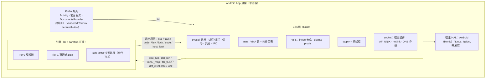

# appine 设计文档

- **状态**：设计决策在 2026-10-24 的设计评审中逐条确认。M0–M8 已完成；M9（发布）进行中，还剩真机验证、许可证义务和 Play 提交（§14.1）。
- **范围**：v1。第 1–13 节写当前的做法，随每一轮的改动更新；改动的经过、测量和出处记在各轮里（[milestones.md](milestones.md)）。
- **一句话**：一个能上 Google Play 的**单进程** Android App，在进程内用解释器 / 同 ISA 二进制翻译运行未经修改的 Alpine Linux aarch64 用户态程序。思路与 iSH 相同，是它在 Android 上的对应物。

**目录**

1. [目标与非目标](#1-目标与非目标)
2. [硬约束](#2-硬约束)
3. [总体架构](#3-总体架构)
4. [CPU 引擎](#4-cpu-引擎)
5. [内存：轻量用户态 soft-MMU](#5-内存轻量用户态-soft-mmu)
6. [进程、线程与调度](#6-进程线程与调度)
7. [信号与 ABI](#7-信号与-abi)
8. [文件系统](#8-文件系统)
9. [TTY 与终端](#9-tty-与终端)
10. [网络](#10-网络)
11. [用户、权限与 Android 集成](#11-用户权限与-android-集成)
12. [威胁模型](#12-威胁模型)
13. [工程](#13-工程)
14. [里程碑](#14-里程碑)
15. [已否决的方案](#15-已否决的方案)
16. [风险与待验证的假设](#16-风险与待验证的假设)

---

## 1. 目标与非目标

### 1.1 目标

- 用户从 Play 安装 App、打开即得到一个 Alpine shell，不需要 root、不依赖 Termux，也不需要任何额外步骤。
- 整个 Linux 环境都跑在 App 自己的进程里，Android 12+ 的 phantom process killer 对它不起作用。
- 直接运行 Alpine 官方 aarch64 仓库里**未经修改**的二进制。

### 1.2 v1 负载分档

| 档位 | 负载 | v1 要求 |
|---|---|---|
| A 日常 CLI | busybox ash、`apk`、coreutils、vim、git、curl、openssh client | **全部可用** |
| B 计算型 | python3、gcc/make 编译中等规模的 C 项目、`./configure` | **能跑通** |
| C 难缠的运行时 | Go 静态二进制、node/V8、JVM | **行为正确，不要求快** |
| D 不承诺 | 容器、init 系统、内核模块、X11/GUI | — |

A–C 都已达到。D 档里 podman、docker（§6 的 namespace、§10）和 OpenRC（§6 的 PID 1）实际能用；systemd、内核模块、GUI 不做。strace、gdb 可以用（§7.6）。

发行版默认是 Alpine，设置里可以换成 Debian 13（§11.4）。glibc 的程序（manylinux wheel、Node.js 的预编译模块、rustup、OpenJDK）不用改内核层就能运行。

### 1.3 性能目标

- CPU 密集任务比原生慢 **3–5 倍以内**（JIT 级别）。现状见 §16 的 R1。
- 交互延迟优先：`ls`、tab 补全不能让人感到卡顿。

---

## 2. 硬约束

| 约束 | 来源 | 后果 |
|---|---|---|
| **Google Play 合规** | Device and Network Abuse 政策：不得下载可执行代码（dex/JAR/.so），"在虚拟机或解释器中运行的代码"除外 | 从网络下载的 Alpine 二进制**不能在宿主 CPU 上直接执行**，CPU 后端只能是解释器或翻译器 |
| 单进程 | 设计目标 + phantom process killer | 所有 guest 进程共享一个宿主地址空间，guest 进程之间的隔离和 fork 都得在软件里实现 |
| W^X 执行限制 | targetSdk ≥ 29 不能 `execve` App 数据目录里的文件 | 不使用 execve，也不依赖宿主加载器 |
| 存储限制 | SELinux：App 不能建硬链接、不能 `chown`、不能 `mknod`；共享存储不区分大小写、没有权限位、不能建 symlink | 文件系统的元数据和命名空间都要自己实现 |
| 网络限制 | targetSdk ≥ 30 不能 bind `NETLINK_ROUTE`，`RTM_GETLINK` 也被拦截；没有 `CAP_NET_RAW` | netlink 在进程内模拟，ICMP 改走 ping socket |
| 页大小 | Android 15 起要求 App 兼容 16KB 页内核 | 给 guest 呈现的页大小必须和宿主页大小解耦 |
| 宿主地址空间 | GKI 常见配置是 4K 页 + 39-bit VA，用户态只有约 512GB | 不能给每个 guest 进程预留很大的连续地址空间 |

**最低系统版本：minSdk 29（Android 10）**。DNS 存根依赖 `android_res_nsend`，它从 API 29 开始提供。

---

## 3. 总体架构



分层原则：

- **引擎**只关心"执行 guest 指令"。遇到 `svc`、访存缺页、未定义指令、`brk`、`ic ivau` 时，把控制权交给内核层。
- **内核层**实现 Linux 用户态 ABI，持有所有 guest 状态：进程、地址空间、fd、文件系统。
- **宿主 HAL** 把宿主的差异隔离开。开发阶段的宿主是 Linux arm64，生产宿主是 Android；不写 macOS 版本的 HAL。
- 核心库（引擎 + 内核层）**不依赖任何 Android 组件**。Android 相关的部分只在 HAL 和 Kotlin 外壳里出现。

---

## 4. CPU 引擎

### 4.1 Guest ISA

guest 是 **aarch64**，直接使用 Alpine 官方 aarch64 仓库。这样选有三个好处：

- guest 和宿主的内存模型都是 ARM 弱序，没有 x86 TSO 与 ARM 弱序之间的转换问题。
- 同 ISA 翻译时，大量指令可以原样拷贝。
- 按 arm64 规范，修改代码之后必须执行 `ic ivau` + `isb`，所以这条指令可以直接当作失效翻译缓存的钩子，不需要对代码页做写保护。

### 4.2 分层

#### Tier 0：解释器

`core/engine/src/c/interp.c`。

- 负责冷代码、短命进程、调试，同时作为语义上的参考实现；Tier 1 不翻译的单条指令也交给它执行。
- 分发是按编码字段逐级 `switch` 的解码，另有一个 512 项的取指 TLB。没有做尾调用式的 threaded 分发：有了 Tier 1，Tier 0 的速度不影响整体。
- 和 Tier 1 共享 guest 状态布局、soft-MMU 接口和异常上报接口。
- **SIMD&FP 数据处理、CRC32 和 LSE 原子指令用"原生单指令执行"实现**：白名单判定（§4.4）、地址翻译和寄存器搬运写在 C 里，运算本身交给宿主执行同一条指令。
  - 每个指令编码对应一段缓存起来的小桩（`core/engine/src/c/native.c`）：通用寄存器字段换成宿主临时寄存器，执行前从 CPU 上下文读入、执行后写回；FP 类的桩还载入并写回 V0–V31、FPCR、FPSR 和 NZCV，同时保存和恢复宿主的 d8–d15 与 FPCR。LSE 指令的地址字段换成翻译好的宿主指针。
  - 好处：结果与硬件逐位一致，NaN 传播、舍入、FZ/DN、FPSR 累积标志都不需要自己实现。
  - 代价：对 SIMD&FP 而言 Tier 0 不再独立于硬件；需要宿主能分配可执行内存（Android 允许 JIT）；只能运行在 aarch64 Linux 宿主上，别的宿主不宣告 FP/ASIMD。
- SIMD&FP 的访存（LDR/STR/LDP/STP 的 B/H/S/D/Q 形式、LD1–LD4/ST1–ST4）仍用 C 经 soft-MMU 实现：先确认要访问的每一页都可访问，再读写，失败时没有副作用。

#### Tier 1：同 ISA 直通式 DBT

`core/engine/src/c/dbt.c`，`appine-run --tier 1` 和 Android App 使用它。

**寄存器约定**

| guest | 宿主 |
|---|---|
| X0–X15、X19–X25、X29、X30 | 同号寄存器 |
| SP | X26 |
| X16、X17、X18、X26、X27、X28（"被占用的寄存器"） | 存放在 CPU 上下文里。引用它们的指令先把值读进临时寄存器，改写寄存器字段后执行，再写回 |
| NZCV、FPCR、FPSR、V0–V31 | 宿主的同名寄存器（§4.3） |

- 宿主 X28 指向 CPU 上下文，X16、X17、X27 是临时寄存器。
- 宿主 X18 是平台寄存器（Android 上 ShadowCallStack 用它），翻译后的代码不碰它，宿主的信号处理函数随时可以用（R6）。
- SP 出现在大约六分之一的指令里，X26 是编译器生成的代码里用得最少的被调用者保存寄存器，所以宿主 X26 让给 SP。以 SP 为基址的访存直接用 X26，回写只要一条 `add`。
- **Go 的程序另用一组**：Go 的编译器固定用 X26–X28 和 X16，几乎不用 X19–X25。execve 时程序带着 Go 的 build ID 注记（`.note.go.buildid`）就改占 X21–X25：X25 指向 CPU 上下文，X21–X23 是临时寄存器，X24 放 SP，被占用的是 guest 的 X18、X21–X25。一个 Tier 1 实例的寄存器分配在创建时定下，例程按它生成，翻译模板按它区分版本。V8、HotSpot 的 JIT 代码也固定用 X26–X28 里的几个，但那里是只读的基址，从 CPU 上下文读不在依赖链上，代价小，它们用默认的一组。
- guest 的 NZCV 就是宿主的，所以插入的代码一律不改动条件标志（用 `cbnz`/`tbnz`/`eor` 代替 `cmp`）。

**指令的处理**

| 指令 | 处理 |
|---|---|
| 只读写寄存器的 ALU、FP、NEON 指令，屏障 | **原样拷贝**。SIMD&FP 数据处理的白名单判定与 Tier 0 共用同一个函数 |
| 访存，包括 SIMD&FP 的 LDR/STR/LDP/STP 和 LD1–LD4/ST1–ST4 | 插入 soft-MMU 的 TLB 快速路径（见下），访问换成宿主地址 |
| 分支和 PC 相对寻址（`adr`/`adrp`/`ldr literal`） | 改成以 guest PC 为基准的常量；分支见下面的"控制流" |
| `svc` | 退出到内核层 |
| `mrs/msr tpidr_el0`、`mrs dczid_el0` | 读写 guest 状态结构里的字段，或者换成常数 |
| `mrs/msr nzcv`、`mrs cntvct_el0`、`mrs cntfrq_el0` | 原样执行 |
| `ldxr`…`stxr` | 改写成比较并交换，见 §4.5 |
| LDAR/STLR、CAS、LSE 原子指令 | 换上翻译好的宿主地址，原样执行 |
| `dc zva` | 翻译地址后用 `stp xzr` 清零 |
| `clrex` | 清掉 guest 的独占标记 |
| HINT，包括 PAC 系列（`PACIASP`/`AUTIASP` 等） | 改写为 NOP，见 §4.4 |
| `dc cvac`/`dc cvau`/`dc civac`/`ic ivau` | 按读访问检查地址，不退出。`ic ivau` 只记下所在的页，到 `dsb`/`isb` 时才由分发器作废翻译（见"失效"） |
| 其他系统寄存器访问、成对的 LDXP/STXP、操作数是被占用寄存器的 CASP | 交给 Tier 0 执行这一条指令 |
| Tier 0 不认识的编码 | 同样交给 Tier 0，保证两层的白名单完全一致（§4.4）。Tier 0 认不认识一条指令按指令字缓存，每个线程 4096 项 |

**访存快速路径**（算地址之外 6 条宿主指令，代码见 §5.1）

1. 算出 guest 地址，用**最后一个字节**所在页的下标取出 TLB 表项，一条 `ldp` 取出 tag 和 addend。访问落在对齐的 16 字节里时不可能跨页，直接用第一个字节的页。
2. tag 与**第一个字节**所在的页比较。TLB 直接映射，跨页时第一页的页号不可能出现在下一页的表项里，所以这一次比较同时排除了跨页访问。
3. 命中就访问 `addend + 地址`。
4. 未命中或者跨页时跳进代码缓存里的回填例程，按 §5.1 的结构遍历页表、填好表项。跨页时两页都要有权限、宿主地址也要连续（两页的 addend 相同），这时整个访问照样在宿主上一次完成；栈帧跨页的函数每次调用都会这样访问，不能退给 Tier 0。
5. 只有页没有映射、权限不符、跨页而宿主地址不连续、SP 未对齐或者地址带 TBI 标签时，才退出到分发器，由 Tier 0 执行这一条指令。这时指令还没有产生任何副作用，所以异常是精确的。

- **依赖链**：基址加立即数的访问，取下标用的末字节地址直接从基址算，与访问地址并行。
- **地址已知的访问**：翻译时跟踪本块里由 ADR/ADRP（和在它上面加的立即数）设下的寄存器，拿不准的一律算写了。以它为基址、不跨页的访问，表项的位置是常数；字面量同样。tag 仍然和真实的地址比较，跟踪错了也只是多走一次回填。全局变量的访问、PLT 从 GOT 取跳转目标都是这样的。
- **SP 对齐检查**：一个块里检查过一次之后，SP 只按 16 的倍数改变时不再检查。
- **共用检查**：同一个块里以同一个寄存器为基址的几条访存共用一次检查。组长检查整组覆盖的范围（最多 512 字节），之后临时寄存器里是基址的宿主地址，组员直接用 `[T2, #偏移]` 访问。组员之间只能有不写基址（按常数加减的除外）的指令和条件分支，SP 只能按 16 的倍数改变；可以夹着别的访存：组长把宿主基址存进 cpu 结构体里的一个槽（同时最多 4 组），之后的组员从槽里取回。条件分支后面的组员不一定执行，覆盖的范围里可能有它们访问不到的页，所以检查失败时由 Tier 0 执行组长；同一个组长第二次失败时作废这个块，它附近的访存不再当组长。

**控制流**

- 块不在条件分支处结束：不跳转的一侧接着翻译，跳转的一侧是侧出口。
- 直接分支通过块链接回填成一条 `b`：出口的链接桩以一条跳到下一条的 `b` 开头，链接时改成跳往目标块。`b` 改成 `b` 是架构允许并发修改的（CMODX），别的线程正在执行这里也没关系。条件分支不在 CMODX 允许的指令里，只在地址空间里只有一个线程时直接改写它。
- 建块时目标已经翻译过的出口直接链接，随整个块一起同步指令缓存；其余的出口第一次走到时退出到分发器链接。只有一个线程时，新块和链接点合在一起同步一次。
- 单独改写的链接点只做缓存维护（`dc cvau`、`ic ivau`），不等它完成，也不做 `isb`：改写的线程直接进入目标块，别的线程在看到新指令之前执行旧指令，退出到分发器照样找到目标块。线程退出到分发器时发现链接点已经改好了，才完整同步一次。
- 间接分支（`br`/`blr`/`ret`）先查一张 4096 项的跳转缓存，未命中再回到分发器。
- **返回预测**：`bl`/`blr` 翻译成宿主的 `bl`，跳过紧随其后的"落点"（链接到 guest 返回地址处的块），再把 (guest 返回地址, 落点) 压进线程的影子返回栈。`ret` 看到栈顶等于 x30 就弹栈、用宿主 `ret` 跳回落点，由宿主的返回地址栈预测；对不上时（longjmp、信号处理函数、协程切换）才查跳转缓存。影子栈是 64 项的环形缓冲，翻译缓存清空时整体重置。
- **kick 检查**：经由后向边或间接分支进入块时检查 kick 标志。块的起始地址沿前向边严格递增，任何循环里至少有一条边会经过检查，所以链接成环的循环也能被打断。
- **桩里放数据字**：块尾的链接桩、退出桩和回填桩平时几乎不执行，guest pc 和退出原因放在桩末尾的数据字里由例程读出，不用几条 `mov` 拼：链接桩是 `b 4; adr T1, 0; b 例程; .quad 原因 << 48 | pc` 5 个字，退出桩去掉开头的 `b` 是 4 个；回填桩是 `adr T1, 8; b 回填例程; .word 信息; .quad pc` 5 个字，信息字里是字节数、失败时的退出原因和回到访问的位移。`bl` 压影子返回栈时也从落点的数据字里读 guest 返回地址。

**精确状态**几乎是免费的：宿主 `ucontext` 里的寄存器就是 guest 寄存器，被占用的寄存器另外保存在上下文里。

**翻译共享**：一个块的翻译只取决于它的 guest pc 和翻译过的指令字，与进程、映射无关。下面几层共用都建立在这一点上。

- **模板**：每翻译一个块就存成模板，放进所有实例共用的模板区（32 MB，写满时整体丢弃）。别的实例要翻译同一个 pc 时，先比对指令字，相同就把模板拷进自己的代码缓存，只重新计算跳往例程的几条 `b`。块之间的链接在各自的拷贝里回填，不同进程在同一地址映射了不同的代码也不会互相影响。
- **一个地址空间里的线程共用一个实例**：代码缓存（128 MB，块之间的链接、跳往例程都是一条 `b`）、翻译表和作废记录共用；每个线程只有自己的跳转缓存、影子返回栈和统计。
  - 分发器不持锁查翻译表：插入只用空位（先写 pc、再写 code），作废只把 pc 改成墓碑，墓碑不复用、重建表时去掉；换表之后，等正在查旧表的线程查完才释放旧表。
  - 翻译不持锁：在线程自己的暂存区里翻译，持锁时只做分配位置、拷贝、链接、同步和放进表这几步。装进去之前和内存里的指令字再比对一次，翻译期间被改写了就重新翻译。新块先同步指令缓存、再放进表里。
  - 整体清空（代码缓存写满）要等所有线程离开翻译后的代码：发起的线程打断其他线程，等它们停在分发器里或者离开分发器再清空。进出分发器只写线程自己的记录，不用共用的计数（每次系统调用都改同一个缓存行太贵）。
- **同一个程序的几个地址空间共用一个实例**（`mm::CodeGroup`）：appine 没有 ASLR，同一个程序的进程（fork 出来的、又 exec 了同一个程序的）映射在同样的地址上，所以按程序（可执行文件的 inode）组成组，像一个地址空间里的线程一样共用。
  - 可信的可执行映射（没写过、有版本的私有文件映射，和 vDSO）要与组里登记的一致：同一段地址只能是同一个版本的同一个文件。这些映射里的块所有成员共用。
  - 别的可执行内存（JIT 生成的、写过的代码）是成员私有的：每个成员有一个标签，这些块的键是 pc | 标签 << 48，只有翻译它的成员查得到；共用的块不链接到私有的块。
  - 每次系统调用之后（`Mm::sync`），可执行映射有变化时核对，与登记的不一致的成员离开组，换用自己的翻译；只剩它一个时组关掉，它作废与它的映射对不上的块。所以没有成员会执行到只对别的成员有效的代码。
- **翻译保留**：地址空间没了之后，它的翻译放回池里（最多 16 个实例、64 MB 代码），按程序作键，新的地址空间（exec 之后、fork 出来的子进程）第一次运行时优先拿同一个程序留下的。
  - 运行之前逐块比对 guest 指令字，对不上的作废。这时共享库还没有加载：落在上一个使用者的文件映射里、页还没映射的块不作废而是**停放**，第一次执行到那一页时整页核对、恢复。
  - 内容由文件和它的版本就能确定的代码段不必比对：内核层把没写过、有可信版本的私有文件映射记给翻译，新的地址空间里同一段地址映射的是同一个版本的同一段文件时，落在里面的块直接保留。版本是宿主 object 的 ctime 和大小（内容的每一次修改宿主都会改 ctime，utimensat 也改不回去）；ctime 离现在太近、有过可写共享映射的文件不给版本。

**失效**

- guest 修改代码之后执行的 `ic ivau`，以及可执行映射的拆除和权限变化，都记进 `mm` 的代码失效日志，并递增代码代数；第一个看到新代数的线程按错过的范围作废一次。只是代码变了时，打断正在执行 guest 代码的其他线程，但不等它们退出：硬件上别的核在上下文同步之前同样可能还执行旧指令（membarrier 的 SYNC_CORE 才等）。
- Tier 1 的 `ic ivau` 记下的页在 dsb、isb 时由分发器就地作废，不退出到内核层。
- 作废按内容：范围里的块只有 guest 指令字和现在不同的才作废，JIT 改写一处代码时同一页里别的方法的块不必跟着作废。
- 作废的块入口改成跳往一个转发桩，重新翻译之后旧入口直接跳往新的块，链接到旧入口的跳转不用改写；正在执行这个块的线程照样执行到块尾。
- CTR_EL0 报告 DIC = IDC = 0，guest 修改代码之后一定会执行 `ic ivau`。

**W^X**：JIT 代码页使用双映射。同一段共享匿名内存用 `mremap` 映射两次，一份 RW 用来写入，一份 RX 用来执行，不依赖 memfd；宿主不允许时退回 RWX。Tier 0 的原生指令桩也这样分配。宿主的 RSS 里两个视图都碰过的页算两次，所以定时器线程每秒拆一次写入视图里写过的页的页表项（`MADV_DONTNEED` 只拆映射、内容留着），OOM killer 量的用量扣掉还没拆的（§12 第 4 条）。

**否决了以 dynarmic 为核心的方案**，见 §15。dynarmic 是 0BSD 许可，可以直接借用它的 A64 解码表（`frontend/A64/decoder`）和测试用例。

### 4.3 FP 状态

FP 和 NEON 指令都在宿主上原生执行。所以每次从宿主代码进入 guest 代码，都要把 guest 的 FPCR 装进宿主 FPCR；回到宿主 C 代码之前再恢复，避免 guest 设置的 flush-to-zero 之类的模式影响我们自己的代码。

Tier 1 的进入例程保存宿主的 d8–d15 和 FPCR，载入 guest 的 FPCR、FPSR 和 V0–V31，翻译后的代码里它们一直在宿主寄存器里；退出例程保存 guest 的 V0–V31 和 FPSR，再恢复宿主的状态。

### 4.4 CPU 特性基线

**原则：guest 看到的特性集合 = 宿主 CPU 支持的 ∩ Tier 0 已实现的 ∩ 白名单。**

- `AT_HWCAP`/`AT_HWCAP2`、`/proc/cpuinfo` 的 Features 行、guest 读 `mrs ID_AA64*_EL1` 得到的值，三者从**同一份集合**生成。
- 白名单以外的编码，在两个 Tier 里都投递 SIGILL（`ILL_ILLOPC`），**绝不把它们原样拷贝执行**。
- 两个 Tier 对同一条指令的语义必须一致。PAC 在 Tier 1 原样执行会用宿主密钥签名，而 Tier 0 只能把它当 NOP。为了一致，Tier 1 也把它们改写成 NOP，并且不宣告 PACA/PACG。
- 通用定时器的 `CNTVCT_EL0`、`CNTFRQ_EL0` 与 Linux 一样允许 EL0 读，两个 Tier 都读宿主的值。Go 的运行时和 V8 直接读它们计时。

| 级别 | 特性 |
|---|---|
| 必须 | FP、ASIMD（v8.0）、CPUID |
| 宿主支持时宣告 | ATOMICS（LSE）、AES、PMULL、SHA1、SHA2、CRC32、ASIMDDP、SHA3 和 SHA512（两者都有才宣告）、I8MM、LRCPC、LRCPC2、FP16（FPHP、ASIMDHP，两者都有才宣告，FPCR 的 FZ16 随之可写）、JSCVT、RDM、FCMA（半精度的形式还要 FP16）、FHM（只和 FP16 一起宣告）、BF16、FRINTTS、FLAGM、FLAGM2（只和 FLAGM 一起）、SB、DCPOP、DCPODP（只和 DCPOP 一起）、DIT |
| 还没做 | LSE2（`uscat`）；SM3/SM4（开发机的 M2 没有，测不了） |
| v1 不做 | SVE/SVE2/SME、PACA/PACG、BTI、MTE |

宣告 LSE 之后，libgcc 的 outline atomics 和 Go 会改走单条原子指令，这类指令很容易翻译。但 musl 的原子操作是用 `ldaxr`/`stlxr` 内联汇编写死的，所以 **LL/SC 必须支持**。

**实现**（`core/engine/src/c/features.c`）：启动时读宿主的 `AT_HWCAP`、`AT_HWCAP2`，与 Tier 0 已实现的集合求交，作为 guest 的 `AT_HWCAP`、`AT_HWCAP2`。宿主没有 FP、ASIMD，或者原生指令桩不可用时，不宣告任何 SIMD&FP 特性；FlagM、FlagM2、SB、DPB、DPB2、DIT 不用原生指令桩，照样宣告（解释器自己算，Tier 1 原样执行，所以也要宿主有）。SIMD&FP 的数据处理指令在 Tier 0 里由原生指令桩执行、在 Tier 1 里原样拷贝，所以加一个这类特性只要放行它的编码。DIT 记在 cpu 里（信号帧、ptrace 的 pstate 第 24 位），MSR、MRS DIT 由 Tier 0 执行；宿主线程的 DIT 跟着 guest 的，每次进入 guest 代码时比较一次。guest 读 ID 寄存器空间（`MIDR_EL1`、`ID_AA64ISAR0_EL1` 等）时，返回与这份集合一致的值。

**白名单的独立核对**：硬件只能告诉我们一条编码能否执行，分不清它属于基础集还是没宣告的扩展。所以另用 LLVM 的反汇编器（`llvm-mc`，按 guest 特性集合设置 `-mattr`）做对照：

- 在 SIMD&FP 数据处理、SIMD 访存、独占访问、LSE、整数 2 源数据处理这几个编码空间里随机抽样，Tier 0 认为能执行的编码必须恰好是 LLVM 能解码的编码（`tests/lockstep/tests/whitelist.rs`）。
- 对"应当全为 1"（SBO）的字段，沿用 LLVM 的口径：独占访问和 LDAR/STLR 忽略它们，CAS/CASP 的 Rt2 必须全为 1。

### 4.5 独占访问（LL/SC）

**问题**：在 `ldxr` 和 `stxr` 之间插入额外的访存（比如 TLB 查找），可能会让独占监视器失效，导致活锁。两层都采用"记下读到的值、写时比较并交换"的语义，不需要识别整个 LL/SC 序列。

soft-MMU 翻译得到的是真实宿主指针，所以原子指令直接作用在宿主内存上，多个线程或进程共享同一页时语义天然正确。

**Tier 0**（`core/engine/src/c/atomic.c`）：

- LDXR/LDXP 记下地址、长度和读到的值；STXR/STXP 在宿主地址上做比较并交换，只有内存值仍等于记下的值才成功，与 QEMU 的做法相同（允许 ABA，对正确的 LL/SC 用法没有影响）。
- CLREX 和 svc 都会清掉独占标记。要求自然对齐，否则是对齐错误。
- LDAR/STLR 用 C 的 acquire/release 原子操作实现；LSE 原子指令和 CAS/CASP 交给原生桩，在翻译后的宿主地址上原样执行。

**Tier 1**：语义与 Tier 0 相同。

- LDXR 查过 TLB 之后在宿主地址上读（LDAXR 用 `ldar`），记下地址、长度和读到的值。
- STXR 先确认独占标记是同一地址、同一长度，再在宿主地址上用 `ldaxr`/`stlxr` 循环做比较并交换：两条指令之间只有寄存器运算，没有访存，宿主的独占监视器不会被我们自己的代码清掉。
- 要写的值在被占用的寄存器里时，循环里的三个临时寄存器都有用处，借一个这条指令没用到的 guest 寄存器放它：先存进 cpu 结构体里它自己的位置，用完恢复。中间不会退出，宿主故障也不从 ucontext 恢复 guest 状态（§12 第 5 条），没有人看得到它被借走。libgcc 的 outline atomics 就是这样的 STXR，Alpine 的 libgcc 又总是走 LL/SC，GCC 编译的程序里的原子操作都会用到。
- CLREX 清掉标记，svc 退出时也清掉。LDAR/STLR、CAS 和 LSE 原子指令换上宿主地址原样执行。
- 成对的 LDXP/STXP，以及操作数是被占用寄存器的 CASP 很少见，仍交给 Tier 0。

---

## 5. 内存：轻量用户态 soft-MMU

这里**不模拟** ARM 的硬件页表，包括 TTBR、描述符格式、TLBI/ASID、异常级别、物理地址层和 MMIO，但**要自己实现 Linux mm 的语义**。

### 5.1 数据结构

- **每个进程一个 `mm`**（`core/kernel/src/mm.rs`），包含两部分：
  - VMA 表：按起始地址排序的 `BTreeMap`，实现 mmap/mprotect/munmap 语义，并用来生成 `/proc/<pid>/maps`、`smaps`。
  - 页表（`core/engine/src/c/mmu.c`）：以 guest 虚拟页号为键的 4 级基数树，每级 512 项，覆盖 48 位地址空间；叶子表项是宿主页地址加 R/W/X 权限位。只有 TLB 未命中时才遍历它。表项按需建立（§5.2），遍历一段范围时没有中间表的地方按缺的那一级整段跳过。
- **每个线程一个软件 TLB**：直接映射，4096 项，每项 `{读 tag, 读 addend, 写 tag, 写 addend}`。
  - tag 存的是页号取反，0 表示无效，所以清零的内存就是空的 TLB，新线程不必逐项写入。
  - 表项填写时记进一张位图，清空时只处理填过的项。

Tier 1 的 TLB 命中路径（8 字节的读；x16 = guest 地址）：

```asm
add  x17, x16, #7            // 最后一个字节
ubfx x17, x17, #12, #12      // 它所在页的页号低 12 位 → TLB 下标
add  x17, x28, x17, lsl #5   // x28 指向 CPU 上下文
ldp  x17, x27, [x17, #TLB]   // tag（页号取反）, addend
eon  x17, x17, x16, lsr #12  // 与第一个字节所在的页比较，跨页时一定不等
cbnz x17, refill
ldr  x0, [x27, x16]          // 宿主地址 = addend + guest 地址
```

- **TLB 未命中**：查基数树（Tier 1 在代码缓存里的回填例程中查，Tier 0 在 C 里查）。查不到，或者权限不符，就交给内核层：还没建表的补上表项（§5.2）、写时复制的复制一份，重新执行；否则给 guest 投递 SIGSEGV 或 SIGBUS。
- **TLB shootdown**：多个线程共享一个 `mm` 时，页表可以在被别的线程遍历的同时修改（表项用原子操作读写，中间表在 `mm` 销毁前不释放）。
  - 解除映射或降低权限之后，修改方递增 `mm` 的代数，打断正在执行 guest 代码的其他线程，等它们退出 guest 代码；每个线程重新进入 guest 代码之前比较代数，变了就刷新自己的 TLB。
  - 只增加权限时不刷新：TLB 里的旧表项只是少了权限，未命中时会重新填写。
  - 代码的变化另有一个代数和失效日志，见 §4.2。
  - 被解除映射的宿主内存要等 shootdown 完成后才释放，所以 guest 自己的数据竞争碰不到已经还给宿主的内存。

### 5.2 页与后备内存

- guest 页**固定 4K**，不管宿主页是 4K 还是 16K。`AT_PAGESZ` 报告 4096。
- **匿名内存**：每个匿名映射单独向宿主 mmap 一段内存，每个 guest VMA 对应一个宿主映射。例外是 fork 时子进程自己的小映射（1 MB 以内，堆和栈除外），它们切自同一段宿主内存，不计入宿主的提交量；代价是这样的映射解除之后，宿主内存要等那一段全都不用了才交还。
- fork 要的这几段（小映射切出来的那一段、堆和栈预留的地址空间）预先映射好：持有 BKL 时直接拿来用，用掉的在放开 BKL 之后补上，每种长度最多留两段、最多记 8 种长度。宿主的 mmap 因此不在 fork 的锁里做。
- **复用**：所有 guest 进程的宿主 mmap、munmap 都要拿同一个宿主进程的 `mmap_lock` 写锁，而 musl 的 malloc、gcc 的垃圾回收器反复映射、拆掉同样大小的块。所以私有匿名的宿主内存交还时只丢弃内容（`MADV_DONTNEED`，只拿读锁），留着（最多 256 MB 地址空间，每种大小最多 32 段），下一次申请同样大小、同样计不计入提交量的直接用。
- **交还宿主**：持有 BKL 时释放的宿主内存（munmap、进程退出和 execve 时销毁地址空间）和销毁的地址空间的页表放开 BKL 之后才交还，宿主上首尾相接的几段一起交还。OOM killer 看到还有没交还完的内存时这一轮不挑进程（§12 第 4 条）。
  - 宿主的 `vm.max_map_count` 是整个 App 进程共用的，所以内核层按地址空间实行 guest 的 `vm.max_map_count`（默认 65530，可写），一个 guest 进程不能把宿主的映射数用完。
  - 堆第一次扩展时预留 256 MB 宿主地址空间（`MAP_NORESERVE`），之后的 brk 只是加长同一个 VMA。相邻的匿名 VMA 不合并（各自是一段宿主内存），只是 `/proc/<pid>/maps` 里相邻、权限相同的匿名映射与 Linux 一样显示成一行。
- **文件映射**直接用宿主 `mmap(objects/<ino>)` 的页作为后备内存。宿主是 16K 页时，映射包含目标位置的 16K 对齐区间，再把页表项指向区间里正确的 4K 偏移。
  - busybox/musl 的代码页通过宿主 page cache **在所有 guest 进程之间共享**。ELF 加载器也这样映射程序的各段，只有段之间共用一页、或者偏移没有对齐时才退回到拷贝。
  - 只读的私有映射（程序和库的代码段）有可信版本（§4.2 的"翻译保留"）时，宿主映射由内核里所有地址空间共用（`mm::FileMaps`，最多 128 段）：同一个版本的同一段文件再映射时直接用它，不必重新映射、缺页。用它的 VMA 要写（mprotect 加写权限、加载器清零 .bss 的开头）之前复制一份自己的。宿主上是只读映射，漏了复制会直接出错，不会悄悄改了别人的代码。宿主内存紧张时（`Machine::trim_memory`）清空。
  - `MAP_SHARED` 映射和 `read`/`write` 之间天然一致。
- **共享内存**：进程间的 `MAP_SHARED` 匿名内存，就是让两张页表指向同一个宿主页。System V 共享内存段同理：段持有一段宿主内存，`shmat` 把它映射进地址空间。
- **提交量**：宿主内存总是可读写，guest 的权限只记在页表里，所以宿主的内存提交量按 Linux 的规则由 guest 的参数决定：只有可写的私有映射计入，`MAP_NORESERVE`、只读和 `PROT_NONE` 的映射用 `MAP_NORESERVE` 向宿主申请（V8 为每块 wasm 内存预留 8 GB 的 `PROT_NONE`）。子进程、mremap 扩展出来的部分、共用的私有文件映射复制的一份同样照 guest 的参数。fork 时子进程的映射逐个向宿主申请，而 Linux 的 `dup_mmap` 按合起来的 VMA 估算，所以 fork 之前按合起来的算一遍（`Mm::commit_too_big`），有一个计入的超过内存和交换区的总量就是 ENOMEM。
- **按需建表**：1 MB 以内的映射建立时就建好页表项，大的等 guest 第一次访问（或者内核层第一次经由页表读写）时，把所在的那张叶子表（2 MB）里属于这个 VMA、在文件末尾之前、还没有表项的页一起建好，重新执行（`Mm::fault_in`）。页表随碰过的内存增长，不随映射的大小（ASan 映射十几 TB 的影子内存）。文件的可执行映射照旧一次建好：翻译共用时按页表核对 guest 指令字（§4.2）。
  - fork 借页（§5.3）、量驻留内存只看有表项的叶子表连成的几段，不逐页查宿主。这要求私有匿名内存里有内容的页一定有表项：内核层直接写宿主内存（加载程序、`PTRACE_POKEDATA`）、调入（mlock、`MAP_POPULATE`）之后补上表项，mremap 把表项一起搬走，`PROT_NONE` 留着表项（下一条）。
- **`PROT_NONE`**：新建的 `PROT_NONE` 映射不放进页表。mprotect 成 `PROT_NONE` 时表项留着、权限清零，宿主页里的内容还在；改回有权限时留着的改权限，其余的按需建。
- **`MADV_DONTNEED`** 把私有匿名内存里整页的部分交给宿主的 `madvise` 回收，宿主页比 4K 大时两头不满一页的部分清零。Go、JVM、V8 的 GC 用它归还内存。
- **超出 EOF 与截短**：
  - 文件映射超出 EOF 的整页不放进页表，guest 访问它们得到 guest 自己的 SIGBUS（`BUS_ADRERR`）；共享映射的文件后来变长了，就把新的内容映射进来，重新执行那条指令。
  - 文件被截短时（truncate、ftruncate、`O_TRUNC`，都经过内核层），所有地址空间里映射它的页超出新末尾的部分从页表里拿掉，再做 shootdown，与 Linux 的 truncate 相同。

### 5.3 fork

- fork 之前先让同一 `mm` 的其他线程停在 guest 代码之外（与 shootdown 用同一套机制），得到 fork 那一刻的快照。
- **写时复制**：写过的私有匿名映射不复制，父子进程的页表都指向父进程的宿主页、去掉写权限，在页表里实现，不依赖宿主的 `mprotect`。按页记账：宿主页在它的 VMA 里的一方是拥有者，它把页借出，别的地址空间借用；同一个 fork 家族共用一张借出记录，键是宿主页的地址。
  - 借用方写（写缺页，或者内核往 guest 内存写）时复制一份到自己 VMA 里对应的位置，页表项改指那里，先让这个地址空间的线程刷新 TLB。
  - 拥有者写、munmap、mremap 搬走、`MADV_DONTNEED` 借出的页之前，先让每个借用方复制自己的一份（要打断借用方正在执行 guest 代码的线程），再恢复写权限。拥有者的地址空间销毁（退出、exec）时页留给借用方（孤儿页，谁也不能再写），借用方持有那段宿主内存；没借出的页交还宿主。
  - 最后一个借用方还回来时，拥有者的页表项马上恢复成所在 VMA 的权限：shell fork 之后子进程马上 exec，父进程不必为此缺页。连续的页接成一段再改页表项，但段不跨 VMA（宿主内存相连的两个 VMA 权限可能不同）。缺页时页表项已经被别人改好（等 BKL 的时候借用方还回了页）就重新执行，与 Linux 一样。
  - mprotect 之后这些页仍然不能写；改权限期间先停住别的线程，免得它们在页表项拿到写权限、还没去掉之前写进借出的页。私有内存的 futex 键是宿主地址，所以 futex 落在借来的页上时先复制，否则写时复制之后等在旧键上的线程再也叫不醒。
  - 宿主从没碰过的页（`/proc/self/pagemap`）一定是零，子进程用自己的。不能用 mincore，它把换出到 zram 的页也报告成"不在"。从来没有可写过的匿名映射整段跳过。16 页以内的映射多半都碰过，不读 pagemap，全部借出。大的映射只读有表项的几段的 pagemap，子进程的表项也只建借来的页，其余的按需建：fork 的开销随碰过的内存增长，不随映射的大小。
- 可写的私有文件映射仍然逐页复制（全零的页跳过）。只读的私有文件映射直接共用宿主映射，mprotect 加写权限之前再复制一份。共享映射与子进程共用。栈下面预留的宿主内存（§5.4）在子进程里照样预留。

### 5.4 guest 地址空间布局

guest 地址空间的布局由我们自己的 mmap 实现决定，不受宿主地址空间布局的限制。软件页表的规模只和碰过的页有关，所以 V8 那种动辄预留几个 GB 的做法、ASan 十几 TB 的影子内存也能满足。不过可以访问的 guest 映射在宿主上是一段同样大的映射，所有 guest 进程的加在一起都在 App 这一个宿主进程里，而 4K 页的 GKI 内核宿主的用户地址空间只有 39 位（512 GB）。所以从建立起一直是 `PROT_NONE`、没有内容的私有匿名映射只是预留，不占宿主地址空间，变得可以访问（mprotect）或者内核要往里写（ptrace）时才给那一段宿主内存（`HostRegion::reserved`）：Chromium（PartitionAlloc 的池、V8 的沙箱）、JVM、Go、wasm 的预留都是这样。可写的大映射仍然一对一，ASan 的影子内存（可写、`MAP_NORESERVE`）在这些设备上映射不出来；guest 的地址空间也不跟着宿主缩小，需要固定高地址的程序（ASan 的分配器）照样用不了。

- 地址空间是 47 位（页表覆盖 48 位，`MAP_FIXED` 可以到 `1 << 48`）。主线程栈的顶在 `1 << 47`，位置无关的主程序加载在 `0x5555_5555_0000`，mmap 自顶向下分配。
- **主线程栈**与 Linux 一样按需向下增长（`core/kernel/src/mm.rs` 的 `grow_down`）：
  - execve 时只映射参数、auxv 下面再多 128 KB，之后 guest 访问栈底下面的地址出错时，把栈延伸到那一页再重新执行。
  - 延伸之后的大小不能超过 `RLIMIT_STACK` 的当前值，所以运行中调高上限立即生效。与下面的映射之间也要留出 256 页的保护间隔（`stack_guard_gap`），否则不增长，guest 收到 SIGSEGV。
  - 宿主内存在栈下面预留到 8 MB，在这个范围里增长只是加长同一个 VMA。超出之后另外申请一段，下面再预留到与栈现在的大小相同，所以 VMA 的个数只按对数增加，`/proc/<pid>/maps` 里仍然合成一行 `[stack]`。`MAP_GROWSDOWN` 的映射也这样增长。
  - 内核访问 guest 内存时只在两处让栈长出来：syscall 入口发现 SP 已经低于栈底时，先把栈延伸到 SP（arm64 没有 red zone）；构造信号帧之前延伸到帧的起点。指向 SP 下面的缓冲区，以及经由 `/proc/<pid>/mem` 访问别的进程的栈，不会让它增长。
- **mmap 区的上界**与 Linux 的 `mmap_base` 一样按 execve 时的 `RLIMIT_STACK` 定下：栈顶往下留出上限加上保护间隔，至少 1 GB 加 8 MB，最多地址空间的 5/6。不限栈大小时仍然自顶向下（Linux 改用 legacy 布局），间隔取最大值。
- execve 的参数和环境变量最多占栈大小上限的 1/4，不超过 6 MB，不少于 128 KB，与 Linux 的 `bprm_stack_limits` 相同。setuid、setgid 程序的上限不超过默认的 8 MB。

---
## 6. 进程、线程与调度

- **1:1 线程模型**：每个 guest 线程（`struct task`）对应一个宿主 pthread，调度交给宿主内核。guest 线程结束之后它的宿主线程和引擎的 CPU 状态留一会儿给下一个 guest 线程用，fork 不必每次新建。CPU 时间取宿主线程的 CPU 时钟，用户态、内核态各自不倒退（照 Linux 的 `cputime_adjust`）。
- **退出状态**：`exit_group`、致命信号先确定整个进程的退出状态；各线程单独退出时，由最后一个进入退出流程的线程确定。按 Linux 6.1 的 `synchronize_group_exit` 在 `PTRACE_EVENT_EXIT` 前同步。
- **驻留内存**（`ru_maxrss`、VmRSS、OOM killer 挑进程）按 VMA 用宿主的 mincore 数，只看有表项的几段（§5.2），文件映射的结果按文件缓存一会儿。
- **大内核锁（BKL）**：进入 syscall 时获取；执行 guest 代码时**不持有**；在内核层里等待之前**释放**。
  - 内核对象之间用 `Rc`/`RefCell` 共享，只在持有 BKL 时访问：计数和借用标志都不是原子的，连 clone、drop 也要持锁。系统调用中途放开 BKL 的只有等待和 `Cx::unlocked`，后者的闭包要求是 `Send`，碰不到内核对象；放锁期间 panic 时先重新拿到 BKL 再展开（§12 第 5 条）。inode 仓库（§8.1）也靠 BKL：`Store` 不是 Sync，SQLite 的连接不加锁。
  - 放开 BKL 时不能还借着内核对象：内核层用自己的 `RefCell`（`core/kernel/src/cell.rs`），数着每个线程借着几个，放锁时检查是 0；交给内核的仓库在不持着那个内核的 BKL 时被使用也算 bug。调试构建总是检查，发布构建打开 `borrow-check` 特性时检查（`appine-run` 和 debug 版 App 默认打开）。
  - 可能要等宿主的操作放开 BKL 做：宿主 fd（socket 等）的读写、普通文件的 pread/pwrite、刷盘，以及 execve 里映射各段、构造初始栈（只碰新的地址空间）。用文件位置的读写，同一个打开文件同时只有一次（相当于 f_pos_lock）。
  - 取锁时先自旋一会儿：临界区通常只有几微秒，睡下再被叫醒要几十微秒。同时最多让宿主 CPU 数一半（1 到 4 个）的等锁线程自旋，其余的直接睡下；自旋时只读一个"有人持有"的标志。
  - 持有 BKL 时要叫醒的线程放开 BKL 之后再叫醒，免得它醒来又睡下去等锁；持有期间释放的宿主内存也在放开之后交还（§5.2）。
  - **不持 BKL 的快速路径**（`syscall::fast`）：stat（root、路径全在仓库的元数据缓存里、不经过合成文件系统和别的挂载时）、读时钟（宿主的时钟和线程自己的 CPU 时钟）、futex 的等待和唤醒（键就是宿主地址、这一页在页表里可写时；futex 的等待队列有自己的锁，持锁的和不持锁的路径不会漏掉唤醒）、nanosleep。做不了时什么也不改，照常取 BKL。线程在持有 BKL 时记下自己的根目录、当前目录和凭据，改它们的一方让一个全局计数加一，别的线程记下的随之作废。有 seccomp 的线程只有过滤器总是放行的编号走快速路径（§11.1）。
  - 其余的拆分按 profiling 决定（R1）：多数负载的系统调用只占几个百分点。几个进程同时起进程时 BKL 是瓶颈，要用上多核得缩小必须串行的部分（比如按 fork 家族给地址空间加锁），还没做。
- **统一的等待机制**：guest 线程永远不直接阻塞在宿主 syscall 上。每个线程有一个专属的 **eventfd** 作为唤醒通道，所有等待都是一次宿主 `poll()`，监听集合里是这个 eventfd 加上要等的宿主 fd。这样 guest 信号、futex 和 I/O 就绪都走同一条唤醒路径，不需要用宿主信号去打断阻塞调用，也就不和 ART/bionic 抢信号编号。
  - 任何可能让别人的等待条件成立的修改都请求一次唤醒，释放 BKL 时叫醒相应的等待者，由它们各自重新检查条件。唤醒请求按线程记：同一个宿主进程里可以有几个内核实例。
  - **分通道**：打开文件上的修改、子进程的状态变化、宿主等的进程结束、线程结束、锁和租约、被屏蔽的信号各有一个通道，只有等它们的线程听。
  - **按对象唤醒**：等待者登记它等的对象（管道、PTY、eventfd、timerfd、inotify、epoll、消息队列、socket 的接收队列……），只影响某个对象的修改只叫醒登记了它的等待者。poll、select、epoll_wait 登记关注的每个文件的对象。每种文件只要登记全了改变它就绪状态的对象就不会漏。只有 SysV IPC、AIO 完成、SIGCONT 这几样还叫醒所有人。
  - 管道照 Linux 的时机叫醒：写入只在原来是空的时候叫醒读端，读出只在空间够了写端要的量、或者越过 `PIPE_BUF` 时叫醒写端。
  - `/proc/<pid>/stat` 的状态：在等待的是 S；事件触发了、线程还没重新拿到 BKL 的是 R，与 Linux 的 `try_to_wake_up` 当场改成可运行一样。
- **futex**：用自管的等待者表实现。键是翻译后的宿主地址；文件的共享映射以宿主文件的 (设备号, inode, 偏移) 为键，不同进程分别 mmap 同一个文件时也能互相唤醒。futex 的等待者不在别的唤醒通道上，只被 FUTEX_WAKE（只通知被唤醒的那几个线程）、信号和结束线程组直接通知。
- **定时器线程**：`Machine` 有一个专门的宿主线程，等到最早的到期时刻，发出间隔定时器、POSIX 定时器和 CPU 时间限制的信号。它还替 `O_ASYNC` 文件和 `EPOLLEXCLUSIVE` 的独占门看着（§10），有 guest 线程在运行时定时检查 App 的内存上限（§12 第 4 条）、为平均负载取样；所有线程都在等待时停下来。
- **TLS**：guest 的 `tpidr_el0` 只是 guest 状态结构里的一个字段。**宿主的 `TPIDR_EL0` 永远是 bionic 的值**，所以 ART 的信号处理链可以安全运行。
- **PID 1**：内核层内置一个虚拟的 init。它不对应任何 guest 程序，负责收养孤儿进程、回收僵尸进程，每个终端标签页的登录 shell 都是它的子进程。
  - 宿主要求时（App 总是，`appine-run --init`）它按 `/etc/inittab` 的一个子集开机、关机（`core/kernel/src/inittab.rs`）：开机运行 `sysinit`、`boot`、默认运行级别的 `wait` 和 `once`，关机运行 `shutdown` 和运行级别 0、6 的项，再 SIGTERM、最多等 1 秒、结束剩下的。没有终端，`respawn`、`askfirst` 不运行；输出写到 `/var/log/boot.log`。Alpine 的 inittab 由此运行 OpenRC。
  - 开过机之后，root 发来的 SIGTERM、SIGUSR1、SIGUSR2 与 busybox 的 init 一样是重启、停机、关机的请求，交给宿主（`Machine::take_power`）。
  - 孤儿先过继给最近的 `PR_SET_CHILD_SUBREAPER` 祖先。子进程记着父进程里建立它的线程（Linux 的 `real_parent`），`PR_SET_PDEATHSIG`、`__WNOTHREAD`、`/proc/<pid>/task/<tid>/children` 按它算。
- **调度参数**：nice 值、亲和性、IO 优先级按线程设置到宿主线程上（guest 提高优先级时宿主线程最低到 -4，不超过 Android 上与显示有关的线程）；实时调度策略只记录。
- **线程数的上限**：`threads-max` 对 root 也有效，默认按物理内存每 MB 一个，并且不超过宿主 fd 上限的一半（每个 guest 线程是一个宿主线程，还占一个 eventfd）；`RLIMIT_NPROC` 默认是它的一半。fork 炸弹停在上限，不会把宿主的线程和 fd 用完。
- **namespace**：八种都有（`core/kernel/src/syscall/ns.rs`），bubblewrap（Codex、Claude Code 的沙箱）和 podman、docker 能用。语义照 Linux 6.1，这里只记做法：
  - **挂载**：复制整棵挂载树。挂载命名空间放在 `FsContext` 里，共用一个 fs 的任务总在同一个挂载命名空间里。挂载的细节见 §8.2。
  - **用户**（`crate::cred::UserNs`）：凭据里的 ID 总是内核 ID，对外（get*id、stat、procfs、`SO_PEERCRED`、si_uid……）按调用者的命名空间的 uid_map、gid_map 换算，映射不到的显示成 65534。能力只在自己的命名空间和后代里有效，各处的检查分成 `capable()`、`capable_wrt_inode_uidgid`、`ns_capable` 三种，照 Linux 用。
  - **pid**（`crate::pidns`）：内核里的 pid、tid 总是全局的，每个新建的命名空间记一张全局编号到本层编号的表，系统调用的参数在分发时换成全局编号，返回值、siginfo、wait 的结果等出口换成调用者那层的；procfs 的每个实例按挂上它的进程所在的命名空间编号。
  - **UTS、IPC**（`crate::nsproxy`）：与 Linux 的 nsproxy 一样按线程记。IPC 命名空间有自己的 System V IPC 对象和 POSIX 消息队列。
  - **网络**：见 §10 的"网络命名空间"。
  - **cgroup**：以建立它的进程所在的 cgroup 为根（§8.2）。
  - **time**（`crate::nsproxy::TimeNs`）：给单调时钟和 boottime 各加一个偏移，读时钟加上，绝对时刻的等待减去，`/proc/uptime`、sysinfo 也按它。用 6.2 起的规则（线程、vfork 的子进程 execve 时才进）。
  - **命名空间文件**：`/proc/<pid>/ns/` 下的魔法链接指向 nsfs 里的文件；打开着的、bind 挂载出去的命名空间文件持有那个命名空间（`crate::nsproxy::NsRef`），里面的进程都退出了也还能 setns 进去（`ip netns add`）。setns 也接受 pidfd（`nsenter -t`），按 Linux 的 `validate_nsset` 全部检查通过才一起换。

---
## 7. 信号与 ABI

### 7.1 信号帧

信号帧**逐字节照抄 Linux arm64 的布局**：

- `siginfo` + `ucontext`；`sigcontext` 包含 `fault_address`、`regs[31]`、`sp`、`pc`、`pstate`（NZCV 和 DIT），后跟 `__reserved` 区里的上下文记录：每次都带 `fpsimd_context`；只在同步异常时带 `esr_context`（EC、WnR、DFSC 由我们合成）；以一个空记录结尾。**不带** `sve_context`/`za_context`。
- 帧下方压入 `frame_record {fp, lr}`，整体按 16 字节对齐。`AT_MINSIGSTKSZ` 报告 4720，与没有 SVE/SME 的 arm64 Linux 相同。
- 完整支持 `sigaltstack`。返回地址：设置了 `SA_RESTORER` 时用 `sa_restorer`，否则指向 vDSO 里的 `__kernel_rt_sigreturn`。

### 7.2 vDSO

- 一个最小但真实的 ELF 镜像（`core/kernel/src/vdso.rs`，运行时按字节拼出），通过 `AT_SYSINFO_EHDR` 交给 guest。只有一页，导出 `LINUX_2.6.39` 版本的符号，每个进程映射一份私有拷贝（调试器可以在里面下断点）。
- `__kernel_rt_sigreturn` **必须恰好是 `mov x8, #139; svc #0` 这两条指令**，libgcc 的 unwinder 靠逐字节匹配它们来识别信号帧。
- 时间函数只写成 `svc` 存根，进内核之后不取 BKL（§6）。v1.x 的快速路径（未实现）：guest 代码直接读 `CNTVCT_EL0`，配合一个由我们更新的 vvar 页。

### 7.3 投递精度

| 类型 | 规则 |
|---|---|
| 访存出错（SIGSEGV/SIGBUS） | pc 指向出错的那条指令；`si_addr` 是精确的 guest 地址；`si_code` 区分 `SEGV_MAPERR`/`SEGV_ACCERR`；基址寄存器的回写不能提前生效 |
| `brk #imm` | SIGTRAP，`TRAP_BRKPT`；信号帧里没有 `esr_context` |
| 对齐错误 | SIGBUS，`BUS_ADRALN`；ESR 的 EC 按数据访问（0x24）、SP 未对齐（0x26）、PC 未对齐（0x22）区分 |
| `udf` 和白名单外的编码 | SIGILL，`ILL_ILLOPC` |
| 异步信号 | kick 置位 CPU 上下文里的 pending 标志：解释器在指令边界检查，DBT 在经由后向边或间接分支进入块时检查（§4.2）。引擎随即退出，由内核层投递 |

- `rt_sigreturn` 恢复全部通用寄存器和 FPSIMD 寄存器，校验每个记录的 magic 和 size。信号处理函数**可能修改 pc**（Go 的异步抢占、V8 的 wasm trap），所以恢复后引擎按新的 pc 重新查找翻译。
- syscall 重启语义照搬 Linux（`ERESTARTSYS` 等四种，配合 `restart_syscall`），像 Linux 那样**另外保存一份 `orig_x0`**；各个系统调用用哪一种也照 Linux。

### 7.4 宿主侧信号

宿主侧要处理的信号用普通 `sigaction` 安装，libsigchain 会把我们的处理函数链在 ART 自己的处理函数之后。

- **越过 EOF 的 SIGBUS**：都事先避开了（§5.2），仓库的 object 文件只有 appine 自己会改。
- **引擎的 bug**（`core/engine/src/c/guard.c`）：引擎装了 SIGSEGV、SIGBUS、SIGILL 的处理函数。引擎运行期间出了故障，处理函数 `siglongjmp` 回运行函数，由它返回 `APPINE_EXIT_HOST_FAULT`，内核层只结束这个 guest 进程（§12 第 5 条）。为此运行期间引擎不调用 malloc、不回调内核层，拿到的锁都登记下来，跳回之后释放；用过的 Tier 1 实例直接释放，翻译模板整体丢弃。App 进程里 ART 的处理函数不认领的故障才交给我们。
- 其余的故障先往 stderr 写一行报告，再交给原来的处理函数（Android 上是 debuggerd）。
- 打断 guest 线程不用宿主信号：kick 只是置位 pending 标志（§7.3），等待中的线程经由 eventfd 唤醒（§6）。

### 7.5 auxv 与内核版本

- auxv 依次提供：`AT_SYSINFO_EHDR`、`AT_MINSIGSTKSZ`、`AT_HWCAP`（§4.4）、`AT_PAGESZ=4096`、`AT_CLKTCK=100`、`AT_PHDR`/`AT_PHENT`/`AT_PHNUM`、`AT_BASE`、`AT_FLAGS`、`AT_ENTRY`、`AT_UID`/`AT_EUID`/`AT_GID`/`AT_EGID`、`AT_SECURE`、`AT_RANDOM`、`AT_HWCAP2`、`AT_EXECFN`、`AT_PLATFORM="aarch64"`。
- `uname -r` 固定报告 `6.1.0-appine`，当作一份 **ABI 契约**：没写明的地方都按 Linux 6.1 的语义实现。比 6.1 新的功能一般不做，例外是 6.5 的 `cachestat`、6.12 起 `/proc/<pid>/fd` 里的项不能当挂载点、6.2 起 time 命名空间的放宽（原生对照的内核都比 6.1 新）。
- 未实现的 syscall **一律返回 `ENOSYS`，绝不崩溃**，同时记录一条本地调试日志（`APPINE_LOG=1`）。有意不实现的：io_uring（§15）。别的返回 `ENOSYS` 的编号见[未实现的系统调用](rounds/139-unimplemented-syscalls.md)。
- guest 改不了宿主的时间：settimeofday、clock_settime 和要改东西的 adjtimex 是 `EPERM`（当作没有 `CAP_SYS_TIME`）；adjtimex 的查询取宿主的 NTP 状态，Android 上按未同步合成。

### 7.6 ptrace

照 Linux 6.1 实现，strace（含 `--seccomp-bpf`）、gdb、delve、lldb、valgrind 能用。与 Linux 不同或者 appine 自己的地方：

- 被跟踪的是线程，跟踪者记的是进程：Linux 只接受跟踪者线程自己发的请求，appine 放宽到跟踪者进程里的任何线程。没有 Yama 的限制。跟踪 pid 1 是 ESRCH（内置的 init 不是 guest 进程，§6）。
- 停在系统调用上时把寄存器存一份，跟踪者读写的是这一份，继续时写回。PTRACE_SYSCALL 让线程继续之后，它的系统调用都交给持有 BKL 的路径（§6 的快速路径不走），vDSO 里读时钟的存根不停，与 Linux 上它们不进内核一样。
- regset：`NT_PRSTATUS`、`NT_PRFPREG`、`NT_ARM_TLS`、`NT_ARM_SYSTEM_CALL`、`NT_ARM_HW_BREAK`、`NT_ARM_HW_WATCH`；没有 SVE、PAC、MTE、SME 的。
- 单步由解释器执行一条指令（`appine_cpu_step`）。
- 改写被跟踪进程的内存（POKETEXT、`/proc/<pid>/mem`）照 `FOLL_FORCE`：没有写权限的私有映射先复制一份再写。写过的地方作废翻译（§4.2），写过的映射不再算作可信的来源。
- **硬件断点和观察点**：报告 6 个断点、4 个观察点的槽，只有解释器检查。有断点的线程只用 Tier 0；有观察点的线程照常用 Tier 1，被观察的页不进它的数据 TLB，这些访问交给 Tier 0 执行那一条指令，由它检查观察点。

### 7.7 core dump

照 Linux 6.1：默认动作是生成 core 的信号结束进程时，`RLIMIT_CORE` 不小于一页、进程可以 dump 才写；文件名按 `core_pattern`（不支持管道形式）和 `core_uses_pid`；格式与 arm64 Linux 写的相同（`PT_LOAD` 按 `coredump_filter`，`PT_NOTE` 里每个线程的寄存器、进程的 `NT_PRPSINFO`、`NT_SIGINFO`、`NT_AUXV`、`NT_FILE`），gdb 可以事后分析（`coredump.rs`）。先结束其他线程并等它们退出，它们退出时把寄存器留在线程组里。

### 7.8 内核日志

- 内核层有一份自己的日志（`core/kernel/src/klog.rs`），与 Linux 6.1 的 printk 环形缓冲区一样：128 KB、最多 4096 条，满了丢掉最老的。宿主内核的日志拿不到，不在里面。
- 记进去的：guest 写 `/dev/kmsg` 的；OOM killer 结束进程（§12 第 4 条）；内核层、引擎的 bug 结束进程（§12 第 5 条）；低端口换了端口（§10）。
- 读的接口与 Linux 相同：`/dev/kmsg`、syslog(2)（`dmesg`）、`/proc/kmsg`，权限按 `dmesg_restrict`、`CAP_SYSLOG`。

---

## 8. 文件系统

### 8.1 rootfs：inode 仓库

- **SQLite** 保存完整的命名空间：目录项、inode、symlink 目标、xattr。使用 WAL 模式，SQLite 以 amalgamation 形式随 App 打包（`rusqlite` 的 `bundled`；NDK 不对外提供系统 SQLite）。
- 每个普通文件的数据存成一个宿主文件 `objects/<ino>`。目录、symlink、设备节点、FIFO、socket 文件只存在于数据库里。object 按 inode 编号相对 `objects` 目录打开（`openat` 等），不解析整个路径。
- 元数据的归属：普通文件的 **size、mtime 和 ctime 以宿主 object 文件为准**（`utimensat` 直接对 object 调用 `futimens`；数据库里改了普通文件的元数据时也 chmod 一下 object，让宿主改 ctime，同一个文件的时间戳只用一个时钟）。mode、uid/gid、xattr、nlink，以及别的 inode 的时间存在 SQLite 里。
- 硬链接就是多个目录项指向同一个 ino。每个元数据操作要么全部生效，要么全部不生效。
- 读写数据直接对宿主 fd 做 `pread`/`pwrite`。两个普通文件之间的 `sendfile`、`copy_file_range` 交给宿主的 `sendfile`。
- **推迟提交**：一次提交比操作本身贵得多，所以写事务打开之后最多推迟 5 毫秒提交，期间的每个操作是事务里的一个保存点，出错（或者内核层 panic）时只回滚到它自己的保存点。guest 的 `fsync`、`sync` 这类，宿主调用 `Machine::sync`、`trim_memory`，以及内核实例关闭时立即提交。App 被杀掉时最多丢失最后几毫秒的元数据修改，仓库仍然是某次提交时的完整状态。
  - 删除最后一个链接时，宿主 object 等提交之后再由后台线程删；inode 行以 nlink = 0 保留到下次开机清理，编号不会被提前重新分配。已经打开的宿主 fd 仍然可以读写。
  - 新建普通文件的 object 立即建好。提交之前被杀掉的话 object 会留下来，所以 `lock` 文件里记着还没提交的写事务新分配的 inode 编号范围，下次开机删掉范围里没有 inode 行的 object。
- **断电**：提交只把帧写进 WAL、不刷（`synchronous = NORMAL`），WAL 和 object 由宿主各自写回，先后没有保证。按原生 ext4（data=ordered、auto_da_alloc）的语义补三处顺序：
  - guest 要求落盘的真的落盘：fsync、fdatasync 先让宿主刷 object，再提交、等 WAL 落盘；sync、syncfs 提交之后对整个宿主文件系统 syncfs；`O_SYNC` 这类的写完了刷 object。刷盘时放开 BKL。
  - 改名覆盖别的文件的普通文件，在包含这次改名的提交之前先让它的数据落盘：apk 装文件、编辑器存盘都是写临时文件再改名、不调 fsync，原生 ext4 的 auto_da_alloc 替它们写回，appine 的改名宿主看不到。
  - 删除 object 之前先等删掉它最后一个链接的提交落盘。
- **检查点**（把 WAL 写回数据库文件，要 fsync）由仓库的后台线程用自己的连接做，不在多半持着 BKL 的提交里；一直有提交、WAL 长到 1 万页时才由提交的线程就地补上。
- **元数据缓存**：路径查找和 stat 走内存里的缓存（目录项，包括不存在的名字；inode 行；符号链接目标；目录列表）。自己的写入在改的时候就去掉受影响的条目，操作成功之后新建的条目直接放进缓存。缓存没命中时，一次路径解析里的所有查询共用一个读事务。缓存也可以不持 BKL 读（§6）：只有持 BKL 的线程修改缓存，修改时持有一把读写锁的写锁，别的线程持读锁读。
- **多个进程共用一个仓库**（App 的内核和"文件"App 的 DocumentsProvider，§11.3）：写事务一开始就取得写锁（`BEGIN IMMEDIATE`）；有别的进程也在用仓库时不推迟提交。仓库目录里的 `lock` 文件：每个进程持有它的共享锁，只有能独占时（相当于开机）才做开机的清理（nlink = 0 的 inode、上次留下的 tmpfs、`/dev/shm` 和 `/run`）。`lock` 文件开头由所有进程共享映射一个提交计数器，缓存发现它不是因为自己的提交而变了，就整体作废。

### 8.2 挂载表

开机时的挂载：

| 挂载点 | 文件系统 |
|---|---|
| `/` | inode 仓库 |
| `/dev` | tmpfs，相当于 devtmpfs：开机时在里面建好标准设备节点（`null`、`zero`、`full`、`random`/`urandom`、`kmsg`、`tty`、`console`、`ptmx`）和 `fd`、`stdin` 等链接，打开时按设备号找到进程内的实现 |
| `/dev/pts` | devpts：每个 PTY 一个 `/dev/pts/N`。属主是打开主设备的进程，属组是 tty，chown、chmod 的结果记在终端上（sshd 把终端交给登录的用户） |
| `/dev/shm`、`/dev/mqueue`、`/run` | 与 systemd 挂的一样：两个 tmpfs 和开机时的 IPC 命名空间的 mqueue（OpenRC 的 `init.sh` 看到已经挂着就不再挂） |
| `/proc` | procfs |
| `/sys` | sysfs |
| `/sys/fs/cgroup` | cgroup2 |
| `/tmp` | 仓库里的目录，开机时不挂 tmpfs |
| `/mnt/<名字>` | SAF 目录挂载（v1.x，见 §11.3） |

- **合成文件系统**（procfs、sysfs、cgroup2、devpts）根据内核层的结构实时合成，打开时生成内容，与 Linux 的 seq_file 一样从偏移 0 再读时重新生成。
  - procfs：smaps 的驻留页按宿主内存算（mincore），fork 之后写时复制共用的页算共享的；`/proc/meminfo` 和 sysinfo 照搬宿主的（与 docker 的容器一样），guest 能用的上限看 cgroup 的 `memory.max`。exe、`fd/<n>`、maps 里的路径与 Linux 的 `d_path` 一样，在 execve、打开文件时算好；exe 与 Linux 的 `mm->exe_file` 一样指向程序文件本身。
  - sysfs：只有 CPU 的拓扑（CPU 都一样，`cache/`、`cpufreq/` 照搬宿主的）和 `/sys/class/net`（读者所在的网络命名空间里的接口，Linux 上是指向 `/sys/devices` 的符号链接，这里是目录）。
  - cgroup2（`core/kernel/src/cgroup.rs`）：根像 docker 用 cgroup 命名空间的容器的根（`/proc/<pid>/cgroup` 是 `0::/`），控制器有 cpuset、cpu、memory、pids。`memory.max`、`memory.current` 是 §12 第 4 条的上限和用量，JVM、Node.js 据此定堆。下面可以建子 cgroup、迁移进程，规则照 Linux 6.1。起作用的限制只有 `pids.max`、`memory.max`（OOM killer 在那个 cgroup 里挑进程）、`cgroup.freeze`（进程在返回 guest 之前停下）和 eBPF 的设备过滤（bpf(2) 只有 `BPF_PROG_TYPE_CGROUP_DEVICE`，校验后解释执行，`core/kernel/src/bpf.rs`）；别的（`memory.high`、`cpu.max`……）只按格式记下。
- **mount(2)**（`core/kernel/src/syscall/mount.rs`）：合成文件系统、tmpfs、mqueue 可以挂到别的目录上，仓库里的和合成文件系统里的目录、文件都可以 bind；`MS_MOVE`、pivot_root、重新挂载、`MNT_DETACH`，新的挂载接口里的 open_tree、move_mount、mount_setattr。chroot 进别的发行版、bubblewrap、容器运行时要的都有。挂载的标志（ro、nosuid、nodev、noexec、nosymfollow）按经由的挂载算，顺序和错误码照 Linux 6.1。与 Linux 不同的地方：
  - 传播类型可以设置，但不模拟，都相当于 private。
  - 重新挂载只改这一个挂载（Linux 不带 bind 时还改共用的超级块）。
  - 别的文件系统是 ENODEV；fsopen、fsconfig、fsmount、fspick 是 ENOSYS（crun、util-linux 退回 mount(2)）；idmapped 挂载是 EINVAL。
- **节点带着经由的挂载**（`Node::Store(挂载编号, inode)`、`Node::Pseudo(挂载编号, 节点)`，相当于 Linux 的 `struct path`）：同一个目录挂在两处是两个节点，`..`、getcwd、`/proc/<pid>/{cwd,root,fd}` 经由各自的挂载点回到上一层。根文件系统也是挂载表里的一项（编号 1），挂在看不到的 rootfs 上。卸下了、还有人在用的挂载留一份记录，没人用了就丢掉。挂载记录全局按编号存，每个记着所属的挂载命名空间（§6）。
- **实例**：procfs、devpts、tmpfs、mqueue 每次挂是新的实例（devpts 有自己的一套终端，mqueue 对应挂的进程所在的 IPC 命名空间）；sysfs、cgroup2 只有一个实例。
- **tmpfs** 是仓库里不挂在根目录下面的一棵树：挂上时新建一个上级是它自己的目录（记在 `detached_roots` 表里），文件照常是宿主上的 object，不占 App 的内存；所有挂载都没了、也没人在用时连同里面的一起删掉，App 被杀掉留下的在下次开机时删。用量与 Linux 一样按页数和 inode 数限制，记在实例上，statfs 和重新挂载时把整棵树现数一遍。与 Linux 不同：普通文件按大小算页数（当作没有空洞），删掉最后一个名字时就释放（Linux 等最后一次关掉）。
- **openat2** 的 `RESOLVE_*`（`vfs::resolve`）照 Linux 6.1 加在同一个路径解析里。

### 8.3 inotify

所有文件系统修改都经过内核层，所以 inotify 不需要宿主参与：各个 syscall 改完仓库之后报告事件，报告的位置和顺序与 Linux 的 fsnotify 钩子相同。监视按仓库的 inode 登记；没有任何监视时，每个事件只多一次判空。

- 按 fd 的操作（读写、截断、关闭）用打开时经过的目录和名字：每个打开的仓库文件都记着它们，所以监视建立之前就打开的文件也报告。
- "文件"App（§11.3）另外打开仓库改的，它把改了什么（`vfs::browse::Change`）交给用着同一个仓库、正在运行的内核（`browse_changing`），内核持着 BKL 照对应的 syscall 报事件。
- procfs、devpts、sysfs 上可以建监视，但不会有事件。没有 fanotify。

---

## 9. TTY 与终端

- **PTY 和行规程完全在进程内实现**（`core/kernel/src/tty.rs`）。借用宿主 PTY 的话，宿主的 `ISIG` 会把信号发给宿主进程组，而宿主根本不知道 guest 进程组的存在。实现照 Linux 的 PTY：termios（含 termios2；速率只记下不起作用）、包模式（`TIOCPKT`）、作业控制（`ISIG`、`setsid`/`TIOCSCTTY`/`tcsetpgrp`、`SIGTTIN`/`SIGTTOU`、`SIGWINCH`）、挂断（最后一个主设备关掉时照 `tty_vhangup`；`vhangup(2)`、`TIOCVHANGUP`）。关闭文件在 Drop 里拿不到内核，所以 `PtyEnd` 记下主设备都关掉了的终端，由放开 BKL 的线程在放开之前挂断。
- guest 可以通过 `/dev/ptmx` 自己申请 PTY，tmux、screen、`script`、sshd 都依赖这一点。
- App 里每个终端标签页对应一个 `/dev/pts/N`，在上面启动一个新会话和登录 shell。
- **终端 UI**：把 Termux 的 `terminal-emulator` + `terminal-view` vendor 进仓库，替换掉原来的 `TerminalSession`（它是 `final` 类，并且写死了 `JNI.createSubprocess`）。新实现经由 `Pty` 接口接到进程内 PTY 的主设备（`Machine` 的控制台）。扩展键栏属于 GPLv3 的 `termux-app` 主模块，所以重写了一份（`ExtraKeysView.kt`）。来源和改动记在 `android/README.md`。
- **开发用的 CLI 前端** `appine-run` 把宿主终端切到 raw 模式，把它当作 PTY master 使用，宿主的 SIGWINCH 变成 `TIOCSWINSZ`。`--pty` 在宿主 stdin 不是终端时也这样做，测试就是经由管道发送 ^C、^Z 这些字节；stdin 读到结束之后，与 `script` 一样等程序读完已经送进去的输入，再往控制台送一个 VEOF。

---
## 10. 网络

| 子项 | 做法 |
|---|---|
| TCP/UDP | 透传给宿主：guest 的 file 对象内部持有一个宿主非阻塞 socket，地址、选项和控制消息按字节原样传递。阻塞在内核层的等待机制里模拟 |
| ICMP | guest 的 raw ICMP socket 在宿主上是同一协议的 ping socket（不需要特权），`SO_TYPE` 照样报告 `SOCK_RAW`（`core/kernel/src/rawicmp.rs`）。每个网络命名空间一个汇集点：ping socket 和设过 TTL 的 UDP socket（traceroute）在宿主上打开 `IP_RECVERR`，到了的报文和 ICMP 错误拼成 raw socket 看到的样子分给每个 raw socket。只能发 echo 请求；别的协议的 raw socket 与 Android 上一样是 EPERM |
| 透明代理 | `SO_ORIGINAL_DST` 照 Linux 的 `getorigdst` 回答（`core/kernel/src/origdst.rs`）：nat 在 connect 时由 socket 层做，所以 connect 把被 nat 换过目的地址的连接按宿主上的四元组记下原目的地址，accept 时领走。`SO_MARK` 只记在 socket 上、带进 nftables，不设到宿主 socket（App 没有这个权限）。没有 TPROXY |
| `NETLINK_ROUTE` | 在进程内模拟，接口和地址取自宿主的 `getifaddrs`（targetSdk 37 下 bionic 仍能列出，只是没有 MAC），消息与 Linux 逐字节相同。邻居表总是空的。改不了宿主的接口和路由（什么也不改的请求成功，比如 dockerd 拉起已经起着的 lo；要改的是 `EOPNOTSUPP`）。虚拟网卡见下面的"网络命名空间" |
| 路由表 | `core/kernel/src/route.rs` 按 Linux 没有自定义规则时的样子拼出主表和本地表。主表是宿主的路由：Android 上 App 读不了宿主的路由表，`TerminalService` 用 `NetworkCallback` 把默认网络的 `LinkProperties.getRoutes()` 经由 `Machine::set_routes` 交进来；别的宿主上读宿主的 `/proc/net/route`。`ip route get` 的源地址由宿主选（对目标 connect 一个 UDP socket） |
| 别的 netlink 协议 | `NETLINK_GENERIC` 只有 `nlctrl`；`NETLINK_NETFILTER` 见下面的 nftables；`NETLINK_KOBJECT_UEVENT` 建得了、什么也收不到。别的（审计、`SOCK_DIAG`……）与没有编进内核的子系统一样是 `EPROTONOSUPPORT` |
| DNS | `resolv.conf` 写 `nameserver 127.0.0.53`。socket 层截下发往这个地址 53 端口的 UDP 数据报，交给 `android_res_nsend`，这样系统的私人 DNS、VPN 和按网络分流设置都能生效；Linux 开发宿主上转发给宿主 `/etc/resolv.conf` 里的服务器。回答放在 socket 自己的队列里 |
| 1024 以下的端口 | App 没有 `CAP_NET_BIND_SERVICE`，Google Play 系统更新只放开了 22、80、443 等少数几个（`core/kernel/src/portmap.rs`）。guest 绑低端口时宿主 socket 先试原来的端口，不让或者被手机上别的 App 占着时依次试 `+ 10000`、`+ 20000`、`+ 30000`，再不行让宿主分配；guest 一侧看不出来（getsockname、accept、recvfrom、`/proc/net` 都是原来的端口，连本机上 guest 绑着的这些端口时换成宿主上的）。换了端口时写一条内核日志，App 第一次看到非回环地址上的监听时发通知（§12 第 7 条）。`MachineOptions::low_port_offset` 为 0 时不映射，`always_map_low_ports` 让宿主绑得了时也换（开发宿主上测映射用） |
| 回环地址 | 透传给宿主，Android 上的浏览器能直接访问 guest 里起的服务。代价是设备上的其他 App 同样能访问，需要写进文档（真机待确认） |
| AF_UNIX | 进程内模拟（`core/kernel/src/unix.rs`）。`SCM_RIGHTS` 传递的是 guest 的打开文件，`SO_PEERCRED` 返回 guest 的 pid 和 uid；只经由在途消息互相引用的 socket 由垃圾回收释放 |
| `/proc/net/*` | 遍历所有进程的 fd 表合成，地址和状态向宿主 socket 查询，不读宿主的 `/proc/net`（Android 10 起 App 读不了）。内核层看不到的计数（错误、重传）是 0 |
| 流量计数 | 内核层自己数 guest 的 socket 收发的载荷（`core/kernel/src/traffic.rs`），`/proc/net/dev`、sysfs 的 `statistics/`、netlink 和 `/proc/net/snmp` 报告同样的数：Android 上 App 读不到宿主的计数，宿主的计数里也有别的 App 的流量。接口按 socket 的本端地址认 |
| tun/VpnService | v1 不做 |

**网络命名空间**（`crate::netns`，§6）：开机时的那个就是宿主的网络。数据包不经过任何虚拟设备，一切在 socket 层换算：

- 新建的里面一开始只有 lo。socket 仍是宿主 socket，地址在边界上换算：guest 的 127.0.0.x 是宿主上给这个命名空间的 127.a.b.x，没有绑定的 socket 在 connect、sendto、listen 之前先绑到 127.a.b.1。
- **虚拟网卡**（`core/kernel/src/netdev.rs`）：bridge、veth、dummy 的建删改、地址、路由、接口的 sysctl 照 Linux 6.1 按命名空间记，netlink、ioctl、`/proc`、`/sys` 都看得到。虚拟地址在 socket 层换成宿主上的回环地址；connect、sendto 按目的地址找到它所在的命名空间，经由默认路由出去的交给宿主网络，反过来按"谁在看"换回。
- **nftables**（`core/kernel/src/nft.rs`）：表、链、规则、集合照 Linux 记在每个网络命名空间里，格式照 6.8，iptables-nft 能用。connect、sendto 时执行发送方 OUTPUT 上的 nat 链，目的地在别的命名空间时再执行那里 PREROUTING 上的 nat（外层的 REDIRECT、DNAT 能透明代理、劫持容器的连接和 DNS）；同时执行沿途经过的过滤链（OUTPUT、FORWARD、INPUT），拒绝的马上返回错误码，丢弃的照 Linux 的重传超时。POSTROUTING 只记下。没有 conntrack，计数器总是 0。
- **端口**：新命名空间里显式绑的端口在宿主上另选（外层占着同一个端口时也绑得上），监听登记在命名空间里，连过去没有对得上的就是 ECONNREFUSED。
- **从外面连进来**：开机时的命名空间里被 PREROUTING DNAT 的监听交给宿主上的转发线程（`core/kernel/src/forward.rs`），从 appine 外面连进来的转给 DNAT 的目的地（podman、docker 的 `-p`），容器里看到的是客户端真实的地址。

**I/O 多路复用**：每个 guest file 对象实现一个 `poll` 操作，宿主 fd 和进程内对象统一在 §6 的等待机制里处理。

- **epoll** 在进程内实现，等待时把关注的宿主 fd 和线程自己的唤醒事件放进同一次宿主 `poll`，关注的进程内文件登记它们的唤醒对象（§6）。没有用宿主 epoll 实现 guest 的 epoll，fd 很多时再换。
- **`EPOLLET`**：与 Linux 一样，某一位从未就绪变成就绪，或者那个方向又来了事件时触发，即使本来就已经就绪（tokio、Go 的 netpoller 靠这一条）。
  - 进程内的对象每来一次事件记一次"数据代数"，与 Linux 唤醒等待队列的时机对应。
  - 宿主 socket 上的数据不经过内核层：有边沿触发的关注时，给它建一个只关注它的、边沿触发的宿主 epoll，宿主每来一次数据它就可读一次。
  - 程序在一个方向上用完数据之后，这个方向上次报告过的位作废；等待时不等报告过、仍然就绪的位，免得宿主 poll 立刻返回、变成忙等。
  - 嵌套的 epoll：内层的数据代数是各个关注来过事件的次数之和，外层边沿触发时按它再触发。
- **`EPOLLEXCLUSIVE`**：一个边沿只报告给一个 epoll。等待者不自己等独占关注的文件，登记在这个文件的独占门上，由定时器线程替它们看，只叫醒排在最前面的一个。
- **信号驱动的 I/O**（`O_ASYNC`、`F_SETOWN`、`F_SETSIG`）：由定时器线程检查（§6），与 `EPOLLET` 用同一个数据代数。

---
## 11. 用户、权限与 Android 集成

### 11.1 凭据与权限

- 按 Linux 的 `struct cred` 实现（`core/kernel/src/cred.rs`）：ruid/euid/suid/fsuid、对应的四个 gid、附加组、umask。凭据放在线程组里（libc 的 setuid 系列本来就会让每个线程都调用一遍）。VFS 做 DAC 权限检查（`generic_permission`、粘滞位、setgid 目录），root 经由能力绕过。
- `fs.protected_symlinks`、`fs.protected_hardlinks` 默认打开（与 systemd、Android 设的一样），规则同 Linux 6.1 的 `may_follow_link`、`may_linkat`：粘滞位、所有人可写的目录里，别人的符号链接不跟随（root 也一样）；不是文件的属主、也没有 `CAP_FOWNER` 时只能硬链接能读写的普通文件，setuid、可执行的 setgid 文件不行。不持 BKL 的路径解析遇到这种链接交给正常的解析。
- **登录账号**：终端标签页由 assets 里的 `login.sh` 以 root 运行，按设置里的"登录账号"决定登录谁，再用 `su 账号 -c 'exec "$SHELL" -l'` 切过去（不用 `su -l`：它总是回家目录，恢复的标签页要从原来的目录开始，见 §11.2）。util-linux 的 su（Debian）对 `-c` 的命令另起会话、没有作业控制，所以有 `--session-command` 时用它。默认是"自动"：用最先建的普通用户（UID 1000–65533、有登录 shell 的里 UID 最小的），没有就是 root，像桌面 Linux 一样在命令行里 `adduser` 之后新标签页就以它登录；也可以明确选 root 或某个账号，选的账号不在了用 root。换发行版、重置 rootfs 之后回到自动。
  - 普通用户第一次成为登录账号时，照 Alpine 的 `setup-user -a` 让它能提权：Alpine 加进 wheel 组、写 `permit persist :wheel`、装 doas（App 带着这个包，离线也能装）；Debian 加进 sudo 组、联网装 sudo（显示 apt 的进度，按 Ctrl-C 跳过这一次，之后每次登录再试）。加过组的记在 `/var/lib/appine/admins`，用户自己移出组也不再加回去。
  - 提权的密码：设了密码的照发行版的惯例要输密码；没设的（`adduser -D`）不问。每次登录按当时的密码重写 `/etc/doas.d/30-appine.conf`（或 `/etc/sudoers.d/appine`）里免密的那几行。
- setuid/setgid 位在 execve 时生效（`PR_SET_NO_NEW_PRIVS` 之后、被没有 `CAP_SYS_PTRACE` 的跟踪者跟踪着时得不到新的特权），特权执行设置 `AT_SECURE`。写、截短普通文件时，没有 `CAP_FSETID` 的进程去掉它的 setuid 位和带着组执行位时的 setgid 位，chown 总是去掉（`file_remove_privs`、`chown_common`）。
- 支持 `chroot`（每个进程记录自己的根目录）。
- capabilities 按 capabilities(7) 的规则随用户 ID 变化：有效用户 ID 为 0 时拥有边界集内的全部能力，变成非 0 时清空有效集，三个用户 ID 都非 0 时清空允许集，文件系统能力跟着 fsuid；`capset`、`PR_CAPBSET_DROP` 可以缩小。execve 按 Linux 6.1 的 `cap_bprm_creds_from_file` 变换能力：程序文件的能力存在扩展属性 `security.capability` 里（v1、v2、v3，v3 只有 rootid 为 0 的起作用），环境能力在执行不带特权的程序时保留下来；securebits 和它们的锁与 Linux 相同。设置文件能力要 `CAP_SETFCAP`，写、截短、chown 时去掉。扩展属性的权限按 `xattr_permission` 检查：`trusted.*` 要 `CAP_SYS_ADMIN`，`user.*` 要文件的读写权限，写别的 `security.*` 要 `CAP_SYS_ADMIN`。
- guest 自己安装 seccomp 过滤器（`core/kernel/src/seccomp.rs`）：严格模式和 cBPF 过滤器，程序的检查、动作和优先级与 Linux 6.1 相同，在系统调用的入口（PTRACE_SYSCALL 的入口停住之后）由解释器执行。过滤器属于线程，clone、fork 继承，execve 保留，可以 TSYNC；支持 `PTRACE_EVENT_SECCOMP` 和通知 fd（USER_NOTIF、ADDFD）。与 Linux 一样按编号缓存过滤器总是放行的编号（`seccomp_cache`），这些系统调用不再运行程序，照常走不持 BKL 的快速路径（§6）。

### 11.2 生命周期

| 项目 | 做法 |
|---|---|
| 前台服务 | 只要还有终端会话或 guest 进程在运行，就保持一个**前台服务**（`TerminalService`），类型为 `specialUse`。通知栏显示"N 个会话运行中"，没有会话时是"在后台运行"，附带"全部退出"按钮。关掉最后一个标签页只关界面：服务每 2 秒看一次，没有会话、界面不在、也没有 guest 进程了才退出 |
| 开机、关机 | 内核启动之后在单独的线程上按 `/etc/inittab` 开机（§6，Alpine 上是 OpenRC 的服务），不挡标签页。"全部退出"、guest 的 `poweroff`/`halt` 先关机，完了才停止服务，这期间通知显示"正在停止服务"；guest 的 `reboot` 关机之后启动一个新的内核、开一个新的标签页。被系统杀掉时来不及关机 |
| 生命周期归属 | 所有会话和 guest 内核的生命周期都**挂在 Service 上，不挂在 Activity 上** |
| 熄屏 | 熄屏后继续运行依赖 `PARTIAL_WAKE_LOCK`，由用户手动开启（设置页的"熄屏时保持运行"、通知上的"保持唤醒"），默认关闭。开着时内核运行期间一直持有。App 有前台服务，Doze 里这个锁照样有效、网络也不断（AOSP 只对进程状态在 `BOUND_FOREGROUND_SERVICE` 之后的 App 禁用），不申请电池优化的豁免 |
| 内存紧张 | 丢掉可以重建的缓存：池里保留的翻译、共用的只读文件映射、dentry/inode 缓存（`Machine::trim_memory`），并提交推迟的写事务。界面停下 1 分钟之后还没回来就释放：Android 14 起有前台服务的进程连 `UI_HIDDEN` 也收不到，只能自己看 Activity 在不在。`onTrimMemory` 的 `RUNNING_LOW`、`RUNNING_CRITICAL`（Android 14 之前）和 `BACKGROUND` 以上立即释放 |
| 进程被杀 | 只恢复标签页布局、每个标签的 cwd 和滚动回看记录，并启动新的 shell，同时提示"上次会话因 App 被系统终止而结束"；**不恢复进程**。内核运行期间在 `files/tabs/` 留着"在运行"的标记，每个标签页的登录账号、前台进程组的当前目录（`Machine::console_cwd`）和回看记录每分钟存一次，界面隐藏、内存紧张、开关标签页时也存；正常退出时连标记一起删掉。服务启动时标记还在就是被杀了：每个标签页以原来的账号、从原来的目录起新的 shell，先显示原来的回看记录和一行提示 |
| 进程被结束、服务没起来 | 内核层结束 guest 进程（bug、引擎故障、OOM killer）时记下报告（`Machine::take_kills`：pid、进程名、控制台、原因，OOM 的还有哪个上限、用量）。App 每秒取一次：控制终端是某个标签页时在那里用黄色说明原因，插在光标所在行上面；没有控制终端、在全屏程序里或者界面不在时发通知。开机完成后 `/var/log/boot.log` 里有 OpenRC 的 `failed to start` 时发通知。appine 自己的 bug 总是发通知，上面有"复制报告"：App 的版本、设备、发行版、执行层、内核层的报告（带 panic 的消息和位置），以及内核日志里它前面的 10 条 |
| 网络服务 | guest 第一次在非回环地址上 `listen` 某个端口时发通知（§12 第 7 条） |
| 开机自启 | v1 不做（只看 App 冷启动） |

### 11.3 共享存储

- **v1：DocumentsProvider**（`Documents.kt`）。把登录账号的家目录注册为系统"文件" App 里的一个根，设置里的开关（默认关）可以把整个 `/` 以只读方式暴露。用户在"文件" App 里用"复制到…"即可导入或导出文件。
  - 不经过内核，直接在仓库里按 guest 路径查（`vfs::browse`：符号链接跟随，只给目录和普通文件，挂载看不到），每次调用另外打开一次仓库，文件以只读打开宿主上的 object 交出去。类型按扩展名猜，猜不出的看开头 4 KB（没有 NUL、是 UTF-8）认出文本。文档 ID 是 guest 的绝对路径，只认规范的、在显示着的根里面的。
  - 家目录里面能新建（属于登录账号，0644/0755，名字有了时换成 `a (1).txt`）、写、删除、改名、移动，按真实路径限制：经由符号链接走到家目录外面的不行；整个 `/` 只读。
  - 双向的通知：修改经由仓库的事务和提交计数器，运行中的内核马上看得到，也报 inotify 事件（§8.3）；为写交出去的文件带上关闭的回调，对方关闭时报 `IN_MODIFY`、`IN_CLOSE_WRITE`。反过来，guest 改了目录项的目录由仓库记下，服务定时取走（`Machine::take_changed_dirs`），通知"文件"App 刷新。
- **v1.x：SAF 目录挂载到 `/mnt/<名字>`**。权限位是合成的（目录 0755、文件 0644）；`chmod`/`chown` 静默成功；`symlink`/`link` 返回 `EPERM`；目录列表在内存中缓存；不区分大小写这一点写进文档。
- 不申请 `MANAGE_EXTERNAL_STORAGE`，Play 不批准终端类 App 使用。

### 11.4 首次启动和设置

`android/app/src/main/java/.../Rootfs.kt`、`SettingsActivity.kt`：

1. 第一次运行时直接导入 Alpine Linux，不让用户选。Alpine 的 minirootfs（`rootfs.tgz`）在 APK 的 assets 里，由 `scripts/fetch-rootfs` 下载，下载时验官方的 GPG 签名，版本和 sha256 固定写在脚本里。Debian 13 在设置里换：debuerreotype 构建的 `debian:trixie`（Docker 官方镜像用的同一份，固定在一个提交上），选了才下载，长度和 sha256 固定写在 `Rootfs.kt` 里，只比 sha256（没有签名，摘要写在 App 里，验签也不会更可信）。它只有 GitHub 一个来源，暂不自己托管。有几个来源时先测速，从快的开始试，一个失败了换下一个；中途断开时带 `Range` 接着下。校验过的 tarball 留在缓存目录里，导入成功才删掉。
2. 以流的方式导入 `rootfs.tmp`，完成后（连同第 3 步写的配置）对整个文件系统 syncfs 一次再改名，改名之后让 `files` 目录也落盘（§8.1 的断电）；导入中途被杀时下次重来。装的是哪个发行版记在 App 的 SharedPreferences 里。
3. 写入包管理器的源（`/etc/apk/repositories` 或 apt 的 deb822 源，apt 用 http：rootfs 里没有 ca-certificates，软件包有签名）、`/etc/hostname`、`/etc/hosts`、`/etc/motd`，以及 `/etc/profile.d/appine.sh`（`TERM=xterm-256color`、`LANG=C.UTF-8`、`NMAP_UNPRIVILEGED=1`、彩色 `PS1`，显示 motd）。Alpine 的 `/etc/resolv.conf` 由内核层在打开仓库时补上（§10）；Debian 的改成指向 DNS 存根。
   - 每次启动内核之前，没有 `/etc/network/interfaces` 时写一个只有回环接口的：网络是宿主的，OpenRC 为要网络的服务拉起 networking，没有这个文件时它失败，服务也起不来。不用 rc.conf 的 `rc_provide`：它加到每一个服务上，容易成环。
   - 装了 OpenRC、hwclock/osclock/swclock 都不在任何运行级别里时，把 osclock 加进 boot：OpenRC 默认用 hwclock 提供 `clock`，而 appine 没有 RTC、也设不了宿主的时间（§7.5），hwclock 必然失败。用户放了哪个时钟服务就不动。
4. 终端标签页经由 `login.sh` 登录（§11.1 的登录账号），shell 取 `/etc/passwd` 里那个账号的：Alpine 是 ash，Debian 是 bash，chsh 改过之后照样。

- **设置页**：标签栏菜单里的"设置"。状态都在 `TerminalService` 里，设置页只显示和转达；有设置页或终端界面在，都算界面可见。
- **换发行版、重置 rootfs**：重置是换成装着的那个。确认之后先在后台下载并校验 tarball，这期间原来的系统照常运行，进度显示在设置页和通知里，两处都能取消；下载好了才结束所有会话、停下内核、删掉仓库、导入新的。下载失败时原来的系统不动；导入失败时退回 APK 里的 Alpine。内核启动失败时也能在设置里重置。一次只有一个 rootfs，换发行版就丢掉原来的文件；rootfs 导出和导入放到 v1.x。
- **镜像选择**：每个发行版内置一份镜像列表：官方的、清华、中科大、阿里云。导入之后在后台并发测速，选最快的写入包管理器的源，全部失败时保持官方的。设置里可以手动选一个，或者选回"自动"重新测速。写进源时只把内置镜像的地址换成选的那个，协议照旧，用户加的行都留着；源里一处内置镜像也没有时不动，提示用户手改。内核运行着也可以写：仓库的提交计数器让内核层的缓存作废（§8.1）。
- **执行层**：设置里可以换成 Tier 0（解释器，排查问题用），记下之后重启内核。
- **升级**：App 更新时不动用户已有的 rootfs。同一分支内由用户自己运行 `apk upgrade`、`apt upgrade`；跨分支升级由用户修改源。

---

## 12. 威胁模型

**对外声明**：和 iSH、Termux 一样，appine **不是安全沙箱**。我们不承诺在 guest 内部不同 uid 之间，以及 guest 和宿主 App 之间，提供安全边界。

| # | 要求 | 做法 |
|---|---|---|
| | **硬性工程不变量** | |
| 1 | guest 只能通过自己的页表访问内存。DBT 只原样拷贝白名单内的指令，所有访存指令都必须改写 | §4.2、§4.4 |
| 2 | 内核层不把 guest 指针当作宿主指针 | syscall 参数里的地址一律是 `u64` 或 `UserSlice`（`core/kernel/src/uaccess.rs`），只能经由 `Mm` 读写 |
| 3 | 宿主路径永远不由 guest 输入拼出来，宿主侧只出现 `objects/<数字>` 形式的路径，symlink 只存在于数据库里。因此"恶意 tar 包借 symlink 逃逸"这类问题在结构上不可能发生 | §8.1 |
| | **稳健性** | |
| 4 | **guest 自己的 OOM killer**：给所有 guest 内存设一个总上限，超出上限时由我们挑选一个 guest 进程杀掉，不让系统 LMK 杀掉整个 App。同时为 `RLIMIT_NPROC` 设置默认值，防止 fork 炸弹 | `core/kernel/src/oom.rs`。上限量的是整个 App 进程的匿名内存（RssAnon + RssShmem + VmSwap，LMK 看的就是它；Tier 1 代码缓存在写入视图里还没拆掉的页扣掉一次，§4.2 的 W^X），默认是物理内存的一半，`MachineOptions::memory_limit` 可以改。guest 碰新的页由宿主内核处理，所以是定时检查：有 guest 线程在运行时每 20 毫秒量一次，超过上限的 3/4 之后每 5 毫秒。超出时按 Linux 的 oom_badness 挑一个进程用 SIGKILL 结束，记进内核日志（§7.8），等它退完（最多 1 秒）再看下一个。上限和用量也以 cgroup 的 `memory.max`、`memory.current` 告诉 guest（§8.2）；guest 给子 cgroup 设的 `memory.max` 一起检查。fork 炸弹由 `threads-max` 和 `RLIMIT_NPROC` 挡住（§6） |
| 5 | 内核层以 `panic=unwind` 编译，在 syscall 入口用 `catch_unwind` 兜住 panic，只杀掉当前 guest 进程并生成报告。debug 构建下直接 abort | `core/kernel/src/bug.rs`。运行循环在每次进入内核的地方（包括不持 BKL 的系统调用）兜住 panic，获取 BKL 时忽略中毒标记；引擎的 bug 走 §7.4 的 `APPINE_EXIT_HOST_FAULT`。两种情况都像 Linux 的 oops 一样用 SIGSEGV 结束整个进程，往 stderr（Android 上是 logcat）写报告（带 panic 的消息和位置），同一份报告也记进内核日志，App 说明原因（§11.2）。运行循环之外的内核代码也兜住：线程开始时、退出的每一步、定时器线程处理一个进程的定时器时，结束那个进程；进程结束的九步各自兜住，一步出错只丢掉这一步做的事；内存上限的检查、信号驱动的 I/O 出错时关掉这项功能；宿主调用 `Machine` 的方法（JNI）时只让那次调用失败。debug 构建默认直接终止宿主进程，`APPINE_ON_BUG=kill`/`abort` 可以覆盖 |
| | **对 Android 暴露的接口** | |
| 6 | 只导出启动 Activity 和 DocumentsProvider，不提供供其他 App 执行命令的 intent | DocumentsProvider 由 `MANAGE_DOCUMENTS` 保护，只有系统的"文件"App 能直接调用，别的 App 经由用户授予的 URI 权限 |
| 7 | guest 第一次在非回环地址上 `listen` 某个端口时，发出一条通知 | 内核攒着事件（`Machine::take_listens`），App 每 2 秒取一次，在"网络服务"渠道里发通知：进程名、端口，低端口换到了宿主上的哪个端口（§10） |
| 8 | JIT 代码页使用 W^X 双映射 | §4.2 |

**信任链**：`apk` 用 rootfs 中自带的 Alpine 公钥验证每个软件包的签名，所以更换镜像不会削弱信任。调试日志只保存在本地；如果以后加入遥测，必须由用户主动开启，并同步更新 Play 的数据安全表单。

---

## 13. 工程

### 13.1 语言与接口

- **引擎**：C17 + aarch64 汇编，用 Clang（NDK）编译。
- **内核层**：Rust，可以参考 Fuchsia Starnix 和 Asterinas 的设计。
- **Android 外壳**：Kotlin。

引擎与内核层之间的接口很窄，采用**退出原因**模型：引擎从不回调内核层，`appine_cpu_run()`（Tier 0）或 `appine_dbt_run()`（Tier 1）一直执行到需要内核层介入的事件，返回一个退出原因；内核层处理完之后再调用它继续执行。这样 C 与 Rust 之间没有重入，FFI 边界最简单。完整定义见 `core/engine/include/appine/engine.h`，Rust 绑定见 `core/engine/src/lib.rs`。

```c
/* 运行：返回 SVC / UNDEF / BRK / FAULT / KICK / CODE / HOST_FAULT 之一 */
enum appine_exit appine_cpu_run(struct appine_cpu *cpu);                          /* Tier 0 */
enum appine_exit appine_dbt_run(struct appine_dbt *dbt, struct appine_cpu *cpu);  /* Tier 1 */
void appine_cpu_kick(struct appine_cpu *cpu);   /* 可从任意线程调用，让目标线程在下一个指令边界退出 */
void appine_cpu_tlb_flush(struct appine_cpu *cpu);

/* soft-MMU 页表：由内核层维护，修改后要刷新所有共用它的 CPU 的 TLB */
int appine_mmu_map(struct appine_mmu *mmu, uint64_t gva, void *host, uint64_t len, uint32_t prot);
int appine_mmu_unmap(struct appine_mmu *mmu, uint64_t gva, uint64_t len);
int appine_mmu_protect(struct appine_mmu *mmu, uint64_t gva, uint64_t len, uint32_t prot);
void *appine_mmu_translate(const struct appine_mmu *mmu, uint64_t gva, uint32_t required_prot);

/* Tier 1 的翻译不会自己失效：由内核层按代码失效日志作废（§4.2） */
void appine_dbt_invalidate(struct appine_dbt *dbt, uint64_t start, uint64_t len);
void appine_dbt_flush(struct appine_dbt *dbt);
void appine_dbt_recheck(struct appine_dbt *dbt);  /* exec 之后：保留翻译，下次运行前逐块核对 */
/* 放回池里之前记下翻译所在的映射；从池里拿到之后，与记下的完全相同的映射里的块不必核对 */
void appine_dbt_set_sources(struct appine_dbt *dbt, const struct appine_dbt_source *s, size_t n);
void appine_dbt_trust(struct appine_dbt *dbt, const struct appine_dbt_source *s, size_t n);

/* 宿主侧的故障兜底（§7.4）：之后运行期间的 SIGSEGV/SIGBUS/SIGILL 变成 HOST_FAULT 退出 */
void appine_fault_guard_install(void);
```

- FAULT 退出时，pc 指向出错指令，`fault_addr`/`fault_access`/`fault_kind` 给出地址、访存类型以及页错误、对齐错误还是 SP 对齐错误；该指令不产生任何副作用。
- CODE 退出表示 guest 执行了 `ic ivau`：pc 已指向下一条指令，`fault_addr` 是它的地址，内核层把这一页记进代码失效日志。
- HOST_FAULT 退出表示引擎自己的 bug 让宿主收到了故障信号（§7.4）：guest 状态不可信，内核层结束这个进程，详情由 `appine_host_fault_last()` 给出。

guest 状态（`struct appine_cpu`）包含：`x[31]`、`sp`、`pc`、`nzcv`、`fpcr`、`fpsr`、`tpidr_el0`、`orig_x0`、fault 信息、`exit_info`、pending 标志、mmu 指针、独占监视器（地址、长度、读到的值）、Tier 1 内部用的几个字段（退出原因、跳转缓存、影子返回栈）、软件 TLB 和取指 TLB、`v[32]`（128 位）。Tier 1 生成的代码用立即数偏移直接寻址的字段放在 TLB 前面。Rust 侧逐字段镜像这个结构体，由 `appine_cpu_layout_check()` 在测试里校验布局。

### 13.2 仓库结构

```
core/engine/     C 引擎（include/appine/engine.h、src/c/）及其 Rust 绑定；tests/ 是 Tier 0、Tier 1 的测试
core/kernel/     Rust 内核层（syscall/ 按类别分文件，vfs/ 是仓库和设备节点）
core/hal/        宿主抽象层（Android 与 Linux 共用一套实现）
hosts/cli/       appine-run（开发用 CLI 前端）及端到端测试（guest 程序、rootfs、基准程序）
hosts/android/   Android App 的原生库 libappine.so（JNI）
tests/guest/     guest 测试程序：手写的汇编，以及用 musl-gcc 编译的 C 程序
tests/lockstep/  指令级 lockstep：原生跳板、随机指令生成，同时比对 Tier 0 和 Tier 1；白名单与 llvm-mc 的对照
tests/bench/     性能探针：独立编译的基准程序和测量工具 appine-bench
tests/diff/      差分测试的脚本
tests/survey/    负载普查的脚本
scripts/         dev（在 Linux arm64 容器里运行命令）、fetch-rootfs、difftest、build-ltp、ltp、survey、release-sources
android/         Gradle 工程：Kotlin 外壳（app/）、vendored 终端库（terminal-emulator/、terminal-view/）
docs/            设计文档（design.md），各轮的记录（rounds/，索引是 milestones.md）
```

构建：Cargo 工作区；引擎通过 `cc` crate 编译，C 代码在 gcc 和 clang 下都以 `-Wall -Wextra -Werror` 编译。Rust 工具链由 `rust-toolchain.toml` 锁定。App 外壳由 Gradle 构建，原生库由 cargo-ndk 构建。

### 13.3 开发环境与测试

- 主要的开发和测试宿主是 Mac 上的 **Linux arm64 虚拟机**（colima、OrbStack 或 Lima），90% 的工作不需要碰手机。`scripts/dev <命令>` 会在一个 arm64 Linux 容器里运行命令，比如 `scripts/dev cargo test --workspace`；Docker daemon 配了代理时，容器会自动沿用。
- **CI**（`.github/workflows`）有两个 job：
  - **Linux arm64**（GitHub 的 `ubuntu-24.04-arm` runner）：格式检查、clippy、`cargo test --workspace`（含三方 lockstep、白名单与 `llvm-mc` 的对照、guest 程序和 rootfs 用例、基准程序在两个执行层下的输出比对）、需要外网的 apk + git 用例、加长的 lockstep、性能探针、差分测试，以及用 clang 编译的引擎测试。
  - **Android APK**（x86_64 runner）：Android 目标的 clippy、`assembleDebug`、lint，APK 作为构件上传。
- **性能探针**：`cargo build --release -p appine-run -p appine-bench` 之后运行 `appine-bench`，它分别以原生、Tier 0、Tier 1 运行 `tests/bench/programs/` 下的程序，要求输出逐字相同，并打印耗时比。
- **调试**：`APPINE_LOG=1` 输出本地调试日志；`APPINE_STRACE=1` 打印每个 syscall 的参数、结果、时间和耗时；`APPINE_PERF_MAP=1` 让 Tier 1 写 `/tmp/perf-<pid>.map` 供 perf 使用；`appine-run --stats` 打印翻译统计。内核层和引擎的 bug 在 debug 构建下默认直接终止宿主进程，`APPINE_ON_BUG=kill` 改成只结束撞上它的 guest 进程（§12 第 5 条）；`APPINE_TEST_HOOKS=1` 时一个 Linux 编号之外的 syscall（`0xa991`）可以模拟各种内核 bug，供端到端测试使用（Android 的 debug 版 App 靠 `test-hooks` 特性带上它）。`scripts/difftest`、`scripts/ltp`、`scripts/survey` 都看 `appine-run` 的 stderr，内核层报告了内部错误时差分测试算失败、LTP 记为 `BUG`、普查标出条数。
- 测试分为五层：
  1. **指令级 lockstep**：用宿主 CPU 当标准答案。生成随机指令和随机寄存器值，分别原生执行和在解释器/DBT 中执行，逐条比对结果。这同时也是对解码器的 fuzz。被测的 guest 地址和原生一侧的宿主地址相同，所以访存用错了 addend 它发现不了，这类错误靠差分测试和真实程序。
  2. **LTP 的 syscall 测试**：`scripts/build-ltp` 在 `alpine` 容器里原生编译，`scripts/ltp` 每个测试起一个新的 `appine-run`，8 路并发，在本地运行，不在 CI 里。按上次的耗时最长的先跑；`LTP_TIMEOUT_MUL=5`，`LTP_RUNTIME_MUL=0.1`（跑满规定时长的竞争测试只跑十分之一）。仓库放在虚拟机本地的 docker 卷上：经由 virtiofs 时八路同时写 SQLite 等锁超时。sigtimedwait01、sigwaitinfo01 默认跳过（musl 的 sigtimedwait 遇到 EINTR 自己重试，原生的 Alpine 上一样跑满超时）。已知的偶发失败见 [milestones.md](milestones.md#已知的偶发失败)。原计划中的 musl libc-test 没有接入。
  3. **端到端场景**：`hosts/cli/tests/rootfs_programs.rs` 里的 busybox、交互式 shell、`apk add`、`git clone` 等用例。`scripts/survey` 在 appine 里跑常见的服务和工具（`tests/survey/`）、Debian 里的 glibc 程序（`glibc/`）、语言自带的测试集和大项目（`suites/`）、AI 编程 CLI（`ai/`，模拟服务冒充模型 API），`-n` 在由仓库导出的原生镜像里跑同样的负载对照；输出要人看，要联网安装软件包，不在 CI 里。
  4. **差分测试**：同一条命令分别在 appine 和真正的 arm64 Linux 中运行，比对输出；信号测试比对 `ucontext` 的内容。`scripts/difftest` 先在 appine 里把测试仓库的根文件系统打包、导入成 docker 镜像，再把 `tests/diff/` 下的每个脚本分别交给 docker 容器和 `appine-run` 执行，比对输出和退出码（脚本不能超过 128 KB）。`appine-run` 也在容器里运行，两边看到同一种网络，路由、接口、地址类的用例才比得了；随内核版本变的地方用例不比。macOS 上默认 4 组同时跑，每个并发通道用一份仓库的 APFS 克隆，上次耗时长的组先开始。
  5. **Android 专项**：用 arm64 Android 模拟器跑 instrumentation 测试（`MachineTest`），覆盖 4K 和 16K 页，包括用测试钩子在 App 进程里模拟内核层和引擎的 bug。GitHub 的 runner 没有 KVM，这一层在本地运行，CI 只构建 APK 并运行 lint。

### 13.4 许可证

appine 按 **AGPL-3.0-or-later** 发布。原因：App 里 vendored 的 Termux 终端库是 GPLv3-only，发布 APK 本来就要按 GPLv3 提供整个 App 的源码；GPLv2 与它、与 Apache-2.0 的代码（jackpal、AndroidX、Kotlin 标准库）都不兼容；AGPLv3 都兼容，而且网络条款覆盖有人拿改过的核心做在线服务（比如代码执行的沙箱）的情形。

- **依赖**：Rust crate 都是宽松许可证，都能选 MIT；Android 库都是 Apache-2.0；SQLite 是公有领域。都与 AGPLv3 兼容。
- **声明**：设置里的"开源许可"列出 App 里所有第三方的东西和许可证全文，构建时生成（`NoticesTask`，见 `android/README.md`）：Rust crate 从 `cargo metadata` 找链接进 `libappine.so` 的，各自发布的许可证文件原样附上；Android 库取运行时的依赖图，不在已知是 Apache-2.0 的组里时构建失败。设置页的这一行、`appine-run --version` 显示 AGPL 第 5 条要的法律声明。
- **APK 里的 Alpine minirootfs**：与 appine 只是放在一起（mere aggregation），不受 appine 的许可证影响；但 busybox、apk-tools、alpine-baselayout、scanelf 是 GPL-2.0-only，musl-utils 有一部分是 GPL-2.0-or-later，发布 APK 时要提供它们的源码。声明里列出每个包的 aports 提交。设置里下载的 Debian 由用户从 Docker 官方镜像的来源下载，不经 appine 分发。
- **源码**：GPLv3、AGPLv3 都要求随 APK 提供完整的对应源码（包括静态链接的 crate）。仓库现在是私有的，发布之前要公开（或者附上提供源码的书面承诺）。`scripts/release-sources` 生成发布时一起放出的三份：appine 自己（`git archive HEAD`，工作区有改动时拒绝）、`cargo vendor`、Alpine minirootfs 的 GPL 包（按安装数据库里的 origin 和 aports 提交从 GitLab 取 aports 的目录，上游源码从 Alpine 的 distfiles 镜像取并按 sha512sums 校验，不执行 APKBUILD）。

---

## 14. 里程碑

### 14.1 计划

按执行顺序排列。编号保持不变，所以 M2 排在 M1a 之前。

| 里程碑 | 状态 | 内容 | 退出标准 |
|---|---|---|---|
| **M0 骨架** | ✅ | 仓库结构、引擎与内核层的工程、`appine-run`、CI、lockstep 测试框架 | 手写的静态 aarch64 程序（`write` + `exit`）能在解释器里跑通；lockstep 测试进入 CI |
| **M2 性能探针** | ✅ | 原型 Tier 1：整数指令 + 访存 + 分支 + 内联 TLB + 块链接；独立编译的整数基准程序（不依赖 libc、不用 SIMD） | 测出原生、Tier 0、Tier 1 的耗时比，**按判定规则复核 3–5 倍的目标**；M1 完成后用 busybox `gzip`/`sha256sum` 补测 |
| **M1a 指令集补全** | ✅ | SIMD&FP、LL/SC 独占访问、按 §4.4 宣告 HWCAP；lockstep 扩展到这些指令 | lockstep 覆盖 SIMD&FP 和独占访问，并在 CI 中通过 |
| **M1b 加载程序** | ✅ | ELF 加载器（PIE、`ld-musl`）、完整 auxv、soft-MMU v1（mmap/brk/mprotect）、基础 syscall、inode 仓库 v1 + minirootfs 导入 | `appine-run /bin/busybox ls /` 跑通（经过 `ld-musl`） |
| **M3a 多进程** | ✅ | 每个 guest 线程一个宿主 pthread、BKL、统一的等待机制；fork/vfork/线程、execve、wait4；信号帧、sigaltstack、vDSO；管道、futex；基本的设备节点；修改命名空间的 syscall | `sh -c` 里的管道、命令替换、trap、`find -exec`、后台任务，以及一个多线程测试程序，在 CI 里两个执行层都通过 |
| **M3b 交互式 shell** | ✅ | 进程内 PTY + 行规程、会话和进程组的作业控制（停止和继续）、`appine-run` 接管宿主终端、devpts 和 procfs | `ash` 下管道、Ctrl-C、Ctrl-Z/`fg`、`vi` 都正常 |
| **M4 网络 + apk** | ✅ | socket 透传、DNS 存根、netlink 模拟、硬链接、AES/SHA 指令 | `apk update && apk add git python3` 成功，`git clone https://…` 成功 |
| **M5 Android 外壳** | ✅ 未提交 Play，未上真机 | Kotlin App、vendored 终端库、`specialUse` 前台服务、首次启动流程 | 真机上装好即用；4K/16K 页设备都通过；**提交 Play 内部测试或封闭测试轨道** |
| **M6 B 档负载** | ✅ | 扩大 syscall 覆盖、文件 mmap 共享、LTP 子集、能跑 `./configure` | 在 appine 中从源码编译 Lua 或 SQLite；python3 测试集子集通过 |
| **M7 Tier 1 正式版** | ✅ | 块链接、跨进程共享翻译缓存、精确异常、LL/SC 处理 | 达到性能目标；lockstep 和差分测试在 Tier 1 下全部通过 |
| **M8 C 档正确性** | ✅ | Go（SIGURG 抢占、nil 解引用转 panic）、node（guest JIT、`ic ivau`、wasm trap handler）；JVM 随后补测 | 能跑一个 Go CLI，`node -e` 正常，`npm install` 一个小包成功 |
| **M9 发布** | 进行中：App 的工作做完了，还剩真机验证、发布前的许可证义务（公开仓库还是附书面承诺待定）和 Play 提交 | 设置页、被杀后恢复标签页、wake lock 开关、许可证审计、以指定用户登录、进程被结束的提示、DocumentsProvider | Play 正式版上线 |

M8 之后、M9 之前插进了一百七十多轮补强：稳定性、兼容性、推迟的内核功能、稳健性、ptrace、命名空间和容器、性能，各轮见 [milestones.md](milestones.md)。

### 14.2 排序依据

- **最没把握的前提最先验证**：M2 用实测数据检验 soft-MMU + DBT 的性能。M0 已经提供了静态 ELF 加载器和 soft-MMU，M2 不需要等 M1，所以提前到 M1 之前，免得 M1 在内存模型上大量投入之后才发现要返工。
- **M2 的判定规则**（事先定好）：Tier 1 相对原生 ≤ 3 倍，按原计划继续；3–5 倍，继续，同时记下优化方向；做完块链接、内联 TLB 这些明显的优化之后仍然 > 5 倍，就在开始 M1 之前重新审视决策 4（soft-MMU，§5）。
- **M1 拆成两步**：M1a 补全解释器的指令集（工作量最大，而且可以完全靠 lockstep 验证），M1b 打通加载和系统调用路径。
- **M3 也拆成两步**：M3a 把内核层改成多进程、多线程，这部分可以用 `sh -c` 和测试程序在 CI 里自动验证；M3b 再做依赖终端交互的部分。线程和 fork 共用"每个任务一个宿主线程、BKL、futex"这套机制，M4 的 `git` 也需要它，所以放进 M3a。
- **只能在真机或 Play 上暴露的风险尽早撞上**：放在 M5，而不是最后。
- **先有负载，再做 DBT**：Tier 1 正式版排在 B 档负载之后，这样有真实负载可测。C 档放到最后，因为它同时依赖精确信号和成熟的 DBT。

### 14.3 结果记录

各轮的结论、测量、实现要点和推迟项每轮一篇，放在 [rounds/](rounds/) 里。[milestones.md](milestones.md) 是按轮次排列的索引，另记着各轮共用的测量条件、已知的偶发失败和 R1 的历次测量。

---

## 15. 已否决的方案

| 方案 | 否决理由 |
|---|---|
| arm64 原生执行 + 拦截 `svc`（seccomp `RET_TRAP`/SIGSYS，或二进制改写） | 违反 Play 关于执行下载代码的政策；guest 修改 `TPIDR_EL0` 会破坏 bionic/ART 的 TLS；在共享地址空间里无法实现 fork |
| Syscall User Dispatch | arm64 依赖 Generic Entry 转换，这组补丁到 2026 年初仍在评审，现有 GKI 设备上没有 |
| 多宿主进程（真正 fork 宿主进程，proot 式） | 受 phantom process killer 影响；和 Termux + proot-distro 没有差异化 |
| fastmem 固定槽位（`host = base + guest`） | 39-bit VA 下进程数受限；4GB 槽位放不下 V8 的 cage；VMA 数量会触顶；guest 页大小被迫等于宿主页大小；宿主进程内没有 CoW 原语 |
| Tier 0 用纯 C（加 SoftFloat）实现 SIMD&FP 语义 | 几百种指令形式，每种都要逐条对齐硬件的 NaN、舍入和标志位规则，工作量是数万行级别；原生单指令执行在同 ISA 宿主上天然逐位精确 |
| 以 dynarmic 为核心 | 页表不区分读写权限；内存回调拿不到精确 guest 状态；code cache 不能跨实例共享；同 ISA 场景下还要绕道 IR；上游仓库已经 404，活跃的 fork 只关心 A32 |
| QEMU / Unicorn | GPLv2（QEMU 有些文件只许 GPLv2），与 appine 的 AGPLv3 和 App 里 GPLv3、Apache-2.0 的代码都不能结合；QEMU linux-user 的模型是每个 guest 进程对应一个宿主进程 |
| 单宿主线程 + 绿色线程 / M:N | 前者无法并行，`make -j` 失去意义；后者要同时承担两边的复杂度 |
| iSH fakefs 式（真实目录树 + 元数据库） | Android 上不能建硬链接；rename/unlink 时目录树与数据库难以保持一致 |
| 磁盘镜像 + 进程内 ext4 驱动 | 要自己实现日志保证崩溃一致性；容量固定；数据缓存两份；无法共享宿主 page cache |
| 借用宿主 PTY | 宿主 `ISIG` 发出的信号到不了 guest 进程组 |
| xterm.js / 自己写终端渲染器 | 前者在 Android 上 IME 和延迟表现差；后者工作量太大 |
| `MANAGE_EXTERNAL_STORAGE` | Play 不批准终端类 App 使用 |
| `dataSync` 前台服务 | Android 15 起每 24 小时最多运行 6 小时 |
| 处处假装 root（proot `-0` 式） | postgres、测试集、sshd 权限分离等场景会出问题 |
| 全部用 C 实现 | 内核层是代码量的大头，内存安全的收益最大 |
| 实现 io_uring | 用的人很少：Android 用 seccomp 不让 App 使用 io_uring，手机上的程序本来就要有退路；Go、Java、Python、Rust 标准库、tokio 都不用，Node.js 的 libuv 从 1.48 起默认不用。只做一部分比 ENOSYS 更危险：程序探测到能用就不走退路了。它还要求内核的等待机制多一种"不等待"模式，以后每个 syscall 都要考虑它 |
| 把持 BKL 的部分交给专门的线程（协程、事件循环） | 只是换一种方式串行，不争用时每个系统调用多一次跨线程的往返（§6） |

---

## 16. 风险与待验证的假设

| # | 风险或假设 | 验证情况 | 退路 |
|---|---|---|---|
| R1 | soft-MMU + 直通式 DBT 能达到 3–5 倍以内 | 基本达到：gcc 编译 3.2 倍，`go build` 2.6 倍，Maven、Gradle 热构建 3.4–3.6 倍，起进程 1–1.3 倍，文件操作 1.6–1.7 倍；python 的解释循环仍约 4.6 倍，约一半是 TLB 检查。并行编译、并行读文件和原生一样扩展；几个进程同时起进程不扩展（BKL），8 个同时 4 倍多。历次测量见 [milestones.md 的 R1 测量记录](milestones.md#r1-的测量记录)，真机待测 | 起进程的路径继续拆 BKL（只对同时起很多短命进程的负载有用）。剩下的 TLB 检查多在追指针的读上，代价是"算下标 → 取表项 → 读"这条依赖链；缩短链的几种排法都多了指令，试过没有收益 |
| R2 | `specialUse` 前台服务能通过 Play 审核 | 提交 Play 时 | 准备好"运行用户主动发起的命令行任务"的说明；退而使用有时长限制的类型，并在 UI 中提示用户 |
| R3 | Termux `terminal-emulator`/`terminal-view` 的许可证 | ✅ 已解决：按 GPLv3 对待，appine 改为 AGPL-3.0-or-later，两者可以结合，见 §13.4 | — |
| R4 | DBT 中 LL/SC 序列的处理（独占监视器活锁） | ✅ 已解决：两层都用比较并交换的语义，Tier 1 的 STXR 是两条指令之间没有访存的 `ldaxr`/`stlxr` 循环，见 §4.5 | — |
| R5 | 每个元数据操作一个 SQLite 事务时 `apk add` 的速度 | ✅ 已关闭：瓶颈在引擎而不在事务；引擎变快之后改成推迟最多 5 毫秒合并提交（§8.1） | — |
| R6 | Tier 1 能否在 Android 上使用宿主 X18 作临时寄存器 | ✅ 已解决：不用，翻译后的代码不碰 X18，临时寄存器改用 X27（§4.2） | — |
| A1 | Go 在 linux/arm64 上不设置 `SA_RESTORER`，依赖 vDSO 中的 sigreturn 跳板 | ✅ 已证实：Go 在 arm64 上 `_SA_RESTORER = 0`，信号处理函数经由 vDSO 的 `__kernel_rt_sigreturn` 返回 | — |
| A2 | Android GKI 常见配置为 4K 页 + 39-bit VA | ✅ 模拟器的 GKI 内核是这样（§5.4） | — |
| A3 | dynarmic 内存回调拿不到精确 guest 状态（根据接口签名推断） | 仅影响 §15 的论证 | — |

---

## 参考资料

- [Google Play: Device and Network Abuse policy](https://support.google.com/googleplay/android-developer/answer/9888379)
- [arm64: entry: Convert to Generic Entry v11（2026-01，含 SUD）](https://lkml.iu.edu/2601.3/04930.html)
- [arm64 memory layout: 4KB pages + VA39（LKML）](https://lore.kernel.org/lkml/YV3ZfmSHHKSWfDQu@arm.com/t/)
- [AOSP sepolicy: support hard linking for split APKs（create_file_perms 移除 link）](https://android.googlesource.com/platform/external/sepolicy/+/9bef250)
- [termux-app LICENSE.md](https://github.com/termux/termux-app/blob/master/LICENSE.md)
- [azahar-emu/dynarmic（0BSD）](https://github.com/azahar-emu/dynarmic)
- iSH：<https://github.com/ish-app/ish>（GPLv3，只借鉴思路，不复制代码）
