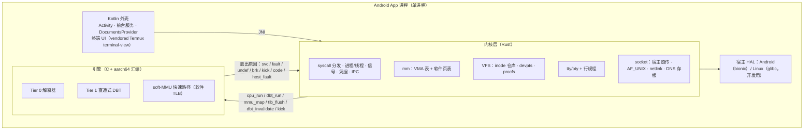

# appine 设计文档

- **状态**：设计决策已在 2026-10-24 的设计评审中逐条确认。M0–M8 已完成，之后做了二十多轮发布前的补强，M9（发布）还没开始。各轮结果见 [milestones.md](milestones.md)。
- **范围**：v1。第 1–13 节写的是当前的实现：2026-10-25 逐节与代码核对过，之后随每一轮的改动更新；和最初设计不一样、或者还没做的地方都在原处写明。
- **一句话**：一个能上 Google Play 的**单进程** Android App，在进程内用解释器 / 同 ISA 二进制翻译运行未经修改的 Alpine Linux aarch64 用户态程序。思路与 iSH 相同，是它在 Android 上的对应物。

**目录**

1. [目标与非目标](#1-目标与非目标)
2. [硬约束](#2-硬约束)
3. [总体架构](#3-总体架构)
4. [CPU 引擎](#4-cpu-引擎)
5. [内存：轻量用户态 soft-MMU](#5-内存轻量用户态-soft-mmu)
6. [进程、线程与调度](#6-进程线程与调度)
7. [信号与 ABI](#7-信号与-abi)
8. [文件系统](#8-文件系统)
9. [TTY 与终端](#9-tty-与终端)
10. [网络](#10-网络)
11. [用户、权限与 Android 集成](#11-用户权限与-android-集成)
12. [威胁模型](#12-威胁模型)
13. [工程](#13-工程)
14. [里程碑](#14-里程碑)（计划和排序依据；各轮结果见 [milestones.md](milestones.md)）
15. [已否决的方案](#15-已否决的方案)
16. [风险与待验证的假设](#16-风险与待验证的假设)

---

## 1. 目标与非目标

### 1.1 目标

- 用户从 Play 安装 App、打开即得到一个 Alpine shell，不需要 root、不依赖 Termux，也不需要任何额外步骤。
- 整个 Linux 环境都跑在 App 自己的进程里，Android 12+ 的 phantom process killer 对它不起作用。
- 直接运行 Alpine 官方 aarch64 仓库里**未经修改**的二进制。

### 1.2 v1 负载分档

| 档位 | 负载 | v1 要求 | 现状 |
|---|---|---|---|
| A 日常 CLI | busybox ash、`apk`、coreutils、vim、git、curl、openssh client | **全部可用** | ✅ M4 起 |
| B 计算型 | python3、gcc/make 编译中等规模的 C 项目、`./configure` | **能跑通** | ✅ M6：在 appine 里从源码编译 Lua、SQLite |
| C 难缠的运行时 | Go 静态二进制、node/V8、JVM | **行为正确，不要求快** | ✅ M8：Go、Node.js、OpenJDK 21/25 |
| D 不做 | docker/podman（namespace、cgroup）、systemd、内核模块、X11/GUI | — | — |

ptrace（§7.6）：strace、gdb 可以用。

glibc 发行版不在 v1 的承诺里。探测过：Debian 13、Ubuntu 24.04 的 rootfs 直接当作仓库时，apt、gcc、gdb、python 的 manylinux wheel、Node.js 的预编译模块、rustup、OpenJDK、code-server 都能用；从 Alpine chroot 进去要自己挂上 `/proc`、`/sys`、`/dev/pts`（§8.2，见 [glibc 发行版的探测](rounds/69-glibc-probe.md)、[mount 的子集](rounds/105-mount-subset.md)），`/dev` 里的设备节点要复制过去（仓库里的目录还不能 bind）。

### 1.3 性能目标

- CPU 密集任务比原生慢 **3–5 倍以内**（JIT 级别）。M2 用性能探针实测复核后保留了这个目标；目前 gcc 编译、`go build`、JVM 构建约 2.8–3.6 倍，python 的解释循环约 4.6 倍，起进程和文件操作 1–1.7 倍，见 §16 的 R1。
- 交互延迟优先：`ls`、tab 补全不能让人感到卡顿。

---

## 2. 硬约束

| 约束 | 来源 | 后果 |
|---|---|---|
| **Google Play 合规** | Device and Network Abuse 政策：不得下载可执行代码（dex/JAR/.so），"在虚拟机或解释器中运行的代码"除外 | 从网络下载的 Alpine 二进制**不能在宿主 CPU 上直接执行**，CPU 后端只能是解释器或翻译器 |
| 单进程 | 设计目标 + phantom process killer | 所有 guest 进程共享一个宿主地址空间，guest 进程之间的隔离和 fork 都得在软件里实现 |
| W^X 执行限制 | targetSdk ≥ 29 不能 `execve` App 数据目录里的文件 | 不使用 execve，也不依赖宿主加载器 |
| 存储限制 | SELinux：App 不能建硬链接、不能 `chown`、不能 `mknod`；共享存储不区分大小写、没有权限位、不能建 symlink | 文件系统的元数据和命名空间都要自己实现 |
| 网络限制 | targetSdk ≥ 30 不能 bind `NETLINK_ROUTE`，`RTM_GETLINK` 也被拦截；没有 `CAP_NET_RAW` | netlink 在进程内模拟，ICMP 改走 ping socket |
| 页大小 | Android 15 起要求 App 兼容 16KB 页内核 | 给 guest 呈现的页大小必须和宿主页大小解耦 |
| 宿主地址空间 | GKI 常见配置是 4K 页 + 39-bit VA，用户态只有约 512GB | 不能给每个 guest 进程预留很大的连续地址空间 |

**最低系统版本：minSdk 29（Android 10）**。DNS 存根依赖 `android_res_nsend`，它从 API 29 开始提供。

---

## 3. 总体架构



分层原则：

- **引擎**只关心"执行 guest 指令"。遇到 `svc`、访存缺页、未定义指令、`brk`、`ic ivau` 时，把控制权交给内核层。
- **内核层**实现 Linux 用户态 ABI，持有所有 guest 状态：进程、地址空间、fd、文件系统。
- **宿主 HAL** 把宿主的差异隔离开。开发阶段的宿主是 Linux arm64，生产宿主是 Android；不写 macOS 版本的 HAL。
- 核心库（引擎 + 内核层）**不依赖任何 Android 组件**。Android 相关的部分只在 HAL 和 Kotlin 外壳里出现。

---

## 4. CPU 引擎

### 4.1 Guest ISA

guest 是 **aarch64**，直接使用 Alpine 官方 aarch64 仓库。这样选有三个好处：

- guest 和宿主的内存模型都是 ARM 弱序，没有 x86 TSO 与 ARM 弱序之间的转换问题。
- 同 ISA 翻译时，大量指令可以原样拷贝。
- 按 arm64 规范，修改代码之后必须执行 `ic ivau` + `isb`，所以这条指令可以直接当作失效翻译缓存的钩子，不需要对代码页做写保护。

### 4.2 分层

#### Tier 0：解释器

`core/engine/src/c/interp.c`。

- 负责冷代码、短命进程、调试，同时作为语义上的参考实现；Tier 1 不翻译的单条指令也交给它执行。
- 分发是按编码字段逐级 `switch` 的解码，另有一个 512 项的取指 TLB。最初计划的 `[[clang::musttail]]` 尾调用式 threaded 分发没有做：Tier 1 成为正式版之后，Tier 0 的速度已经不影响整体（M2 时 Tier 0 比原生慢约 40 倍）。
- 和 Tier 1 共享 guest 状态布局、soft-MMU 接口和异常上报接口。
- **SIMD&FP 数据处理、CRC32 和 LSE 原子指令用"原生单指令执行"实现**（M1a 决定）：白名单判定（§4.4）、地址翻译和寄存器搬运写在 C 里，运算本身交给宿主执行同一条指令。
  - 每个指令编码对应一段缓存起来的小桩（`core/engine/src/c/native.c`）：通用寄存器字段被换成宿主临时寄存器，执行前从 CPU 上下文读入、执行后写回；FP 类的桩还会载入并写回 V0–V31、FPCR、FPSR 和 NZCV，同时保存和恢复宿主的 d8–d15 与 FPCR。LSE 指令的地址字段换成翻译好的宿主指针。
  - 好处：结果与硬件逐位一致，NaN 传播、舍入、FZ/DN、FPSR 累积标志都不需要自己实现；实现量只有白名单解码和访存部分。
  - 代价：对 SIMD&FP 而言，Tier 0 不再是独立于硬件的参考实现（硬件本来就是 lockstep 的标准答案）；Tier 0 需要宿主能分配可执行内存（Android 允许 JIT）；只能运行在 aarch64 Linux 宿主上，非这类宿主不宣告 FP/ASIMD。
- SIMD&FP 的访存（LDR/STR/LDP/STP 的 B/H/S/D/Q 形式、LD1–LD4/ST1–ST4 的多结构、单结构和 replicate 形式）仍用 C 经 soft-MMU 实现：先确认要访问的每一页都可访问，再读写，失败时没有副作用。

#### Tier 1：同 ISA 直通式 DBT

`core/engine/src/c/dbt.c`，`appine-run --tier 1` 和 Android App 使用它。M2 是原型，M7 补全成正式版，M9 之前又加上了 SP 常驻寄存器、返回预测、翻译保留、跨页访问、共用的 TLB 检查，以及同一个地址空间的线程共用翻译（见 [milestones.md](milestones.md)）。

**寄存器约定**

| guest | 宿主 |
|---|---|
| X0–X15、X19–X25、X29、X30 | 同号寄存器 |
| SP | X26 |
| X16、X17、X18、X26、X27、X28（"被占用的寄存器"） | 存放在 CPU 上下文里。引用它们的指令先把值读进临时寄存器，改写寄存器字段后执行，再写回 |
| NZCV、FPCR、FPSR、V0–V31 | 宿主的同名寄存器（§4.3） |

- 宿主 X28 指向 CPU 上下文，X16、X17、X27 是临时寄存器。
- 宿主 X18 是平台寄存器（Android 上 ShadowCallStack 用它），翻译后的代码不碰它，宿主的信号处理函数随时可以用（R6）。
- SP 出现在 17% 的指令里（函数的序言和尾声），X26 是编译器生成的代码里用得最少的被调用者保存寄存器（gcc 的 cc1 里不到 SP 的十分之一），所以宿主 X26 让给 SP。以 SP 为基址的访存直接用 X26，回写只要一条 `add`。
- **Go 的程序另用一组**：Go 的编译器固定用 X28（当前的 goroutine）、X27（汇编器的临时寄存器）、X26（闭包的上下文），函数序言的栈检查用 X16，原生的 `go build` 里 compile 有 15.5% 的执行时间落在用到上表那几个寄存器的指令上（gcc 的 cc1 是 5.2%），X19–X25 却几乎不用。所以 execve 时程序带着 Go 的链接器写的 build ID 注记（`.note.go.buildid`），Tier 1 就改占 X21–X25：X25 指向 CPU 上下文，X21–X23 是临时寄存器，X24 放 SP，被占用的是 guest 的 X18、X21–X25。一个 Tier 1 实例的寄存器分配在创建时定下，例程按它生成，翻译模板按它区分版本。`go build` 快 3–5%（见 [Go 换一组被占用的寄存器](rounds/113-go-registers.md)）。V8（x26–x28）、HotSpot（x27、x28）的 JIT 代码也固定用默认一组的几个，但它们是只读的基址（根表、堆基址、当前线程），从 CPU 上下文读不在依赖链上，代价小；贵的是被占用的寄存器里放着不停被写的临时值。量过别的组合没有收益，这两种程序也用默认的一组（[V8 和 HotSpot 的寄存器](rounds/124-v8-hotspot-registers.md)）。
- guest 的 NZCV 就是宿主的，所以插入的代码一律不改动条件标志（用 `cbnz`/`tbnz`/`eor` 代替 `cmp`）。

**指令的处理**

| 指令 | 处理 |
|---|---|
| 只读写寄存器的 ALU、FP、NEON 指令，屏障 | **原样拷贝**。SIMD&FP 数据处理的白名单判定与 Tier 0 共用同一个函数 |
| 访存，包括 SIMD&FP 的 LDR/STR/LDP/STP 和 LD1–LD4/ST1–ST4 | 插入 soft-MMU 的 TLB 快速路径（见下），访问换成宿主地址 |
| 分支和 PC 相对寻址（`adr`/`adrp`/`ldr literal`） | 改成以 guest PC 为基准的常量；分支见下面的"控制流" |
| `svc` | 退出到内核层 |
| `mrs/msr tpidr_el0`、`mrs dczid_el0` | 读写 guest 状态结构里的字段，或者换成常数 |
| `mrs/msr nzcv`、`mrs cntvct_el0`、`mrs cntfrq_el0` | 原样执行 |
| `ldxr`…`stxr` | 改写成比较并交换，见 §4.5 |
| LDAR/STLR、CAS、LSE 原子指令 | 换上翻译好的宿主地址，原样执行 |
| `dc zva` | 翻译地址后用 `stp xzr` 清零 |
| `clrex` | 清掉 guest 的独占标记 |
| HINT，包括 PAC 系列（`PACIASP`/`AUTIASP` 等） | 改写为 NOP，见 §4.4 |
| `dc cvac`/`dc cvau`/`dc civac`/`ic ivau` | 按读访问检查地址（与 Tier 0 一样），不退出。`ic ivau` 只记下所在的页，到 `dsb`/`isb` 时才退出到分发器、作废翻译（见下面的"失效"）：JIT 刷新缓存时一页要执行几十条，不必每条都退出 |
| 其他系统寄存器访问（`mrs ctr_el0`、`mrs ID_*_EL1`、读写 FPCR/FPSR 等）、成对的 LDXP/STXP、操作数是被占用寄存器的 CASP | 交给 Tier 0 执行这一条指令 |
| Tier 0 不认识的编码 | 同样交给 Tier 0，保证两层的白名单完全一致（§4.4）。翻译时问 Tier 0 认不认识一条指令要把它执行一遍；回答只取决于指令字，每个线程按指令字缓存 4096 项 |

**访存快速路径**（算地址之外 6 条宿主指令，代码见 §5.1）

1. 算出 guest 地址，用**最后一个字节**所在页的下标取出 TLB 表项，一条 `ldp` 取出 tag 和 addend。访问落在对齐的 16 字节里时（以对齐的 SP 为基址、偏移对齐的访问）不可能跨页，直接用第一个字节的页，省掉一条 `add`。
2. tag 与**第一个字节**所在的页比较。TLB 直接映射，跨页时第一页的页号不可能出现在下一页的表项里，所以这一次比较同时排除了跨页访问。
3. 命中就访问 `addend + 地址`。
4. 未命中或者跨页时跳进代码缓存里的回填例程。不跨页时按 §5.1 的结构遍历页表、填好表项。跨页时两页都要有这次访问的权限，宿主地址也要连续（两页的 addend 相同，同一次宿主映射里的页都是这样），这时整个访问照样在宿主上一次完成：两页都在 TLB 里时只比对两个表项，不在的先填进去。栈帧跨页的函数每次调用都会这样访问，所以不能退给 Tier 0（python 的解释器循环每次迭代都有两次这样的访问）。
5. 只有页没有映射、权限不符、跨页而宿主地址不连续（mremap 扩大的映射、另起一段的栈）、SP 未对齐或者地址带 TBI 标签时，才退出到分发器，由 Tier 0 执行这一条指令。这时指令还没有产生任何副作用，所以异常是精确的。

- **依赖链**：基址加立即数的访问，最后一个字节的地址（取下标用）直接从基址算，不等访问地址算出来，和它并行，指令数不变，追指针的读每次少等一个周期。
- **地址已知的访问**：翻译时跟踪本块里值已知的寄存器（ADR/ADRP 设下的，和在它上面加的立即数；别的指令可能写它时就不再算已知，拿不准的一律算写了）。以它为基址、不跨页的访问，表项的位置是常数，取表项不必等 ADRP 换成的几条 `movk` 和地址的加法；字面量（`ldr Xt, =label`）同样。tag 仍然和真实的地址比较，所以就算跟踪错了，也只是多走一次回填。全局变量的访问、PLT 里从 GOT 取跳转目标都是这样的。
- **SP 对齐检查**：一个块里检查过一次之后，SP 只按 16 的倍数改变时不再检查。
- **共用检查**：同一个块里以同一个寄存器为基址的几条访存（函数的序言和尾声、结构体的几个字段）共用一次检查。组长检查整组覆盖的范围（最多 512 字节），之后临时寄存器里是基址的宿主地址，组员直接用 `[T2, #偏移]` 访问，和原生一样是一条指令。组员之间只能有不写基址（按常数加减的除外）的指令和条件分支，SP 只能按 16 的倍数改变。组员之间可以夹着别的访存（别的组的、不分组的）和用到这个临时寄存器的指令：组长把宿主基址存进 cpu 结构体里的一个槽（同时最多 4 组），之后的组员先取回来，槽的地址是常数，可以提前取出，组员的访问不必等 TLB 查表。python 的解释循环里栈帧、代码对象这几个基址的访存互相交错，不允许中间夹着别的访存就几乎省不下检查。条件分支后面的组员不一定会执行，覆盖的范围里也可能有它们访问不到的页，所以检查失败时由 Tier 0 执行组长；同一个组长第二次失败时作废这个块，它和后面一个块长度以内的访存都不再当组长（第一次只记下来：栈还没长到那里这类情况，Tier 0 执行组员时就会解决）。gcc 和 python 里约四分之一的访存省掉了检查。

**控制流**

- 块不在条件分支处结束：不跳转的一侧接着翻译，跳转的一侧是侧出口。
- 直接分支通过块链接回填成一条 `b`：出口的链接桩以一条跳到下一条的 `b` 开头，链接时把它改成跳往目标块。`b` 改成 `b` 是架构允许并发修改的（ARM ARM 的 CMODX 规则），别的线程正在执行这里也没关系。条件分支的目标在它的偏移范围内时，直接改写条件分支本身；条件分支不在 CMODX 允许的指令里，所以只在地址空间里只有一个线程时这样做。
- 建块时目标已经翻译过的出口直接链接，随整个块一起同步指令缓存；其余的出口第一次走到时退出到分发器链接。只有一个线程时，新块和链接点合在一起同步一次：`ic ivau` 之后的 `dsb` 要等作废广播完成，一次约 0.1 微秒，比作废本身贵得多。
- 单独改写的链接点只做缓存维护（`dc cvau`、`ic ivau`），不等它完成，也不做 `isb`：改写的线程接着直接进入目标块，用不着新指令；别的线程在看到新指令之前执行的是旧指令，退出到分发器照样找到目标块。java 启动时每个块要链接一两次，每次都完整同步太贵（见[别的负载和文件操作](rounds/32-workloads-file-ops.md)）。一个线程退出到分发器时发现链接点已经改好了（说明它还执行了旧指令），才完整同步一次。
- 间接分支（`br`/`blr`/`ret`）先查一张 4096 项的跳转缓存，未命中再回到分发器。
- **返回预测**：函数调用（`bl`/`blr`）翻译成宿主的 `bl`，跳过紧随其后的"落点"（链接到 guest 返回地址处的块），再把 (guest 返回地址, 落点) 压进线程的影子返回栈。`ret` 看到栈顶等于 x30 就弹栈、用宿主 `ret` 跳回落点，由宿主的返回地址栈预测；对不上时（longjmp、信号处理函数、协程切换）才查跳转缓存。影子栈是 64 项的环形缓冲，每一项都跳往继续执行它记的 guest 地址的代码（空项按 x30 查找），翻译缓存清空时整体重置。
- **kick 检查**：经由后向边或间接分支进入块时检查 kick 标志。块的起始地址沿前向边严格递增，任何循环里至少有一条边会经过检查，所以链接成环的循环也能被打断。
- **桩里放数据字**：块尾的链接桩、退出桩和回填桩占翻译后代码的四成多，平时几乎不执行。它们不用三四条 `mov` 拼 guest pc，而是把 pc（和退出原因）放在桩末尾的数据字里，由例程读出：链接桩是 `b 4; adr T1, 0; b 例程; .quad 原因 << 48 | pc` 5 个字，退出桩没有开头的 `b` 是 4 个；回填桩是 `adr T1, 8; b 回填例程; .word 信息; .quad pc` 5 个字，信息字里是字节数、失败时的退出原因和回到访问的位移，成功时例程直接跳回访问，失败时自己带着 pc 退出。`bl` 压影子返回栈时也从落点的数据字里读 guest 返回地址。原来链接桩 6–8 个字，回填桩连同失败时的退出约 10 个，每条 guest 指令翻译成 7.5–8.3 个宿主字，现在约 6 个（[翻译代码的密度](rounds/107-code-density.md)）。

**精确状态**几乎是免费的：宿主 `ucontext` 里的寄存器就是 guest 寄存器，被占用的寄存器另外保存在上下文里。

**翻译共享**：一个块的翻译只取决于它的 guest pc 和翻译过的指令字，与进程、映射无关。

- 每翻译一个块就存成模板，放进所有实例共用的模板区（32 MB，写满时整体丢弃；同一个 pc 最多留 4 个版本）。
- 别的实例（另一个线程、fork 出来的子进程、又一次 exec 的同一个程序）要翻译同一个 pc 时，先比对指令字，相同就把模板拷进自己的代码缓存，只重新计算跳往例程的几条 `b`。
- 块之间的链接在各自的拷贝里回填，所以不需要像原计划那样按 `(inode, offset)` 识别文件页，不同进程在同一地址映射了不同的代码也不会互相影响。`./configure` 这类负载里 85% 的块直接来自模板。

**按地址空间共用**：代码缓存（128 MB，块跳往缓存开头的例程、块之间的链接都是一条 `b`，偏移范围是 ±128 MB）、翻译表和作废记录由一个地址空间里的所有线程共用；每个线程只有自己的跳转缓存、影子返回栈和统计。每个线程各翻译一份的话，Go 的 `compile`、JVM 这类多线程的进程里同样的块要翻译、链接、同步指令缓存好几遍，每个线程还各占一块代码缓存（见[多线程共用翻译和定向唤醒](rounds/24-shared-translation.md)）。

- 分发器不持锁查翻译表：插入只用空位（先写 pc、再写 code），作废只把 pc 改成墓碑，墓碑不复用、重建表时去掉。读到旧 code 的线程进入的是作废块的入口，那里跳往转发桩。换表之后，等正在查旧表的线程查完才释放旧表（每个线程查表时序号为奇数）。
- 翻译不持锁：在线程自己的暂存区里翻译（或者拷贝模板），持锁时只做分配位置、拷贝、修正跳往例程的 `b`、链接、同步和放进表这几步。翻译之前先拷一份 guest 指令字，装进去之前和内存里的再比对一次：翻译期间别的线程改写并作废了这段代码时（那时新块还不在表里），丢掉重新翻译。持锁翻译的话，JVM 这种几个线程同时翻译的负载会在锁上排队。
- 新块先同步指令缓存、再放进表里，别的线程才可能跳过去；链接点的回填不持锁（`b` 改 `b`）。取锁时先自旋一会儿再睡。
- 整体清空（代码缓存写满）要等所有线程离开翻译后的代码：发起的线程打断其他线程，等它们停在分发器里或者离开分发器再清空，各线程据代数清空自己的跳转缓存和影子返回栈。

**同一个程序的地址空间共用**（`mm::CodeGroup`）：翻译只取决于 pc 和指令字，几个地址空间在同样的地址映射着同样的代码时，块对它们都有效。appine 没有 ASLR，同一个程序的进程（fork 出来的、又 exec 了同一个程序的）映射在同样的地址上，所以按程序（可执行文件的 inode）组成组，共用一个实例，就像一个地址空间里的线程一样；每个地址空间仍按自己的代码代数作废。并行编译的四个 cc1 原来各占 35–40 MB 代码缓存，20 个空闲的 python3 各 4 MB（[同一个程序共用翻译](rounds/108-shared-translation.md)）。

- 成员可信的可执行映射（没写过、有版本的私有文件映射，即"翻译保留"里的版本，和内容没被改过的 vDSO）要与组里登记的一致：同一段地址只能是同一个版本的同一个文件，地址减去文件偏移也相同（动态链接器先按整个文件的跨度映射，再把后面的段盖上去，同一个库的可执行映射先长后短）。新的映射一致就登记进组里，引擎也有一份（`appine_dbt_share`）。
- 别的可执行内存（JIT 生成的、写过的代码）是成员私有的：每个成员有一个标签，登记过的映射里的块按 pc 放进翻译表，所有成员共用；别处的块的键是 pc | 标签 << 48，只有翻译它的成员查得到。guest 的 pc 只有 48 位，更高的查表前就排除，两种键不会相同。两种键都按 pc 散列，一次线性探测同时比两个键。共用的块不链接到私有的块：共用块的链接桩在退出码里带一位标记，分发器据此不回填。node 的几个进程因此共用 V8 的解释器、内置函数和 ICU 的翻译（node 的翻译 89–99% 是这些），各自的 JIT 代码分开（见[有 JIT 代码的进程也共用翻译](rounds/115-shared-with-jit.md)）。
- 每次系统调用之后（`Mm::sync`），可执行映射有变化（mmap、mprotect、mremap、栈增长、ptrace 写代码）时核对：可信的映射与登记的不一致或者压着别的成员私有的范围、私有的范围压着登记过的映射时，成员离开组。它做一次 shootdown，别的线程重新进入 guest 代码之前看到空间的代数变了，就换用自己的翻译；只剩它一个时组关掉，它留着原来的翻译。所以别的成员不会执行到只对某个成员有效的代码。
- 组里有了第二个成员时，作废登记范围以外、不带标签的块（池里上一个使用者留下的）。实例回到池里时去掉带标签的块，标签从头分配；一个组的标签（65535 个）用完时不再接受新成员。
- 成员拆掉自己的映射时照常作废，别的成员只是要重新翻译；它在同一个地址映射别的代码时就离开组。成员跳到一个只有别的成员映射过、自己没有映射的地址时，执行的是那里的翻译，而不是收到 SIGSEGV（[同一个程序共用翻译](rounds/108-shared-translation.md)的推迟项）。

**翻译保留**：地址空间没了之后，它的翻译放回池里，不清空，标成待核对；新的地址空间（exec 之后、fork 出来的子进程）第一次运行时从池里取。

- 池里的实例按程序（可执行文件的 inode）作键，优先还给同一个程序：shell 脚本里反复 exec 的 busybox、`go build` 的一个个 compile 进程、一次次 `node -e` 都能拿回前一个留下的翻译。没有同键的就拿空的或者新建，不清空别的程序留下的。
- 运行之前逐块比对 guest 指令字（每个块记着自己翻译时的指令字），对不上的按"失效"的办法作废，大部分对不上时才整体清空。这和拷贝模板时的比对是同一件事，只是一次做完，省掉逐块拷贝模板、重新链接、同步指令缓存。
- 这时只有程序和动态链接器映射了，共享库还没有加载。落在上一个使用者的文件映射里、页还没映射的块不作废，而是**停放**：入口照样改成跳往转发桩（指向它的链接都经由转发桩退出到分发器），代码和被改写的那条指令留着。分发器查不到某个 pc、它所在的页里有停放的块时，把这一页停放的块一起核对，指令字和现在的相同的恢复入口、放回表里，对不上的作废。一页一起做，因为每个停放的块第一次执行到时都要退出一次，逐个恢复时光是这些退出就把省下的时间用掉了。不停放的话，`node -e 0` 每次热启动都要把 libcrypto、ICU、libstdc++ 这些库里的几千个块作废、再从模板拷贝回来（见[node 启动](rounds/34-node-startup.md)）。匿名内存里的块（JIT 生成的代码）不停放：下一次多半对不上，停放着只会让查表失败时多拿一次锁。
- 内容由文件和它的版本就能确定的代码段不必比对：地址空间不再使用时，内核层把没写过、有可信版本的私有文件映射（程序、动态链接器和共享库的代码段，最多 64 段）记给翻译（起止地址、宿主文件的设备号和 inode、文件偏移、版本）；新的地址空间里同一段地址映射的是同一个版本的同一段文件时，落在里面的块直接保留。版本是宿主 object 的 ctime 和大小：内容的每一次修改宿主都会把 ctime 改成当时的时间，utimensat 也改不回去。ctime 离现在不到 2 秒（宿主的时间戳取自粗粒度的时钟，紧接着的修改可能得到同一个 ctime）、有过可写共享映射（写进共享映射的页一直是脏的就不再改 ctime）的文件不给版本。不然 shell 每起一个 busybox 进程，都要把池里攒下的各个 applet 的块比对一遍，代码页还要逐页缺页（见[起进程的宿主开销](rounds/28-spawn-host-cost.md)）。
- 池里最多 16 个实例：几个进程同时跑同一个程序（`make -j`、并发的 shell 管道）时各占一个，实例少了就常常拿不到同键的，只好重新翻译。保留的代码总共最多 64 MB（翻译表、块的记录和指令字另外约多三分之一），超出时先去掉空的、再去掉最久没用的；块数超过 13 万的实例放回池里时清空，块的记录和指令字用过的页也交还宿主。超过 32 MB 的实例（一次 `java` 就有四五十 MB）只在不挤掉别人时保留，免得跑一次 java 就把 node、python 这些常用程序留下的翻译全挤掉。

**失效**

- guest 修改代码之后执行的 `ic ivau`，以及可执行映射的拆除和权限变化，都记进 `mm` 的代码失效日志，并递增代码代数。只是代码变了时（JIT 的 `ic ivau`），打断正在执行 guest 代码的其他线程，但不持着 BKL 等它们退出：硬件上别的核在上下文同步之前同样可能还执行旧指令。membarrier 的 SYNC_CORE 才等。
- 翻译是共用的，第一个看到新代数的线程按错过的范围逐页作废一次就够了。日志保留最近 4096 个代数，落后更多时整体清空。超过 256 页的范围（拆掉一个库）逐个看所有的块，不整体清空。
- 作废按内容：范围里的块只有 guest 指令字和现在不同的才作废（翻译只取决于 pc 和指令字，字面量也是运行时才读）。拆掉映射、去掉执行权限之后这一页找不到可执行的映射，照样全部作废。JIT 改写一处代码只 `ic ivau` 一两行，而 `ic ivau` 是按页记下的，按内容比对之后，同一页里别的方法的块不必跟着作废、重新翻译（见[JIT 负载](rounds/35-jit.md)）。
- Tier 1 的 `ic ivau` 记下的页在 dsb、isb 时由分发器就地作废，不退出到内核层：翻译由地址空间里的线程共用，作废块的入口改写之后别的线程下次进入就会看到。HotSpot 每改一处代码就 `ic ivau`、dsb 一次，经由内核层的话每次都要取 BKL、记日志。Tier 0 和别的退出时还记着的页仍然经由内核层的日志。
- 作废的块入口改成跳往一个转发桩，重新翻译之后旧入口直接跳往新的块，别的块链接到旧入口的跳转不用找出来改写。别的线程可能正在执行这个块，它照样执行到块尾。一批块一起作废：先写好所有转发桩、同步一次，再改所有入口、同步一次。
- 作废的块在翻译表（开放寻址、线性探测）里留下墓碑，表里有四分之三不空、墓碑占一半以上时原样重建。块的记录记满时，作废的超过八分之一就去掉它们的记录、重建表，不整体清空（JVM 活着的块有十几万个，作废的也有三四成）。
- CTR_EL0 报告 DIC = IDC = 0，guest 修改代码之后一定会执行 `ic ivau`。

**W^X**：JIT 代码页使用双映射。同一段共享匿名内存用 `mremap` 映射两次，一份 RW 用来写入，一份 RX 用来执行，不依赖 memfd；宿主不允许时退回 RWX。Tier 0 的原生指令桩也这样分配。宿主的 RSS 按映射数页，两个视图都碰过的页算两次，翻译占的内存就多算了一倍：引擎记下写入视图里写过的页，内核层的定时器线程有 guest 线程在运行时每秒拆一次它们的页表项（共享内存上的 `MADV_DONTNEED` 只拆映射、内容留着，再写时重新缺页），所有线程都等待之后再拆一次；OOM killer 量的用量扣掉还没拆的（§12 第 4 条）。按时间拆而不按写入量拆：JIT 负载每秒往几千个不同的页里回填链接、作废块，每攒 256 KB 拆一次时 Maven 慢了 3%（[代码缓存只算一次](rounds/106-code-cache-rss.md)）。原生指令桩的缓存不拆，通常只用到几十 KB。

**否决了以 dynarmic 为核心的方案**，见 §15。dynarmic 是 0BSD 许可，可以直接借用它的 A64 解码表（`frontend/A64/decoder`）和测试用例。

### 4.3 FP 状态

FP 和 NEON 指令都在宿主上原生执行。所以每次从宿主代码进入 guest 代码，都要把 guest 的 FPCR 装进宿主 FPCR；回到宿主 C 代码之前再恢复，避免 guest 设置的 flush-to-zero 之类的模式影响我们自己的代码。

Tier 1 的进入例程保存宿主的 d8–d15 和 FPCR，载入 guest 的 FPCR、FPSR 和 V0–V31，翻译后的代码里它们一直在宿主寄存器里；退出例程保存 guest 的 V0–V31 和 FPSR，再恢复宿主的状态。

### 4.4 CPU 特性基线

**原则：guest 看到的特性集合 = 宿主 CPU 支持的 ∩ Tier 0 已实现的 ∩ 白名单。**

- `AT_HWCAP`/`AT_HWCAP2`、`/proc/cpuinfo` 的 Features 行、guest 读 `mrs ID_AA64*_EL1` 得到的值，三者从**同一份集合**生成。
- 白名单以外的编码，在两个 Tier 里都投递 SIGILL（`ILL_ILLOPC`），**绝不把它们原样拷贝执行**。
- 两个 Tier 对同一条指令的语义必须一致。PAC 在 Tier 1 原样执行会用宿主密钥签名，而 Tier 0 只能把它当 NOP。为了一致，Tier 1 也把它们改写成 NOP，并且不宣告 PACA/PACG。
- 通用定时器的 `CNTVCT_EL0`、`CNTFRQ_EL0` 与 Linux 一样允许 EL0 读，两个 Tier 都读宿主的值（M8）。Go 的运行时和 V8 直接读它们计时。

| 级别 | 特性 |
|---|---|
| 必须 | FP、ASIMD（v8.0）、CPUID |
| 宿主支持时宣告 | ATOMICS（LSE）、AES、PMULL、SHA1、SHA2、CRC32、ASIMDDP（点积，[ASIMDDP](rounds/133-asimddp.md)）、SHA3 和 SHA512（两者都有才宣告）、I8MM（`AT_HWCAP2`，[SHA3、SHA512 和 I8MM](rounds/135-sha3-sha512-i8mm.md)）、LRCPC（LDAPR，[LRCPC](rounds/136-lrcpc.md)）、LRCPC2（带偏移的 LDAPUR、STLUR，[LRCPC2](rounds/138-lrcpc2.md)）、FP16（FPHP、ASIMDHP，两者都有才宣告，FPCR 的 FZ16 随之可写）和 JSCVT（FJCVTZS，[FP16 和 JSCVT](rounds/141-fp16-jscvt.md)）、RDM（SQRDMLAH）、FCMA（FCMLA、FCADD，半精度的形式还要 FP16）、FHM（FMLAL，只和 FP16 一起宣告）、BF16（`AT_HWCAP2`，[RDM、FCMA、FHM 和 BF16](rounds/142-rdm-fcma-fhm-bf16.md)） |
| 还没做 | FRINTTS、FLAGM/FLAGM2、SB、DIT、DCPOP/DCPODP、SM3/SM4、LSE2（`uscat`）（数据处理类的白名单照上面几轮加就行） |
| v1 不做 | SVE/SVE2/SME、PACA/PACG、BTI、MTE |

宣告 LSE 之后，libgcc 的 outline atomics 和 Go 会改走单条原子指令，这类指令很容易翻译。但 musl 的原子操作是用 `ldaxr`/`stlxr` 内联汇编写死的，所以 **LL/SC 必须支持**。

**实现**（M1a，`core/engine/src/c/features.c`）：启动时读宿主的 `AT_HWCAP`、`AT_HWCAP2`，与 Tier 0 已实现的集合求交，作为 guest 的 `AT_HWCAP`、`AT_HWCAP2`（后者只有 I8MM、BF16）。宿主没有 FP、ASIMD，或者原生指令桩不可用时，不宣告任何 SIMD&FP 特性。SIMD&FP 的数据处理指令（含这些扩展）在 Tier 0 里由原生指令桩执行、在 Tier 1 里原样拷贝，所以加一个这类特性只要放行它的编码。guest 读 ID 寄存器空间（`MIDR_EL1`、`ID_AA64ISAR0_EL1`、`ID_AA64ISAR1_EL1`、`ID_AA64PFR0_EL1` 等）时，返回与这份集合一致的值。`/proc/cpuinfo` 随 procfs 一起生成（M3b）。

**白名单的独立核对**：硬件只能告诉我们一条编码能否执行，分不清它属于基础集还是 FP16 之类没宣告的扩展。所以另用 LLVM 的反汇编器（`llvm-mc`，按 guest 特性集合设置 `-mattr`）做对照：

- 在 SIMD&FP 数据处理、SIMD 访存、独占访问、LSE、整数 2 源数据处理这几个编码空间里随机抽样，Tier 0 认为能执行的编码必须恰好是 LLVM 能解码的编码（`tests/lockstep/tests/whitelist.rs`）。
- 对"应当全为 1"（SBO）的字段，沿用 LLVM 的口径：独占访问和 LDAR/STLR 忽略它们，CAS/CASP 的 Rt2 必须全为 1。

### 4.5 独占访问（LL/SC）

**问题**：在 `ldxr` 和 `stxr` 之间插入额外的访存（比如 TLB 查找），可能会让独占监视器失效，导致活锁。最初的设计是识别出整个 LL/SC 序列，在序列开始前一次性完成地址翻译，做不到的整段改写成 CAS 语义或放到慢路径（DynamoRIO 在 AArch64 上遇到过同样的问题）。实际两层都采用了"记下读到的值、写时比较并交换"的语义，不需要识别序列。

soft-MMU 翻译得到的是真实宿主指针，所以原子指令直接作用在宿主内存上，多个线程或进程共享同一页时语义天然正确。

**Tier 0**（M1a，`core/engine/src/c/atomic.c`）：

- LDXR/LDXP 记下地址、长度和读到的值；STXR/STXP 在宿主地址上做比较并交换，只有内存值仍等于记下的值才成功，与 QEMU 的做法相同（允许 ABA，对正确的 LL/SC 用法没有影响）。
- CLREX 和 svc 都会清掉独占标记。要求自然对齐，否则是对齐错误。
- LDAR/STLR 用 C 的 acquire/release 原子操作实现；LSE 原子指令和 CAS/CASP 交给原生桩，在翻译后的宿主地址上原样执行。

**Tier 1**（M7）：语义与 Tier 0 相同。

- LDXR 查过 TLB 之后在宿主地址上读（LDAXR 用 `ldar`），记下地址、长度和读到的值。
- STXR 先确认独占标记是同一地址、同一长度，再在宿主地址上用 `ldaxr`/`stlxr` 循环做比较并交换：两条指令之间只有寄存器运算，没有访存，宿主的独占监视器不会被我们自己的代码清掉。
- 要写的值在被占用的寄存器里时，循环里的三个临时寄存器都有用处，借一个这条指令没用到的 guest 寄存器放它：先存进 cpu 结构体里它自己的位置（翻译后的代码运行期间那里没有用），用完恢复。中间不会退出，宿主故障也不从 ucontext 恢复 guest 状态（§12 第 5 条），没有人看得到它被借走。libgcc 的 outline atomics（GCC 在 arm64 上默认使用）正是这样写的，Alpine 的 libgcc 又不按 HWCAP 认 LSE，总是走 LL/SC，所以 GCC 编译的程序里的原子操作（引用计数、锁）都是这样的 STXR，整条交给 Tier 0 就太慢了（见[node 启动](rounds/34-node-startup.md)）。
- CLREX 清掉标记，svc 退出时也清掉。LDAR/STLR、CAS 和 LSE 原子指令换上宿主地址原样执行。
- 成对的 LDXP/STXP，以及操作数是被占用寄存器的 CASP 很少见，仍交给 Tier 0。

---

## 5. 内存：轻量用户态 soft-MMU

这里**不模拟** ARM 的硬件页表，包括 TTBR、描述符格式、TLBI/ASID、异常级别、物理地址层和 MMIO，但**要自己实现 Linux mm 的语义**。

### 5.1 数据结构

- **每个进程一个 `mm`**（`core/kernel/src/mm.rs`），包含两部分：
  - VMA 表：按起始地址排序的 `BTreeMap`，实现 mmap/mprotect/munmap 语义，并用来生成 `/proc/<pid>/maps`、`smaps`。
  - 页表（`core/engine/src/c/mmu.c`）：以 guest 虚拟页号为键的 4 级基数树，每级 512 项，覆盖 48 位地址空间；叶子表项是宿主页地址加 R/W/X 权限位。只有 TLB 未命中时，我们自己的 C 代码才会遍历它。
- **每个线程一个软件 TLB**：直接映射，4096 项（M7 从 512 项加大），每项 `{读 tag, 读 addend, 写 tag, 写 addend}`。
  - tag 存的是页号取反，0 表示无效，所以清零的内存就是空的 TLB，新线程不必逐项写入，没碰过的页不占内存。
  - 表项填写时记进一张位图，清空时只处理填过的项，所以 munmap 频繁的程序清空 TLB 也不贵。

Tier 1 的 TLB 命中路径（8 字节的读；x16 = guest 地址）：

```asm
add  x17, x16, #7            // 最后一个字节
ubfx x17, x17, #12, #12      // 它所在页的页号低 12 位 → TLB 下标
add  x17, x28, x17, lsl #5   // x28 指向 CPU 上下文
ldp  x17, x27, [x17, #TLB]   // tag（页号取反）, addend
eon  x17, x17, x16, lsr #12  // 与第一个字节所在的页比较，跨页时一定不等
cbnz x17, refill
ldr  x0, [x27, x16]          // 宿主地址 = addend + guest 地址
```

- **TLB 未命中**：查基数树（Tier 1 在代码缓存里的回填例程中查，Tier 0 在 C 里查）。查不到，或者权限不符，就交给内核层，由它给 guest 投递 SIGSEGV 或 SIGBUS。
- **TLB shootdown**：多个线程共享一个 `mm` 时，页表可以在被别的线程遍历的同时修改（表项用原子操作读写，中间表在 `mm` 销毁前不释放）。
  - 解除映射或降低权限之后，修改方递增 `mm` 的代数，打断正在执行 guest 代码的其他线程，等它们退出 guest 代码；每个线程重新进入 guest 代码之前比较代数，变了就刷新自己的 TLB。
  - 只增加权限时不刷新：TLB 里的旧表项只是少了权限，未命中时会重新填写。
  - 代码的变化另有一个代数和失效日志，见 §4.2。
  - 被解除映射的宿主内存要等 shootdown 完成后才释放，所以 guest 自己的数据竞争碰不到已经还给宿主的内存。

### 5.2 页与后备内存

- guest 页**固定 4K**，不管宿主页是 4K 还是 16K。`AT_PAGESZ` 报告 4096。
- **匿名内存**：每个匿名映射单独向宿主 mmap 一段内存，每个 guest VMA 对应一个宿主映射。例外是 fork 时子进程自己的小映射（1 MB 以内，堆和栈除外），它们切自同一段宿主内存：shell fork 之后马上 exec，不值得为每个映射各做一次宿主的 mmap 和 munmap。这一段不计入宿主的提交量（每个映射都不超过 1 MB，计不计入只关系到一次申请超过内存总量时失败）。代价是这样的映射解除映射之后，宿主内存要等那一段全都不用了才交还。
- fork 要的这几段（小映射切出来的那一段、堆和栈预留的地址空间，都是 `MAP_NORESERVE`、没碰过的）预先映射好：同一个程序反复 fork 时要的长度总是那几个，持有 BKL 时直接拿来用，用掉的在放开 BKL 之后补上，每种长度最多留两段、最多记 8 种长度。这样宿主的 mmap（fork 持锁时间的大头）不在锁里做。
- **复用**：所有 guest 进程都在同一个宿主进程里，宿主的 mmap、munmap 都要拿这一个进程的 `mmap_lock` 写锁，原生的每个进程各有一把。musl 的 malloc、gcc 的垃圾回收器反复映射、拆掉同样大小的块（`xargs -P4` 编译 Lua 有十几万次）。所以私有匿名的宿主内存交还时只丢弃内容（`MADV_DONTNEED`，只拿读锁），留着（最多 256 MB 地址空间，每种大小最多 32 段），下一次申请同样大小、同样计不计入提交量的直接用；mmap 持锁的时间少了一半（[起进程和 mmap 的持锁时间](rounds/109-spawn-mmap-bkl.md)）。
- **交还宿主**：持有 BKL 时释放的宿主内存（munmap、进程退出和 execve 时销毁地址空间）和销毁的地址空间的页表放开 BKL 之后才交还，宿主上首尾相接的几段一起交还：拆页表、刷 TLB 要几十微秒，等着回收的 shell、管道另一头的进程不必跟着等 BKL。OOM killer 看到还有没交还完的内存时这一轮不挑进程（§12 第 4 条）。在后台线程里交还试过，微基准反而变慢：宿主的 `mmap_lock` 上与 fork 的 mmap 争抢，叫醒后台线程也要跨核中断。
  - 最初的设计是按大块 arena（如每块 2MB）申请、再切成 4K 页，以减少宿主 VMA 数量，没有做。宿主的 `vm.max_map_count` 是整个 App 进程共用的，所以内核层按地址空间实行 guest 的 `vm.max_map_count`（默认 65530，可写），一个 guest 进程不能把宿主的映射数用完。
  - 堆第一次扩展时预留 256 MB 宿主地址空间（`MAP_NORESERVE`，不碰不占内存），之后的 brk 只是加长同一个 VMA。相邻的匿名 VMA 不合并（各自是一段宿主内存），只是 `/proc/<pid>/maps` 里相邻、权限相同的匿名映射与 Linux 一样显示成一行。
- **文件映射**直接用宿主 `mmap(objects/<ino>)` 的页作为后备内存。如果宿主是 16K 页，就映射包含目标位置的 16K 对齐区间，再把页表项指向区间里正确的 4K 偏移。这样带来两个好处：
  - busybox/musl 的代码页通过宿主 page cache **在所有 guest 进程之间共享**。ELF 加载器也这样映射程序的各段（M6），只有段之间共用一页、或者偏移没有对齐时才退回到拷贝。
  - 只读的私有映射（程序和库的代码段）有可信版本（§4.2 的"翻译保留"）时，宿主映射由内核里所有地址空间共用（`mm::FileMaps`，最多 128 段）：同一个版本的同一段文件再映射时直接用它，宿主页表还在，不必重新映射、缺页，退出时也不必拆掉。用它的 VMA 与 fork 之后父子共用宿主映射时一样，要写（mprotect 加写权限、加载器清零 .bss 的开头）之前复制一份自己的。宿主上是只读映射，万一漏了复制会直接出错，不会悄悄改了别人的代码。宿主内存紧张时（`Machine::trim_memory`）清空。
  - `MAP_SHARED` 映射和 `read`/`write` 之间天然一致。
- **共享内存**：进程间的 `MAP_SHARED` 匿名内存，就是让两张页表指向同一个宿主页。System V 共享内存段同理：段持有一段宿主内存，`shmat` 把它映射进地址空间。
- **提交量**：宿主内存总是可读写，guest 的权限只记在页表里，所以宿主的内存提交量（overcommit 记账）按 Linux 的规则由 guest 的参数决定：只有可写的私有映射计入，`MAP_NORESERVE`、只读和 `PROT_NONE` 的映射用 `MAP_NORESERVE` 向宿主申请（M8）。V8 为每块 wasm 内存预留 8 GB 的 `PROT_NONE`，计入的话在内存小的设备上直接失败。
- **`PROT_NONE`** 的页不放进页表，mprotect 加上权限时再放：8 GB 的预留逐页写页表要占 16 MB。页表的解除映射和修改权限遇到没有中间表的地方整段跳过。
- **`MADV_DONTNEED`** 把私有匿名内存里整页的部分交给宿主的 `madvise` 回收，宿主页比 4K 大时两头不满一页的部分清零。Go、JVM、V8 的 GC 用它归还内存，全部清零反而会让这些页实际占用内存。
- **超出 EOF 与截短**：
  - 文件映射超出 EOF 的整页不放进页表，访问它们时宿主 mmap 会产生 SIGBUS。guest 访问这些页，得到的是 guest 自己的 SIGBUS（`BUS_ADRERR`）；共享映射的文件后来变长了，就把新的内容映射进来，重新执行那条指令。
  - 文件被截短时（truncate、ftruncate、`O_TRUNC`，都经过内核层），所有地址空间里映射它的页超出新末尾的部分从页表里拿掉，再做 shootdown，与 Linux 的 truncate 相同。

### 5.3 fork

- fork 之前先让同一 `mm` 的其他线程停在 guest 代码之外（与 shootdown 用同一套机制），得到 fork 那一刻的快照。
- **写时复制**（M9 之前；最初的 v1 是全量复制）：写过的私有匿名映射不复制，父子进程的页表都指向父进程的宿主页、去掉写权限，在页表里实现，不依赖宿主的 `mprotect`。按页记账：宿主页在它的 VMA 里的一方是拥有者，它把页借出，别的地址空间借用；同一个 fork 家族共用一张借出记录，键是宿主页的地址。
  - 借用方写（写缺页，或者内核往 guest 内存写）时复制一份到自己 VMA 里对应的位置，页表项改指那里，先让这个地址空间的线程刷新 TLB。
  - 拥有者写、munmap、mremap 搬走、`MADV_DONTNEED` 借出的页之前，先让每个借用方复制自己的一份（要打断借用方正在执行 guest 代码的线程），再恢复写权限。拥有者的地址空间销毁（退出、exec）时页留给借用方（孤儿页，谁也不能再写），借用方持有那段宿主内存；没借出的页交还宿主。
  - 最后一个借用方还回来时，拥有者的页表项马上恢复成所在 VMA 的权限：shell fork 之后子进程马上 exec，父进程不必为此缺页。连续的页接成一段再改页表项，但段不跨 VMA：mprotect 切开的、相邻两次 mmap 的宿主内存也可能相连，权限却不同（[fork 之后还回的页按各自的权限恢复](rounds/63-returned-loans.md)）。缺页时页表项已经被别人改好（等 BKL 的时候借用方还回了页）就重新执行，与 Linux 一样。
  - mprotect 之后这些页仍然不能写；改权限期间先停住别的线程，免得它们在页表项拿到写权限、还没去掉之前写进借出的页。私有内存的 futex 键是宿主地址，所以 futex 落在借来的页上时先复制，否则写时复制之后等在旧键上的线程再也叫不醒。
  - 宿主从没碰过的页（`/proc/self/pagemap`）一定是零，子进程用自己的。不能用 mincore，它把换出到 zram 的页也报告成"不在"。从来没有可写过（内核也没有写过）的匿名映射整段跳过，不逐页检查（M8：V8 为每块 wasm 内存预留 8 GB）。16 页以内的映射多半都碰过，不读 pagemap，全部借出（读 pagemap 在 fork 的持锁时间里占得不少）。
- 可写的私有文件映射仍然逐页复制（全零的页跳过）。只读的私有文件映射直接共用宿主映射，mprotect 加写权限之前再复制一份（M4）。共享映射与子进程共用。栈下面预留的宿主内存（§5.4）在子进程里照样预留，子进程的栈接着就地增长。

### 5.4 guest 地址空间布局

guest 地址空间的布局由我们自己的 mmap 实现决定，不受宿主地址空间布局的限制。软件页表的规模只和实际用到的页数有关，所以 V8 那种动辄预留几个 GB 的做法也能满足。

- 地址空间是 47 位。主线程栈的顶在 `1 << 47`，位置无关的主程序加载在 `0x5555_5555_0000`（地址空间的 2/3），mmap 自顶向下分配。
- **主线程栈**与 Linux 一样按需向下增长（`core/kernel/src/mm.rs` 的 `grow_down`）：
  - execve 时只映射参数、auxv 下面再多 128 KB，之后 guest 访问栈底下面的地址出错时，把栈延伸到那一页再重新执行。
  - 延伸之后的大小不能超过 `RLIMIT_STACK` 的当前值，所以运行中调高上限立即生效。与下面的映射之间也要留出 256 页的保护间隔（`stack_guard_gap`），否则不增长，guest 收到 SIGSEGV。
  - 宿主内存在栈下面预留到 8 MB（不碰不占内存），在这个范围里增长只是加长同一个 VMA。超出之后另外申请一段，下面再预留到与栈现在的大小相同，所以 VMA 的个数只按对数增加，`/proc/<pid>/maps` 里仍然合成一行 `[stack]`。`MAP_GROWSDOWN` 的映射也这样增长。
  - 内核访问 guest 内存时也要让栈长出来，否则 Linux 上能用的缓冲区会得到 EFAULT。内核访问 guest 内存的地方很多，这里只在两处增长：syscall 入口发现 SP 已经低于栈底时，先把栈延伸到 SP（arm64 没有 red zone，syscall 用到的栈上缓冲区都在 SP 以上）；构造信号帧之前延伸到帧的起点。指向 SP 下面的缓冲区，以及经由 `/proc/<pid>/mem` 访问别的进程的栈，不会让它增长。
- **mmap 区的上界**与 Linux 的 `mmap_base` 一样按 execve 时的 `RLIMIT_STACK` 定下：栈顶往下留出上限加上保护间隔，至少 1 GB 加 8 MB（Linux 是 128 MB 加上栈的随机偏移，arm64 上约 1 GB），最多地址空间的 5/6。不限栈大小时 Linux 改为自底向上分配（legacy 布局），这里仍然自顶向下，间隔取最大值。
- execve 的参数和环境变量（字符串加指针）最多占栈大小上限的 1/4，不超过 6 MB，不少于 128 KB，与 Linux 的 `bprm_stack_limits` 相同。setuid、setgid 程序的上限与 Linux 一样不超过默认的 8 MB。

---

## 6. 进程、线程与调度

- **退出状态**：`exit_group`、致命信号先确定整个进程的退出状态；各线程单独退出时，由最后一个进入退出流程的线程确定。按 Linux 6.1 稳定分支的 [`synchronize_group_exit`](https://github.com/gregkh/linux/blob/linux-6.1.y/kernel/exit.c) 在 `PTRACE_EVENT_EXIT` 前同步，所以跟踪者改变放行顺序不改变进程退出码；状态确定后，退出清理中的内核故障也不再覆盖它。
- **1:1 线程模型**：每个 guest 线程（`struct task`）对应一个宿主 pthread，调度交给宿主内核。guest 线程结束之后它的宿主线程留 5 秒给下一个 guest 线程用（最多留 8 个），fork 不必每次新建宿主线程（叫醒新线程要跨核中断，还要分配内核栈）。复用时 CPU 时间从线程开始时的读数算起，nice、IO 优先级、亲和性重新设置。CPU 时间的总数取宿主线程的 CPU 时钟，内核态的部分取宿主记的内核态时间（读别的线程时只有 `/proc` 里按时钟滴答取整的值），用户态是两者之差；与 Linux 的 `cputime_adjust` 一样记下上次报告的值，让用户态、内核态的时间各自不倒退。引擎的 CPU 状态（含 4096 项的数据 TLB，约 130 KB）也留 8 个给下一个线程，只清掉填过的 TLB 项，不必每个线程新映射一段、逐页缺页、结束时再拆掉。
- **驻留内存**（`ru_maxrss`、`/proc/<pid>/status` 的 VmRSS、OOM killer 挑进程）按 VMA 用宿主的 mincore 数，execve 和退出时各量一次。宿主上首尾相接的 VMA 合起来量一次；只有 page cache 页的文件映射（没写过的私有映射、共享映射）驻留多少是文件本身的事，结果按文件的一段缓存 1 秒，程序和库的代码段不必每次在 page cache 里逐页查找。峰值（`ru_maxrss`）的取样更省：要量的几段合计不超过 1 MB 时按全部驻留算（最多多算 1 MB）；fork 出来、不到一个时钟滴答就 execve 的进程（shell 起进程）不量它自己的匿名内存，只算借来的页和缓存着的文件映射。mincore 持着 BKL 等宿主的 mmap_lock，4 个进程同时起进程时，这几次取样占了一成多的时间。
- **大内核锁（BKL）**：进入 syscall 时获取；执行 guest 代码时**不持有**；在内核层里等待之前**释放**。内核对象之间用 `Rc`/`RefCell` 共享，只在持有 BKL 时访问：计数和借用标志都不是原子的，连 clone、drop 也要持锁。系统调用中途放开 BKL 的只有等待和 `Cx::unlocked`，后者的闭包要求是 `Send`，碰不到内核对象；两处在放锁期间 panic 时（§12 第 5 条）都先重新拿到 BKL，展开时外层丢掉的 `Rc` 才不会和别的线程同时改计数。放开 BKL 时也不能还借着内核对象（别的线程借它会 panic）：内核层用自己的 `RefCell`（`core/kernel/src/cell.rs`），数着每个线程借着几个，放锁时检查是 0：调试构建总是检查，发布构建打开 `borrow-check` 特性时检查（`appine-run` 默认打开，差分测试、LTP、普查用的都是它；debug 版 App 也打开），App 的发布版不数。
  - 可能要等宿主的操作放开 BKL 做：宿主 fd（socket 等）的读写，以及普通文件的 pread/pwrite（冷数据要等闪存）。用文件位置的读写，同一个打开文件同时只有一次（相当于 Linux 的 f_pos_lock）；O_APPEND 的写仍持锁。
  - 取锁时先自旋一会儿：临界区通常只有几微秒（一次 lstat），长的（execve、fork、进程退出）十几到二十几微秒，睡下再被叫醒要几十微秒，这段时间锁空着。同时只让一个等锁的线程自旋，最多 30 微秒，其余的直接睡下；自旋时只读一个"有人持有"的标志，看起来空了才去抢，不让锁的缓存行在几个核之间来回。只自旋不到 1 微秒时，几个进程同时起进程的总吞吐还不如一个；让所有等锁的线程都自旋收益一样，但自旋要多占不少 CPU（见[BKL 的等待和持锁](rounds/29-bkl-wait-hold.md)）。
  - 持有 BKL 时要叫醒的线程（等待者的 eventfd、FUTEX_WAKE、信号、宿主线程池里接手新线程的空闲线程）放开 BKL 之后再叫醒：被叫醒的线程马上就要拿 BKL，放开之前叫醒它只会让它再睡下去等锁，等这边放开时又要叫醒一次。持有期间释放的宿主内存也在放开之后交还（§5.2）。
  - execve 打开程序和解释器时用记着的宿主文件和读进来的开头（`loader::ExeCache`，最多 32 个，同一个版本才用，版本见 §4.2 的"翻译保留"），不必每次打开、读、关闭。
  - execve 放开 BKL 建新的地址空间：路径解析、打开程序和解释器、检查格式在锁里做，映射各段、构造初始栈只碰新的地址空间和共用的只读文件映射（它自己有锁），在锁外做，占 execve 持锁时间的大半。回来之后线程已经被要求退出（别的线程 exit_group、execve）就放弃。
  - **不持 BKL 的 stat**（`syscall::fast`）：newfstatat、statx 在运行循环里先试一次不取 BKL 的做法，条件是凭据不必检查搜索权限（root）、路径从根目录或当前目录开始（`AT_FDCWD` 或绝对路径）、整条路径都在仓库的元数据缓存里、不经过合成文件系统（§8.1）。做不了时什么也不改，照常取 BKL。线程在持有 BKL 时记下自己的根目录、当前目录和凭据；chdir、chroot、unshare、改凭据的一方让一个全局计数加一，别的线程记下的随之作废（`CLONE_FS` 共享的当前目录、线程组共享的凭据可能被别的线程改掉）。访问 guest 内存时线程仍然标记着在执行 guest 代码，解除映射的线程要等它，与 guest 代码自己访存一样。持 BKL 的话并行的 lstat 被串行化，`git status` 开着并行 lstat 比单线程还慢。
  - **不持 BKL 读时钟**（同在 `syscall::fast`）：`clock_gettime`、`gettimeofday`、`clock_getres` 读宿主的时钟（实时、单调、启动以来等）和线程自己的 CPU 时钟（`CLOCK_THREAD_CPUTIME_ID`，或者 `pthread_getcpuclockid` 编码出来的自己的 tid）时不取 BKL；进程的、别的线程的 CPU 时钟要用内核里的状态，照常取 BKL。vDSO 的时间函数还是 svc 存根（§7.2），Go 的 nanotime、JVM 的 `System.nanoTime` 每次都进内核，取 BKL 的话几个线程同时读时钟就要排队（见[拆 BKL](rounds/38-split-bkl.md)）。
  - **不持 BKL 的 futex 和睡眠**（同在 `syscall::fast`）：futex 的等待队列有自己的锁（持有 BKL 时也可以再取它，反过来不行），检查 futex 的值和登记成为等待者在同一次持锁里做，唤醒也取它，所以持锁的和不持锁的路径之间不会漏掉唤醒。`FUTEX_WAIT`/`WAKE`（含 `_BITSET`）在键就是宿主地址时不取 BKL：这一页在线程的页表里可写（借来的写时复制的页、只读的映射交给持锁的路径），而且不在可以写的共享文件映射里（那里以文件和偏移为键，§6 的 futex）。可以写的共享文件映射所在的范围由地址空间在新建、搬动这种映射时重新统计，不用整个地址空间一个标志：Go 的每个工具链进程都可写地共享映射一个 16 KB 的遥测计数文件。`nanosleep`、`clock_nanosleep`（实时、单调、启动以来的时钟）也不取 BKL。等待的线程睡在自己的事件上，睡着时不算在执行 guest 代码（解除映射的线程不必等它），与持锁的等待一样被 futex 唤醒、信号和结束线程组叫醒；不是被 futex 唤醒、也没到期就醒了（多半是来了信号）时，交给持锁的路径重新做，由它处理信号和重新开始。nanosleep 交过去时带着原来的到期时刻，被信号打断时剩下的时间不从头算。
  - **有 seccomp 的线程**（§11.1）：只有过滤器总是放行的编号（按编号缓存的位图，线程另存一份原子的）和 vDSO 里读时钟的存根走上面这些不持 BKL 的路径，别的交给持锁的路径检查。
  - 其余的拆分按 profiling 决定（R1）：多数负载的系统调用只占几个百分点。
- **统一的等待机制**：guest 线程永远不直接阻塞在宿主 syscall 上。每个线程有一个专属的 **eventfd** 作为唤醒通道，所有等待都是一次宿主 `poll()`，监听集合里是这个 eventfd 加上要等的宿主 fd。
  - 任何可能让别人的等待条件成立的修改都请求一次唤醒，释放 BKL 时叫醒正在等待的线程，由它们各自重新检查条件。futex 是例外，见下一条。
  - 唤醒分通道：关闭文件、读写管道这类打开文件上的修改只叫醒关心文件的等待者；在 wait4 里等子进程的线程、宿主等进程结束的线程和定时器线程（没有 `O_ASYNC` 文件时）不听这个通道。不然每关一个文件都把它们叫醒一遍，醒来抢 BKL，`git status` 这类开关大量文件的负载会慢很多。子进程的状态变化、宿主在等的进程结束、线程结束也各有一个通道：wait4 只听子进程，`Machine::wait` 只听它在等的进程，定时器线程哪个都不听。文件锁（flock、记录锁、OFD 锁）、租约和打开文件的位置锁（f_pos_lock）放开或者变了走锁的通道，只有等它们的线程听（F_SETLKW、阻塞的 flock、等租约被打破的 open、等位置锁的读写和 sendfile），poll、epoll 的等待者不听：原来解锁走文件类的通道，每次都把停在 poll、epoll 里的线程叫醒一遍。
  - 按对象唤醒：等待者登记它等的对象（管道、PTY、eventfd、timerfd、inotify、epoll、POSIX 消息队列，AF_UNIX socket 的接收队列和连接的两个方向，宿主 socket 和 netlink socket 自己），只影响某个对象的修改（读写、两端的打开和关闭、消息队列的收发、`timerfd_settime`、`epoll_ctl`、DNS 存根和 netlink 的回答……）只叫醒登记了它的等待者。poll、select、epoll_wait 登记关注的每个文件的对象（嵌套的 epoll 逐层往里加），阻塞的读写登记自己的对象（阻塞在宿主 socket 上的收发、accept、connect 登记这个 socket，加上等它的宿主 fd；`appine-run` 交给 guest 的宿主 stdio 上的阻塞读只等宿主 fd，不登记对象），shell 的每次管道读写不会把读着别的管道的进程（`$(...)` 外面的 shell、`tail`）叫醒，空闲的 Node.js、Go 程序、阻塞在 recv 里的线程也不会被别的进程的每次读写叫醒。没有修改整个请求文件类的通道，只有请求所有通道的修改（SysV IPC、AIO 完成、SIGCONT、关闭控制台）还会叫醒所有听它的等待者，所以每种文件只要登记全了改变它就绪状态的对象就不会漏。poll、epoll 只在关注 pidfd 时才听子进程的通道。被屏蔽的信号挂起（发给进程的被所有线程屏蔽，发给线程的被它屏蔽）只请求信号的通道，只有 sigtimedwait、signalfd 的阻塞读和关注了 signalfd 的 poll、epoll 听它：musl 的 fork 在 clone 前后屏蔽所有信号，这时退出的子进程的 SIGCHLD 就是这样，原来每次都叫醒所有等待者。vfork 的父进程只等子进程 execve 或退出时直接叫醒它（以及致命信号），不在任何通道上。关闭宿主 socket 只叫醒登记了它的等待者：它们的宿主 poll 拿着宿主 fd，放手之后宿主 socket 才真正关闭、对方才收到 FIN。关闭加过 flock、OFD 锁、租约的文件，以及进程退出时加过 POSIX 记录锁的 fd 表，只请求锁的通道；管道、PTY、AF_UNIX socket 的另一方由它们自己按对象叫醒。与 Linux 一样，写入只在管道原来是空的时候叫醒（读端只在空着时等；不空时只叫醒边沿触发、少等了事件的 epoll_wait，§10），读出只在空间够了被阻塞的写端要的量、或者越过 `PIPE_BUF`（poll 报告可写的门槛）时叫醒，读端用 stdio 每次读 1 KB 时不会每次都叫醒写端；大块写入写满之后等到能写一页再接着写。
  - 这样 guest 信号、futex 和 I/O 就绪都走同一条唤醒路径，也不需要用宿主信号去打断阻塞调用，避免了和 ART/bionic 抢信号编号。
  - `/proc/<pid>/stat` 的状态：在等待（释放 BKL 之前置上标记）、事件还没被触发的是 S；事件触发了、线程还没重新拿到 BKL 的是 R，与 Linux 的 `try_to_wake_up` 当场改成可运行一样（LTP 发信号叫醒子进程之后等它回到 S 来同步）。
  - 最初还计划了自管的 wait queue（mutex + condvar），实际只用了 poll 这一种。
- **futex**：用自管的等待者表实现。键是翻译后的宿主地址；文件的共享映射以宿主文件的 (设备号, inode, 偏移) 为键，不同进程分别 mmap 同一个文件时宿主地址不同，也能互相唤醒（M4）。信号可以唤醒指定线程。futex 的等待者不在"全部叫醒"的名单里，只被 FUTEX_WAKE（它只通知被唤醒的那几个线程）、信号和结束线程组直接通知：JVM、Go 运行时里停在锁和条件变量上的线程很多，不能让别处的每次修改都把它们叫醒一遍。
- **定时器线程**：`Machine` 有一个专门的宿主线程，等到最早的到期时刻，发出间隔定时器、POSIX 定时器和 CPU 时间限制的信号。设置定时器时直接叫醒它（只叫醒它）；有登记了 `O_ASYNC` 的文件、或者有线程在 `EPOLLEXCLUSIVE` 的独占门上等着时，内核状态的任何修改都会叫醒它（设置 `O_ASYNC`、在这些文件上读数据、用完数据时直接叫醒它），它顺便检查这些文件，宿主 socket 的就绪、新到的数据也由它一起 poll（§10）。有 guest 线程在运行时，它还定时检查 App 的内存是否超出上限（§12 第 4 条），并且与 Linux 一样每 5 秒为平均负载取一次样（不在内核里等待的线程数，按 1、5、15 分钟做指数衰减平均）。所有线程都在等待时这两项都停下来，下一个要执行 guest 代码的线程叫醒它，停下来期间错过的取样按 0 补上。
- **TLS**：guest 的 `tpidr_el0` 只是 guest 状态结构里的一个字段。**宿主的 `TPIDR_EL0` 永远是 bionic 的值**，所以 ART 的信号处理链可以安全运行。
- **PID 1**：内核层内置一个虚拟的 init。它不对应任何 guest 程序，只负责收养孤儿进程、回收僵尸进程。每个终端标签页的登录 shell 都是它的子进程。v1 不运行 OpenRC。新的 pid 命名空间里的第一个进程是那里的 1 号进程（见下面的 namespace）。孤儿先过继给同一个 pid 命名空间里最近的、设了 `PR_SET_CHILD_SUBREAPER` 的祖先（tini、s6 这类进程管理程序用它），没有才给 1 号进程（[PR_SET_CHILD_SUBREAPER](rounds/126-child-subreaper.md)）。子进程还记着父进程里建立它的线程（Linux 的 `real_parent`）：那个线程退出时转给同一个进程里还活着的线程，过继时记成新父进程里的线程，`/proc/<pid>/task/<tid>/children` 按它列出（[task 目录的 children](rounds/134-task-children.md)）；`PR_SET_PDEATHSIG` 按线程记，父线程一退出就发（进程还在也一样），wait 的 `__WNOTHREAD` 只等调用的线程建的子进程（[PDEATHSIG 和 __WNOTHREAD](rounds/137-pdeathsig-wnothread.md)）。
- **调度参数**：nice 值按线程设置到宿主线程上（guest 提高优先级时宿主线程最低到 -4，不超过 Android 上与显示有关的线程）；`sched_setaffinity` 设置宿主线程的亲和性；实时调度策略只记录，由宿主按普通线程调度。IO 优先级（ioprio_set）与 Linux 的 io_context 一样按线程记、`CLONE_IO` 共用，也设置到宿主线程上（RT 类降成同一级的 BE），guest 线程自己做的文件读写按它排队；没设过的，ioprio_get 对进程组、用户按调度策略和 nice 值推出来（[ioprio、syslog 和 adjtimex](rounds/140-ioprio-syslog-adjtimex.md)）。
- **线程数的上限**：`/proc/sys/kernel/threads-max` 对 root 也有效，默认按物理内存每 MB 一个，并且不超过宿主 fd 上限的一半：每个 guest 线程是一个宿主线程，还占一个 eventfd。`RLIMIT_NPROC` 默认是它的一半，与 Linux 一样按真实用户 ID 数线程，root 和有 `CAP_SYS_RESOURCE`、`CAP_SYS_ADMIN` 的不受它限制。两者超出时 fork 和建线程返回 `EAGAIN`，fork 炸弹因此停在上限，不会把宿主的线程和 fd 用完。
- **namespace**：为了 bubblewrap（Claude Code、Codex 的沙箱，[AI 编程 CLI](rounds/103-ai-cli-survey.md)）一种种补上，现在除了 time 命名空间都有了：挂载、用户、pid、UTS、IPC、网络和 cgroup 命名空间（`core/kernel/src/syscall/ns.rs`，[挂载命名空间](rounds/118-mount-namespaces.md)、[用户命名空间](rounds/119-user-namespaces.md)、[pid 命名空间](rounds/120-pid-namespaces.md)、[UTS 和 IPC 命名空间](rounds/121-uts-ipc-namespaces.md)、[网络命名空间](rounds/122-net-namespaces.md)、[cgroup 命名空间和 bwrap](rounds/123-bwrap.md)；bubblewrap 和 Codex、Claude Code 的沙箱在 appine 里都能用）。挂载命名空间：`clone`、`unshare` 的 `CLONE_NEWNS` 要 `CAP_SYS_ADMIN`，复制原来的整棵挂载树（新的挂载编号），根目录、当前目录换到复制出来的挂载上（bind 出去的挂载命名空间文件和挂在它上面的不复制）；挂载命名空间放在 `FsContext` 里（`CLONE_NEWNS` 不能和 `CLONE_FS` 同用、只换挂载命名空间的 setns 要求 fs 没有共用，共用一个 fs 的任务总在同一个挂载命名空间里；经由 pidfd 连同别的一起换时 Linux 不查，共用这个 fs 的线程也跟着换了）。没有线程用它、也没有命名空间文件留着它之后，下一次清理（线程退出、umount）时卸下它的挂载。用户命名空间（`crate::cred::UserNs`）：凭据里的 ID 总是内核 ID，对外（get*id、stat、`/proc/<pid>/status`、chown 和 setuid 系列的参数）按调用者的命名空间的 uid_map、gid_map 换算，映射不到的显示成 65534、传进来是 EINVAL；新建（不要特权，chroot 了不行，最深 33 层，再深是 ENOSPC）之后在里面有全部能力，`/proc/<pid>/uid_map`、`gid_map`、`setgroups` 的读写按 Linux 6.1 的 `map_write`、`new_idmap_permitted`、`proc_setgroups_write`。能力只在自己的命名空间和后代里有效（`cap_capable`）：`Cred::capable` 是 Linux 的 `capable()`（只看开机时的命名空间），文件的 DAC 检查要文件的属主、属组在自己的命名空间里有映射（`capable_wrt_inode_uidgid`），setuid 系列、capset 看自己的命名空间，mount 系列看挂载命名空间的属主，ptrace、kill 看目标的；ptrace 的访问检查另有 commoncap 那一步（同一个用户命名空间、目标的允许集不超过自己的）。`/proc/<pid>/ns/` 下是十种命名空间的魔法链接（`mnt:[4026531841]` 这样，跟随要能以 `PTRACE_MODE_READ_FSCREDS` 访问那个进程），跟随之后是 nsfs 里的文件（设备号 0:4，inode 号是命名空间的编号，读是 EINVAL）。打开着的、bind 挂载出去的命名空间文件持有那个命名空间（`crate::nsproxy::NsRef`）：里面的进程都退出了也还能 setns 进去，挂载、IPC 对象、网络命名空间的回环地址随它留着（`ip netns add` 靠这个）；文件上的 `NS_GET_USERNS`、`NS_GET_PARENT`、`NS_GET_NSTYPE`、`NS_GET_OWNER_UID` 按 Linux 6.1 的 `ns_ioctl`（[命名空间文件留住命名空间](rounds/129-namespace-files.md)）；pid 命名空间（`crate::pidns`）：内核里的 pid、tid 总是全局的，每个新建的命名空间记一张全局编号到本层编号的表，系统调用的参数在分发时换成全局编号（看不到的换成不存在的编号），返回值、siginfo、wait 的结果、`SO_PEERCRED` 这些出口换成调用者那层的；procfs 的每个实例记着挂上它的进程所在的命名空间，目录名、`self`、stat、status（含 `NSpid` 等每层一列）按它算。命名空间里的第一个进程编号是 1：里面的孤儿过继给它，它不接收按默认方式处理的信号（祖先命名空间里发来的 SIGKILL、SIGSTOP 除外），它退出时里面的进程都被结束，它等到它们都被回收了才算结束，之后不能再在里面建进程（ENOMEM）。`unshare`、setns 的 `CLONE_NEWPID` 只改之后的子进程所在的命名空间（按线程记，Linux 的 `pid_ns_for_children`），最多嵌套 32 层。UTS、IPC 命名空间（`crate::nsproxy`）与 Linux 的 nsproxy 一样按线程记：UTS 命名空间有自己的主机名、域名（复制原来的），IPC 命名空间有自己的 System V IPC 对象、POSIX 消息队列和它们的限制（新建时是空的、限制是默认值，对象放在内核里按命名空间的编号存，没有线程用它、也没有命名空间文件留着它之后丢掉），共享内存段的映射记着段所在的命名空间。网络命名空间（`crate::netns`）：开机时的那个就是宿主的网络；新建的里面只有 lo，socket 仍是宿主 socket，建立时记下所在的命名空间，地址在边界上换算：guest 的 127.0.0.x 是宿主上给这个命名空间的 127.a.b.x，AF_INET6 的 ::1、:: 是 IPv4 映射的 127.a.b.1，没有绑定的 socket 在 connect、sendto、listen 之前先绑到 127.a.b.1，别的地址绑不上、到不了；lo 的状态（开关、地址、MTU）经由 netlink 和接口 ioctl 配置，netlink、接口 ioctl、`/proc/<pid>/net` 都只看到它；AF_UNIX 的抽象地址按网络命名空间分开。setns 可以换挂载命名空间（根目录、当前目录换成那边的根）、用户命名空间、给子进程用的 pid 命名空间和 UTS、IPC、网络命名空间，cgroup 命名空间只有编号和属主（所有进程都在同一个 cgroup "/" 里，从哪个命名空间看都是根）。setns 的 fd 是命名空间文件或者 pidfd：pidfd 一次换成那个进程的几种命名空间（util-linux 2.41 起的 `nsenter -t` 这样用），按 Linux 6.1 的 `validate_nsset` 依次检查用户、挂载、UTS、IPC、pid、cgroup、网络、time，一种不行就都不换，一起进用户命名空间时后面几种按那里的能力算（[setns 经由 pidfd](rounds/132-setns-pidfd.md)）。setns 到 time 命名空间（只有开机时的那个）什么也不做（多线程的进程是 EUSERS），`CLONE_NEWTIME` 是 EPERM。别的 `CLONE_NEW*` 仍是 `EPERM`（`unshare` 的 `CLONE_FILES`、`CLONE_FS`、`CLONE_SYSVSEM` 是支持的）。

---

## 7. 信号与 ABI

### 7.1 信号帧

信号帧**逐字节照抄 Linux arm64 的布局**：

- `siginfo` + `ucontext`；`sigcontext` 包含 `fault_address`、`regs[31]`、`sp`、`pc`、`pstate`，后跟 `__reserved` 区里的上下文记录：
  - `fpsimd_context`：每次都带（FPSR、FPCR、V0–V31）。
  - `esr_context`：只在同步异常时带，由我们合成 EC、WnR、DFSC 字段。
  - 以一个空记录结尾。**不带** `sve_context`/`za_context`。
- 帧下方压入 `frame_record {fp, lr}`，整体按 16 字节对齐。`AT_MINSIGSTKSZ` 要和实际帧大小一致，报告 4720，与没有 SVE/SME 的 arm64 Linux 相同。
- v1 就完整支持 `sigaltstack`，包括 `SS_ONSTACK`、`SS_DISABLE`、`SS_AUTODISARM`。
- 返回地址：设置了 `SA_RESTORER` 时用 `sa_restorer`，否则指向 vDSO 里的 `__kernel_rt_sigreturn`。

### 7.2 vDSO

- v1 提供一个最小但真实的 ELF 镜像（`core/kernel/src/vdso.rs`，运行时按字节拼出），通过 `AT_SYSINFO_EHDR` 交给 guest。镜像只有一页，导出 `LINUX_2.6.39` 版本的符号，每个进程映射一份只读、可执行的私有拷贝（与 Linux 一样，调试器可以在里面下断点）。
- `__kernel_rt_sigreturn` **必须恰好是 `mov x8, #139; svc #0` 这两条指令**，因为 libgcc 的 unwinder 靠逐字节匹配它们来识别信号帧。前面另有一条 nop，与 Linux 相同。
- 时间函数（`__kernel_clock_gettime`、`gettimeofday`、`clock_getres`）在 v1 里只写成 `svc` 存根，进内核之后不取 BKL（§6），每次约 90 纳秒。
- v1.x 实现快速路径（未实现）：guest 代码直接读 `CNTVCT_EL0`，再配合一个由我们更新的 vvar 页提供换算系数。

### 7.3 投递精度

| 类型 | 规则 |
|---|---|
| 访存出错（SIGSEGV/SIGBUS） | pc 指向出错的那条指令；`si_addr` 是精确的 guest 地址；`si_code` 区分 `SEGV_MAPERR`/`SEGV_ACCERR`；基址寄存器的回写（post-index、`ldp`）不能提前生效 |
| `brk #imm` | 投递 SIGTRAP，`si_code` 为 `TRAP_BRKPT`；与 Linux 一样，信号帧里没有 `esr_context` |
| 对齐错误 | 投递 SIGBUS，`si_code` 为 `BUS_ADRALN`。ESR 的 EC：数据访问（独占访问、原子操作）是 0x24，DFSC 为对齐错误；SP 未对齐是 0x26，`si_addr` 是 SP；PC 未对齐是 0x22 |
| `udf` 和白名单外的编码 | 投递 SIGILL，`si_code` 为 `ILL_ILLOPC` |
| 异步信号 | kick 置位 CPU 上下文里的 pending 标志：解释器在指令边界检查，DBT 在经由后向边或间接分支进入块时检查（§4.2）。引擎随即退出，由内核层投递 |

- `rt_sigreturn` 恢复全部通用寄存器和 FPSIMD 寄存器，并校验每个记录的 magic 和 size，帧损坏时投递 SIGSEGV。信号处理函数**可能修改 pc**（Go 的异步抢占、nil 解引用转 panic，V8 的 wasm trap 都会这样做），所以恢复后引擎要按新的 pc 重新查找翻译。
- syscall 重启语义照搬 Linux 的 `ERESTARTSYS`/`ERESTARTNOHAND`/`ERESTARTNOINTR`/`ERESTART_RESTARTBLOCK`（配合 `restart_syscall`）。因为 `x0` 会被返回值覆盖，需要像 Linux 那样**另外保存一份 `orig_x0`**。

### 7.4 宿主侧信号

设计时预计宿主侧只需要处理两种信号：文件映射越过 EOF 时的 SIGBUS，以及引擎自身 bug 导致的 SIGSEGV（转成崩溃报告）。用普通 `sigaction` 安装即可，libsigchain 会把我们的处理函数链在 ART 自己的处理函数之后。现状：

- **越过 EOF 的 SIGBUS**：都事先避开了（§5.2）。映射时就超出 EOF 的页不放进页表，映射之后文件被截短时把超出新末尾的页从页表里拿掉；仓库的 object 文件只有 appine 自己会改。
- **引擎的 bug**（`core/engine/src/c/guard.c`）：引擎装了 SIGSEGV、SIGBUS、SIGILL 的处理函数。`appine_cpu_run()`、`appine_dbt_run()` 运行期间（翻译后的代码、解释器、翻译器）出了故障，处理函数 `siglongjmp` 回运行函数，由它返回 `APPINE_EXIT_HOST_FAULT`，内核层只结束这个 guest 进程（§12 第 5 条）。为此运行期间引擎不调用 malloc、不回调内核层，拿到的锁（原生桩缓存的读写锁、翻译模板的锁）都登记下来，跳回之后释放；用过的 Tier 1 实例直接释放，翻译模板整体丢弃。每次进入引擎多一次 `sigsetjmp`，最便宜的 syscall 多约 6 纳秒。App 进程里故障先经过 libsigchain：ART 的处理函数不认领，才交给我们的，`siglongjmp` 离开时 libsigchain 没有要恢复的状态；模拟器上的 instrumentation 测试在 App 进程里验证了这条路径（4K、16K 页），之后 ART 和 Machine 照常工作。
- 其余的故障（内核层自己的、ART 没认领的别的线程的）先往 stderr 写一行报告（信号、`si_code`、宿主 pc、地址、线程名），再交给原来的处理函数：Android 上是 debuggerd，生成 tombstone；Linux 开发宿主上是 Rust 标准库的栈溢出检查，之后按默认动作产生 core dump。
- 打断 guest 线程不用宿主信号：kick 只是置位 pending 标志（§7.3），等待中的线程经由 eventfd 唤醒（§6）。
- 开发用的 `appine-run` 另外装了 SIGWINCH 处理函数，把宿主终端的窗口变化转给 PTY（§9）。

### 7.5 auxv 与内核版本

- auxv 依次提供：`AT_SYSINFO_EHDR`、`AT_MINSIGSTKSZ`、`AT_HWCAP`（§4.4）、`AT_PAGESZ=4096`、`AT_CLKTCK=100`、`AT_PHDR`/`AT_PHENT`/`AT_PHNUM`、`AT_BASE`、`AT_FLAGS`、`AT_ENTRY`、`AT_UID`/`AT_EUID`/`AT_GID`/`AT_EGID`、`AT_SECURE`、`AT_RANDOM`、`AT_HWCAP2`（§4.4，宿主没有 I8MM、BF16 时是 0）、`AT_EXECFN`、`AT_PLATFORM="aarch64"`。
- `uname -r` 固定报告一个 LTS 版本 `6.1.0-appine`。我们把它当作一份 **ABI 契约**：除文档明确列出的例外，按这个内核版本的语义实现。比 6.1 新的功能一般不做（比如 6.9 的 `PIDFD_THREAD`），例外是 6.5 的 `cachestat`，以及 6.12 起 `/proc/<pid>/fd`、`fdinfo` 里的项不能当挂载点（§8.2）。
- 未实现的 syscall **一律返回 `ENOSYS`，绝不崩溃**，同时记录一条本地调试日志（`APPINE_LOG=1` 时输出）。
- 有意不实现的：io_uring 保持 `ENOSYS`（§15）。别的返回 `ENOSYS` 的编号，以及哪些与没配对应功能的 Linux 6.1 一样，见[未实现的系统调用](rounds/139-unimplemented-syscalls.md)。
- 时钟和内核日志：settimeofday、clock_settime 和要改东西的 adjtimex 是 `EPERM`（当作没有 `CAP_SYS_TIME`，guest 改不了宿主的时间）；adjtimex、clock_adjtime 的查询取宿主的 NTP 状态，Android 的应用 seccomp 不让调，按不运行内核 NTP 调整的 Android 内核的样子合成（未同步）。syslog(2) 读的是内核层自己的日志（§7.8），权限（`dmesg_restrict`、`CAP_SYSLOG`）和控制台级别（`/proc/sys/kernel/printk`）按 6.1（[ioprio、syslog 和 adjtimex](rounds/140-ioprio-syslog-adjtimex.md)）。

### 7.6 ptrace

- 被跟踪的是线程，跟踪者记的是进程：Linux 只接受跟踪者线程自己发的请求，appine 放宽到跟踪者进程里的任何线程（appine 不记 fork 的是哪个线程，PTRACE_TRACEME 的跟踪者是父进程）。权限与 Linux 的 `PTRACE_MODE_ATTACH_REALCREDS` 相同：同一个用户并且可以 dump，或者有 `CAP_SYS_PTRACE`；没有 Yama 的限制。跟踪 pid 1 是 ESRCH，内置的 init 不是 guest 进程（§6）。
- 被跟踪的线程在这些地方停下（ptrace-stop）：投递信号之前、group-stop、PTRACE_SYSCALL 让它继续之后系统调用的入口和出口，以及 `PTRACE_EVENT_*`（fork、vfork、clone、exec、vfork 结束、退出、seccomp，PTRACE_INTERRUPT 和 PTRACE_SEIZE 跟进来的新线程的 `PTRACE_EVENT_STOP`）。出口停不停与 arm64 Linux 的 `syscall_trace_exit` 一样看出口时的状态：在系统调用中途停住（fork、vfork、clone 和 vfork 结束的 `PTRACE_EVENT_*`，`PTRACE_EVENT_SECCOMP`）时被改用 PTRACE_SYSCALL 继续的，出口也停，入口没停过也一样（`strace --seccomp-bpf` 靠它拿返回值）。有跟踪者时每个系统调用都记下编号（Linux 的 `regs->syscallno`），中途和出口停住时 `NT_ARM_SYSTEM_CALL` 读到的是这个系统调用的。停住时把寄存器存一份，跟踪者读写的是这一份，继续时写回 CPU 状态；停住期间只有 SIGKILL 能让它离开。与 arm64 Linux 一样，系统调用停住时 x7 是 0（入口）或 1（出口），跟踪者看不到、也改不了它原来的值；入口处跟踪者可以经由 `NT_ARM_SYSTEM_CALL` 改编号，改成 -1 时跳过这个系统调用，x0 是跟踪者设的返回值。
- 与 Linux 一样，被跟踪的线程不丢弃被忽略的信号（跟踪者要看到它们）；参加完 group-stop 就照常执行，即使线程组仍然停着；SEIZE 跟踪的线程的 group-stop 报告成 `PTRACE_EVENT_STOP`，PTRACE_LISTEN 等它结束。跟踪一个已经停住的进程时，group-stop 报告停住它的信号（线程组记着，父进程取走了停止事件也一样），每取一个信号之前先报告 group-stop：ATTACH 时先是 group-stop，再是 ATTACH 发的 SIGSTOP。
- wait 报告 ptrace-stop 不要求 `WUNTRACED`，被跟踪的线程退出时也报告给跟踪者（不是主线程的单独报告），报告 ptrace-stop 时带着被跟踪进程的 rusage（strace -c 用它算时间）。跟踪者不是父进程时，与 Linux 一样，结束了的进程先只有跟踪者看得见（只给它发 SIGCHLD，父进程的 wait 接着等），跟踪者用 wait 取走或者退出之后才交给父进程；被跟踪的非主线程退出时不让父进程等（Linux 的 `delay_group_leader` 会等）。跟踪者退出时，设了 `PTRACE_O_EXITKILL` 的被跟踪线程被结束，其余的不再被跟踪：停在信号投递停止里、这次停住已经被 wait 取走的，信号丢掉（Linux 的 `wait_task_stopped` 取走时清掉 `exit_code`），还没取走的照常投递。
- regset：`NT_PRSTATUS`、`NT_PRFPREG`、`NT_ARM_TLS`、`NT_ARM_SYSTEM_CALL`、`NT_ARM_HW_BREAK`、`NT_ARM_HW_WATCH`（见下）。guest 没有 SVE、PAC、MTE、SME，也就没有它们的 regset。
- 单步（PTRACE_SINGLESTEP）由解释器执行一条指令（`appine_cpu_step`），执行完了投递 `TRAP_TRACE` 的 SIGTRAP。与 arm64 Linux 一样，单步执行 svc 时系统调用做完再报告（`SI_USER`），下一次单步不执行指令、原地再报告一次；单步时进了信号处理函数，先停在处理函数的第一条指令上（`ptrace_notify` 的 SIGTRAP，`si_code` 也是 SIGTRAP），不执行它。
- sigsuspend、ppoll 临时换掉屏蔽字时，PTRACE_GETSIGMASK 读到的是原来的（与 Linux 的 `TIF_RESTORE_SIGMASK` 一样）；PTRACE_SETSIGMASK 之后不再恢复原来的，处理函数返回后是跟踪者设的。
- 改写被跟踪进程的内存（PTRACE_POKETEXT/POKEDATA、`/proc/<pid>/mem`）照 Linux 的 `FOLL_FORCE`：没有写权限的私有映射也能写（下断点），先复制成自己的一份；没有写权限的共享映射不能写。写过的地方作废翻译（§4.2），写过的映射不再算作翻译池里可信的来源。`/proc/<pid>/mem` 读写的是打开时那个进程的地址空间，进程 execve 之后旧的 fd 读到 EOF。`/proc/<pid>/auxv` 是加载器留下的一份 auxv，gdb 靠它算 PIE 程序的加载地址。打开 mem 要能跟踪那个进程（`PTRACE_MODE_ATTACH`），auxv、environ、maps、smaps、pagemap 要能以只读方式跟踪（`PTRACE_MODE_READ`，规则相同：同一个用户而且可以 dump，或者有 `CAP_SYS_PTRACE`）。
- PTRACE_SYSCALL 让线程继续之后，它的系统调用都交给持有 BKL 的路径，好在入口和出口停下（§6 的不持 BKL 的系统调用不走）。vDSO 里读时钟的存根不停，有 seccomp 时出口也不停，与 Linux 上它们不进内核一样。
- `process_vm_readv`、`process_vm_writev`：权限同上，远端按页拷贝，碰到不能访问的页就停在那里，返回已经拷了多少。
- 硬件断点和观察点：与常见的 Cortex-A 核一样报告 6 个断点、4 个观察点的槽。控制字按 Linux 检查和规范化（字节选择必须连续，观察点的种类是读、写或两者，断点只能是 4 字节；地址按 8 字节对齐、偏移挪进字节选择）。它们属于线程，跟踪者让线程继续时交给 CPU，只有解释器检查：每条指令执行之前比较断点，每次访存（普通读写、原子操作、独占访问、SIMD、`dc zva`）在页表检查之后、产生副作用之前比较观察点，原子的读改写算读也算写。命中时指令不执行，投递 `TRAP_HWBKPT` 的 SIGTRAP，`si_addr` 是断点地址或者访问的起点，与 arm64 Linux 一样由调试器停用、单步越过再恢复。有断点的线程只用 Tier 0 执行，不影响别的线程；有观察点的线程照常用 Tier 1，被观察的页不进它的数据 TLB（读观察点让读的一半失效，有任何观察点时写的一半都失效，因为原子的读改写也查写的一半），有观察点时翻译后的代码里的回填例程直接失败，这两种访问都交给 Tier 0 执行那一条指令，由它检查观察点、按同样的规则填表；观察的范围变了就清空 TLB。fork、clone 出来的线程没有，execve 时清掉，PTRACE_DETACH 不清。

### 7.7 core dump

- 默认动作是生成 core 的信号（SIGQUIT、SIGILL、SIGTRAP、SIGABRT、SIGBUS、SIGFPE、SIGSEGV、SIGXCPU、SIGXFSZ、SIGSYS）结束进程时，与 Linux 一样：`RLIMIT_CORE` 不小于一页、进程可以 dump（`PR_SET_DUMPABLE`；setuid 程序 execve 之后不可以）才写；先结束其他线程并等它们退出，它们退出时把寄存器留在线程组里（`coredump.rs`）。
- 文件名按 `/proc/sys/kernel/core_pattern`（默认 `core`，支持 `%p`、`%i`、`%u`、`%g`、`%s`、`%t`、`%h`、`%e`、`%E`、`%c`、`%d`）和 `core_uses_pid`，相对进程的当前目录；先删掉同名的文件再以 0600 新建。管道形式（`|程序`）不支持，不写。与 Linux 一样，写出的字节（空洞不算）到了 `RLIMIT_CORE` 就截断，截断了也算写了。
- 格式与 arm64 Linux 写的相同，gdb 可以事后分析：每个映射一个 `PT_LOAD`，写多少按 `/proc/<pid>/coredump_filter`（默认 0x33）和 Linux 的 `vma_dump_size`：vDSO 总是写，写过的私有匿名映射和匿名共享内存整个写（没碰过的页留空洞，从来没有可写过的预留不写），私有文件映射可写过的整个写，否则只写 ELF 文件的第一页。`PT_NOTE` 里每个线程有 `NT_PRSTATUS`、`NT_PRFPREG`、`NT_ARM_TLS`、`NT_ARM_HW_BREAK`、`NT_ARM_HW_WATCH`、`NT_ARM_SYSTEM_CALL`，产生信号的线程在最前面，后面接着进程的 `NT_PRPSINFO`、`NT_SIGINFO`、`NT_AUXV`、`NT_FILE`。
- 建成了 core 文件的进程，wait 的状态带 `WCOREDUMP`，SIGCHLD 和 waitid 的 `si_code` 是 `CLD_DUMPED`。
- 与 Linux 的 `do_signal` 一样，阻塞在系统调用里被结束的线程先按"重新执行"把 pc 退回 svc、x0 恢复成原来的参数再结束，core 文件和 `PTRACE_EVENT_EXIT` 看到的都是这样。`MADV_DONTDUMP` 的映射不写（smaps 的 `dd`）。

### 7.8 内核日志

- 内核层有一份自己的日志（`core/kernel/src/klog.rs`），与 Linux 6.1 的 printk 环形缓冲区一样：128 KB、最多 4096 条，满了丢掉最老的；每条有序号、时间戳（宿主的 `CLOCK_MONOTONIC`）、facility 和级别；结尾没有换行的记录还没定稿，下一条来了才读得到。宿主内核的日志拿不到（Android 上 App 也读不了），不在里面。
- 记进去的：guest 写 `/dev/kmsg` 的（一次写或一次 writev 是一条，开头的 `<N>` 是前缀，`/proc/sys/kernel/printk_devkmsg` 默认 `ratelimit`，每个打开文件 5 秒内最多 10 条）；OOM killer 结束进程（§12 第 4 条，按 Linux 的 memcg OOM 写 `Memory cgroup out of memory: Killed process …`）；内核层、引擎的 bug 结束进程（§12 第 5 条，与写给宿主 stderr 的报告相同）；只有 `CAP_SYS_ADMIN` 读日志时的那条警告。
- 读的接口与 Linux 相同：`/dev/kmsg`（0644，每个打开文件自己的位置，一次读一条，`SEEK_SET`/`SEEK_DATA`/`SEEK_END`，被挤掉时 EPIPE，poll 只报告可读）；syslog(2) 的读全部、读后清空、清空（`dmesg`、`dmesg -c`）；syslog(2) 的读和 `/proc/kmsg`（0400，共用一个读的位置，读走就没了）。权限按 `dmesg_restrict`、`CAP_SYSLOG`（[/dev/kmsg 和内核日志](rounds/143-kmsg.md)）。

---

## 8. 文件系统

### 8.1 rootfs：inode 仓库

- **SQLite** 保存完整的命名空间：目录项、inode、symlink 目标、xattr。使用 WAL 模式，SQLite 以 amalgamation 形式随 App 打包（`rusqlite` 的 `bundled`；NDK 不对外提供系统 SQLite）。
- 每个普通文件的数据存成一个宿主文件 `objects/<ino>`。目录、symlink、设备节点、FIFO、socket 文件只存在于数据库里。
- 元数据的归属：
  - 普通文件的 **size、mtime 和 ctime 以宿主 object 文件为准**。`utimensat` 直接对宿主 object 调用 `futimens`，`UTIME_NOW` 原样交给宿主。数据库里改了普通文件的元数据（权限、属主、链接数、改名、xattr）时也 chmod 一下 object，由宿主把它的 ctime 改成当时的时间：数据库用的时钟和宿主文件系统打时间戳用的不一定一致（virtiofs 上差了几十毫秒），同一个文件的时间戳只用一个时钟。
  - mode、uid/gid、xattr、nlink，以及别的 inode 的 mtime、ctime 存在 SQLite 里。目录里新建、删除、改名时，目录的 mtime、ctime 改成当时的时间（Python 的 import、Maildir、git 按目录的 mtime 发现变化）。
- 硬链接就是多个目录项指向同一个 ino。每个元数据操作（新建、删除、`rename`、改属性）要么全部生效，要么全部不生效。
- **推迟提交**：一次提交要把改了的页写进 WAL（每页两次 pwrite，加上 WAL 索引的加解锁），约 15 微秒，比操作本身（约 2 微秒）贵得多。所以写事务打开之后最多推迟 5 毫秒提交，期间的每个操作是事务里的一个保存点，出错（或者内核层 panic）时只回滚到它自己的保存点。到点时由下一个操作或者定时器线程提交；guest 的 `fsync`、`fdatasync`、`sync`、`syncfs`，宿主调用 `Machine::sync`、`trim_memory`（Android 的 `onTrimMemory`，§11.2），以及内核实例关闭时立即提交。
  - App 被杀掉时最多丢失最后几毫秒的元数据修改，仓库仍然是某次提交时的完整状态。Linux 断电时丢失的更多（ext4 默认每 5 秒提交一次日志）；guest 用 fsync 要求持久的修改不会丢。
  - 删除最后一个链接时，宿主 object 等提交之后再删：提交之前被杀掉的话，目录项还在，object 也得在。
  - **检查点**（把 WAL 写回数据库文件，fsync 两次）由仓库的后台线程用自己的连接做（PASSIVE，不挡写者），不在多半持着 BKL 的提交里：手机上一次 fsync 就是几毫秒到几十毫秒，这期间要进内核的 guest 线程都要等。`sqlite3_wal_hook` 代替 SQLite 默认的自动检查点，每多出 1000 页请后台线程做一次；WAL 只有在全部写回之后开始的写事务里才从头再用，所以 WAL 长过 1000 页、还有没写回的帧时，后台线程在写入停下 100 毫秒之后再写回一次。一直有提交、后台总差最后几帧时，WAL 长到 1 万页由提交的线程就地补上（大部分帧后台已经写回）。WAL 从头再用时截短到 8 MB（`journal_size_limit`）。
  - 新建普通文件的 object 立即建好（guest 马上就要读写）。提交之前被杀掉的话，这些 inode 随事务丢失，object 却留了下来；编号以后会再分配出去，分给目录这类没有 object 的 inode 时它就永远留下了。所以 `lock` 文件里记着还没提交的写事务新分配的 inode 编号范围，下次开机删掉范围里没有 inode 行的 object；新建 object 时已经有同名的就清空接着用。
- 读写数据直接对宿主 fd 做 `pread`/`pwrite`。两个普通文件之间的 `sendfile`、`copy_file_range` 交给宿主的 `sendfile`（Android 14 之前 App 的 seccomp 不允许 `copy_file_range`，会收到 SIGSYS），数据不经过内核层。
- object 按 inode 编号相对 `objects` 目录打开、新建、删除和改时间、权限（`openat`、`unlinkat`、`utimensat`、`fchmodat`），不解析整个路径。
- **元数据缓存**：路径查找和 stat 走内存里的缓存（目录项，包括不存在的名字；inode 行；符号链接目标；目录列表），不逐级查询数据库。自己的写入在改的时候就去掉受影响的条目，所以操作里照样读缓存（只是不往里填：查到的可能被回滚）；操作成功之后，它新建的目录项和 inode 行直接放进缓存，新建之后马上按路径 chmod、chown、stat 不必再查数据库。缓存没命中时，一次路径解析里的所有查询共用一个读事务：WAL 模式下每条语句单独开、关读事务都要 fcntl 加解锁，比查询本身还贵。
  - 缓存也可以不持 BKL 读（§6 的不持 BKL 的 stat）：只有持 BKL 的线程修改缓存，修改时持有一把读写锁的写锁，它自己读时不加锁；别的线程持读锁读，没命中就交回正常路径（由它填进缓存）。普通文件的 size 和时间在持读锁时向宿主 stat object，inode 编号删除后被重新使用时结果不会一半来自旧文件。
- **多个进程共用一个仓库**：
  - 写事务一开始就取得写锁（`BEGIN IMMEDIATE`），写事务互相等待（busy_timeout 10 秒）。
  - 有别的进程也在用仓库时不推迟提交，每个操作立即提交，免得别的进程看不到。打开仓库时发现已经有别人在用，先等它提交推迟的写事务（它看到使用者的计数之后也不再推迟）。
  - 仓库目录里的 `lock` 文件：每个进程持有它的共享锁，只有能独占时（相当于开机）才清理 nlink = 0 的 inode、清空 `/dev/shm` 和 `/run`。
  - `lock` 文件开头的 32 字节由所有进程共享映射：提交计数器（每次提交之后加一，缓存发现它不是因为自己的提交而变了，就整体作废）；正在使用仓库的进程数（异常退出的进程没有减掉自己，只会让别的进程不推迟提交，开机时清零）；还没提交的写事务新分配的 inode 编号范围。
- 删除最后一个链接时，提交之后由后台线程删除宿主 object（宿主的 unlink 要拿 `objects` 目录的锁，`rm -rf` 时占了 guest 线程一成多的时间）：已经打开的宿主 fd 仍然可以读写和 fstat，数据在最后一个 fd 关闭时由宿主释放。inode 行以 nlink = 0 保留，所以编号不会在后台线程删完之前被重新分配；下次独占打开仓库时清理（所有这样的行在一个事务里删除）。开机清理时自己删 object，不交给后台线程：行一删掉，编号就可能分给新建的文件，后台线程晚一点删的会是新文件的 object。经由 `/proc/self/fd` 重新打开这样的文件时直接复制宿主 fd。

### 8.2 挂载表

开机时的挂载：

| 挂载点 | 文件系统 |
|---|---|
| `/` | inode 仓库 |
| `/dev` | inode 仓库里的目录（M3b 决定不做内存里的 devfs，相当于 Linux 上"静态 `/dev` + devpts"）。标准设备节点（`null`、`zero`、`full`、`random`/`urandom`、`tty`、`console`、`ptmx`）每次启动时补齐，打开时按设备号找到进程内的实现 |
| `/dev/pts` | devpts：每个 PTY 一个 `/dev/pts/N`，随 PTY 的创建和关闭出现和消失。与 Linux 按 `gid=5,mode=620` 挂载的一样，属主是打开主设备的进程的 fsuid，属组是 tty，权限 0620；chown、chmod、utimensat（按路径或者从设备的 fd）照常检查权限，结果记在终端上（sshd 把终端交给登录的用户），别的合成节点不能修改。访问、修改时间与 Linux 一样在从设备读到、写出数据时更新，只改秒、相差 8 秒以上才改（w、who 的空闲时间看访问时间） |
| `/dev/shm`、`/run` | inode 仓库里的目录。Linux 上它们是 tmpfs，所以仓库被第一个使用者打开时清空其中的内容 |
| `/proc` | procfs：根据内核层的 task、mm 等结构实时合成。smaps 的驻留页按宿主内存算（mincore）；匿名内存都算脏页，fork 之后和别的地址空间共用的（写时复制借出、借来的）算共享的，Pss 按共用的个数分摊，与 Linux 的 mapcount 一样（redis、valkey 启动时靠它检查内核），其余算私有的；文件映射都算私有的干净页。`/proc/meminfo` 和 sysinfo 的内存各项照搬宿主的（与 docker 的容器一样），guest 能用的上限看 cgroup 的 `memory.max`。`/proc/<pid>/exe`、`fd/<n>` 和 maps 里文件的路径与 Linux 的 `d_path` 一样解析完符号链接，在 execve、打开文件时按最后找到文件的目录和名字算好，之后改名不再更新；不在读者的根目录下面时（chroot）与 `d_path` 一样是从真正的根算起的路径，不加标记，只有 getcwd 以 `(unreachable)` 开头；文件删除之后（inode 的 nlink 是 0），`fd/<n>` 和 maps 里的路径后面加上 ` (deleted)`，exe 不加 |
| `/sys` | sysfs：只有 CPU 的拓扑（`/sys/devices/system/cpu` 下的 `online`、`possible`、各个 `cpu<n>` 的 `topology/`、`regs/identification/`）。CPU 都一样（与 `/proc/cpuinfo` 一致），各自是一个核，都在一个封装里。各个 `cpu<n>` 的 `cache/`、`cpufreq/` 照搬宿主对应的那个 CPU 的（宿主有、App 读得了的才有），CPU 列表和掩码换成 guest 的编号。没有 `transparent_hugepage`，相当于没有编进 THP 的内核。`/sys/class/net/<接口>` 是宿主的接口：`statistics/` 下的计数（§10）和 `address`、`flags`、`ifindex`、`mtu`、`operstate`、`type` 等几项属性，取值与 netlink 的回答一致；Linux 上接口目录是指向 `/sys/devices` 的符号链接，这里是目录 |
| `/sys/fs/cgroup` | 只读的 cgroup2（`core/kernel/src/cgroup.rs`），挂在 sysfs 的 `fs/cgroup` 目录上（新挂的 sysfs 里它是空目录，与 Linux 一样要另外挂）：所有 guest 进程在同一个 cgroup 里，像 docker 用 cgroup 命名空间的容器（`/proc/<pid>/cgroup` 是 `0::/`），控制器有 cpuset、cpu、memory、pids。`memory.max` 是 §12 第 4 条的上限，`memory.current` 是那里量的用量，`memory.stat` 按 Linux 6.1 的格式把它分成匿名内存（含换出的）和共享内存（.NET 的 GC 按 `memory.current` 减去其中的 `inactive_file` 算用量），`memory.events` 记着超出上限和结束进程的次数；没有 CPU 配额，cpuset 是所有 CPU。JVM 的容器支持和 Node.js（libuv 的 `uv_get_constrained_memory`）据此按上限定堆。写、建子 cgroup 都是 EROFS |
| `/tmp` | 仓库里的目录，开机时不挂 tmpfs，避免占用 App 内存配额（mount(2) 挂的 tmpfs 也存在仓库里，见下面） |
| `/mnt/<名字>` | SAF 目录挂载（v1.x，见 §11.3） |

之后可以用 mount(2) 把合成文件系统、tmpfs 挂到别的目录上，仓库里的和合成文件系统里的目录、文件都可以 bind（`core/kernel/src/syscall/mount.rs`，[mount 的子集](rounds/105-mount-subset.md)、[仓库里的目录 bind](rounds/116-store-binds.md)）：chroot 进别的发行版的脚本要的 `mount -t proc|sysfs|devpts|cgroup2`、`mount --rbind /dev`，bubblewrap 这类沙箱要的 `--ro-bind`、`--tmpfs`、`MS_MOVE`、pivot_root。

- 节点带着经由的挂载（`Node::Store(挂载编号, inode)`、`Node::Pseudo(挂载编号, 节点)`，相当于 Linux 的 `struct path`）：同一个目录挂在（bind 到）两处是两个节点，`..`、getcwd、`/proc/<pid>/{cwd,root,fd}` 经由各自的挂载点回到上一层，`..` 不越过 chroot 的根目录，bind 挂载里看不到被 bind 的目录外面。仓库里的普通文件、设备节点、FIFO 的打开文件另记经由的挂载（`OpenFile::mnt`）。根文件系统也是挂载表里的一项（编号 1），挂载树的根挂在看不到的 rootfs 上（mountinfo 里它的上级写 0），pivot_root 可以换掉它。卸下（`MNT_DETACH`）了、还有进程的根目录、当前目录或打开的文件在里面的挂载留一份记录，里面的节点照常能用，挂载的根没有上级，没人用了就丢掉。不持 BKL 的 stat（§6）只在根文件系统的挂载里走，遇到仓库里的挂载点、根目录或当前目录在别的挂载里时交给正常的路径解析，挂载表变了让各线程重新取。
- `/proc/<pid>/mounts`、`mountinfo` 按挂上的先后列出，挂载点相对那个进程的根目录，根目录以外的不列（chroot 进去之后看不到根文件系统），第四列是 bind 的目录、文件在文件系统里的路径，路径里的空格等按 Linux 的 `mangle` 转义。挂载编号不重复使用。仓库的 bind 挂载与源共用设备号（8:1）。新挂的 procfs 与 Linux 5.8 起一样是新的实例，有自己的设备号，可以叠在同一处；sysfs、cgroup2 只有一个实例，同一个挂载的根上再挂是 EBUSY；devpts 在 Linux 上每次是新的实例（有自己的一套终端），这里各个挂载看到的是同一套终端，设备号也相同（ttyname 拿 `/dev/pts/<n>` 的 `st_dev` 比对从设备的）。cgroup2 只能只读地挂，rw 时 EROFS（mount 命令会改成只读再试）。
- 挂载的标志（ro、nosuid、nodev、noexec、nosymfollow、访问时间）记在挂载上，按经由的挂载算，顺序与 Linux 6.1 相同：只读的挂载里新建、删除、改名、改属性和扩展属性、写方式打开普通文件、截断都是 EROFS（新建已经存在的名字先报 EEXIST，设备节点、FIFO 照常能写）；noexec 的挂载里的文件不能执行（EACCES）、不能映射成可执行的（EPERM，之后 mprotect 成可执行是 EACCES，smaps 没有 `me`）；nosuid 的挂载里 setuid、setgid 位和文件能力不起作用；nodev 的挂载里打不开设备节点和终端；nosymfollow 的挂载里的符号链接不跟随（ELOOP）；statfs 的 `f_flags` 按它报告。跨挂载的 rename、link 是 EXDEV（同一个文件系统 bind 到两处也是）。bind 挂载的标志与源所在的挂载相同。重新挂载只改这一个挂载（Linux 不带 bind 时还改共用的超级块）。`MS_MOVE` 连同挂在里面的一起挪。pivot_root 把 `new_root` 的挂载换到根目录所在的挂载的位置，原来的根挂到 `put_old` 上，根目录、当前目录是原来的根的进程都换过去，各种检查与 Linux 6.1 相同。传播类型可以设置，但不模拟，都相当于 private。卸下（含 `MNT_DETACH`、`MNT_EXPIRE`）、挂载在用时的 EBUSY，删除、改名挂载点的 EBUSY 与 Linux 6.1 相同；`/proc/<pid>/fd`、`fdinfo` 里的项不能当挂载点（ENOENT），与 6.12 起相同（LTP 的 mount08）。
- tmpfs（[tmpfs](rounds/117-tmpfs.md)）是仓库里不挂在根目录下面的一棵树：挂上时新建一个上级是它自己的目录（记在仓库的 `detached_roots` 表里），文件照常是宿主上的 object，不占 App 的内存；所有挂载、bind 挂载都没了（卸下了的也没有进程在用）时连同里面的一起删掉，App 被杀掉留下的在下次开机时删。每次挂上是新的实例，有自己的设备号，statfs 报告 `TMPFS_MAGIC`；`mode=`、`uid=`、`gid=`、`size=`（可以是物理内存的百分比）、`nr_blocks=`、`nr_inodes=`、`inode32`/`inode64`、`huge=`、`mpol=` 和通用的超级块标志按 Linux 6.1 的 `shmem_parse_one` 解析，不认识的是 EINVAL，mountinfo 的超级块选项照 `shmem_show_options` 写。用量与 Linux 一样按页数和 inode 数限制（默认都是物理内存的一半的页数，0 是不限）：根目录和每个名字各占一个 inode（硬链接也是），普通文件按大小算页数（与 `st_blocks` 一样当作没有空洞），长的符号链接一页；新建、链接放不下是 ENOSPC，写到满为止，一页也写不了是 ENOSPC，fallocate 放不下是 ENOSPC，截短照 Linux 不限制。用量记在实例上，新建、删除、写、截短时跟着改，statfs 和重新挂载时把整棵树现数一遍；删掉最后一个名字时就释放（Linux 等最后一次关掉）。重新挂载可以改 `size=`、`nr_inodes=`、`inode32`/`inode64`，小于已经用掉的、原来不限的改成限制都是 EINVAL（[tmpfs 的用量和限制](rounds/131-tmpfs-usage.md)）。
- 命名空间文件（`/proc/<pid>/ns/*`）也能 bind 到文件上（`ip netns add`、`unshare --net=<文件>`）：挂载在 nsfs 里（mountinfo 里是 `net:[编号] … - nsfs nsfs rw`），持有那个命名空间。挂载命名空间的文件只能 bind 进比它旧的命名空间（Linux 的 `mnt_ns_loop`，不然命名空间可能经由挂载留着自己），复制挂载命名空间时不带它。
- 没有做的：别的文件系统是 ENODEV（与没有编进内核的一样），新的挂载接口（fsopen、open_tree 等）仍是 ENOSYS（util-linux 的 mount 退回 mount(2)）。
- 挂载命名空间（§6）：挂载记录全局按编号存，每个记着所属的命名空间；mountinfo 只列那个进程的命名空间里的，mount、umount、pivot_root 只能动自己的命名空间里的挂载（Linux 的 `check_mnt`，别的是 EINVAL）。`/proc/<pid>/root`、`cwd` 是直接指到那个进程的根目录、当前目录的魔法链接，经由它们能进到别的挂载命名空间、chroot 的外面。

### 8.3 inotify

所有文件系统修改都经过内核层，所以 inotify 不需要宿主参与：各个 syscall 改完仓库之后报告事件，报告的位置和顺序与 Linux 的 fsnotify 钩子相同。监视按仓库的 inode 登记；没有任何监视时，每个事件只多一次判空。

- 文件上的事件同时报给它所在目录的监视，带上文件名。
  - 按路径的操作只在有监视时再解析一次路径，找出文件所在的目录。
  - 按 fd 的操作（读写、截断、关闭）用打开时经过的目录和名字：每个打开的仓库文件都记着它们，相当于 Linux 打开文件引用的目录项，所以监视建立之前就打开的文件也报告。rename 移动目录项时，经由它打开的文件跟着改；删除之后不变，与 Linux 一样仍然报给原来的目录。
- `IN_CLOSE_*` 在打开文件的最后一个引用释放时报告，与 Linux 的 fput 相同。`IN_DELETE_SELF` 在最后一个链接删除时报告；还有经由被删除的那个名字打开着的文件时，等它们都关闭再报告，与 Linux 在目录项的最后一个引用释放时报告相同。
- 每个用户（有效 uid）的实例数和监视数受 `max_user_instances`、`max_user_watches` 限制（EMFILE、ENOSPC），队列长度取创建实例时的 `max_queued_events`。
- procfs、devpts、sysfs 上可以建监视，但不会有事件。`/proc/sys/fs/inotify/*` 和 `/proc/<pid>/fdinfo/<fd>` 的格式与 Linux 相同。
- 没有 fanotify。

---

## 9. TTY 与终端

- **PTY 和行规程完全在进程内实现**（`core/kernel/src/tty.rs`）。如果借用宿主 PTY，宿主的 `ISIG` 会把信号发给宿主进程组，而宿主根本不知道 guest 进程组的存在。实现覆盖以下内容：
  - termios：`ICANON` 行编辑、`ECHO*`、`ICRNL`/`OPOST`/`ONLCR`、`VMIN`/`VTIME`。
  - 作业控制：`ISIG` 发信号给 guest 前台进程组；`setsid`/`TIOCSCTTY`/`tcsetpgrp`；后台进程组读写终端时的 `SIGTTIN`/`SIGTTOU`；会话关闭时的 `SIGHUP`；`TIOCSWINSZ` 触发的 `SIGWINCH`。
  - 挂断：最后一个主设备关掉（tmux、sshd 的会话结束）或者 App 关掉控制台时，与 Linux 的 `pty_close` → `tty_vhangup` 一样，会话组长收到 `SIGHUP`、`SIGCONT`（它退出时再发给挂断时的前台进程组），会话里的进程都失去控制终端，`/dev/pts/<n>` 删掉、编号可以再用，打开着的从设备读到 EOF，写和 ioctl 是 `EIO`，poll 总是就绪（[关掉主设备时挂断从设备](rounds/104-pty-hangup.md)）。关闭文件在 Drop 里，拿不到内核，所以 `PtyEnd` 记下主设备都关掉了的终端，由放开 BKL 的线程在放开之前挂断。`vhangup(2)`（要 `CAP_SYS_TTY_CONFIG`，挂断调用者的控制终端）和 `TIOCVHANGUP`（要 `CAP_SYS_ADMIN`）按 Linux 的 `tty_vhangup` 只挂断挂断时打开着的文件（终端记着这一边被挂断过几次，打开文件记着打开时的次数），信号和失去控制终端同上，没读的输入丢掉；节点不删，重新打开照常能用（login、agetty 靠这个赶走终端上留下的进程），挂断之后还没重新打开时再挂断什么也不做（`TTY_HUPPED`）。主设备上的 `TIOCVHANGUP` 只挂断主设备这一边（[vhangup](rounds/130-vhangup.md)）。
- guest 可以通过 `/dev/ptmx` 自己申请 PTY，tmux、screen、`script`、sshd 都依赖这一点。
- App 里每个终端标签页对应一个 `/dev/pts/N`，在上面启动一个新会话和登录 shell。
- **终端 UI**：把 Termux 的 `terminal-emulator` + `terminal-view` vendor 进仓库，替换掉原来的 `TerminalSession`（它是 `final` 类，并且写死了 `JNI.createSubprocess`）。新实现经由 `Pty` 接口接到进程内 PTY 的主设备（`Machine` 的控制台）。扩展键栏属于 GPLv3 的 `termux-app` 主模块，所以重写了一份（`ExtraKeysView.kt`）。来源和改动记在 `android/README.md`。
- **开发用的 CLI 前端** `appine-run` 把宿主终端切到 raw 模式，把它当作 PTY master 使用：一个桥接线程把宿主的按键写进 master，把 master 的输出写回宿主，宿主的 SIGWINCH 变成 `TIOCSWINSZ`。`--pty` 在宿主 stdin 不是终端时也这样做，测试就是经由管道发送 ^C、^Z 这些字节。宿主 stdin 读到结束（管道、文件）之后，与 util-linux 的 `script` 一样，等程序读完已经送进去的输入，再往控制台送一个 VEOF（^D）：shell、cat 这类读到 EOF 就结束的程序随之退出，不当作挂断。规范模式下送出的 VEOF 是行尾的 EOF 标记，程序还没读到它就切到了非规范模式（shell 的行编辑回到提示符）时标记就没了，这时再送一次字符。

---

## 10. 网络

| 子项 | 做法 |
|---|---|
| TCP/UDP | 透传给宿主：guest 的 file 对象内部持有一个宿主非阻塞 socket，地址、选项和控制消息按字节原样传递。阻塞在内核层的等待机制里模拟 |
| ICMP | 把 guest 的 `SOCK_RAW + IPPROTO_ICMP`（`IPPROTO_ICMPV6`）翻译成宿主的 `SOCK_DGRAM` 同一协议（ping socket，不需要特权），`SO_TYPE` 照样报告 `SOCK_RAW`（`core/kernel/src/rawicmp.rs`）。建 raw socket 与 Linux 一样要网络命名空间的属主里的 `CAP_NET_RAW`；别的协议的 raw socket 与 Android 上一样是 EPERM，宿主有 NET_RAW 也不交给它。每个网络命名空间一个汇集点：raw socket 背后的 ping socket，以及设过 TTL 的 UDP socket（traceroute 的探测包），在宿主上打开 `IP_RECVERR`，到了的报文和错误队列里的 ICMP 错误（拼回引用原来报文的 ICMP 错误报文）分给同一个协议族的每个 raw socket 的队列，由定时器线程替 poll、epoll 的等待者看着；echo 的 id 按宿主上的编号换回 guest 发出的，IPv4 的前面拼上 IP 头（TTL、目的地址取自宿主上总是打开的 `IP_RECVTTL`、`IP_PKTINFO`）。替 guest 打开的 `IP_RECVERR` 按 Linux 不开它时的规矩模拟：没连接的 socket 看不到错误，连接了的只看到对得上连接的硬错误。`ICMP_FILTER`、`ICMPV6_FILTER`、`IPV6_CHECKSUM`、raw socket 上的 `IP_RECVERR`（错误队列）记在内核层（[raw ICMP 的模拟](rounds/125-raw-icmp.md)、[traceroute 和 mtr](rounds/128-traceroute.md)）。只能发 echo 请求，`IP_HDRINCL` 设不上 |
| `NETLINK_ROUTE` | 在进程内模拟，接口和地址取自宿主的 `getifaddrs`（targetSdk 37 下 bionic 仍能列出，只是没有 MAC）。`RTM_NEWLINK` 按 Linux 的顺序带着 `ip link` 用到的属性（状态与 sysfs 的 `operstate` 相同，qdisc 都是 noqueue，发送队列长度取自宿主的 sysfs，取不到时是 1000）和下面的流量计数（`IFLA_STATS64`、`IFLA_STATS`），没有设备参数（`IFLA_AF_SPEC` 等）；单条的 `RTM_GETLINK` 按编号或者名字查。`RTM_NEWADDR` 与 Linux 逐字节相同（创建时刻除外）：地址都当作永久的，IPv4 的广播地址按前缀算。转储的 NLMSG_DONE 与 Linux 一样另是一个数据报（[接口和地址的 netlink 消息](rounds/101-link-addr.md)）。路由见下一行；规则（`ip rule`）只有 Linux 默认的那几条；邻居表（`ip neigh`）的转储总是空的，Android 上 App 看不到宿主的 ARP、NDP 表。`RTM_GETNSID`（`ip netns list`）对找得到的网络命名空间总是回答没有分配编号（-1），`RTM_NEWNSID` 不支持。别的请求回答 `EOPNOTSUPP`，与 Linux 的 `netlink_ack` 一样错误附上整条请求、确认只附上消息头 |
| 路由表 | `core/kernel/src/route.rs` 按 Linux 没有自定义规则时的样子拼出主表和本地表，netlink 的转储、`ip route get`、`/proc/net/route`、`ipv6_route` 的格式和顺序与 Linux 逐字节相同（差分测试）。主表是宿主的路由：Android 上 App 读不了宿主的路由表，`TerminalService` 用 `NetworkCallback` 把默认网络的 `LinkProperties.getRoutes()` 经由 `Machine::set_routes` 交进来，网络变化时重新交；别的宿主上读宿主的 `/proc/net/route`、`ipv6_route`；都没有时按接口的地址合成网段的路由，加一条走默认接口、没有网关的默认路由。本地表按接口的地址合成（`fib_add_ifaddr`、addrconf 加的那些）。`ip route get` 的源地址由宿主选（对目标 connect 一个 UDP socket），网关按主表最长前缀匹配，主表里没有对应的路由时（464xlat）当作经由源地址所在的接口。改路由是 `EOPNOTSUPP`（[路由表](rounds/98-routes.md)） |
| `NETLINK_GENERIC` | 只有 Linux 总会有的 `nlctrl` 一个族：`CTRL_CMD_GETFAMILY` 回答它自己，查别的族（nl80211、ethtool、wireguard、TASKSTATS……）、发往别的族编号都是 `ENOENT`，与没有编进这些子系统的 Linux 一样，iw、ethtool、wg、iotop 照它报错或者退回别的做法。回答、错误码、确认和错误消息的格式与 Linux 6.8 逐字节相同（差分测试） |
| 别的 netlink 协议 | `NETLINK_KOBJECT_UEVENT` 建得了、什么也收不到（mdev、udev 只听热插拔事件）。别的协议（审计、`SOCK_DIAG`、netfilter……）与 Linux 上没有编进内核的子系统一样，`socket` 返回 `EPROTONOSUPPORT`：libaudit 据此当作没有审计（PAM 登录不等 ACK），ss 退回读 `/proc/net`。netlink socket 上的等待按 `SO_RCVTIMEO` 超时 |
| DNS | `resolv.conf` 写 `nameserver 127.0.0.53`（打开仓库时没有就写一份）。socket 层截下发往这个地址 53 端口的 UDP 数据报，交给 `android_res_nsend`，这样系统的私人 DNS、VPN 和按网络分流设置都能生效；Linux 开发宿主上转发给宿主 `/etc/resolv.conf` 里的服务器。发往存根的 TCP 连接没有截获，musl 的解析器只在 UDP 回答被截断时才用 TCP，而存根交给 guest 的是完整的回答 |
| 1024 以下的端口 | v1 直接返回宿主给出的 `EACCES`，之后再加可配置的端口映射（真机待确认） |
| 回环地址 | 透传给宿主，Android 上的浏览器能直接访问 guest 里起的服务。代价是设备上的其他 App 同样能访问，需要写进文档（真机待确认） |
| AF_UNIX | 进程内模拟（`core/kernel/src/unix.rs`）。`SCM_RIGHTS` 传递的是 guest 的打开文件，`SO_PEERCRED` 返回 guest 的 pid 和 uid；只经由在途消息互相引用的 socket 由垃圾回收释放 |
| `/proc/net/*` | 遍历所有进程的 fd 表合成 tcp、udp、unix、icmp、raw 等文件，地址和状态向宿主 socket 查询，不读宿主的 `/proc/net`（Android 10 起 App 读不了）。`dev` 列出宿主的接口和下面的流量计数；`if_inet6` 列出宿主接口上的 IPv6 地址（getifaddrs，OpenJDK 靠它判断有没有 IPv6），标志都是 `IFA_F_PERMANENT`；`route`、`ipv6_route` 见上面的路由表；`sockstat`、`sockstat6` 数 guest 的 socket（已经关掉、还在 TIME_WAIT 的连接看不到）；`snmp`、`netstat` 的字段和格式与 Linux 6.1 相同，计数取自下面的流量计数（CurrEstab 是现在 ESTABLISHED 的 TCP socket 数），内核层看不到的（错误、重传、复位、TCP 的扩展计数）是 0；`arp` 只有表头。没有 `snmp6` 等。与 Linux 一样，这些文件在 `/proc/<pid>/net`（含 task 子目录里的）下，内容是那个进程所在的网络命名空间的（新建的里面只有 lo、socket 只列建在里面的、计数是 0，[网络命名空间](rounds/122-net-namespaces.md)）；`/proc/net` 是指向 `self/net` 的链接 |
| 流量计数 | 内核层自己数 guest 的 TCP、UDP、ping socket 收发的载荷（`core/kernel/src/traffic.rs`），`/proc/net/dev`、sysfs 的 `statistics/` 和 netlink 报告同样的数：Android 上 App 读不到宿主的计数，宿主的计数里也有别的 App 的流量。接口按 socket 的本端地址认（宿主选路的结果），本端地址还没定下的数据报按对端，回环地址算回环接口，别的算默认接口（发往公网时宿主选的本端地址所在的接口）。不含协议头和 ACK，流式 socket 的包数按 MSS 估计；DNS 存根的查询不经过宿主 socket，不算。同时按协议数（`/proc/net/snmp`、`netstat`）：IPv4 的包数和字节数，TCP 的段，IPv4 UDP 的数据报，ping socket 的回显请求和回答；TCP 主动连接在宿主发出 SYN（connect 成功、正在连接、被拒绝）时算一次，阻塞的 connect、再一次 connect 或者 SO_ERROR 得知它失败时算一次失败，accept 到的算被动连接 |
| tun/VpnService | v1 不做 |

**I/O 多路复用**：每个 guest file 对象实现一个 `poll` 操作，宿主 fd 和进程内对象统一在 §6 的等待机制里处理。

- **epoll** 在进程内实现，等待时把关注的宿主 fd 和线程自己的唤醒事件放进同一次宿主 `poll`，关注的进程内文件登记它们的唤醒对象（§6）。没有用宿主 epoll 实现 guest 的 epoll（M4），fd 很多时再换；宿主 epoll 只用来记录宿主 socket 上新到的数据（见下）。水平触发的关注在就绪的比 maxevents 多时轮流报告。
- **`EPOLLET`**（Go 的 netpoller、tokio 都用它）：与 Linux 一样，某一位从未就绪变成就绪，或者那个方向又来了事件时触发，即使本来就已经就绪。mio（tokio）的唤醒器从来不读走 eventfd 的计数，只靠每次写都触发一次（M8 的近似没有这一条，tokio 程序会卡住，见 [epoll 的边沿](rounds/42-epoll-edges.md)）。
  - 进程内的对象每来一次事件记一次"数据代数"：管道和 socket 的写入、新的连接、eventfd 的写和读、timerfd 到期、PTY 的输入和输出、inotify 事件、挂起的信号、消息队列的收发，与 Linux 唤醒等待队列的时机对应。
  - 宿主 socket 上的数据不经过内核层：有边沿触发（或独占）的关注时，给它建一个只关注它的、边沿触发的宿主 epoll，宿主每来一次数据它就可读一次。检查就绪时它和宿主 socket 放在同一次宿主 poll 里，可读时才取走事件。建不了的（宿主 stdio 是普通文件时）仍然只看程序有没有用完数据。
  - 程序在一个方向上用完数据（读写得到 EAGAIN，或者没有读写满要求的长度）之后，这个方向上次报告过的位也作废：读到 EAGAIN 和新数据到达之间没有调用 epoll_wait 时（Go 的 netpoller）不会丢事件。
  - 等待时不等报告过、仍然就绪的位，否则宿主 poll 立刻返回，epoll_wait 变成反复释放、获取 BKL 的忙等，把别的线程饿死；改为等宿主 epoll 上的新事件，进程内的对象来了数据、程序用完数据时叫醒这些 epoll_wait 重新计算要等什么。
  - 嵌套的 epoll：Linux 里面的 epoll 每被唤醒一次（它关注的文件在关注的方向上来了事件）都唤醒外面等它的，外面边沿触发的关注再触发一次。这里内层 epoll 的数据代数是各个关注从加入起在关注的方向上来过事件的次数之和，去掉的关注的份额留在底数里（只增不减），加入、修改时已经就绪的也算一次。外层以边沿触发关注内层时，内层（和再往里嵌套的）关注的宿主 socket 也建记录新数据的宿主 epoll；外层只等内层的新事件时，等这些宿主 epoll 和内层的 timerfd。
  - `epoll_ctl` 也叫醒正在等这个 epoll 的线程，让它们按新的关注重新等；外面以 poll、epoll 等着它的线程等的是它的唤醒对象。
- **`EPOLLEXCLUSIVE`**：与 Linux 每次唤醒只叫醒一个独占的等待者一样。一个边沿（数据代数）只报告给一个 epoll：水平触发的关注由报告过它的 epoll 接着报告，别的 epoll 等下一个边沿。等待时不自己等独占关注的文件（宿主 poll、文件类的广播都会把所有等它的线程叫醒），登记在这个文件的独占门上，由定时器线程替它们看：数据代数变了、文件就绪、这个边沿还没被报告过时，只叫醒排在最前面的一个。只等独占关注的 epoll_wait 不登记在文件类的唤醒里（`epoll_ctl` 直接叫醒等这个 epoll 的线程），几个进程各用一个 epoll 等同一个监听 socket 时，来一个连接只有一个进程醒；epoll 里还有进程内的别的文件时，那个等待者照旧被这些文件上的修改叫醒（§6）。
- **信号驱动的 I/O**（`O_ASYNC`、`F_SETOWN`、`F_SETSIG`）：由定时器线程检查（§6），文件变得可读、可写、出错或挂断，或者已经可读时又来了数据（与 `EPOLLET` 用同一个数据代数，Linux 每来一次数据都通知）时给属主发 SIGIO 或 `F_SETSIG` 设置的信号。

---

## 11. 用户、权限与 Android 集成

### 11.1 凭据与权限

- 按 Linux 的 `struct cred` 实现（`core/kernel/src/cred.rs`）：ruid/euid/suid/fsuid、对应的四个 gid、附加组、umask。凭据放在线程组里（libc 的 setuid 系列本来就会让每个线程都调用一遍）。VFS 做 DAC 权限检查（`generic_permission`、粘滞位、setgid 目录），root 经由能力绕过。
- **默认以 root 登录**。设置里提供"以指定用户登录"（App 还没有设置界面）。
- setuid/setgid 位在 execve 时生效（`PR_SET_NO_NEW_PRIVS` 之后、被没有 `CAP_SYS_PTRACE` 的跟踪者跟踪着时得不到新的特权），特权执行设置 `AT_SECURE`。写、截短普通文件时，没有 `CAP_FSETID` 的进程去掉它的 setuid 位和带着组执行位时的 setgid 位，chown 总是去掉（`file_remove_privs`、`chown_common`）。
- 支持 `chroot`（每个进程记录自己的根目录）。
- capabilities 按 capabilities(7) 的规则随用户 ID 变化：有效用户 ID 为 0 时拥有边界集内的全部能力，变成非 0 时清空有效集，三个用户 ID 都非 0 时清空允许集，文件系统能力跟着 fsuid；`capset`、`PR_CAPBSET_DROP` 可以缩小。execve 按 Linux 6.1 的 `cap_bprm_creds_from_file` 变换能力：程序文件的能力存在扩展属性 `security.capability` 里（v1、v2、v3，v3 只有 rootid 为 0 的起作用），环境（ambient）能力在执行不带特权的程序时保留下来；securebits 的 `NOROOT`、`NO_SETUID_FIXUP`、`KEEP_CAPS`、`NO_CAP_AMBIENT_RAISE` 和它们的锁与 Linux 相同。设置文件能力要 `CAP_SETFCAP`，写、截短、chown 时去掉（[文件能力](rounds/100-file-caps.md)）。扩展属性的权限按 `xattr_permission` 检查：`trusted.*` 要 `CAP_SYS_ADMIN`，`user.*` 要文件的读写权限，写别的 `security.*` 要 `CAP_SYS_ADMIN`。
- guest 自己安装 seccomp 过滤器（`core/kernel/src/seccomp.rs`）：严格模式和 cBPF 过滤器，程序的检查、动作和优先级与 Linux 6.1 相同，在系统调用的入口（PTRACE_SYSCALL 的入口停住之后）由解释器执行。过滤器属于线程，clone、fork 继承，execve 保留，可以 TSYNC；支持 `PTRACE_EVENT_SECCOMP` 和通知 fd（USER_NOTIF、ADDFD）。与 Linux 一样按编号缓存过滤器总是放行的编号（`seccomp_cache`），这些系统调用不再运行程序，和 vDSO 里读时钟的存根（Linux 上它们不进内核，不检查）一样照常走不持 BKL 的快速路径（§6），别的持 BKL 检查。

### 11.2 生命周期

| 项目 | 设计 | 现状 |
|---|---|---|
| 前台服务 | 只要还有终端会话或 guest 进程在运行，就保持一个**前台服务**，类型为 `specialUse`。通知栏显示"N 个会话运行中"，附带"全部退出"按钮 | ✅ M5（`TerminalService`） |
| 生命周期归属 | 所有会话和 guest 内核的生命周期都**挂在 Service 上，不挂在 Activity 上** | ✅ M5 |
| 熄屏 | 熄屏后继续运行依赖 `PARTIAL_WAKE_LOCK`，由用户手动开启，默认关闭 | M9 |
| 内存紧张 | 丢掉可以重建的缓存：池里保留的翻译、共用的只读文件映射、dentry/inode 缓存（`Machine::trim_memory`，运行中的进程用着的不动），并提交推迟的写事务。界面停下（切到别的 App、熄屏）1 分钟之后还没回来就释放，很快切回来时不必重新翻译：Android 14 起不再发 `RUNNING_*` 这些级别，有前台服务的进程连界面隐藏（`UI_HIDDEN`）也收不到（进程状态停在前台服务），只能自己看 Activity 在不在。`onTrimMemory` 的 `RUNNING_LOW`、`RUNNING_CRITICAL`（Android 14 之前）和 `BACKGROUND` 以上立即释放。释放和停止内核在同一个后台线程上按顺序做 | ✅ M9 之前 |
| 进程被杀 | v1 只恢复标签页布局、每个标签的 cwd 和滚动回看记录，并启动新的 shell，同时明确提示"上次会话因 App 被系统终止而结束"。v1 **不恢复进程** | M9 |
| 开机自启 | v1 不做 | — |

### 11.3 共享存储

- **v1：DocumentsProvider**（未实现）。把登录用户的 home 目录注册为系统"文件" App 里的一个根，高级选项可以把整个 `/` 以只读方式暴露。用户在"文件" App 里用"复制到…"即可导入或导出文件。
- **v1.x：SAF 目录挂载到 `/mnt/<名字>`**。权限位是合成的（目录 0755、文件 0644）；`chmod`/`chown` 静默成功；`symlink`/`link` 返回 `EPERM`；目录列表在内存中缓存；不区分大小写这一点写进文档。
- 不申请 `MANAGE_EXTERNAL_STORAGE`，Play 不批准终端类 App 使用。

### 11.4 首次启动

`android/app/src/main/java/.../Rootfs.kt`：

1. 第一次运行时让用户选发行版：Alpine Linux、Debian 13、Ubuntu 24.04。Alpine 的 minirootfs（`rootfs.tgz`）在 APK 的 assets 里，由 `scripts/fetch-rootfs` 下载，版本和 sha256 固定写在脚本里；Debian（debuerreotype 构建的 `debian:trixie`，固定在一个提交上）、Ubuntu（官方的 ubuntu-base，清华、中科大的镜像上有同一份）的选了才下载，版本、长度和 sha256 固定写在 `Rootfs.kt` 里，摘要对不上的不用。有几个来源时先测速（各下最多 512 KB、5 秒，按吞吐量比），从快的开始试，一个失败了换下一个；中途超时、断开时带 `Range` 接着下。校验过的 tarball 留在缓存目录里，导入成功才删掉。原计划还要校验官方的 GPG 签名，没有做。
2. 以流的方式导入 `rootfs.tmp`，完成后再改名，导入中途被杀时下次重来。
3. 写入包管理器的源（`/etc/apk/repositories` 或 apt 的 deb822 源，apt 用 http：rootfs 里没有 ca-certificates，软件包有签名）、`/etc/hostname`、`/etc/hosts`（Alpine 已有就不动；Debian 的没有，Ubuntu 的是空的）、`/etc/motd`，以及 `/etc/profile.d/appine.sh`（`TERM=xterm-256color`、`LANG=C.UTF-8`、彩色 `PS1`，显示 motd，切到 `$HOME`）。Alpine 的 `/etc/resolv.conf` 由内核层在打开仓库时补上（§10）；Debian 的指向 1.1.1.1、Ubuntu 的是空的，App 改成指向 DNS 存根。
4. 终端标签页以 `/etc/passwd` 里 root 的 shell 登录（`ConsolePty.LOGIN`）：Alpine 是 ash，Debian、Ubuntu 是 bash，chsh 改过之后照样。

- **镜像选择**：每个发行版内置一份镜像列表：官方的（dl-cdn、deb.debian.org、ports.ubuntu.com）、清华、中科大、阿里云。首次启动时在后台并发测速（与下载 tarball 的测速相同），选最快的写入包管理器的源，全部失败时保持官方的。设置里手动更换镜像还没做。
- **升级**：App 更新时不动用户已有的 rootfs。同一分支内由用户自己运行 `apk upgrade`、`apt upgrade`；跨分支升级由用户修改源。
- **重置 rootfs**：标签栏的菜单里，确认之后结束所有会话和 guest 进程，删掉仓库，重新选发行版（[App 里选 rootfs](rounds/99-choose-rootfs.md)）。一次只有一个 rootfs，换发行版就丢掉原来的文件；rootfs 导出和导入（tar 格式）放到 v1.x。

---

## 12. 威胁模型

**对外声明**：和 iSH、Termux 一样，appine **不是安全沙箱**。我们不承诺在 guest 内部不同 uid 之间，以及 guest 和宿主 App 之间，提供安全边界。

| # | 要求 | 现状 |
|---|---|---|
| | **硬性工程不变量** | |
| 1 | guest 只能通过自己的页表访问内存。DBT 只原样拷贝白名单内的指令，所有访存指令都必须改写 | ✅ |
| 2 | 内核层不把 guest 指针当作宿主指针 | ✅ syscall 参数里的地址一律是 `u64` 或 `UserSlice`（`core/kernel/src/uaccess.rs`），只能经由 `Mm` 读写。计划中带类型的 `UserPtr<T>` 没有引入 |
| 3 | 宿主路径永远不由 guest 输入拼出来，宿主侧只出现 `objects/<数字>` 形式的路径，symlink 只存在于数据库里。因此"恶意 tar 包借 symlink 逃逸"这类问题在结构上不可能发生 | ✅ |
| | **稳健性** | |
| 4 | **guest 自己的 OOM killer**：给所有 guest 内存设一个总上限，默认按设备内存的比例计算，可以配置。超出上限时由我们挑选一个 guest 进程杀掉，不让系统 LMK 杀掉整个 App。同时为 `RLIMIT_NPROC` 设置默认值，防止 fork 炸弹 | ✅ `core/kernel/src/oom.rs`。上限量的是整个 App 进程的匿名内存（`/proc/self/status` 的 RssAnon + RssShmem + VmSwap，LMK 看的就是它；Tier 1 代码缓存在写入视图里还没拆掉的页算了两次，扣掉一次，见 §4.2 的 W^X），默认是物理内存的一半，`MachineOptions::memory_limit`、`appine-run --memory-limit` 可以改。guest 碰新的页由宿主内核处理，所以是定时检查：有 guest 线程在运行时每 20 毫秒量一次，超过上限的 3/4 之后每 5 毫秒，全都在等待时停下。超出时按 Linux 的 oom_badness（驻留页数加上按物理内存折算的 `oom_score_adj`）挑一个进程（与 Linux 一样，没有 `CAP_SYS_RESOURCE` 的进程不能把 `oom_score_adj` 调到 `oom_score_adj_min` 以下），用 SIGKILL 结束，记进内核日志（§7.8），等它退完（最多 1 秒）再看下一个。不停分配内存的程序在被发现之前还能多用几十 MB。fork 炸弹由 `threads-max` 和 `RLIMIT_NPROC` 挡住（§6）。上限和用量也以 cgroup v2 的 `memory.max`、`memory.current` 告诉 guest（§8.2），运行时按上限而不是物理内存定堆 |
| 5 | 内核层以 `panic=unwind` 编译，在 syscall 入口用 `catch_unwind` 兜住 panic，只杀掉当前 guest 进程并生成报告。debug 构建下直接 abort | ✅ `core/kernel/src/bug.rs`。运行循环在每次进入内核的地方（包括不持 BKL 的系统调用）兜住 panic，获取 BKL 时忽略中毒标记；引擎的 bug 走 §7.4 的 `APPINE_EXIT_HOST_FAULT`。两种情况都像 Linux 的 oops 结束当前任务那样，用 SIGSEGV 结束整个进程，并往 stderr（Android 上转到 logcat）写报告，同一份报告也记进内核日志（§7.8，guest 里 `dmesg` 看得到）。BKL 保护的状态可能只改了一半，结束出问题的进程之后大部分不一致也随之消失。运行循环之外的内核代码也兜住：guest 线程开始时、退出的每一步（出错之后其余步骤照做，进程总会结束）、定时器线程处理一个进程的定时器时，都结束那个进程；最后一个线程退出之后结束进程的九步（子进程交给 init、PDEATHSIG、SysV IPC 的清理、释放控制终端、交给跟踪者或父进程、放开它跟踪的进程、孤儿进程组的 SIGHUP/SIGCONT 等）也各自兜住，一步出错只丢掉这一步做的事，进程已经结束，只报告；内存上限的检查、信号驱动的 I/O 分不出进程，出错时关掉这项功能；宿主调用 `Machine` 的方法（Android 上是 JNI 调用）时只让那次调用失败，控制台上的调用还挂断那个控制台。debug 构建默认直接终止宿主进程，`APPINE_ON_BUG=kill`/`abort` 可以覆盖 |
| | **对 Android 暴露的接口** | |
| 6 | 只导出启动 Activity 和 DocumentsProvider，不提供供其他 App 执行命令的 intent | ✅ 目前只导出启动 Activity（还没有 DocumentsProvider） |
| 7 | guest 第一次在非回环地址上 `listen` 某个端口时，发出一条通知 | 未实现 |
| 8 | JIT 代码页使用 W^X 双映射 | ✅ M7 |

**信任链**：`apk` 用 rootfs 中自带的 Alpine 公钥验证每个软件包的签名，所以更换镜像不会削弱信任。调试日志只保存在本地；如果以后加入遥测，必须由用户主动开启，并同步更新 Play 的数据安全表单。

---

## 13. 工程

### 13.1 语言与接口

- **引擎**：C17 + aarch64 汇编，用 Clang（NDK）编译。
- **内核层**：Rust，可以参考 Fuchsia Starnix 和 Asterinas 的设计。
- **Android 外壳**：Kotlin。

引擎与内核层之间的接口很窄，采用**退出原因**模型：引擎从不回调内核层，`appine_cpu_run()`（Tier 0）或 `appine_dbt_run()`（Tier 1）一直执行到需要内核层介入的事件，返回一个退出原因；内核层处理完之后再调用它继续执行。这样 C 与 Rust 之间没有重入，FFI 边界最简单。完整定义见 `core/engine/include/appine/engine.h`，Rust 绑定见 `core/engine/src/lib.rs`。

```c
/* 运行：返回 SVC / UNDEF / BRK / FAULT / KICK / CODE / HOST_FAULT 之一 */
enum appine_exit appine_cpu_run(struct appine_cpu *cpu);                          /* Tier 0 */
enum appine_exit appine_dbt_run(struct appine_dbt *dbt, struct appine_cpu *cpu);  /* Tier 1 */
void appine_cpu_kick(struct appine_cpu *cpu);   /* 可从任意线程调用，让目标线程在下一个指令边界退出 */
void appine_cpu_tlb_flush(struct appine_cpu *cpu);

/* soft-MMU 页表：由内核层维护，修改后要刷新所有共用它的 CPU 的 TLB */
int appine_mmu_map(struct appine_mmu *mmu, uint64_t gva, void *host, uint64_t len, uint32_t prot);
int appine_mmu_unmap(struct appine_mmu *mmu, uint64_t gva, uint64_t len);
int appine_mmu_protect(struct appine_mmu *mmu, uint64_t gva, uint64_t len, uint32_t prot);
void *appine_mmu_translate(const struct appine_mmu *mmu, uint64_t gva, uint32_t required_prot);

/* Tier 1 的翻译不会自己失效：由内核层按代码失效日志作废（§4.2） */
void appine_dbt_invalidate(struct appine_dbt *dbt, uint64_t start, uint64_t len);
void appine_dbt_flush(struct appine_dbt *dbt);
void appine_dbt_recheck(struct appine_dbt *dbt);  /* exec 之后：保留翻译，下次运行前逐块核对 */
/* 放回池里之前记下翻译所在的映射；从池里拿到之后，与记下的完全相同的映射里的块不必核对 */
void appine_dbt_set_sources(struct appine_dbt *dbt, const struct appine_dbt_source *s, size_t n);
void appine_dbt_trust(struct appine_dbt *dbt, const struct appine_dbt_source *s, size_t n);

/* 宿主侧的故障兜底（§7.4）：之后运行期间的 SIGSEGV/SIGBUS/SIGILL 变成 HOST_FAULT 退出 */
void appine_fault_guard_install(void);
```

- FAULT 退出时，pc 指向出错指令，`fault_addr`/`fault_access`/`fault_kind` 给出地址、访存类型以及页错误、对齐错误还是 SP 对齐错误；该指令不产生任何副作用。
- CODE 退出表示 guest 执行了 `ic ivau`：pc 已指向下一条指令，`fault_addr` 是它的地址，内核层把这一页记进代码失效日志。
- HOST_FAULT 退出表示引擎自己的 bug 让宿主收到了故障信号（§7.4）：guest 状态不可信，内核层结束这个进程，详情由 `appine_host_fault_last()` 给出。

guest 状态（`struct appine_cpu`）包含：`x[31]`、`sp`、`pc`、`nzcv`、`fpcr`、`fpsr`、`tpidr_el0`、`orig_x0`、fault 信息、`exit_info`、pending 标志、mmu 指针、独占监视器（地址、长度、读到的值）、Tier 1 内部用的几个字段（退出原因、跳转缓存、影子返回栈）、软件 TLB 和取指 TLB、`v[32]`（128 位）。Tier 1 生成的代码用立即数偏移直接寻址的字段放在 TLB 前面。Rust 侧逐字段镜像这个结构体，由 `appine_cpu_layout_check()` 在测试里校验布局。

### 13.2 仓库结构

```
core/engine/     C 引擎（include/appine/engine.h、src/c/）及其 Rust 绑定；tests/ 是 Tier 0、Tier 1 的测试
core/kernel/     Rust 内核层（syscall/ 按类别分文件，vfs/ 是仓库和设备节点）
core/hal/        宿主抽象层（Android 与 Linux 共用一套实现）
hosts/cli/       appine-run（开发用 CLI 前端）及端到端测试（guest 程序、rootfs、基准程序）
hosts/android/   Android App 的原生库 libappine.so（JNI）
tests/guest/     guest 测试程序：手写的汇编，以及用 musl-gcc 编译的 C 程序
tests/lockstep/  指令级 lockstep：原生跳板、随机指令生成，同时比对 Tier 0 和 Tier 1；白名单与 llvm-mc 的对照
tests/bench/     M2 性能探针：独立编译的基准程序和测量工具 appine-bench
tests/diff/      差分测试的脚本（14 组）
scripts/         dev（在 Linux arm64 容器里运行命令）、fetch-rootfs、difftest、build-ltp、ltp
android/         Gradle 工程：Kotlin 外壳（app/）、vendored 终端库（terminal-emulator/、terminal-view/）
docs/            设计文档（design.md），各轮的记录（rounds/，索引是 milestones.md）
```

构建：Cargo 工作区；引擎通过 `cc` crate 编译，C 代码在 gcc 和 clang 下都以 `-Wall -Wextra -Werror` 编译。Rust 工具链由 `rust-toolchain.toml` 锁定。App 外壳由 Gradle 构建，原生库由 cargo-ndk 构建（M5 起）。

### 13.3 开发环境与测试

- 主要的开发和测试宿主是 Mac 上的 **Linux arm64 虚拟机**（colima、OrbStack 或 Lima），90% 的工作不需要碰手机。`scripts/dev <命令>` 会在一个 arm64 Linux 容器里运行命令，比如 `scripts/dev cargo test --workspace`；Docker daemon 配了代理时，容器会自动沿用。
- **CI**（`.github/workflows`）有两个 job：
  - **Linux arm64**（GitHub 的 `ubuntu-24.04-arm` runner）：依次执行格式检查、clippy、`cargo test --workspace`（含三方 lockstep、白名单与 `llvm-mc` 的对照、guest 程序和 rootfs 用例、基准程序在两个执行层下的输出比对）、需要外网的 apk + git 用例、20 万轮的加长 lockstep、性能探针、差分测试，以及用 clang 编译的引擎测试。
  - **Android APK**（x86_64 runner）：Android 目标的 clippy、`assembleDebug`、lint，APK 作为构件上传。
- **性能探针**：`cargo build --release -p appine-run -p appine-bench` 之后运行 `appine-bench`，它分别以原生、Tier 0、Tier 1 运行 `tests/bench/programs/` 下的程序，要求输出逐字相同，并打印耗时比。
- **调试**：`APPINE_LOG=1` 输出本地调试日志；`APPINE_STRACE=1` 打印每个 syscall 的参数、结果、时间和耗时；`APPINE_PERF_MAP=1` 让 Tier 1 写 `/tmp/perf-<pid>.map` 供 perf 使用；`appine-run --stats` 打印翻译统计。内核层和引擎的 bug 在 debug 构建下默认直接终止宿主进程，`APPINE_ON_BUG=kill` 改成只结束撞上它的 guest 进程（release 构建的默认做法，§12 第 5 条）；debug 构建设置 `APPINE_TEST_HOOKS=1` 时，一个 Linux 编号之外的 syscall（`0xa991`）可以模拟这两种 bug，以及线程开始和退出、进程结束的每一步、定时器线程、宿主调用里的 panic，供端到端测试使用；Android 的 debug 版 App 是 release 构建，靠 `test-hooks` 特性带上它。放开 BKL 时借着内核对象的检查（§6）在 debug 构建、`appine-run` 和 debug 版 App 里都有；`scripts/difftest`、`scripts/ltp`、`scripts/survey` 都看 `appine-run` 的 stderr，内核层报告了内部错误（`appine: internal error`）时差分测试算失败、LTP 记为 `BUG`、普查在那一行标出条数。
- 测试分为五层：
  1. **指令级 lockstep**：用宿主 CPU 当标准答案。生成随机指令和随机寄存器值，分别原生执行和在解释器/DBT 中执行，逐条比对结果。这同时也是对解码器的 fuzz。被测的 guest 地址和原生一侧的宿主地址相同，同样的内容在两处都有，所以访存用错了 addend（比如取错表项而没有比较 tag）它发现不了，这类错误靠差分测试和真实程序。
  2. **LTP 的 syscall 测试**：`scripts/build-ltp` 在 `alpine` 容器里原生编译，`scripts/ltp` 每个测试起一个新的 `appine-run`，在本地运行，不在 CI 里。目前 1552 个里通过 955–959 个（差别是[已知的偶发失败](milestones.md#已知的偶发失败)），剩下的失败见 [M6 结果](rounds/08-m6.md)和之后几轮。原计划中的 musl libc-test 没有接入。
  3. **端到端场景**：`hosts/cli/tests/rootfs_programs.rs` 里的 busybox、交互式 shell、`apk add`、`git clone` 等用例；从源码编译真实项目（Lua、SQLite）手工测量。`scripts/survey`（[负载普查](rounds/62-workload-survey.md)）在 appine 里跑常见的服务和工具（`tests/survey/`：sshd、tmux、postgres、redis、mariadb、Rust、.NET 等），收集失败和未实现的 syscall；`tests/survey/glibc/` 在 Debian、Ubuntu 的仓库里跑 glibc 的程序（[glibc 发行版的探测](rounds/69-glibc-probe.md)），`tests/survey/suites/` 跑语言自带的测试集和大项目，`tests/survey/ai/` 跑 AI 编程 CLI（模拟服务冒充模型 API，让它们调用工具，[AI 编程 CLI](rounds/103-ai-cli-survey.md)），`-n` 在由仓库导出的原生镜像里跑同样的负载对照（[第二轮普查](rounds/70-survey-suites.md)）；输出要人看，要联网安装约 1 GB 软件包，不在 CI 里。
  4. **差分测试**：同一条命令分别在 appine 和真正的 arm64 Linux 中运行，比对输出；信号测试比对 `ucontext` 的内容。`scripts/difftest`（M7）先在 appine 里把测试仓库的根文件系统打包、导入成 docker 镜像，再把 `tests/diff/` 下的每个脚本分别交给 docker 容器和 `appine-run` 执行，比对输出和退出码（脚本整个作为 `sh -c` 的一个参数，不能超过 128 KB，超过时直接报失败）。`appine-run` 也在容器里运行（macOS 上经由 `scripts/dev`，Linux 宿主上放进一个 Debian 镜像），两边看到同一种网络，路由、接口、地址类的用例才比得了；转储怎么分成数据报、新内核加的 securebits 这类随内核版本变的地方，用例不比。
  5. **Android 专项**：用 arm64 Android 模拟器跑 instrumentation 测试（`MachineTest`），覆盖 4K 和 16K 页，包括用测试钩子在 App 进程里模拟内核层和引擎的 bug。GitHub 的 runner 没有 KVM，这一层在本地运行，CI 只构建 APK 并运行 lint。原计划核心库另外提供一个"模拟 Android 限制"的开关，在 Linux 上提前暴露问题，还没有做。

---

## 14. 里程碑

### 14.1 计划

按执行顺序排列。编号保持不变，所以 M2 排在 M1a 之前。

| 里程碑 | 状态 | 内容 | 退出标准 |
|---|---|---|---|
| **M0 骨架** | ✅ | 仓库结构、引擎与内核层的工程、`appine-run`、CI、lockstep 测试框架 | 手写的静态 aarch64 程序（`write` + `exit`）能在解释器里跑通；lockstep 测试进入 CI |
| **M2 性能探针** | ✅ | 原型 Tier 1：整数指令 + 访存 + 分支 + 内联 TLB + 块链接；独立编译的整数基准程序（不依赖 libc、不用 SIMD） | 测出原生、Tier 0、Tier 1 的耗时比，**按判定规则复核 3–5 倍的目标**；M1 完成后用 busybox `gzip`/`sha256sum` 补测 |
| **M1a 指令集补全** | ✅ | SIMD&FP、LL/SC 独占访问、按 §4.4 宣告 HWCAP；lockstep 扩展到这些指令 | lockstep 覆盖 SIMD&FP 和独占访问，并在 CI 中通过 |
| **M1b 加载程序** | ✅ | ELF 加载器（PIE、`ld-musl`）、完整 auxv、soft-MMU v1（mmap/brk/mprotect）、基础 syscall、inode 仓库 v1 + minirootfs 导入 | `appine-run /bin/busybox ls /` 跑通（经过 `ld-musl`） |
| **M3a 多进程** | ✅ | 每个 guest 线程一个宿主 pthread、BKL、统一的等待机制；fork/vfork/线程、execve、wait4；信号帧、sigaltstack、vDSO；管道、futex；基本的设备节点；修改命名空间的 syscall | `sh -c` 里的管道、命令替换、trap、`find -exec`、后台任务，以及一个多线程测试程序，在 CI 里两个执行层都通过 |
| **M3b 交互式 shell** | ✅ | 进程内 PTY + 行规程、会话和进程组的作业控制（停止和继续）、`appine-run` 接管宿主终端、devpts 和 procfs | `ash` 下管道、Ctrl-C、Ctrl-Z/`fg`、`vi` 都正常 |
| **M4 网络 + apk** | ✅ | socket 透传、DNS 存根、netlink 模拟、硬链接、AES/SHA 指令 | `apk update && apk add git python3` 成功，`git clone https://…` 成功 |
| **M5 Android 外壳** | ✅ 未提交 Play，未上真机 | Kotlin App、vendored 终端库、`specialUse` 前台服务、首次启动流程 | 真机上装好即用；4K/16K 页设备都通过；**提交 Play 内部测试或封闭测试轨道** |
| **M6 B 档负载** | ✅ | 扩大 syscall 覆盖、文件 mmap 共享、LTP 子集、能跑 `./configure` | 在 appine 中从源码编译 Lua 或 SQLite；python3 测试集子集通过 |
| **M7 Tier 1 正式版** | ✅ | 块链接、跨进程共享翻译缓存、精确异常、LL/SC 处理 | 达到性能目标；lockstep 和差分测试在 Tier 1 下全部通过 |
| **M8 C 档正确性** | ✅ | Go（SIGURG 抢占、nil 解引用转 panic）、node（guest JIT、`ic ivau`、wasm trap handler）；JVM 随后补测 | 能跑一个 Go CLI，`node -e` 正常，`npm install` 一个小包成功 |
| **M9 发布** | 未开始 | 被杀后恢复标签页、wake lock 开关、许可证审计 | Play 正式版上线 |

M8 之后、M9 之前插进了二十多轮补强：稳定性和内存、兼容性补漏、把前面推迟的内核功能补上、让一个 guest 程序弄不垮整个 App（内核层和引擎的 bug、内存上限、fork 炸弹）、主线程栈按 `RLIMIT_STACK` 增长、`onTrimMemory`、平均负载和 sysfs、ptrace（含硬件断点和观察点）、epoll 的边沿触发、按对象唤醒、core dump、cgroup v2 的视图、seccomp，以及十几轮性能剖析和优化，各轮见 [milestones.md](milestones.md) 的索引。

### 14.2 排序依据

- **最没把握的前提最先验证**：M2 用实测数据检验 soft-MMU + DBT 的性能。M0 已经提供了静态 ELF 加载器和 soft-MMU，M2 不需要等 M1，所以提前到 M1 之前，免得 M1 在内存模型上大量投入之后才发现要返工。
- **M2 的判定规则**（事先定好）：Tier 1 相对原生 ≤ 3 倍，按原计划继续；3–5 倍，继续，同时记下优化方向；做完块链接、内联 TLB 这些明显的优化之后仍然 > 5 倍，就在开始 M1 之前重新审视决策 4（soft-MMU，§5）。
- **M1 拆成两步**：M1a 补全解释器的指令集（工作量最大，而且可以完全靠 lockstep 验证），M1b 打通加载和系统调用路径。
- **M3 也拆成两步**：M3a 把内核层改成多进程、多线程，这部分可以用 `sh -c` 和测试程序在 CI 里自动验证；M3b 再做依赖终端交互的部分。线程原本不在任何一个里程碑里，但它和 fork 共用"每个任务一个宿主线程、BKL、futex"这套机制，M4 的 `git` 也需要它，所以放进 M3a。
- **只能在真机或 Play 上暴露的风险尽早撞上**：放在 M5，而不是最后。
- **先有负载，再做 DBT**：Tier 1 正式版排在 B 档负载之后，这样有真实负载可测。C 档放到最后，因为它同时依赖精确信号和成熟的 DBT。

### 14.3 结果记录

各轮的结论、测量、实现要点和推迟项每轮一篇，放在 [rounds/](rounds/) 里。[milestones.md](milestones.md) 是按轮次排列的索引，另记着各轮共用的测量条件、已知的偶发失败和 R1 的历次测量。

---

## 15. 已否决的方案

| 方案 | 否决理由 |
|---|---|
| arm64 原生执行 + 拦截 `svc`（seccomp `RET_TRAP`/SIGSYS，或二进制改写） | 违反 Play 关于执行下载代码的政策；guest 修改 `TPIDR_EL0` 会破坏 bionic/ART 的 TLS；在共享地址空间里无法实现 fork |
| Syscall User Dispatch | arm64 依赖 Generic Entry 转换，这组补丁到 2026 年初仍在评审，现有 GKI 设备上没有 |
| 多宿主进程（真正 fork 宿主进程，proot 式） | 受 phantom process killer 影响；和 Termux + proot-distro 没有差异化 |
| fastmem 固定槽位（`host = base + guest`） | 39-bit VA 下进程数受限；4GB 槽位放不下 V8 的 cage；VMA 数量会触顶；guest 页大小被迫等于宿主页大小；宿主进程内没有 CoW 原语 |
| Tier 0 用纯 C（加 SoftFloat）实现 SIMD&FP 语义 | 几百种指令形式，每种都要逐条对齐硬件的 NaN、舍入和标志位规则，工作量是数万行级别；原生单指令执行在同 ISA 宿主上天然逐位精确（M1a 决定） |
| 以 dynarmic 为核心 | 页表不区分读写权限；内存回调拿不到精确 guest 状态；code cache 不能跨实例共享；同 ISA 场景下还要绕道 IR；上游仓库已经 404，活跃的 fork 只关心 A32 |
| QEMU / Unicorn | GPLv2（QEMU 有些文件只许 GPLv2），与 appine 的 AGPLv3 不能结合；QEMU linux-user 的模型是每个 guest 进程对应一个宿主进程 |
| 单宿主线程 + 绿色线程 / M:N | 前者无法并行，`make -j` 失去意义；后者要同时承担两边的复杂度 |
| iSH fakefs 式（真实目录树 + 元数据库） | Android 上不能建硬链接；rename/unlink 时目录树与数据库难以保持一致 |
| 磁盘镜像 + 进程内 ext4 驱动 | 要自己实现日志保证崩溃一致性；容量固定；数据缓存两份；无法共享宿主 page cache |
| 借用宿主 PTY | 宿主 `ISIG` 发出的信号到不了 guest 进程组 |
| xterm.js / 自己写终端渲染器 | 前者在 Android 上 IME 和延迟表现差；后者工作量太大 |
| `MANAGE_EXTERNAL_STORAGE` | Play 不批准终端类 App 使用 |
| `dataSync` 前台服务 | Android 15 起每 24 小时最多运行 6 小时 |
| 处处假装 root（proot `-0` 式） | postgres、测试集、sshd 权限分离等场景会出问题 |
| 全部用 C 实现 | 内核层是代码量的大头，内存安全的收益最大 |
| 实现 io_uring | 用的人很少：Android 用 seccomp 不让 App 使用 io_uring，手机上的程序本来就要有退路；Go、Java、Python、Rust 标准库、tokio 都不用，Node.js 的 libuv 从 1.48 起默认不用。只做一部分比 ENOSYS 更危险：程序探测到能用就不走退路了。它还要求内核的等待机制多一种"不等待"模式、等待醒来之后顺带推进请求，以后每个 syscall 都要考虑它。试做过一轮，见 [M9 之前：推迟项](rounds/19-deferred.md) |

---

## 16. 风险与待验证的假设

| # | 风险或假设 | 验证情况 | 退路 |
|---|---|---|---|
| R1 | soft-MMU + 直通式 DBT 能达到 3–5 倍以内 | 基本达到：gcc 编译 3.2 倍，`go build` 2.6 倍，Maven、Gradle 热构建 3.4–3.6 倍，起进程 1–1.3 倍，文件操作 1.6–1.7 倍；python 的解释循环仍约 4.6 倍，约一半是 TLB 检查；几个进程同时起进程 2.5–3.1 倍（BKL）。历次测量见 [milestones.md 的 R1 测量记录](milestones.md#r1-的测量记录)，真机待测 | 起进程、mmap 的路径继续拆 BKL（比如地址空间的操作改用每个 mm 自己的锁）。剩下的检查多在追指针的读上，代价是"guest 地址 → 算下标 → 取表项 → 读"这条依赖链：同一页反复访问时 CPU 能预测表项的地址，检查几乎不花时间，页一变就多出约 7 个周期；按访存点缓存上次的页、用第一个字节的页做下标、另存一份 addend 数组按下标直接取都试过，真实负载上没有收益：缩短链的排法都多了指令（见[交错访存共用检查](rounds/27-interleaved-checks.md)、[翻译后代码里的访存](rounds/30-translated-access.md)） |
| R2 | `specialUse` 前台服务能通过 Play 审核 | 提交 Play 时（M5 按决定暂不提交） | 准备好"运行用户主动发起的命令行任务"的说明；退而使用有时长限制的类型，并在 UI 中提示用户 |
| R3 | Termux `terminal-emulator`/`terminal-view` 的许可证。仓库整体是 GPLv3，例外条款只提到 jackpal 的 Apache 2.0 代码，Termux 后来新增的文件归属不明确 | 发布前（M9 的许可证审计） | 只保留 jackpal 原版 Apache 2.0 代码，放弃后来新增的功能（如 sixel） |
| R4 | DBT 中 LL/SC 序列的处理（独占监视器活锁） | ✅ 已解决：M1a 在 Tier 0 用 CAS 模拟，M7 在 Tier 1 把 STXR 改写成两条指令之间没有访存的 `ldaxr`/`stlxr` 循环，见 §4.5 | — |
| R5 | 每个元数据操作一个 SQLite 事务时 `apk add` 的速度 | ✅ 已关闭（M4）：`apk add` 比原生慢约 7 倍，但只读的 `apk info` 也慢 6.3 倍，瓶颈在引擎而不在事务，见 [M4 结果](rounds/06-m4.md)。引擎变快之后提交成了文件操作的大头，M9 之前改成推迟最多 5 毫秒合并提交（§8.1） | — |
| R6 | Tier 1 能否在 Android 上使用宿主 X18 作临时寄存器 | ✅ 已解决：M5 在进入、退出翻译代码时保存、恢复 X18，但翻译代码执行期间宿主信号处理函数仍可能用到它；M7 改用宿主 X27 作临时寄存器，guest X27 存放在上下文里，翻译后的代码不再碰 X18，性能差别在误差范围内 | — |
| A1 | Go 在 linux/arm64 上不设置 `SA_RESTORER`，依赖 vDSO 中的 sigreturn 跳板 | ✅ 已证实：M8 确认 Go 1.26 在 arm64 上 `_SA_RESTORER = 0`（只在 x86 上用），信号处理函数经由 vDSO 的 `__kernel_rt_sigreturn` 返回，异步抢占、`os/signal` 和 CPU profiling 都正常 | — |
| A2 | Android GKI 常见配置为 4K 页 + 39-bit VA | 仅影响 §15 的论证 | — |
| A3 | dynarmic 内存回调拿不到精确 guest 状态（根据接口签名推断） | 仅影响 §15 的论证 | — |

---

## 参考资料

- [Google Play: Device and Network Abuse policy](https://support.google.com/googleplay/android-developer/answer/9888379)
- [arm64: entry: Convert to Generic Entry v11（2026-01，含 SUD）](https://lkml.iu.edu/2601.3/04930.html)
- [arm64 memory layout: 4KB pages + VA39（LKML）](https://lore.kernel.org/lkml/YV3ZfmSHHKSWfDQu@arm.com/t/)
- [AOSP sepolicy: support hard linking for split APKs（create_file_perms 移除 link）](https://android.googlesource.com/platform/external/sepolicy/+/9bef250)
- [termux-app LICENSE.md](https://github.com/termux/termux-app/blob/master/LICENSE.md)
- [azahar-emu/dynarmic（0BSD）](https://github.com/azahar-emu/dynarmic)
- iSH：<https://github.com/ish-app/ish>（GPLv3，只借鉴思路，不复制代码）
