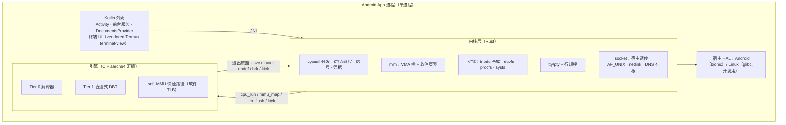

# appine 设计文档

- **状态**：草案 v0.1，所有决策已于 2026-10-24 的设计评审中逐条确认
- **范围**：v1
- **一句话**：一个能上 Google Play 的**单进程** Android App，在进程内用解释器 / 同 ISA 二进制翻译运行未经修改的 Alpine Linux aarch64 用户态程序。思路与 iSH 相同，是它在 Android 上的对应物。

---

## 1. 目标与非目标

### 1.1 目标

- 用户从 Play 安装 App、打开即得到一个 Alpine shell，不需要 root、不依赖 Termux，也不需要任何额外步骤。
- 整个 Linux 环境都跑在 App 自己的进程里，Android 12+ 的 phantom process killer 对它不起作用。
- 直接运行 Alpine 官方 aarch64 仓库里**未经修改**的二进制。

### 1.2 v1 负载分档

| 档位 | 负载 | v1 要求 |
|---|---|---|
| A 日常 CLI | busybox ash、`apk`、coreutils、vim、git、curl、openssh client | **全部可用** |
| B 计算型 | python3、gcc/make 编译中等规模的 C 项目、`./configure` | **能跑通** |
| C 难缠的运行时 | Go 静态二进制、node/V8、JVM | **行为正确，不要求快** |
| D 不做 | docker/podman（namespace、cgroup）、systemd、内核模块、X11/GUI | — |

ptrace（gdb/strace）推迟到 v1 之后。

### 1.3 性能目标

- CPU 密集任务比原生慢 **3–5 倍以内**（JIT 级别）。这个目标会在 M2 由性能探针实测后复核。
- 交互延迟优先：`ls`、tab 补全不能让人感到卡顿。

---

## 2. 硬约束

| 约束 | 来源 | 后果 |
|---|---|---|
| **Google Play 合规** | Device and Network Abuse 政策：不得下载可执行代码（dex/JAR/.so），"在虚拟机或解释器中运行的代码"除外 | 从网络下载的 Alpine 二进制**不能在宿主 CPU 上直接执行**，CPU 后端只能是解释器或翻译器 |
| 单进程 | 设计目标 + phantom process killer | 所有 guest 进程共享一个宿主地址空间，guest 进程之间的隔离和 fork 都得在软件里实现 |
| W^X 执行限制 | targetSdk ≥ 29 不能 `execve` App 数据目录里的文件 | 不使用 execve，也不依赖宿主加载器 |
| 存储限制 | SELinux：App 不能建硬链接、不能 `chown`、不能 `mknod`；共享存储不区分大小写、没有权限位、不能建 symlink | 文件系统的元数据和命名空间都要自己实现 |
| 网络限制 | targetSdk ≥ 30 不能 bind `NETLINK_ROUTE`，`RTM_GETLINK` 也被拦截；没有 `CAP_NET_RAW` | netlink 在进程内模拟，ICMP 改走 ping socket |
| 页大小 | Android 15 起要求 App 兼容 16KB 页内核 | 给 guest 呈现的页大小必须和宿主页大小解耦 |
| 宿主地址空间 | GKI 常见配置是 4K 页 + 39-bit VA，用户态只有约 512GB | 不能给每个 guest 进程预留很大的连续地址空间 |

**最低系统版本：minSdk 29（Android 10）**。DNS 存根依赖 `android_res_nsend`，它从 API 29 开始提供。

---

## 3. 总体架构



分层原则：

- **引擎**只关心"执行 guest 指令"。遇到 `svc`、访存缺页、未定义指令、`brk` 时，把控制权交给内核层。
- **内核层**实现 Linux 用户态 ABI，持有所有 guest 状态：进程、地址空间、fd、文件系统。
- **宿主 HAL** 把宿主的差异隔离开。开发阶段的宿主是 Linux arm64，生产宿主是 Android；不写 macOS 版本的 HAL。
- 核心库（引擎 + 内核层）**不依赖任何 Android 组件**。Android 相关的部分只在 HAL 和 Kotlin 外壳里出现。

---

## 4. CPU 引擎

### 4.1 Guest ISA

guest 是 **aarch64**，直接使用 Alpine 官方 aarch64 仓库。这样选有三个好处：

- guest 和宿主的内存模型都是 ARM 弱序，没有 x86 TSO 与 ARM 弱序之间的转换问题。
- 同 ISA 翻译时，大量指令可以原样拷贝。
- 按 arm64 规范，修改代码之后必须执行 `ic ivau` + `isb`，所以这条指令可以直接当作失效翻译缓存的钩子，不需要对代码页做写保护。

### 4.2 分层

**Tier 0：解释器。**
- 负责冷代码、短命进程、调试，同时作为语义上的参考实现。
- 分发采用 `[[clang::musttail]]` 尾调用的 threaded 风格。
- 和 Tier 1 共享 guest 状态布局、soft-MMU 接口和异常上报接口。

**Tier 1：同 ISA 直通式 DBT。** M2 的原型在 `core/engine/src/c/dbt.c`，用 `appine-run --tier 1` 启用。
- **寄存器约定**：guest 的 X0–X15、X19–X27、X29、X30 放在同号的宿主寄存器里；宿主 X28 指向 CPU 上下文，X16–X18 是临时寄存器。guest 自己的 X16、X17、X18、X28 和 SP 存放在上下文里（"被占用的寄存器"）：引用它们的指令先把值读进临时寄存器，改写寄存器字段后执行，再写回。guest 的 NZCV 就是宿主的 NZCV，所以插入的代码一律不改动条件标志（用 `cbnz`/`tbnz`/`eor` 代替 `cmp`）。
- 只读写寄存器的 ALU 指令（以后还有 FP、NEON 指令）**原样拷贝**。
- 只有以下几类指令需要改写：
  - 访存指令：插入 soft-MMU 的 TLB 快速路径。
  - 分支和 PC 相对寻址（`adr`/`adrp`/`ldr literal`）：改成以 guest PC 为基准的常量。
  - `svc`：转去调用内核层。
  - `mrs/msr tpidr_el0`：改为读写 guest 状态结构里的字段。
  - `mrs ID_*_EL1`：返回我们宣告的特性值。
  - `ldxr…stxr` 序列：见 4.5。
  - `dc zva`、`dc cvau`、`ic ivau`：它们的操作数是 guest 地址，需要先翻译。
  - PAC 系列 HINT 指令（`PACIASP`/`AUTIASP` 等）：改写为 NOP，见 4.4。
- **访存快速路径**（约 10 条宿主指令）：算出 guest 地址 → 跨页检查 → 用一条 `ldp` 取出 TLB 表项的 tag 和 addend → 比较 → 访问 `addend + 地址`。TLB 未命中、跨页或 SP 未对齐时退出到分发器，由 Tier 0 执行这一条指令；这时指令还没有产生任何副作用，所以异常是精确的。
- **控制流**：直接分支通过块链接回填成一条 `b`；间接分支（`br`/`blr`/`ret`）先查一张 4096 项的跳转缓存，未命中再回到分发器。每个块入口检查 kick 标志，链接成环的循环也能被打断。
- Tier 0 不认识的指令同样交给 Tier 0 执行，保证两层的白名单完全一致（§4.4）。
- 精确状态几乎是免费的：宿主 `ucontext` 里的寄存器就是 guest 寄存器，被占用的寄存器另外保存在上下文里。
- 文件映射的代码，其翻译结果按 `(inode, offset)` **跨进程共享**，这样 `./configure` 产生的大量短命进程不必每次重新翻译。
- 原型还没处理的问题：
  - **自修改代码和映射变化**：翻译结果不会自动失效，`ic ivau`、munmap、mprotect 都要触发失效。Tier 1 成为默认执行层之前必须解决。
  - **宿主 X18**：Android 上它是平台保留寄存器（ShadowCallStack 会用到），原型拿它当临时寄存器。正式版要么换掉它，要么在宿主信号入口先恢复它。
  - LL/SC 序列，见 4.5。
- JIT 代码页使用 **W^X 双映射**：同一个 memfd 映射两次，一份 RW 用来写入，一份 RX 用来执行。原型目前直接映射成 RWX。

**否决了以 dynarmic 为核心的方案**，见 §15。dynarmic 是 0BSD 许可，可以直接借用它的 A64 解码表（`frontend/A64/decoder`）和测试用例。

### 4.3 FP 状态

FP 和 NEON 指令都在宿主上原生执行。所以每次从宿主代码进入 guest 代码，都要把 guest 的 FPCR 装进宿主 FPCR；回到宿主 C 代码之前再恢复，避免 guest 设置的 flush-to-zero 之类的模式影响我们自己的代码。

### 4.4 CPU 特性基线

**原则：guest 看到的特性集合 = 宿主 CPU 支持的 ∩ Tier 0 已实现的 ∩ 白名单。**

- `AT_HWCAP`/`AT_HWCAP2`、`/proc/cpuinfo` 的 Features 行、guest 读 `mrs ID_AA64*_EL1` 得到的值，三者从**同一份集合**生成。
- 白名单以外的编码，在两个 Tier 里都投递 SIGILL（`ILL_ILLOPC`），**绝不把它们原样拷贝执行**。
- 两个 Tier 对同一条指令的语义必须一致。PAC 在 Tier 1 原样执行会用宿主密钥签名，而 Tier 0 只能把它当 NOP。为了一致，Tier 1 也把它们改写成 NOP，并且不宣告 PACA/PACG。

| 级别 | 特性 |
|---|---|
| 必须 | FP、ASIMD（v8.0）、CPUID |
| 宿主支持时宣告 | ATOMICS（LSE）、AES、PMULL、SHA1、SHA2、CRC32 |
| v1.x | ASIMDDP、LRCPC、SHA3、SHA512 |
| v1 不做 | FP16（FPHP/ASIMDHP）、SVE/SVE2/SME、BF16、I8MM、PACA/PACG、BTI、MTE |

宣告 LSE 之后，libgcc 的 outline atomics 和 Go 会改走单条原子指令，这类指令很容易翻译。但 musl 的原子操作是用 `ldaxr`/`stlxr` 内联汇编写死的，所以 **LL/SC 必须支持**。

### 4.5 独占访问（LL/SC）

在 `ldxr` 和 `stxr` 之间插入额外的访存（比如 TLB 查找），可能会让独占监视器失效，导致活锁。处理办法是：识别出整个 LL/SC 序列，在序列开始前一次性完成地址翻译；做不到的就把整段改写成 CAS 语义，或者整段放到慢路径执行。DynamoRIO 在 AArch64 上遇到过同样的问题，可以参考它的做法。soft-MMU 翻译得到的是真实宿主指针，所以原子指令直接作用在宿主内存上，多个线程或进程共享同一页时语义天然正确。

---

## 5. 内存：轻量用户态 soft-MMU

这里**不模拟** ARM 的硬件页表，包括 TTBR、描述符格式、TLBI/ASID、异常级别、物理地址层和 MMIO，但**要自己实现 Linux mm 的语义**。

### 5.1 数据结构

- **每个进程一个 `mm`**，包含两部分：
  - VMA 区间树：实现 mmap/mprotect/munmap 语义，并用来生成 `/proc/<pid>/maps`。
  - 页表：以 guest 虚拟页号为键的基数树，表项内容为 `{宿主页指针, R/W/X/COW 标志位}`。只有 TLB 未命中时，我们自己的 C 代码才会遍历它。
- **每个线程一个软件 TLB**：直接映射，初始 512 项，每项 `{读 tag, 写 tag, addend}`。tag 比较时把对齐位也算进去，这样跨页和未对齐的访问都会自动落到慢路径。

TLB 命中路径（示意）：

```asm
ubfx x16, xA, #12, #9        // 页号低 9 位 → TLB 下标
add  x16, xTLB, x16, lsl #4
ldp  x17, x16, [x16]         // tag, addend
cmp  x17, xA, lsr #12
b.ne slow_path
ldr  x0, [x16, xA]           // 宿主地址 = addend + guest 地址
```

- **TLB 未命中**：查基数树。查不到，或者权限不符，就调用内核层的 `mem_fault`，由它负责懒分配、CoW 复制，或者给 guest 投递 SIGSEGV。

### 5.2 页与后备内存

- guest 页**固定 4K**，不管宿主页是 4K 还是 16K。`AT_PAGESZ` 报告 4096。
- 匿名内存按大块 arena（如每块 2MB）从宿主申请，再切成 4K 页，宿主 VMA 数量因此保持很少。所有 guest 进程共用宿主的 `vm.max_map_count`，这一点很重要。
- 文件映射直接用宿主 `mmap(objects/<ino>)` 的页作为后备内存。如果宿主是 16K 页，就映射包含目标位置的 16K 对齐区间，再把页表项指向区间里正确的 4K 偏移。这样带来两个好处：
  - busybox/musl 的代码页通过宿主 page cache **在所有 guest 进程之间共享**。
  - `MAP_SHARED` 映射和 `read`/`write` 之间天然一致。
- 进程间的 `MAP_SHARED` 匿名内存，就是让两张页表指向同一个宿主页。
- 访问文件映射时如果超出 EOF，宿主会产生 SIGBUS，我们把它转换成 guest 的 SIGBUS。

### 5.3 fork

- **v1：全量复制。** shell 的 fork 通常紧接着 exec，复制几 MB 内存的代价可以接受。
- **v2：页引用计数 + CoW。** 用页表项里的 COW 位实现，不依赖宿主的 `mprotect`。

### 5.4 guest 地址空间布局

guest 地址空间的布局由我们自己的 mmap 实现决定，不受宿主地址空间布局的限制。软件页表的规模只和实际用到的页数有关，所以 V8 那种动辄预留几个 GB 的做法也能满足。

---

## 6. 进程、线程与调度

- **1:1 线程模型**：每个 guest 线程（`struct task`）对应一个宿主 pthread，调度交给宿主内核。
- **大内核锁（BKL）**：进入 syscall 时获取；执行 guest 代码时**不持有**；在内核层里等待之前**释放**。之后按 profiling 结果逐步拆分。
- **统一的等待机制**：guest 线程永远不直接阻塞在宿主 syscall 上。所有等待都走以下两种途径之一：
  - 自管的 wait queue（mutex + condvar）；
  - 宿主 `poll()`，监听集合里包含该线程专属的 **eventfd**，作为唤醒通道。

  这样 guest 信号、futex 和 I/O 就绪都走同一条唤醒路径，也不需要用宿主信号去打断阻塞调用，避免了和 ART/bionic 抢信号编号。
- **futex**：以翻译后的宿主地址为键，用自管 wait queue 实现。不同 guest 进程共享同一页时也能正确等待和唤醒，而且信号可以唤醒指定线程。
- **TLS**：guest 的 `tpidr_el0` 只是 guest 状态结构里的一个字段。**宿主的 `TPIDR_EL0` 永远是 bionic 的值**，所以 ART 的信号处理链可以安全运行。
- **PID 1**：内核层内置一个虚拟的 init。它不对应任何 guest 程序，只负责收养孤儿进程、回收僵尸进程。每个终端标签页的登录 shell 都是它的子进程。v1 不运行 OpenRC。
- **namespace**：不支持。`unshare`、`setns`、`clone(CLONE_NEW*)` 一律返回 `EPERM`。

---

## 7. 信号与 ABI

### 7.1 信号帧

信号帧**逐字节照抄 Linux arm64 的布局**：

- `siginfo` + `ucontext`；`sigcontext` 包含 `fault_address`、`regs[31]`、`sp`、`pc`、`pstate`，后跟 `__reserved` 区里的上下文记录：
  - `fpsimd_context`：每次都带（FPSR、FPCR、V0–V31）。
  - `esr_context`：只在同步异常时带，由我们合成 EC、WnR、DFSC 字段。
  - 以一个空记录结尾。**不带** `sve_context`/`za_context`。
- 帧下方压入 `frame_record {fp, lr}`，整体按 16 字节对齐。`AT_MINSIGSTKSZ` 要和实际帧大小一致。
- v1 就完整支持 `sigaltstack`，包括 `SS_ONSTACK`、`SS_DISABLE`、`SS_AUTODISARM`。
- 返回地址：设置了 `SA_RESTORER` 时用 `sa_restorer`，否则指向 vDSO 里的 `__kernel_rt_sigreturn`。

### 7.2 vDSO

- v1 提供一个最小但真实的 ELF 镜像，通过 `AT_SYSINFO_EHDR` 交给 guest，所有进程共享同一个只读、可执行的页。
- `__kernel_rt_sigreturn` **必须恰好是 `mov x8, #139; svc #0` 这两条指令**，因为 libgcc 的 unwinder 靠逐字节匹配它们来识别信号帧。
- 时间函数（`__kernel_clock_gettime`、`gettimeofday`、`clock_getres`）在 v1 里只写成 `svc` 存根。
- v1.x 实现快速路径：guest 代码直接读 `CNTVCT_EL0`，再配合一个由我们更新的 vvar 页提供换算系数。

### 7.3 投递精度

| 类型 | 规则 |
|---|---|
| 访存出错（SIGSEGV/SIGBUS） | pc 指向出错的那条指令；`si_addr` 是精确的 guest 地址；`si_code` 区分 `SEGV_MAPERR`/`SEGV_ACCERR`；基址寄存器的回写（post-index、`ldp`）不能提前生效 |
| `brk #imm` | 投递 SIGTRAP，`si_code` 为 `TRAP_BRKPT`，ESR 中带上立即数 |
| `udf` 和白名单外的编码 | 投递 SIGILL，`si_code` 为 `ILL_ILLOPC` |
| 异步信号 | 解释器在指令边界投递；DBT 在块出口和循环回边检查每线程的 pending 标志后投递 |

- `rt_sigreturn` 恢复全部通用寄存器和 FPSIMD 寄存器，并校验每个记录的 magic 和 size，帧损坏时投递 SIGSEGV。信号处理函数**可能修改 pc**（Go 的异步抢占就会这样做），所以恢复后引擎要按新的 pc 重新查找翻译。
- syscall 重启语义照搬 Linux 的 `ERESTARTSYS`/`ERESTARTNOHAND`/`ERESTARTNOINTR`/`ERESTART_RESTARTBLOCK`（配合 `restart_syscall`）。因为 `x0` 会被返回值覆盖，需要像 Linux 那样**另外保存一份 `orig_x0`**。

### 7.4 宿主侧信号

宿主侧只需要处理两种信号：文件映射越过 EOF 时的 SIGBUS，以及引擎自身 bug 导致的 SIGSEGV（转成崩溃报告）。用普通 `sigaction` 安装即可，libsigchain 会把我们的处理函数链在 ART 自己的处理函数之后。

### 7.5 auxv 与内核版本

- auxv 依次提供：`AT_HWCAP`/`AT_HWCAP2`（§4.4）、`AT_PAGESZ=4096`、`AT_MINSIGSTKSZ`、`AT_SYSINFO_EHDR`、`AT_RANDOM`、`AT_SECURE`、`AT_PLATFORM="aarch64"`、`AT_EXECFN`、`AT_CLKTCK=100`、`AT_PHDR`/`AT_PHENT`/`AT_PHNUM`/`AT_ENTRY`/`AT_BASE`，以及 `AT_UID`/`AT_EUID`/`AT_GID`/`AT_EGID`。
- `uname -r` 固定报告一个 LTS 版本，比如 `6.1.0-appine`。我们把它当作一份 **ABI 契约**：除文档明确列出的例外，按这个内核版本的语义实现。
- 未实现的 syscall **一律返回 `ENOSYS`，绝不崩溃**，同时记录一条本地调试日志。

---

## 8. 文件系统

### 8.1 rootfs：inode 仓库

- **SQLite** 保存完整的命名空间：目录项、inode、symlink 目标、xattr。使用 WAL 模式，SQLite 以 amalgamation 形式随 App 打包（NDK 不对外提供系统 SQLite）。
- 每个普通文件的数据存成一个宿主文件 `objects/<ino>`。目录、symlink、设备节点、FIFO、socket 文件只存在于数据库里。
- 元数据的归属：
  - 普通文件的 **size 和 mtime 以宿主 object 文件为准**。`utimensat` 直接对宿主 object 调用 `futimens`。
  - mode、uid/gid、ctime、xattr、nlink 存在 SQLite 里。
- 硬链接就是多个目录项指向同一个 ino。`rename`/`unlink` 在同一个 SQLite 事务里完成。被 LMK 杀掉进程不会丢失已提交的事务。
- 读写数据直接对宿主 fd 做 `pread`/`pwrite`。路径查找走内存里的 dentry/inode 缓存，不会逐级查询数据库。
- nlink 为 0 但仍有 fd 打开的文件，在最后一个引用关闭时删除对应 object。启动时扫描一遍孤儿 object。
- 需要实测的代价：每个元数据操作都是一个事务。解包上万个文件（比如 `apk add`）时，可能需要按 syscall 批量合并提交。

### 8.2 挂载表

| 挂载点 | 文件系统 |
|---|---|
| `/` | inode 仓库 |
| `/dev` | 内存中的 devfs：`null`、`zero`、`full`、`random`/`urandom`、`tty`、`ptmx`、`pts/*` |
| `/proc`、`/sys` | 根据内核层的 task、mm 等结构实时合成 |
| `/tmp` | 默认放在 inode 仓库里，不用内存 tmpfs，避免占用 App 内存配额 |
| `/mnt/<名字>` | SAF 目录挂载（v1.x，见 §11.3） |

---

## 9. TTY 与终端

- **PTY 和行规程完全在进程内实现**。如果借用宿主 PTY，宿主的 `ISIG` 会把信号发给宿主进程组，而宿主根本不知道 guest 进程组的存在。实现覆盖以下内容：
  - termios：`ICANON` 行编辑、`ECHO*`、`ICRNL`/`OPOST`/`ONLCR`、`VMIN`/`VTIME`。
  - 作业控制：`ISIG` 发信号给 guest 前台进程组；`setsid`/`TIOCSCTTY`/`tcsetpgrp`；后台进程组读写终端时的 `SIGTTIN`/`SIGTTOU`；会话关闭时的 `SIGHUP`；`TIOCSWINSZ` 触发的 `SIGWINCH`。
- guest 可以通过 `/dev/ptmx` 自己申请 PTY，tmux、screen、`script`、sshd 都依赖这一点。
- App 里每个终端标签页对应一个 `/dev/pts/N`，在上面启动一个新会话和登录 shell。
- **终端 UI**：把 Termux 的 `terminal-emulator` + `terminal-view` vendor 进仓库，替换掉原来的 `TerminalSession`（它是 `final` 类，并且写死了 `JNI.createSubprocess`）。新实现继承 `TerminalOutput`，通过 JNI 接到进程内 PTY master 的 ring buffer。扩展键栏属于 GPLv3 的 `termux-app` 主模块，需要自己重写。
- 开发阶段的 CLI 前端 `appine-run` 把宿主终端切到 raw 模式，把它当作 PTY master 使用。

---

## 10. 网络

| 子项 | 做法 |
|---|---|
| TCP/UDP | 透传给宿主：guest 的 file 对象内部持有一个宿主非阻塞 socket |
| ICMP | 把 guest 的 `SOCK_RAW + IPPROTO_ICMP` 翻译成宿主的 `SOCK_DGRAM + IPPROTO_ICMP`（ping socket） |
| `NETLINK_ROUTE` | 在进程内模拟，数据通过 JNI 从 `ConnectivityManager`/`LinkProperties` 获取，`NetworkCallback` 负责刷新 |
| DNS | `resolv.conf` 写 `nameserver 127.0.0.53`。socket 层截下发往这个地址 53 端口的 UDP/TCP 请求，交给 `android_res_nsend`，这样系统的私人 DNS、VPN 和按网络分流设置都能生效 |
| 1024 以下的端口 | v1 直接返回宿主给出的 `EACCES`，之后再加可配置的端口映射 |
| 回环地址 | 透传给宿主，Android 上的浏览器能直接访问 guest 里起的服务。代价是设备上的其他 App 同样能访问，需要写进文档 |
| AF_UNIX | 进程内模拟。`SCM_RIGHTS` 传递的是 guest fd，`SO_PEERCRED` 返回 guest 的 pid 和 uid |
| tun/VpnService | v1 不做 |

**I/O 多路复用**：每个 guest file 对象实现一个 `poll` 操作。宿主 fd 和进程内对象统一在 §6 的等待机制里处理。guest 的 `epoll` 在进程内实现，内部按需把宿主 fd 注册进一个宿主 epoll。

---

## 11. 用户、权限与 Android 集成

### 11.1 凭据与权限

- 按 Linux 的 `struct cred` 完整实现：ruid/euid/suid/fsuid、附加组、umask。VFS 做 DAC 权限检查，root 可以绕过。
- **默认以 root 登录**。设置里提供"以指定用户登录"。
- setuid/setgid 位在 execve 时生效，并设置 `AT_SECURE`。
- 支持 `chroot`（每个进程记录自己的根目录 dentry）。
- capabilities 简化处理：uid 0 拥有全部能力，其他 uid 没有。v1 不支持文件 capabilities。
- guest 自己安装 seccomp 过滤器：v1 返回 `EINVAL`，v1.x 在内核层实现 cBPF 解释器。

### 11.2 生命周期

- 只要还有终端会话或 guest 进程在运行，就保持一个**前台服务**，类型为 `specialUse`。通知栏显示"N 个会话运行中"，附带"全部退出"按钮。
- 所有会话和 guest 内核的生命周期都**挂在 Service 上，不挂在 Activity 上**。
- 熄屏后继续运行依赖 `PARTIAL_WAKE_LOCK`，由用户手动开启，默认关闭。
- 在 `onTrimMemory` 中缩减可以重建的缓存：翻译缓存、dentry/inode 缓存、空闲 arena。
- 进程被杀后，v1 只恢复标签页布局、每个标签的 cwd 和滚动回看记录，并启动新的 shell，同时明确提示"上次会话因 App 被系统终止而结束"。v1 **不恢复进程**。
- 开机自启 v1 不做。

### 11.3 共享存储

- **v1：DocumentsProvider**。把登录用户的 home 目录注册为系统"文件" App 里的一个根，高级选项可以把整个 `/` 以只读方式暴露。用户在"文件" App 里用"复制到…"即可导入或导出文件。
- **v1.x：SAF 目录挂载到 `/mnt/<名字>`**。权限位是合成的（目录 0755、文件 0644）；`chmod`/`chown` 静默成功；`symlink`/`link` 返回 `EPERM`；目录列表在内存中缓存；不区分大小写这一点写进文档。
- 不申请 `MANAGE_EXTERNAL_STORAGE`，Play 不批准终端类 App 使用。

### 11.4 首次启动

1. 把 APK assets 里的 Alpine minirootfs 以流的方式导入 inode 仓库。打包前，构建脚本会按官方 sha256 和 GPG 签名校验这个 tarball，版本锁定为构建时最新的 stable 分支。
2. 写入 `/etc/resolv.conf`、`/etc/hosts`、`/etc/hostname`、`/etc/apk/repositories`、`/etc/profile.d/appine.sh`（`TERM=xterm-256color`、`LANG=C.UTF-8`、`PS1`）和 `/etc/motd`。
3. 以 root 身份启动 `ash -l`。

- **镜像选择**：APK 里内置一份镜像列表，包括 dl-cdn、TUNA、USTC、阿里云等。首次启动时在后台并发测速，选最快的写入配置，测速失败时退回 dl-cdn。设置里可以手动更换。
- **升级**：App 更新时不动用户已有的 rootfs。同一分支内由用户自己运行 `apk upgrade`；跨分支升级由用户修改 `repositories`。
- **v1 提供"重置 rootfs"**。rootfs 导出和导入（tar 格式）放到 v1.x。

---

## 12. 威胁模型

**对外声明**：和 iSH、Termux 一样，appine **不是安全沙箱**。我们不承诺在 guest 内部不同 uid 之间，以及 guest 和宿主 App 之间，提供安全边界。

**硬性工程不变量**：

1. guest 只能通过自己的页表访问内存。DBT 只原样拷贝白名单内的指令，所有访存指令都必须改写。
2. 内核层不把 guest 指针当作宿主指针。在 Rust 里用 `UserPtr<T>` 类型表示 guest 指针，它只能通过 `mm.read`/`mm.write` 访问。
3. 宿主路径永远不由 guest 输入拼出来，宿主侧只出现 `objects/<数字>` 形式的路径，symlink 只存在于数据库里。因此"恶意 tar 包借 symlink 逃逸"这类问题在结构上不可能发生。

**稳健性**：

4. **guest 自己的 OOM killer**：给所有 guest 内存设一个总上限，默认按设备内存的比例计算，可以配置。超出上限时由我们挑选一个 guest 进程杀掉，不让系统 LMK 杀掉整个 App。同时为 `RLIMIT_NPROC` 设置默认值，防止 fork 炸弹。
5. 内核层以 `panic=unwind` 编译，在 syscall 入口用 `catch_unwind` 兜住 panic，只杀掉当前 guest 进程并生成报告。debug 构建下直接 abort。

**对 Android 暴露的接口**：

6. 只导出启动 Activity 和 DocumentsProvider，不提供供其他 App 执行命令的 intent。
7. guest 第一次在非回环地址上 `listen` 某个端口时，发出一条通知。
8. JIT 代码页使用 W^X 双映射。

**信任链**：`apk` 用 rootfs 中自带的 Alpine 公钥验证每个软件包的签名，所以更换镜像不会削弱信任。调试日志只保存在本地；如果以后加入遥测，必须由用户主动开启，并同步更新 Play 的数据安全表单。

---

## 13. 工程

### 13.1 语言与接口

- **引擎**：C17 + aarch64 汇编，用 Clang（NDK）编译。
- **内核层**：Rust，可以参考 Fuchsia Starnix 和 Asterinas 的设计。
- **Android 外壳**：Kotlin。

引擎与内核层之间的接口很窄，采用**退出原因**模型：引擎从不回调内核层，`appine_cpu_run()` 一直执行到需要内核层介入的事件，返回一个退出原因；内核层处理完之后再调用它继续执行。这样 C 与 Rust 之间没有重入，FFI 边界最简单。完整定义见 `core/engine/include/appine/engine.h`，Rust 绑定见 `core/engine/src/lib.rs`。

```c
/* 运行：返回 SVC / UNDEF / BRK / FAULT / KICK 之一 */
enum appine_exit appine_cpu_run(struct appine_cpu *cpu);
void appine_cpu_kick(struct appine_cpu *cpu);   /* 可从任意线程调用，让目标线程在下一个指令边界退出 */
void appine_cpu_tlb_flush(struct appine_cpu *cpu);

/* soft-MMU 页表：由内核层维护，修改后要刷新所有共用它的 CPU 的 TLB */
int appine_mmu_map(struct appine_mmu *mmu, uint64_t gva, void *host, uint64_t len, uint32_t prot);
int appine_mmu_unmap(struct appine_mmu *mmu, uint64_t gva, uint64_t len);
int appine_mmu_protect(struct appine_mmu *mmu, uint64_t gva, uint64_t len, uint32_t prot);
void *appine_mmu_translate(const struct appine_mmu *mmu, uint64_t gva, uint32_t required_prot);
```

- FAULT 退出时，pc 指向出错指令，`fault_addr`/`fault_access`/`fault_kind` 给出地址、访存类型以及页错误还是对齐错误；该指令不产生任何副作用。
- 翻译缓存失效（`tc_invalidate`，由 `ic ivau` 和 munmap 触发）随 Tier 1 加入。

guest 状态（`struct appine_cpu`）包含：`x[31]`、`sp`、`pc`、`nzcv`、`fpcr`、`fpsr`、`v[32]`（128 位）、`tpidr_el0`、`orig_x0`、fault 信息、pending 标志、mmu 指针和软件 TLB。独占监视器状态随 LL/SC 一起加入。Rust 侧逐字段镜像这个结构体，由 `appine_cpu_layout_check()` 在测试里校验布局。

### 13.2 仓库结构

```
core/engine/     C 引擎（include/appine/engine.h、src/c/）及其 Rust 绑定
core/kernel/     Rust 内核层
core/hal/        宿主抽象层（Android 与 Linux 共用一套实现）
hosts/cli/       appine-run（开发用 CLI 前端）及 guest 端到端测试
tests/guest/     手写的 guest 汇编测试程序
tests/lockstep/  指令级 lockstep：原生跳板、随机指令生成，同时比对 Tier 0 和 Tier 1
tests/bench/     M2 性能探针：独立编译的基准程序和测量工具 appine-bench
scripts/dev      在 Linux arm64 容器里运行命令
android/         Gradle 工程（Kotlin 外壳、vendored 终端库），M5 加入
docs/            设计文档
```

构建：Cargo 工作区；引擎通过 `cc` crate 编译，C 代码在 gcc 和 clang 下都以 `-Wall -Wextra -Werror` 编译。Rust 工具链由 `rust-toolchain.toml` 锁定。M5 起由 Gradle 构建 App 外壳，cargo-ndk 构建原生库。

### 13.3 开发环境与测试

- 主要的开发和测试宿主是 Mac 上的 **Linux arm64 虚拟机**（colima、OrbStack 或 Lima），90% 的工作不需要碰手机。`scripts/dev <命令>` 会在一个 arm64 Linux 容器里运行命令，比如 `scripts/dev cargo test --workspace`；Docker daemon 配了代理时，容器会自动沿用。
- CI 跑在 GitHub 的 `ubuntu-24.04-arm` runner 上，依次执行格式检查、clippy、全部测试（含 lockstep、guest 程序和基准程序在两个执行层下的输出比对）、加长的 lockstep、性能探针，以及用 clang 编译的引擎测试。
- 性能探针：`cargo build --release -p appine-run -p appine-bench` 之后运行 `appine-bench`，它分别以原生、Tier 0、Tier 1 运行 `tests/bench/programs/` 下的程序，要求输出逐字相同，并打印耗时比。
- 测试分为五层：
  1. **指令级 lockstep**：用宿主 CPU 当标准答案。生成随机指令和随机寄存器值，分别原生执行和在解释器/DBT 中执行，逐条比对结果。这同时也是对解码器的 fuzz。
  2. musl libc-test，加上 LTP 中挑选出的 syscall 和信号子集。
  3. 端到端场景：busybox 测试集、`apk add`、`git clone`、从源码编译真实项目。
  4. **差分测试**：同一条命令分别在 appine 和真正的 arm64 Linux 虚拟机中运行，比对输出；信号测试比对 `ucontext` 的内容。
  5. Android 专项：在 CI 中用 arm64 Android 模拟器跑 instrumentation 测试，覆盖 4K 和 16K 页。核心库另外提供一个"模拟 Android 限制"的开关，在 Linux 上提前暴露问题。

---

## 14. 里程碑

按执行顺序排列。编号保持不变，所以 M2 排在 M1a 之前。

| 里程碑 | 内容 | 退出标准 |
|---|---|---|
| **M0 骨架** ✅ | 仓库结构、引擎与内核层的工程、`appine-run`、CI、lockstep 测试框架 | 手写的静态 aarch64 程序（`write` + `exit`）能在解释器里跑通；lockstep 测试进入 CI |
| **M2 性能探针** ✅ | 原型 Tier 1：整数指令 + 访存 + 分支 + 内联 TLB + 块链接；独立编译的整数基准程序（不依赖 libc、不用 SIMD） | 测出原生、Tier 0、Tier 1 的耗时比，**按判定规则复核 3–5 倍的目标**；M1 完成后用 busybox `gzip`/`sha256sum` 补测 |
| **M1a 指令集补全** | SIMD&FP、LL/SC 独占访问、按 §4.4 宣告 HWCAP；lockstep 扩展到这些指令 | lockstep 覆盖 SIMD&FP 和独占访问，并在 CI 中通过 |
| **M1b 加载程序** | ELF 加载器（PIE、`ld-musl`）、完整 auxv、soft-MMU v1（mmap/brk/mprotect）、基础 syscall、inode 仓库 v1 + minirootfs 导入 | `appine-run /bin/busybox ls /` 跑通（经过 `ld-musl`） |
| **M3 交互式 shell** | fork/execve/wait4、信号帧、管道、PTY + 行规程、作业控制 | `ash` 下管道、Ctrl-C、Ctrl-Z/`fg`、`vi` 都正常 |
| **M4 网络 + apk** | socket 透传、DNS 存根、netlink 模拟、硬链接、AES/SHA 指令 | `apk update && apk add git python3` 成功，`git clone https://…` 成功 |
| **M5 Android 外壳** | Kotlin App、vendored 终端库、`specialUse` 前台服务、首次启动流程 | 真机上装好即用；4K/16K 页设备都通过；**提交 Play 内部测试或封闭测试轨道** |
| **M6 B 档负载** | 扩大 syscall 覆盖、文件 mmap 共享、LTP 子集、能跑 `./configure` | 在 appine 中从源码编译 Lua 或 SQLite；python3 测试集子集通过 |
| **M7 Tier 1 正式版** | 块链接、跨进程共享翻译缓存、精确异常、LL/SC 处理 | 达到性能目标；lockstep 和差分测试在 Tier 1 下全部通过 |
| **M8 C 档正确性** | Go（SIGURG 抢占、nil 解引用转 panic）、node（guest JIT、`ic ivau`、wasm trap handler） | 能跑一个 Go CLI，`node -e` 正常，`npm install` 一个小包成功 |
| **M9 发布** | 被杀后恢复标签页、wake lock 开关、许可证审计 | Play 正式版上线 |

排序依据：

- **最没把握的前提最先验证**：M2 用实测数据检验 soft-MMU + DBT 的性能。M0 已经提供了静态 ELF 加载器和 soft-MMU，M2 不需要等 M1，所以提前到 M1 之前，免得 M1 在内存模型上大量投入之后才发现要返工。
- **M2 的判定规则**（事先定好）：Tier 1 相对原生 ≤ 3 倍，按原计划继续；3–5 倍，继续，同时记下优化方向；做完块链接、内联 TLB 这些明显的优化之后仍然 > 5 倍，就在开始 M1 之前重新审视决策 4（soft-MMU）。
- **M1 拆成两步**：M1a 补全解释器的指令集（工作量最大，而且可以完全靠 lockstep 验证），M1b 打通加载和系统调用路径。
- **只能在真机或 Play 上暴露的风险尽早撞上**：放在 M5，而不是最后。
- **先有负载，再做 DBT**：Tier 1 正式版排在 B 档负载之后，这样有真实负载可测。C 档放到最后，因为它同时依赖精确信号和成熟的 DBT。

### M2 结果（2026-10-24）

**结论：Tier 1 相对原生的几何平均是 1.85 倍，落在"≤ 3 倍，按原计划继续"一档。决策 4（soft-MMU）和决策 5（分层引擎）不需要改动，下一步做 M1a。**

测量条件：Apple Silicon 上 colima 起的 arm64 Linux 虚拟机（4 核）；基准程序用 gcc `-O2 -mgeneral-regs-only` 静态编译，不依赖 libc，见 `tests/bench/programs/`；原生和 Tier 1 各运行 5 次取最短耗时，Tier 0 运行 1 次；三种方式的输出逐字相同。

| 程序 | 负载 | 原生 | Tier 0 | Tier 1 |
|---|---|---|---|---|
| sha256 | 32 位 ALU | 0.287s | 65.7× | 1.36× |
| lz | 访存、分支 | 0.239s | 49.7× | 1.97× |
| sort | 访存、难预测的分支 | 0.318s | 23.3× | 1.64× |
| crc32 | 查表 | 0.311s | 18.5× | 2.17× |
| vm | 间接分支 | 0.290s | 73.6× | 2.29× |
| **几何平均** | | | **40.1×** | **1.85×** |

翻译统计（`appine-run --stats`）：约 55% 的 guest 指令原样拷贝，5–13% 因为用到被占用的寄存器或 SP 而改写，13–22% 是改写成快速路径的访存指令，没有指令退回 Tier 0。开销基本按访存比例增长：ALU 为主的 sha256 最低，以访存和间接分支为主的 crc32、vm 最高。

这个数字偏乐观，原因有四：

1. **宿主核心很宽**。Apple Silicon 能把插入的整数指令大量并行吸收，手机上的中核、小核未必如此。CI 已加入同样的探针（GitHub 的 arm64 runner），可以拿到第二种微架构的数据；M5 再到真机上测。
2. **只有整数负载**。没有 SIMD、没有 libc，热循环里也没有 syscall。M1 完成后要用 busybox `gzip`/`sha256sum` 补测。
3. **原型缺少一些功能**。自修改代码的失效检查、LL/SC、SIMD 访存都还没做；加上之后，访存路径的成本应该大致相同，但还要实测确认。
4. **单线程**，也没有信号投递。

如果补测结果变差，手上的优化方向有：同一基本块内对同一页的 TLB 检查外提；把 guest SP 常驻在一个宿主寄存器里，省掉每次栈访问前的一条 `ldr`；基址对齐已知时省掉跨页检查；`ret` 改用宿主的返回地址预测，不走跳转缓存。

Tier 0 慢了 40 倍，这在意料之中：它只负责冷代码和语义参考，而且还没用上设计里的尾调用分发。

---

## 15. 已否决的方案

| 方案 | 否决理由 |
|---|---|
| arm64 原生执行 + 拦截 `svc`（seccomp `RET_TRAP`/SIGSYS，或二进制改写） | 违反 Play 关于执行下载代码的政策；guest 修改 `TPIDR_EL0` 会破坏 bionic/ART 的 TLS；在共享地址空间里无法实现 fork |
| Syscall User Dispatch | arm64 依赖 Generic Entry 转换，这组补丁到 2026 年初仍在评审，现有 GKI 设备上没有 |
| 多宿主进程（真正 fork 宿主进程，proot 式） | 受 phantom process killer 影响；和 Termux + proot-distro 没有差异化 |
| fastmem 固定槽位（`host = base + guest`） | 39-bit VA 下进程数受限；4GB 槽位放不下 V8 的 cage；VMA 数量会触顶；guest 页大小被迫等于宿主页大小；宿主进程内没有 CoW 原语 |
| 以 dynarmic 为核心 | 页表不区分读写权限；内存回调拿不到精确 guest 状态；code cache 不能跨实例共享；同 ISA 场景下还要绕道 IR；上游仓库已经 404，活跃的 fork 只关心 A32 |
| QEMU / Unicorn | GPLv2（QEMU 有些文件只许 GPLv2），与 appine 的 AGPLv3 不能结合；QEMU linux-user 的模型是每个 guest 进程对应一个宿主进程 |
| 单宿主线程 + 绿色线程 / M:N | 前者无法并行，`make -j` 失去意义；后者要同时承担两边的复杂度 |
| iSH fakefs 式（真实目录树 + 元数据库） | Android 上不能建硬链接；rename/unlink 时目录树与数据库难以保持一致 |
| 磁盘镜像 + 进程内 ext4 驱动 | 要自己实现日志保证崩溃一致性；容量固定；数据缓存两份；无法共享宿主 page cache |
| 借用宿主 PTY | 宿主 `ISIG` 发出的信号到不了 guest 进程组 |
| xterm.js / 自己写终端渲染器 | 前者在 Android 上 IME 和延迟表现差；后者工作量太大 |
| `MANAGE_EXTERNAL_STORAGE` | Play 不批准终端类 App 使用 |
| `dataSync` 前台服务 | Android 15 起每 24 小时最多运行 6 小时 |
| 处处假装 root（proot `-0` 式） | postgres、测试集、sshd 权限分离等场景会出问题 |
| 全部用 C 实现 | 内核层是代码量的大头，内存安全的收益最大 |

---

## 16. 风险与待验证的假设

| # | 风险或假设 | 何时验证 | 退路 |
|---|---|---|---|
| R1 | soft-MMU + 直通式 DBT 能达到 3–5 倍以内 | M2 初测 1.85×（见 §14）；M1 后用 busybox 补测，M5 上真机 | 调整性能目标；做块内 TLB 检查外提等更激进的优化 |
| R2 | `specialUse` 前台服务能通过 Play 审核 | M5 | 准备好"运行用户主动发起的命令行任务"的说明；退而使用有时长限制的类型，并在 UI 中提示用户 |
| R3 | Termux `terminal-emulator`/`terminal-view` 的许可证。仓库整体是 GPLv3，例外条款只提到 jackpal 的 Apache 2.0 代码，Termux 后来新增的文件归属不明确 | 发布前 | 只保留 jackpal 原版 Apache 2.0 代码，放弃后来新增的功能（如 sixel） |
| R4 | DBT 中 LL/SC 序列的处理（独占监视器活锁） | M1a / M7 | 整段改写成 CAS，或者整段走慢路径 |
| R5 | 每个元数据操作一个 SQLite 事务时 `apk add` 的速度 | M4 | 按 syscall 批量合并提交 |
| R6 | Tier 1 能否在 Android 上使用宿主 X18 作临时寄存器 | M5 | 换用别的临时寄存器，代价是多占用一个 guest 寄存器；或者在宿主信号入口恢复 X18 |
| A1 | Go 在 linux/arm64 上不设置 `SA_RESTORER`，依赖 vDSO 中的 sigreturn 跳板 | M3 | 无论结论如何，vDSO 跳板都要提供 |
| A2 | Android GKI 常见配置为 4K 页 + 39-bit VA | 仅影响 §15 的论证 | — |
| A3 | dynarmic 内存回调拿不到精确 guest 状态（根据接口签名推断） | 仅影响 §15 的论证 | — |

---

## 参考资料

- [Google Play: Device and Network Abuse policy](https://support.google.com/googleplay/android-developer/answer/9888379)
- [arm64: entry: Convert to Generic Entry v11（2026-01，含 SUD）](https://lkml.iu.edu/2601.3/04930.html)
- [arm64 memory layout: 4KB pages + VA39（LKML）](https://lore.kernel.org/lkml/YV3ZfmSHHKSWfDQu@arm.com/t/)
- [AOSP sepolicy: support hard linking for split APKs（create_file_perms 移除 link）](https://android.googlesource.com/platform/external/sepolicy/+/9bef250)
- [termux-app LICENSE.md](https://github.com/termux/termux-app/blob/master/LICENSE.md)
- [azahar-emu/dynarmic（0BSD）](https://github.com/azahar-emu/dynarmic)
- iSH：<https://github.com/ish-app/ish>（GPLv3，只借鉴思路，不复制代码）
