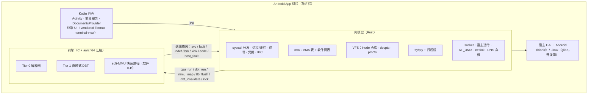

# appine 设计文档

- **状态**：设计决策已在 2026-10-24 的设计评审中逐条确认。M0–M8 已完成，之后做了几轮发布前的补强，M9（发布）还没开始。各轮结果见 [milestones.md](milestones.md)。
- **范围**：v1。第 1–13 节写的是当前的实现，2026-10-25 与代码核对过；和最初设计不一样、或者还没做的地方都在原处写明。
- **一句话**：一个能上 Google Play 的**单进程** Android App，在进程内用解释器 / 同 ISA 二进制翻译运行未经修改的 Alpine Linux aarch64 用户态程序。思路与 iSH 相同，是它在 Android 上的对应物。

**目录**

1. [目标与非目标](#1-目标与非目标)
2. [硬约束](#2-硬约束)
3. [总体架构](#3-总体架构)
4. [CPU 引擎](#4-cpu-引擎)
5. [内存：轻量用户态 soft-MMU](#5-内存轻量用户态-soft-mmu)
6. [进程、线程与调度](#6-进程线程与调度)
7. [信号与 ABI](#7-信号与-abi)
8. [文件系统](#8-文件系统)
9. [TTY 与终端](#9-tty-与终端)
10. [网络](#10-网络)
11. [用户、权限与 Android 集成](#11-用户权限与-android-集成)
12. [威胁模型](#12-威胁模型)
13. [工程](#13-工程)
14. [里程碑](#14-里程碑)（计划和排序依据；各轮结果见 [milestones.md](milestones.md)）
15. [已否决的方案](#15-已否决的方案)
16. [风险与待验证的假设](#16-风险与待验证的假设)

---

## 1. 目标与非目标

### 1.1 目标

- 用户从 Play 安装 App、打开即得到一个 Alpine shell，不需要 root、不依赖 Termux，也不需要任何额外步骤。
- 整个 Linux 环境都跑在 App 自己的进程里，Android 12+ 的 phantom process killer 对它不起作用。
- 直接运行 Alpine 官方 aarch64 仓库里**未经修改**的二进制。

### 1.2 v1 负载分档

| 档位 | 负载 | v1 要求 | 现状 |
|---|---|---|---|
| A 日常 CLI | busybox ash、`apk`、coreutils、vim、git、curl、openssh client | **全部可用** | ✅ M4 起 |
| B 计算型 | python3、gcc/make 编译中等规模的 C 项目、`./configure` | **能跑通** | ✅ M6：在 appine 里从源码编译 Lua、SQLite |
| C 难缠的运行时 | Go 静态二进制、node/V8、JVM | **行为正确，不要求快** | ✅ M8：Go、Node.js、OpenJDK 21/25 |
| D 不做 | docker/podman（namespace、cgroup）、systemd、内核模块、X11/GUI | — | — |

ptrace（gdb/strace）推迟到 v1 之后，目前一律返回 `EPERM`（§7.5）。

### 1.3 性能目标

- CPU 密集任务比原生慢 **3–5 倍以内**（JIT 级别）。M2 用性能探针实测复核后保留了这个目标；目前编译类负载约 4–6 倍（`./configure` 这类短命进程多的更高），历次测量见 §16 的 R1。
- 交互延迟优先：`ls`、tab 补全不能让人感到卡顿。

---

## 2. 硬约束

| 约束 | 来源 | 后果 |
|---|---|---|
| **Google Play 合规** | Device and Network Abuse 政策：不得下载可执行代码（dex/JAR/.so），"在虚拟机或解释器中运行的代码"除外 | 从网络下载的 Alpine 二进制**不能在宿主 CPU 上直接执行**，CPU 后端只能是解释器或翻译器 |
| 单进程 | 设计目标 + phantom process killer | 所有 guest 进程共享一个宿主地址空间，guest 进程之间的隔离和 fork 都得在软件里实现 |
| W^X 执行限制 | targetSdk ≥ 29 不能 `execve` App 数据目录里的文件 | 不使用 execve，也不依赖宿主加载器 |
| 存储限制 | SELinux：App 不能建硬链接、不能 `chown`、不能 `mknod`；共享存储不区分大小写、没有权限位、不能建 symlink | 文件系统的元数据和命名空间都要自己实现 |
| 网络限制 | targetSdk ≥ 30 不能 bind `NETLINK_ROUTE`，`RTM_GETLINK` 也被拦截；没有 `CAP_NET_RAW` | netlink 在进程内模拟，ICMP 改走 ping socket |
| 页大小 | Android 15 起要求 App 兼容 16KB 页内核 | 给 guest 呈现的页大小必须和宿主页大小解耦 |
| 宿主地址空间 | GKI 常见配置是 4K 页 + 39-bit VA，用户态只有约 512GB | 不能给每个 guest 进程预留很大的连续地址空间 |

**最低系统版本：minSdk 29（Android 10）**。DNS 存根依赖 `android_res_nsend`，它从 API 29 开始提供。

---

## 3. 总体架构



分层原则：

- **引擎**只关心"执行 guest 指令"。遇到 `svc`、访存缺页、未定义指令、`brk`、`ic ivau` 时，把控制权交给内核层。
- **内核层**实现 Linux 用户态 ABI，持有所有 guest 状态：进程、地址空间、fd、文件系统。
- **宿主 HAL** 把宿主的差异隔离开。开发阶段的宿主是 Linux arm64，生产宿主是 Android；不写 macOS 版本的 HAL。
- 核心库（引擎 + 内核层）**不依赖任何 Android 组件**。Android 相关的部分只在 HAL 和 Kotlin 外壳里出现。

---

## 4. CPU 引擎

### 4.1 Guest ISA

guest 是 **aarch64**，直接使用 Alpine 官方 aarch64 仓库。这样选有三个好处：

- guest 和宿主的内存模型都是 ARM 弱序，没有 x86 TSO 与 ARM 弱序之间的转换问题。
- 同 ISA 翻译时，大量指令可以原样拷贝。
- 按 arm64 规范，修改代码之后必须执行 `ic ivau` + `isb`，所以这条指令可以直接当作失效翻译缓存的钩子，不需要对代码页做写保护。

### 4.2 分层

#### Tier 0：解释器

`core/engine/src/c/interp.c`。

- 负责冷代码、短命进程、调试，同时作为语义上的参考实现；Tier 1 不翻译的单条指令也交给它执行。
- 分发是按编码字段逐级 `switch` 的解码，另有一个 512 项的取指 TLB。最初计划的 `[[clang::musttail]]` 尾调用式 threaded 分发没有做：Tier 1 成为正式版之后，Tier 0 的速度已经不影响整体（M2 时 Tier 0 比原生慢约 40 倍）。
- 和 Tier 1 共享 guest 状态布局、soft-MMU 接口和异常上报接口。
- **SIMD&FP 数据处理、CRC32 和 LSE 原子指令用"原生单指令执行"实现**（M1a 决定）：白名单判定（§4.4）、地址翻译和寄存器搬运写在 C 里，运算本身交给宿主执行同一条指令。
  - 每个指令编码对应一段缓存起来的小桩（`core/engine/src/c/native.c`）：通用寄存器字段被换成宿主临时寄存器，执行前从 CPU 上下文读入、执行后写回；FP 类的桩还会载入并写回 V0–V31、FPCR、FPSR 和 NZCV，同时保存和恢复宿主的 d8–d15 与 FPCR。LSE 指令的地址字段换成翻译好的宿主指针。
  - 好处：结果与硬件逐位一致，NaN 传播、舍入、FZ/DN、FPSR 累积标志都不需要自己实现；实现量只有白名单解码和访存部分。
  - 代价：对 SIMD&FP 而言，Tier 0 不再是独立于硬件的参考实现（硬件本来就是 lockstep 的标准答案）；Tier 0 需要宿主能分配可执行内存（Android 允许 JIT）；只能运行在 aarch64 Linux 宿主上，非这类宿主不宣告 FP/ASIMD。
- SIMD&FP 的访存（LDR/STR/LDP/STP 的 B/H/S/D/Q 形式、LD1–LD4/ST1–ST4 的多结构、单结构和 replicate 形式）仍用 C 经 soft-MMU 实现：先确认要访问的每一页都可访问，再读写，失败时没有副作用。

#### Tier 1：同 ISA 直通式 DBT

`core/engine/src/c/dbt.c`，`appine-run --tier 1` 和 Android App 使用它。M2 是原型，M7 补全成正式版，M9 之前又加上了 SP 常驻寄存器、返回预测、翻译保留、跨页访问、共用的 TLB 检查，以及同一个地址空间的线程共用翻译（见 [milestones.md](milestones.md)）。

**寄存器约定**

| guest | 宿主 |
|---|---|
| X0–X15、X19–X25、X29、X30 | 同号寄存器 |
| SP | X26 |
| X16、X17、X18、X26、X27、X28（"被占用的寄存器"） | 存放在 CPU 上下文里。引用它们的指令先把值读进临时寄存器，改写寄存器字段后执行，再写回 |
| NZCV、FPCR、FPSR、V0–V31 | 宿主的同名寄存器（§4.3） |

- 宿主 X28 指向 CPU 上下文，X16、X17、X27 是临时寄存器。
- 宿主 X18 是平台寄存器（Android 上 ShadowCallStack 用它），翻译后的代码不碰它，宿主的信号处理函数随时可以用（R6）。
- SP 出现在 17% 的指令里（函数的序言和尾声），X26 是编译器生成的代码里用得最少的被调用者保存寄存器（gcc 的 cc1 里不到 SP 的十分之一），所以宿主 X26 让给 SP。以 SP 为基址的访存直接用 X26，回写只要一条 `add`。
- guest 的 NZCV 就是宿主的，所以插入的代码一律不改动条件标志（用 `cbnz`/`tbnz`/`eor` 代替 `cmp`）。

**指令的处理**

| 指令 | 处理 |
|---|---|
| 只读写寄存器的 ALU、FP、NEON 指令，屏障 | **原样拷贝**。SIMD&FP 数据处理的白名单判定与 Tier 0 共用同一个函数 |
| 访存，包括 SIMD&FP 的 LDR/STR/LDP/STP 和 LD1–LD4/ST1–ST4 | 插入 soft-MMU 的 TLB 快速路径（见下），访问换成宿主地址 |
| 分支和 PC 相对寻址（`adr`/`adrp`/`ldr literal`） | 改成以 guest PC 为基准的常量；分支见下面的"控制流" |
| `svc` | 退出到内核层 |
| `mrs/msr tpidr_el0`、`mrs dczid_el0` | 读写 guest 状态结构里的字段，或者换成常数 |
| `mrs/msr nzcv`、`mrs cntvct_el0`、`mrs cntfrq_el0` | 原样执行 |
| `ldxr`…`stxr` | 改写成比较并交换，见 §4.5 |
| LDAR/STLR、CAS、LSE 原子指令 | 换上翻译好的宿主地址，原样执行 |
| `dc zva` | 翻译地址后用 `stp xzr` 清零 |
| `clrex` | 清掉 guest 的独占标记 |
| HINT，包括 PAC 系列（`PACIASP`/`AUTIASP` 等） | 改写为 NOP，见 §4.4 |
| `dc cvac`/`dc cvau`/`dc civac`/`ic ivau` | 按读访问检查地址（与 Tier 0 一样），不退出。`ic ivau` 只记下所在的页，到 `dsb`/`isb` 时才退出、交给内核层作废翻译（见下面的"失效"）：JIT 刷新缓存时一页要执行几十条，原来每条都退出，Maven 一次构建 87 万次 |
| 其他系统寄存器访问（`mrs ctr_el0`、`mrs ID_*_EL1`、读写 FPCR/FPSR 等）、成对的 LDXP/STXP、操作数是被占用寄存器的 CASP | 交给 Tier 0 执行这一条指令 |
| Tier 0 不认识的编码 | 同样交给 Tier 0，保证两层的白名单完全一致（§4.4） |

**访存快速路径**（算地址之外 6 条宿主指令，代码见 §5.1）

1. 算出 guest 地址，用**最后一个字节**所在页的下标取出 TLB 表项，一条 `ldp` 取出 tag 和 addend。访问落在对齐的 16 字节里时（以对齐的 SP 为基址、偏移对齐的访问）不可能跨页，直接用第一个字节的页，省掉一条 `add`。
2. tag 与**第一个字节**所在的页比较。TLB 直接映射，跨页时第一页的页号不可能出现在下一页的表项里，所以这一次比较同时排除了跨页访问。
3. 命中就访问 `addend + 地址`。
4. 未命中或者跨页时跳进代码缓存里的回填例程。不跨页时按 §5.1 的结构遍历页表、填好表项。跨页时两页都要有这次访问的权限，宿主地址也要连续（两页的 addend 相同，同一次宿主映射里的页都是这样），这时整个访问照样在宿主上一次完成：两页都在 TLB 里时只比对两个表项，不在的先填进去。栈帧跨页的函数每次调用都会这样访问，所以不能退给 Tier 0（python 的解释器循环里有一处，原来每次迭代退出两次）。
5. 只有页没有映射、权限不符、跨页而宿主地址不连续（mremap 扩大的映射、另起一段的栈）、SP 未对齐或者地址带 TBI 标签时，才退出到分发器，由 Tier 0 执行这一条指令。这时指令还没有产生任何副作用，所以异常是精确的。

- **依赖链**：基址加立即数的访问，最后一个字节的地址（取下标用）直接从基址算，不等访问地址算出来，和它并行，指令数不变，追指针的读每次少等一个周期。
- **地址已知的访问**：翻译时跟踪本块里值已知的寄存器（ADR/ADRP 设下的，和在它上面加的立即数；别的指令可能写它时就不再算已知，拿不准的一律算写了）。以它为基址、不跨页的访问，表项的位置是常数，取表项不必等 ADRP 换成的几条 `movk` 和地址的加法；字面量（`ldr Xt, =label`）同样。tag 仍然和真实的地址比较，所以就算跟踪错了，也只是多走一次回填。全局变量的访问、PLT 里从 GOT 取跳转目标都是这样的。
- **SP 对齐检查**：一个块里检查过一次之后，SP 只按 16 的倍数改变时不再检查。
- **共用检查**：同一个块里以同一个寄存器为基址的几条访存（函数的序言和尾声、结构体的几个字段）共用一次检查。组长检查整组覆盖的范围（最多 512 字节），之后临时寄存器里是基址的宿主地址，组员直接用 `[T2, #偏移]` 访问，和原生一样是一条指令。组员之间只能有不写基址（按常数加减的除外）的指令和条件分支，SP 只能按 16 的倍数改变。组员之间可以夹着别的访存（别的组的、不分组的）和用到这个临时寄存器的指令：组长把宿主基址存进 cpu 结构体里的一个槽（同时最多 4 组），之后的组员先取回来，槽的地址是常数，可以提前取出，组员的访问不必等 TLB 查表。python 的解释循环里栈帧、代码对象这几个基址的访存互相交错，原来一个块里 15 次检查一次也省不下，现在剩 8 次。条件分支后面的组员不一定会执行，覆盖的范围里也可能有它们访问不到的页，所以检查失败时由 Tier 0 执行组长；同一个组长第二次失败时作废这个块，它和后面一个块长度以内的访存都不再当组长（第一次只记下来：栈还没长到那里这类情况，Tier 0 执行组员时就会解决）。gcc 和 python 里约四分之一的访存省掉了检查。

**控制流**

- 块不在条件分支处结束：不跳转的一侧接着翻译，跳转的一侧是侧出口。
- 直接分支通过块链接回填成一条 `b`：出口的链接桩以一条跳到下一条的 `b` 开头，链接时把它改成跳往目标块。`b` 改成 `b` 是架构允许并发修改的（ARM ARM 的 CMODX 规则），别的线程正在执行这里也没关系。条件分支的目标在它的偏移范围内时，直接改写条件分支本身；条件分支不在 CMODX 允许的指令里，所以只在地址空间里只有一个线程时这样做。
- 建块时目标已经翻译过的出口直接链接，随整个块一起同步指令缓存；其余的出口第一次走到时退出到分发器链接。只有一个线程时，新块和链接点合在一起同步一次：`ic ivau` 之后的 `dsb` 要等作废广播完成，一次约 0.1 微秒，比作废本身贵得多。
- 间接分支（`br`/`blr`/`ret`）先查一张 4096 项的跳转缓存，未命中再回到分发器。
- **返回预测**：函数调用（`bl`/`blr`）翻译成宿主的 `bl`，跳过紧随其后的"落点"（链接到 guest 返回地址处的块），再把 (guest 返回地址, 落点) 压进线程的影子返回栈。`ret` 看到栈顶等于 x30 就弹栈、用宿主 `ret` 跳回落点，由宿主的返回地址栈预测；对不上时（longjmp、信号处理函数、协程切换）才查跳转缓存。影子栈是 64 项的环形缓冲，每一项都跳往继续执行它记的 guest 地址的代码（空项按 x30 查找），翻译缓存清空时整体重置。
- **kick 检查**：经由后向边或间接分支进入块时检查 kick 标志。块的起始地址沿前向边严格递增，任何循环里至少有一条边会经过检查，所以链接成环的循环也能被打断。

**精确状态**几乎是免费的：宿主 `ucontext` 里的寄存器就是 guest 寄存器，被占用的寄存器另外保存在上下文里。

**翻译共享**：一个块的翻译只取决于它的 guest pc 和翻译过的指令字，与进程、映射无关。

- 每翻译一个块就存成模板，放进所有实例共用的模板区（32 MB，写满时整体丢弃；同一个 pc 最多留 4 个版本）。
- 别的实例（另一个线程、fork 出来的子进程、又一次 exec 的同一个程序）要翻译同一个 pc 时，先比对指令字，相同就把模板拷进自己的代码缓存，只重新计算跳往例程的几条 `b`。
- 块之间的链接在各自的拷贝里回填，所以不需要像原计划那样按 `(inode, offset)` 识别文件页，不同进程在同一地址映射了不同的代码也不会互相影响。`./configure` 这类负载里 85% 的块直接来自模板。

**按地址空间共用**：代码缓存（128 MB，块跳往缓存开头的例程、块之间的链接都是一条 `b`，偏移范围是 ±128 MB）、翻译表和作废记录由一个地址空间里的所有线程共用；每个线程只有自己的跳转缓存、影子返回栈和统计。原来每个线程各翻译一份：Go 的一个 `compile` 进程有 7 个线程，各翻译 3–5 万个块，`go build` 里翻译、拷贝模板、链接和同步指令缓存都要做好几遍；JVM 每个线程也各占一块代码缓存。

- 分发器不持锁查翻译表：插入只用空位（先写 pc、再写 code），作废只把 pc 改成墓碑，墓碑不复用、重建表时去掉。读到旧 code 的线程进入的是作废块的入口，那里跳往转发桩。换表之后，等正在查旧表的线程查完才释放旧表（每个线程查表时序号为奇数）。
- 翻译不持锁：在线程自己的暂存区里翻译（或者拷贝模板），持锁时只做分配位置、拷贝、修正跳往例程的 `b`、链接、同步和放进表这几步。翻译之前先拷一份 guest 指令字，装进去之前和内存里的再比对一次：翻译期间别的线程改写并作废了这段代码时（那时新块还不在表里），丢掉重新翻译。原来持锁翻译时，JVM 的主线程一次构建要在锁上等一秒多。
- 新块先同步指令缓存、再放进表里，别的线程才可能跳过去；链接点的回填不持锁（`b` 改 `b`）。取锁时先自旋一会儿再睡。
- 整体清空（代码缓存写满）要等所有线程离开翻译后的代码：发起的线程打断其他线程，等它们停在分发器里或者离开分发器再清空，各线程据代数清空自己的跳转缓存和影子返回栈。

**翻译保留**：地址空间没了之后，它的翻译放回池里，不清空，标成待核对；新的地址空间（exec 之后、fork 出来的子进程）第一次运行时从池里取。

- 池里的实例按程序（可执行文件的 inode）作键，优先还给同一个程序：shell 脚本里反复 exec 的 busybox、`go build` 的一个个 compile 进程、一次次 `node -e` 都能拿回前一个留下的翻译。没有同键的就拿空的或者新建，不清空别的程序留下的。
- 运行之前逐块比对 guest 指令字（每个块记着自己翻译时的指令字），对不上的按"失效"的办法作废，大部分对不上时才整体清空。这和拷贝模板时的比对是同一件事，只是一次做完，省掉逐块拷贝模板、重新链接、同步指令缓存。
- 内容由文件和它的版本就能确定的代码段不必比对：地址空间不再使用时，内核层把没写过、有可信版本的私有文件映射（程序和动态链接器的代码段）记给翻译（起止地址、宿主文件的设备号和 inode、文件偏移、版本）；新的地址空间里同一段地址映射的是同一个版本的同一段文件时，落在里面的块直接保留。版本是宿主 object 的 ctime 和大小：内容的每一次修改宿主都会把 ctime 改成当时的时间，utimensat 也改不回去。ctime 离现在不到 2 秒（宿主的时间戳取自粗粒度的时钟，紧接着的修改可能得到同一个 ctime）、有过可写共享映射（写进共享映射的页一直是脏的就不再改 ctime）的文件不给版本。原来 shell 每起一个 busybox 进程都要把池里所有块比对一遍，代码页还要逐页缺页，占管道负载一成的时间。
- 池里最多 6 个实例，保留的代码总共最多 64 MB，超出时先去掉空的、再去掉最久没用的；块数超过 13 万的实例放回池里时清空。

**失效**

- guest 修改代码之后执行的 `ic ivau`，以及可执行映射的拆除和权限变化，都记进 `mm` 的代码失效日志，并递增代码代数。只是代码变了时（JIT 的 `ic ivau`），打断正在执行 guest 代码的其他线程，但不持着 BKL 等它们退出：硬件上别的核在上下文同步之前同样可能还执行旧指令。membarrier 的 SYNC_CORE 才等。
- 翻译是共用的，第一个看到新代数的线程按错过的范围逐页作废一次就够了。日志保留最近 4096 个代数，落后更多时整体清空。超过 256 页的范围（拆掉一个库）逐个看所有的块，不整体清空。
- 作废的块入口改成跳往一个转发桩，重新翻译之后旧入口直接跳往新的块，别的块链接到旧入口的跳转不用找出来改写。别的线程可能正在执行这个块，它照样执行到块尾。一批块一起作废：先写好所有转发桩、同步一次，再改所有入口、同步一次。
- 作废的块在翻译表（开放寻址、线性探测）里留下墓碑，表里有四分之三不空、墓碑占一半以上时原样重建。块的记录记满时，作废的超过八分之一就去掉它们的记录、重建表，不整体清空（JVM 活着的块有十几万个，作废的也有三四成）。
- CTR_EL0 报告 DIC = IDC = 0，guest 修改代码之后一定会执行 `ic ivau`。

**W^X**：JIT 代码页使用双映射。同一段共享匿名内存用 `mremap` 映射两次，一份 RW 用来写入，一份 RX 用来执行，不依赖 memfd；宿主不允许时退回 RWX。Tier 0 的原生指令桩也这样分配。

**否决了以 dynarmic 为核心的方案**，见 §15。dynarmic 是 0BSD 许可，可以直接借用它的 A64 解码表（`frontend/A64/decoder`）和测试用例。

### 4.3 FP 状态

FP 和 NEON 指令都在宿主上原生执行。所以每次从宿主代码进入 guest 代码，都要把 guest 的 FPCR 装进宿主 FPCR；回到宿主 C 代码之前再恢复，避免 guest 设置的 flush-to-zero 之类的模式影响我们自己的代码。

Tier 1 的进入例程保存宿主的 d8–d15 和 FPCR，载入 guest 的 FPCR、FPSR 和 V0–V31，翻译后的代码里它们一直在宿主寄存器里；退出例程保存 guest 的 V0–V31 和 FPSR，再恢复宿主的状态。

### 4.4 CPU 特性基线

**原则：guest 看到的特性集合 = 宿主 CPU 支持的 ∩ Tier 0 已实现的 ∩ 白名单。**

- `AT_HWCAP`/`AT_HWCAP2`、`/proc/cpuinfo` 的 Features 行、guest 读 `mrs ID_AA64*_EL1` 得到的值，三者从**同一份集合**生成。
- 白名单以外的编码，在两个 Tier 里都投递 SIGILL（`ILL_ILLOPC`），**绝不把它们原样拷贝执行**。
- 两个 Tier 对同一条指令的语义必须一致。PAC 在 Tier 1 原样执行会用宿主密钥签名，而 Tier 0 只能把它当 NOP。为了一致，Tier 1 也把它们改写成 NOP，并且不宣告 PACA/PACG。
- 通用定时器的 `CNTVCT_EL0`、`CNTFRQ_EL0` 与 Linux 一样允许 EL0 读，两个 Tier 都读宿主的值（M8）。Go 的运行时和 V8 直接读它们计时。

| 级别 | 特性 |
|---|---|
| 必须 | FP、ASIMD（v8.0）、CPUID |
| 宿主支持时宣告 | ATOMICS（LSE）、AES、PMULL、SHA1、SHA2、CRC32 |
| v1.x | ASIMDDP、LRCPC、SHA3、SHA512 |
| v1 不做 | FP16（FPHP/ASIMDHP）、SVE/SVE2/SME、BF16、I8MM、PACA/PACG、BTI、MTE |

宣告 LSE 之后，libgcc 的 outline atomics 和 Go 会改走单条原子指令，这类指令很容易翻译。但 musl 的原子操作是用 `ldaxr`/`stlxr` 内联汇编写死的，所以 **LL/SC 必须支持**。

**实现**（M1a，`core/engine/src/c/features.c`）：启动时读宿主的 `AT_HWCAP`，与 Tier 0 已实现的集合求交，作为 guest 的 `AT_HWCAP`（`AT_HWCAP2` 为 0）。宿主没有 FP、ASIMD，或者原生指令桩不可用时，不宣告任何 SIMD&FP 特性。guest 读 ID 寄存器空间（`MIDR_EL1`、`ID_AA64ISAR0_EL1`、`ID_AA64PFR0_EL1` 等）时，返回与这份集合一致的值。`/proc/cpuinfo` 随 procfs 一起生成（M3b）。

**白名单的独立核对**：硬件只能告诉我们一条编码能否执行，分不清它属于基础集还是 FP16 之类没宣告的扩展。所以另用 LLVM 的反汇编器（`llvm-mc`，按 guest 特性集合设置 `-mattr`）做对照：

- 在 SIMD&FP 数据处理、SIMD 访存、独占访问、LSE、整数 2 源数据处理这几个编码空间里随机抽样，Tier 0 认为能执行的编码必须恰好是 LLVM 能解码的编码（`tests/lockstep/tests/whitelist.rs`）。
- 对"应当全为 1"（SBO）的字段，沿用 LLVM 的口径：独占访问和 LDAR/STLR 忽略它们，CAS/CASP 的 Rt2 必须全为 1。

### 4.5 独占访问（LL/SC）

**问题**：在 `ldxr` 和 `stxr` 之间插入额外的访存（比如 TLB 查找），可能会让独占监视器失效，导致活锁。最初的设计是识别出整个 LL/SC 序列，在序列开始前一次性完成地址翻译，做不到的整段改写成 CAS 语义或放到慢路径（DynamoRIO 在 AArch64 上遇到过同样的问题）。实际两层都采用了"记下读到的值、写时比较并交换"的语义，不需要识别序列。

soft-MMU 翻译得到的是真实宿主指针，所以原子指令直接作用在宿主内存上，多个线程或进程共享同一页时语义天然正确。

**Tier 0**（M1a，`core/engine/src/c/atomic.c`）：

- LDXR/LDXP 记下地址、长度和读到的值；STXR/STXP 在宿主地址上做比较并交换，只有内存值仍等于记下的值才成功，与 QEMU 的做法相同（允许 ABA，对正确的 LL/SC 用法没有影响）。
- CLREX 和 svc 都会清掉独占标记。要求自然对齐，否则是对齐错误。
- LDAR/STLR 用 C 的 acquire/release 原子操作实现；LSE 原子指令和 CAS/CASP 交给原生桩，在翻译后的宿主地址上原样执行。

**Tier 1**（M7）：语义与 Tier 0 相同。

- LDXR 查过 TLB 之后在宿主地址上读（LDAXR 用 `ldar`），记下地址、长度和读到的值。
- STXR 先确认独占标记是同一地址、同一长度，再在宿主地址上用 `ldaxr`/`stlxr` 循环做比较并交换：两条指令之间只有寄存器运算，没有访存，宿主的独占监视器不会被我们自己的代码清掉。
- CLREX 清掉标记，svc 退出时也清掉。LDAR/STLR、CAS 和 LSE 原子指令换上宿主地址原样执行。
- 成对的 LDXP/STXP，以及操作数是被占用寄存器的 CASP 很少见，仍交给 Tier 0。

---

## 5. 内存：轻量用户态 soft-MMU

这里**不模拟** ARM 的硬件页表，包括 TTBR、描述符格式、TLBI/ASID、异常级别、物理地址层和 MMIO，但**要自己实现 Linux mm 的语义**。

### 5.1 数据结构

- **每个进程一个 `mm`**（`core/kernel/src/mm.rs`），包含两部分：
  - VMA 表：按起始地址排序的 `BTreeMap`，实现 mmap/mprotect/munmap 语义，并用来生成 `/proc/<pid>/maps`、`smaps`。
  - 页表（`core/engine/src/c/mmu.c`）：以 guest 虚拟页号为键的 4 级基数树，每级 512 项，覆盖 48 位地址空间；叶子表项是宿主页地址加 R/W/X 权限位。只有 TLB 未命中时，我们自己的 C 代码才会遍历它。
- **每个线程一个软件 TLB**：直接映射，4096 项（M7 从 512 项加大），每项 `{读 tag, 读 addend, 写 tag, 写 addend}`。
  - tag 存的是页号取反，0 表示无效，所以清零的内存就是空的 TLB，新线程不必逐项写入，没碰过的页不占内存。
  - 表项填写时记进一张位图，清空时只处理填过的项，所以 munmap 频繁的程序清空 TLB 也不贵。

Tier 1 的 TLB 命中路径（8 字节的读；x16 = guest 地址）：

```asm
add  x17, x16, #7            // 最后一个字节
ubfx x17, x17, #12, #12      // 它所在页的页号低 12 位 → TLB 下标
add  x17, x28, x17, lsl #5   // x28 指向 CPU 上下文
ldp  x17, x27, [x17, #TLB]   // tag（页号取反）, addend
eon  x17, x17, x16, lsr #12  // 与第一个字节所在的页比较，跨页时一定不等
cbnz x17, refill
ldr  x0, [x27, x16]          // 宿主地址 = addend + guest 地址
```

- **TLB 未命中**：查基数树（Tier 1 在代码缓存里的回填例程中查，Tier 0 在 C 里查）。查不到，或者权限不符，就交给内核层，由它给 guest 投递 SIGSEGV 或 SIGBUS。
- **TLB shootdown**：多个线程共享一个 `mm` 时，页表可以在被别的线程遍历的同时修改（表项用原子操作读写，中间表在 `mm` 销毁前不释放）。
  - 解除映射或降低权限之后，修改方递增 `mm` 的代数，打断正在执行 guest 代码的其他线程，等它们退出 guest 代码；每个线程重新进入 guest 代码之前比较代数，变了就刷新自己的 TLB。
  - 只增加权限时不刷新：TLB 里的旧表项只是少了权限，未命中时会重新填写。
  - 代码的变化另有一个代数和失效日志，见 §4.2。
  - 被解除映射的宿主内存要等 shootdown 完成后才释放，所以 guest 自己的数据竞争碰不到已经还给宿主的内存。

### 5.2 页与后备内存

- guest 页**固定 4K**，不管宿主页是 4K 还是 16K。`AT_PAGESZ` 报告 4096。
- **匿名内存**：每个匿名映射单独向宿主 mmap 一段内存，每个 guest VMA 对应一个宿主映射。例外是 fork 时子进程自己的小映射（1 MB 以内，堆和栈除外），它们切自同一段宿主内存：shell fork 之后马上 exec，原来每个映射各一次宿主的 mmap 和 munmap。这一段不计入宿主的提交量（每个映射都不超过 1 MB，计不计入只关系到一次申请超过内存总量时失败）。代价是这样的映射解除映射之后，宿主内存要等那一段全都不用了才交还。
- fork 要的这几段（小映射切出来的那一段、堆和栈预留的地址空间，都是 `MAP_NORESERVE`、没碰过的）预先映射好：同一个程序反复 fork 时要的长度总是那几个，持有 BKL 时直接拿来用，用掉的在放开 BKL 之后补上，每种长度最多留两段、最多记 8 种长度。宿主的 mmap 原来占 fork 持锁时间的四成。
- **交还宿主**：持有 BKL 时释放的宿主内存（munmap、进程退出和 execve 时销毁地址空间）和销毁的地址空间的页表放开 BKL 之后才交还，宿主上首尾相接的几段一起交还：拆页表、刷 TLB 要几十微秒，等着回收的 shell、管道另一头的进程不必跟着等 BKL。OOM killer 看到还有没交还完的内存时这一轮不挑进程（§12 第 4 条）。在后台线程里交还试过，微基准反而变慢：宿主的 `mmap_lock` 上与 fork 的 mmap 争抢，叫醒后台线程也要跨核中断。
  - 最初的设计是按大块 arena（如每块 2MB）申请、再切成 4K 页，以减少宿主 VMA 数量，没有做。宿主的 `vm.max_map_count` 是整个 App 进程共用的，所以内核层按地址空间实行 guest 的 `vm.max_map_count`（默认 65530，可写），一个 guest 进程不能把宿主的映射数用完。
  - 堆第一次扩展时预留 256 MB 宿主地址空间（`MAP_NORESERVE`，不碰不占内存），之后的 brk 只是加长同一个 VMA。相邻的匿名 VMA 不合并（各自是一段宿主内存），只是 `/proc/<pid>/maps` 里相邻、权限相同的匿名映射与 Linux 一样显示成一行。
- **文件映射**直接用宿主 `mmap(objects/<ino>)` 的页作为后备内存。如果宿主是 16K 页，就映射包含目标位置的 16K 对齐区间，再把页表项指向区间里正确的 4K 偏移。这样带来两个好处：
  - busybox/musl 的代码页通过宿主 page cache **在所有 guest 进程之间共享**。ELF 加载器也这样映射程序的各段（M6），只有段之间共用一页、或者偏移没有对齐时才退回到拷贝。
  - 只读的私有映射（程序和库的代码段）有可信版本（§4.2 的"翻译保留"）时，宿主映射由内核里所有地址空间共用（`mm::FileMaps`，最多 128 段）：同一个版本的同一段文件再映射时直接用它，宿主页表还在，不必重新映射、缺页，退出时也不必拆掉。用它的 VMA 与 fork 之后父子共用宿主映射时一样，要写（mprotect 加写权限、加载器清零 .bss 的开头）之前复制一份自己的。宿主上是只读映射，万一漏了复制会直接出错，不会悄悄改了别人的代码。宿主内存紧张时（`Machine::trim_memory`）清空。
  - `MAP_SHARED` 映射和 `read`/`write` 之间天然一致。
- **共享内存**：进程间的 `MAP_SHARED` 匿名内存，就是让两张页表指向同一个宿主页。System V 共享内存段同理：段持有一段宿主内存，`shmat` 把它映射进地址空间。
- **提交量**：宿主内存总是可读写，guest 的权限只记在页表里，所以宿主的内存提交量（overcommit 记账）按 Linux 的规则由 guest 的参数决定：只有可写的私有映射计入，`MAP_NORESERVE`、只读和 `PROT_NONE` 的映射用 `MAP_NORESERVE` 向宿主申请（M8）。V8 为每块 wasm 内存预留 8 GB 的 `PROT_NONE`，计入的话在内存小的设备上直接失败。
- **`PROT_NONE`** 的页不放进页表，mprotect 加上权限时再放：8 GB 的预留逐页写页表要占 16 MB。页表的解除映射和修改权限遇到没有中间表的地方整段跳过。
- **`MADV_DONTNEED`** 把私有匿名内存里整页的部分交给宿主的 `madvise` 回收，宿主页比 4K 大时两头不满一页的部分清零。Go、JVM、V8 的 GC 用它归还内存，全部清零反而会让这些页实际占用内存。
- **超出 EOF 与截短**：
  - 文件映射超出 EOF 的整页不放进页表，访问它们时宿主 mmap 会产生 SIGBUS。guest 访问这些页，得到的是 guest 自己的 SIGBUS（`BUS_ADRERR`）；共享映射的文件后来变长了，就把新的内容映射进来，重新执行那条指令。
  - 文件被截短时（truncate、ftruncate、`O_TRUNC`，都经过内核层），所有地址空间里映射它的页超出新末尾的部分从页表里拿掉，再做 shootdown，与 Linux 的 truncate 相同。

### 5.3 fork

- fork 之前先让同一 `mm` 的其他线程停在 guest 代码之外（与 shootdown 用同一套机制），得到 fork 那一刻的快照。
- **写时复制**（M9 之前；最初的 v1 是全量复制）：写过的私有匿名映射不复制，父子进程的页表都指向父进程的宿主页、去掉写权限，在页表里实现，不依赖宿主的 `mprotect`。按页记账：宿主页在它的 VMA 里的一方是拥有者，它把页借出，别的地址空间借用；同一个 fork 家族共用一张借出记录，键是宿主页的地址。
  - 借用方写（写缺页，或者内核往 guest 内存写）时复制一份到自己 VMA 里对应的位置，页表项改指那里，先让这个地址空间的线程刷新 TLB。
  - 拥有者写、munmap、mremap 搬走、`MADV_DONTNEED` 借出的页之前，先让每个借用方复制自己的一份（要打断借用方正在执行 guest 代码的线程），再恢复写权限。拥有者的地址空间销毁（退出、exec）时页留给借用方（孤儿页，谁也不能再写），借用方持有那段宿主内存；没借出的页交还宿主。
  - 最后一个借用方还回来时，拥有者的页表项马上恢复写权限：shell fork 之后子进程马上 exec，父进程不必为此缺页。缺页时页表项已经被别人改好（等 BKL 的时候借用方还回了页）就重新执行，与 Linux 一样。
  - mprotect 之后这些页仍然不能写；改权限期间先停住别的线程，免得它们在页表项拿到写权限、还没去掉之前写进借出的页。私有内存的 futex 键是宿主地址，所以 futex 落在借来的页上时先复制，否则写时复制之后等在旧键上的线程再也叫不醒。
  - 宿主从没碰过的页（`/proc/self/pagemap`）一定是零，子进程用自己的。不能用 mincore，它把换出到 zram 的页也报告成"不在"。从来没有可写过（内核也没有写过）的匿名映射整段跳过，不逐页检查（M8：V8 的 wasm 预留区原来让 node 的每次 fork 多花一秒）。16 页以内的映射多半都碰过，不读 pagemap，全部借出（读 pagemap 原来占 fork 持锁时间的三成多）。
- 可写的私有文件映射仍然逐页复制（全零的页跳过）。只读的私有文件映射直接共用宿主映射，mprotect 加写权限之前再复制一份（M4）。共享映射与子进程共用。栈下面预留的宿主内存（§5.4）在子进程里照样预留，子进程的栈接着就地增长。

### 5.4 guest 地址空间布局

guest 地址空间的布局由我们自己的 mmap 实现决定，不受宿主地址空间布局的限制。软件页表的规模只和实际用到的页数有关，所以 V8 那种动辄预留几个 GB 的做法也能满足。

- 地址空间是 47 位。主线程栈的顶在 `1 << 47`，位置无关的主程序加载在 `0x5555_5555_0000`（地址空间的 2/3），mmap 自顶向下分配。
- **主线程栈**与 Linux 一样按需向下增长（`core/kernel/src/mm.rs` 的 `grow_down`）：
  - execve 时只映射参数、auxv 下面再多 128 KB，之后 guest 访问栈底下面的地址出错时，把栈延伸到那一页再重新执行。
  - 延伸之后的大小不能超过 `RLIMIT_STACK` 的当前值，所以运行中调高上限立即生效。与下面的映射之间也要留出 256 页的保护间隔（`stack_guard_gap`），否则不增长，guest 收到 SIGSEGV。
  - 宿主内存在栈下面预留到 8 MB（不碰不占内存），在这个范围里增长只是加长同一个 VMA。超出之后另外申请一段，下面再预留到与栈现在的大小相同，所以 VMA 的个数只按对数增加，`/proc/<pid>/maps` 里仍然合成一行 `[stack]`。`MAP_GROWSDOWN` 的映射也这样增长。
  - 内核访问 guest 内存时也要让栈长出来，否则 Linux 上能用的缓冲区会得到 EFAULT。内核访问 guest 内存的地方很多，这里只在两处增长：syscall 入口发现 SP 已经低于栈底时，先把栈延伸到 SP（arm64 没有 red zone，syscall 用到的栈上缓冲区都在 SP 以上）；构造信号帧之前延伸到帧的起点。指向 SP 下面的缓冲区，以及经由 `/proc/<pid>/mem` 访问别的进程的栈，不会让它增长。
- **mmap 区的上界**与 Linux 的 `mmap_base` 一样按 execve 时的 `RLIMIT_STACK` 定下：栈顶往下留出上限加上保护间隔，至少 1 GB 加 8 MB（Linux 是 128 MB 加上栈的随机偏移，arm64 上约 1 GB），最多地址空间的 5/6。不限栈大小时 Linux 改为自底向上分配（legacy 布局），这里仍然自顶向下，间隔取最大值。
- execve 的参数和环境变量（字符串加指针）最多占栈大小上限的 1/4，不超过 6 MB，不少于 128 KB，与 Linux 的 `bprm_stack_limits` 相同。setuid、setgid 程序的上限与 Linux 一样不超过默认的 8 MB。

---

## 6. 进程、线程与调度

- **1:1 线程模型**：每个 guest 线程（`struct task`）对应一个宿主 pthread，调度交给宿主内核。guest 线程结束之后它的宿主线程留 5 秒给下一个 guest 线程用（最多留 8 个）：fork 原来有四分之一的时间花在新建宿主线程上。复用时 CPU 时间从线程开始时的读数算起，nice、亲和性重新设置。引擎的 CPU 状态（含 4096 项的数据 TLB，约 130 KB）也留 8 个给下一个线程，只清掉填过的 TLB 项：原来每个线程新映射一段、逐页缺页、结束时拆掉。
- **驻留内存**（`ru_maxrss`、`/proc/<pid>/status` 的 VmRSS、OOM killer 挑进程）按 VMA 用宿主的 mincore 数，execve 和退出时各量一次。宿主上首尾相接的 VMA 合起来量一次；只有 page cache 页的文件映射（没写过的私有映射、共享映射）驻留多少是文件本身的事，结果按文件的一段缓存 1 秒，程序和库的代码段不必每次在 page cache 里逐页查找。
- **大内核锁（BKL）**：进入 syscall 时获取；执行 guest 代码时**不持有**；在内核层里等待之前**释放**。内核对象之间用 `Rc`/`RefCell` 共享，只在持有 BKL 时访问。
  - 可能要等宿主的操作放开 BKL 做：宿主 fd（socket 等）的读写，以及普通文件的 pread/pwrite（冷数据要等闪存）。用文件位置的读写，同一个打开文件同时只有一次（相当于 Linux 的 f_pos_lock）；O_APPEND 的写仍持锁。
  - 取锁时先自旋一会儿：临界区通常只有几微秒（一次 lstat），长的（execve、fork、进程退出）十几到二十几微秒，睡下再被叫醒要几十微秒，这段时间锁空着。同时只让一个等锁的线程自旋，最多 30 微秒，其余的直接睡下；自旋时只读一个"有人持有"的标志，看起来空了才去抢，不让锁的缓存行在几个核之间来回。原来每个线程只自旋 100 次（不到 1 微秒），四个进程同时起进程时总吞吐还不如一个；让所有等锁的线程都自旋 30 微秒也能拿到同样的收益，但自旋占了四分之一以上的 CPU。
  - 持有 BKL 时要叫醒的线程（等待者的 eventfd、FUTEX_WAKE、信号、宿主线程池里接手新线程的空闲线程）放开 BKL 之后再叫醒：被叫醒的线程马上就要拿 BKL，放开之前叫醒它只会让它再睡下去等锁，等这边放开时又要叫醒一次。持有期间释放的宿主内存也在放开之后交还（§5.2）。
  - execve 打开程序和解释器时用记着的宿主文件和读进来的开头（`loader::ExeCache`，最多 32 个，同一个版本才用，版本见 §4.2 的"翻译保留"），不必每次打开、读、关闭。
  - execve 放开 BKL 建新的地址空间：路径解析、打开程序和解释器、检查格式在锁里做，映射各段、构造初始栈只碰新的地址空间和共用的只读文件映射（它自己有锁），在锁外做，占 execve 持锁时间的大半。回来之后线程已经被要求退出（别的线程 exit_group、execve）就放弃。
  - **不持 BKL 的 stat**（`syscall::fast`）：newfstatat、statx 在运行循环里先试一次不取 BKL 的做法，条件是凭据不必检查搜索权限（root）、路径从根目录或当前目录开始（`AT_FDCWD` 或绝对路径）、整条路径都在仓库的元数据缓存里、不经过合成文件系统（§8.1）。做不了时什么也不改，照常取 BKL。线程在持有 BKL 时记下自己的根目录、当前目录和凭据；chdir、chroot、unshare、改凭据的一方让一个全局计数加一，别的线程记下的随之作废（`CLONE_FS` 共享的当前目录、线程组共享的凭据可能被别的线程改掉）。访问 guest 内存时线程仍然标记着在执行 guest 代码，解除映射的线程要等它，与 guest 代码自己访存一样。原来并行 lstat 被 BKL 串行化，`git status` 开着并行 lstat 比单线程还慢。
  - 其余的拆分按 profiling 决定（R1）：多数负载的系统调用只占几个百分点。
- **统一的等待机制**：guest 线程永远不直接阻塞在宿主 syscall 上。每个线程有一个专属的 **eventfd** 作为唤醒通道，所有等待都是一次宿主 `poll()`，监听集合里是这个 eventfd 加上要等的宿主 fd。
  - 任何可能让别人的等待条件成立的修改都请求一次唤醒，释放 BKL 时叫醒正在等待的线程，由它们各自重新检查条件。futex 是例外，见下一条。
  - 唤醒分通道：关闭文件、读写管道、释放文件锁这类打开文件上的修改只叫醒关心文件的等待者；在 wait4 里等子进程的线程、宿主等进程结束的线程和定时器线程（没有 `O_ASYNC` 文件时）不听这个通道。原来 `git status` 每关一个文件都把它们叫醒一遍，醒来抢 BKL，单线程的 `git status` 慢了一倍。子进程的状态变化、宿主在等的进程结束、线程结束也各有一个通道：wait4 只听子进程，`Machine::wait` 只听它在等的进程，定时器线程哪个都不听。
  - 管道读写、两端的打开和关闭只叫醒等这个管道的线程（等待时登记管道），以及没有指明对象的等待者（poll、epoll）；普通文件、目录这类没有人等它关闭的文件关闭时不叫醒任何人，除非它加过 flock、OFD 锁或者租约。原来 shell 的每次管道读写、每次 exec 关文件都把读着别的管道的进程（`$(...)` 外面的 shell、`tail`）叫醒一遍。
  - 这样 guest 信号、futex 和 I/O 就绪都走同一条唤醒路径，也不需要用宿主信号去打断阻塞调用，避免了和 ART/bionic 抢信号编号。
  - 最初还计划了自管的 wait queue（mutex + condvar），实际只用了 poll 这一种。
- **futex**：用自管的等待者表实现。键是翻译后的宿主地址；文件的共享映射以宿主文件的 (设备号, inode, 偏移) 为键，不同进程分别 mmap 同一个文件时宿主地址不同，也能互相唤醒（M4）。信号可以唤醒指定线程。futex 的等待者不在"全部叫醒"的名单里，只被 FUTEX_WAKE（它只通知被唤醒的那几个线程）、信号和结束线程组直接通知：JVM、Go 运行时里停在锁和条件变量上的线程很多，原来别处的每次修改都把它们全部叫醒一遍。
- **定时器线程**：`Machine` 有一个专门的宿主线程，等到最早的到期时刻，发出间隔定时器、POSIX 定时器和 CPU 时间限制的信号。设置定时器会叫醒它；有登记了 `O_ASYNC` 的文件时，内核状态的任何修改都会叫醒它，它顺便检查这些文件，宿主 socket 的就绪也由它一起 poll（§10）。有 guest 线程在运行时，它还定时检查 App 的内存是否超出上限（§12 第 4 条）。
- **TLS**：guest 的 `tpidr_el0` 只是 guest 状态结构里的一个字段。**宿主的 `TPIDR_EL0` 永远是 bionic 的值**，所以 ART 的信号处理链可以安全运行。
- **PID 1**：内核层内置一个虚拟的 init。它不对应任何 guest 程序，只负责收养孤儿进程、回收僵尸进程。每个终端标签页的登录 shell 都是它的子进程。v1 不运行 OpenRC。
- **调度参数**：nice 值按线程设置到宿主线程上（guest 提高优先级时宿主线程最低到 -4，不超过 Android 上与显示有关的线程）；`sched_setaffinity` 设置宿主线程的亲和性；实时调度策略只记录，由宿主按普通线程调度。
- **线程数的上限**：`/proc/sys/kernel/threads-max` 对 root 也有效，默认按物理内存每 MB 一个，并且不超过宿主 fd 上限的一半：每个 guest 线程是一个宿主线程，还占一个 eventfd。`RLIMIT_NPROC` 默认是它的一半，与 Linux 一样按真实用户 ID 数线程，root 和有 `CAP_SYS_RESOURCE`、`CAP_SYS_ADMIN` 的不受它限制。两者超出时 fork 和建线程返回 `EAGAIN`，fork 炸弹因此停在上限，不会把宿主的线程和 fd 用完。
- **namespace**：不支持。`clone(CLONE_NEW*)` 和 `unshare` 的命名空间标志返回 `EPERM`（`unshare` 的 `CLONE_FILES`、`CLONE_FS`、`CLONE_SYSVSEM` 是支持的），`setns` 返回 `ENOSYS`。

---

## 7. 信号与 ABI

### 7.1 信号帧

信号帧**逐字节照抄 Linux arm64 的布局**：

- `siginfo` + `ucontext`；`sigcontext` 包含 `fault_address`、`regs[31]`、`sp`、`pc`、`pstate`，后跟 `__reserved` 区里的上下文记录：
  - `fpsimd_context`：每次都带（FPSR、FPCR、V0–V31）。
  - `esr_context`：只在同步异常时带，由我们合成 EC、WnR、DFSC 字段。
  - 以一个空记录结尾。**不带** `sve_context`/`za_context`。
- 帧下方压入 `frame_record {fp, lr}`，整体按 16 字节对齐。`AT_MINSIGSTKSZ` 要和实际帧大小一致，报告 4720，与没有 SVE/SME 的 arm64 Linux 相同。
- v1 就完整支持 `sigaltstack`，包括 `SS_ONSTACK`、`SS_DISABLE`、`SS_AUTODISARM`。
- 返回地址：设置了 `SA_RESTORER` 时用 `sa_restorer`，否则指向 vDSO 里的 `__kernel_rt_sigreturn`。

### 7.2 vDSO

- v1 提供一个最小但真实的 ELF 镜像（`core/kernel/src/vdso.rs`，运行时按字节拼出），通过 `AT_SYSINFO_EHDR` 交给 guest。镜像只有一页，导出 `LINUX_2.6.39` 版本的符号，每个进程映射一份只读、可执行的私有拷贝（与 Linux 一样，调试器可以在里面下断点）。
- `__kernel_rt_sigreturn` **必须恰好是 `mov x8, #139; svc #0` 这两条指令**，因为 libgcc 的 unwinder 靠逐字节匹配它们来识别信号帧。前面另有一条 nop，与 Linux 相同。
- 时间函数（`__kernel_clock_gettime`、`gettimeofday`、`clock_getres`）在 v1 里只写成 `svc` 存根。
- v1.x 实现快速路径（未实现）：guest 代码直接读 `CNTVCT_EL0`，再配合一个由我们更新的 vvar 页提供换算系数。

### 7.3 投递精度

| 类型 | 规则 |
|---|---|
| 访存出错（SIGSEGV/SIGBUS） | pc 指向出错的那条指令；`si_addr` 是精确的 guest 地址；`si_code` 区分 `SEGV_MAPERR`/`SEGV_ACCERR`；基址寄存器的回写（post-index、`ldp`）不能提前生效 |
| `brk #imm` | 投递 SIGTRAP，`si_code` 为 `TRAP_BRKPT`；与 Linux 一样，信号帧里没有 `esr_context` |
| 对齐错误 | 投递 SIGBUS，`si_code` 为 `BUS_ADRALN`。ESR 的 EC：数据访问（独占访问、原子操作）是 0x24，DFSC 为对齐错误；SP 未对齐是 0x26，`si_addr` 是 SP；PC 未对齐是 0x22 |
| `udf` 和白名单外的编码 | 投递 SIGILL，`si_code` 为 `ILL_ILLOPC` |
| 异步信号 | kick 置位 CPU 上下文里的 pending 标志：解释器在指令边界检查，DBT 在经由后向边或间接分支进入块时检查（§4.2）。引擎随即退出，由内核层投递 |

- `rt_sigreturn` 恢复全部通用寄存器和 FPSIMD 寄存器，并校验每个记录的 magic 和 size，帧损坏时投递 SIGSEGV。信号处理函数**可能修改 pc**（Go 的异步抢占、nil 解引用转 panic，V8 的 wasm trap 都会这样做），所以恢复后引擎要按新的 pc 重新查找翻译。
- syscall 重启语义照搬 Linux 的 `ERESTARTSYS`/`ERESTARTNOHAND`/`ERESTARTNOINTR`/`ERESTART_RESTARTBLOCK`（配合 `restart_syscall`）。因为 `x0` 会被返回值覆盖，需要像 Linux 那样**另外保存一份 `orig_x0`**。

### 7.4 宿主侧信号

设计时预计宿主侧只需要处理两种信号：文件映射越过 EOF 时的 SIGBUS，以及引擎自身 bug 导致的 SIGSEGV（转成崩溃报告）。用普通 `sigaction` 安装即可，libsigchain 会把我们的处理函数链在 ART 自己的处理函数之后。现状：

- **越过 EOF 的 SIGBUS**：都事先避开了（§5.2）。映射时就超出 EOF 的页不放进页表，映射之后文件被截短时把超出新末尾的页从页表里拿掉；仓库的 object 文件只有 appine 自己会改。
- **引擎的 bug**（`core/engine/src/c/guard.c`）：引擎装了 SIGSEGV、SIGBUS、SIGILL 的处理函数。`appine_cpu_run()`、`appine_dbt_run()` 运行期间（翻译后的代码、解释器、翻译器）出了故障，处理函数 `siglongjmp` 回运行函数，由它返回 `APPINE_EXIT_HOST_FAULT`，内核层只结束这个 guest 进程（§12 第 5 条）。为此运行期间引擎不调用 malloc、不回调内核层，拿到的锁（原生桩缓存的读写锁、翻译模板的锁）都登记下来，跳回之后释放；用过的 Tier 1 实例直接释放，翻译模板整体丢弃。每次进入引擎多一次 `sigsetjmp`，最便宜的 syscall 多约 6 纳秒。App 进程里故障先经过 libsigchain：ART 的处理函数不认领，才交给我们的，`siglongjmp` 离开时 libsigchain 没有要恢复的状态；模拟器上的 instrumentation 测试在 App 进程里验证了这条路径（4K、16K 页），之后 ART 和 Machine 照常工作。
- 其余的故障（内核层自己的、ART 没认领的别的线程的）先往 stderr 写一行报告（信号、`si_code`、宿主 pc、地址、线程名），再交给原来的处理函数：Android 上是 debuggerd，生成 tombstone；Linux 开发宿主上是 Rust 标准库的栈溢出检查，之后按默认动作产生 core dump。
- 打断 guest 线程不用宿主信号：kick 只是置位 pending 标志（§7.3），等待中的线程经由 eventfd 唤醒（§6）。
- 开发用的 `appine-run` 另外装了 SIGWINCH 处理函数，把宿主终端的窗口变化转给 PTY（§9）。

### 7.5 auxv 与内核版本

- auxv 依次提供：`AT_SYSINFO_EHDR`、`AT_MINSIGSTKSZ`、`AT_HWCAP`（§4.4）、`AT_PAGESZ=4096`、`AT_CLKTCK=100`、`AT_PHDR`/`AT_PHENT`/`AT_PHNUM`、`AT_BASE`、`AT_FLAGS`、`AT_ENTRY`、`AT_UID`/`AT_EUID`/`AT_GID`/`AT_EGID`、`AT_SECURE`、`AT_RANDOM`、`AT_HWCAP2=0`、`AT_EXECFN`、`AT_PLATFORM="aarch64"`。
- `uname -r` 固定报告一个 LTS 版本 `6.1.0-appine`。我们把它当作一份 **ABI 契约**：除文档明确列出的例外，按这个内核版本的语义实现。比 6.1 新的功能一般不做（比如 6.9 的 `PIDFD_THREAD`），例外是 6.5 的 `cachestat`。
- 未实现的 syscall **一律返回 `ENOSYS`，绝不崩溃**，同时记录一条本地调试日志（`APPINE_LOG=1` 时输出）。
- 有意不实现的：ptrace 一律返回 `EPERM`（与 Yama 的 `ptrace_scope=3` 相同，程序会当作没有权限）；io_uring 保持 `ENOSYS`（§15）。

---

## 8. 文件系统

### 8.1 rootfs：inode 仓库

- **SQLite** 保存完整的命名空间：目录项、inode、symlink 目标、xattr。使用 WAL 模式，SQLite 以 amalgamation 形式随 App 打包（`rusqlite` 的 `bundled`；NDK 不对外提供系统 SQLite）。
- 每个普通文件的数据存成一个宿主文件 `objects/<ino>`。目录、symlink、设备节点、FIFO、socket 文件只存在于数据库里。
- 元数据的归属：
  - 普通文件的 **size 和 mtime 以宿主 object 文件为准**。`utimensat` 直接对宿主 object 调用 `futimens`。
  - mode、uid/gid、ctime、xattr、nlink 存在 SQLite 里。
- 硬链接就是多个目录项指向同一个 ino。`rename`/`unlink` 在同一个 SQLite 事务里完成。被 LMK 杀掉进程不会丢失已提交的事务。
- 读写数据直接对宿主 fd 做 `pread`/`pwrite`。
- **元数据缓存**：路径查找和 stat 走内存里的缓存（目录项，包括不存在的名字；inode 行；符号链接目标；目录列表），不逐级查询数据库。自己的写入只去掉受影响的条目。缓存没命中时，一次路径解析里的所有查询共用一个读事务：WAL 模式下每条语句单独开、关读事务都要 fcntl 加解锁，比查询本身还贵。
  - 缓存也可以不持 BKL 读（§6 的不持 BKL 的 stat）：只有持 BKL 的线程修改缓存，修改时持有一把读写锁的写锁，它自己读时不加锁；别的线程持读锁读，没命中就交回正常路径（由它填进缓存）。普通文件的 size 和时间在持读锁时向宿主 stat object，inode 编号删除后被重新使用时结果不会一半来自旧文件。
- **多个进程共用一个仓库**：
  - 每个元数据操作是一个事务（`BEGIN IMMEDIATE`），写事务互相等待（busy_timeout 10 秒）。M4 实测过这样做的代价，`apk add` 的瓶颈不在这里（R5）。
  - 仓库目录里的 `lock` 文件：每个进程持有它的共享锁，只有能独占时（相当于开机）才清理 nlink = 0 的 inode、清空 `/dev/shm` 和 `/run`。
  - `lock` 文件的前 8 字节是所有进程共享映射的提交计数器：每次提交之后加一，缓存发现它不是因为自己的提交而变了，就整体作废。
- 删除最后一个链接时立即删除宿主 object：已经打开的宿主 fd 仍然可以读写和 fstat，数据在最后一个 fd 关闭时由宿主释放。inode 行以 nlink = 0 保留，下次独占打开仓库时清理。经由 `/proc/self/fd` 重新打开这样的文件时直接复制宿主 fd。

### 8.2 挂载表

| 挂载点 | 文件系统 |
|---|---|
| `/` | inode 仓库 |
| `/dev` | inode 仓库里的目录（M3b 决定不做内存里的 devfs，相当于 Linux 上"静态 `/dev` + devpts"）。标准设备节点（`null`、`zero`、`full`、`random`/`urandom`、`tty`、`console`、`ptmx`）每次启动时补齐，打开时按设备号找到进程内的实现 |
| `/dev/pts` | devpts：每个 PTY 一个 `/dev/pts/N`，随 PTY 的创建和关闭出现和消失 |
| `/dev/shm`、`/run` | inode 仓库里的目录。Linux 上它们是 tmpfs，所以仓库被第一个使用者打开时清空其中的内容 |
| `/proc` | procfs：根据内核层的 task、mm 等结构实时合成 |
| `/sys` | 仓库里的空目录，没有 sysfs |
| `/tmp` | 放在 inode 仓库里，不用内存 tmpfs，避免占用 App 内存配额 |
| `/mnt/<名字>` | SAF 目录挂载（v1.x，见 §11.3） |

### 8.3 inotify

所有文件系统修改都经过内核层，所以 inotify 不需要宿主参与：各个 syscall 改完仓库之后报告事件，报告的位置和顺序与 Linux 的 fsnotify 钩子相同。监视按仓库的 inode 登记；没有任何监视时，每个事件只多一次判空。

- 文件上的事件同时报给它所在目录的监视，带上文件名。
  - 按路径的操作只在有监视时再解析一次路径，找出文件所在的目录。
  - 按 fd 的操作（读写、截断、关闭）用打开时经过的目录和名字：每个打开的仓库文件都记着它们，相当于 Linux 打开文件引用的目录项，所以监视建立之前就打开的文件也报告。rename 移动目录项时，经由它打开的文件跟着改；删除之后不变，与 Linux 一样仍然报给原来的目录。
- `IN_CLOSE_*` 在打开文件的最后一个引用释放时报告，与 Linux 的 fput 相同。`IN_DELETE_SELF` 在最后一个链接删除时报告；还有经由被删除的那个名字打开着的文件时，等它们都关闭再报告，与 Linux 在目录项的最后一个引用释放时报告相同。
- 每个用户（有效 uid）的实例数和监视数受 `max_user_instances`、`max_user_watches` 限制（EMFILE、ENOSPC），队列长度取创建实例时的 `max_queued_events`。
- procfs、devpts 上可以建监视，但不会有事件。`/proc/sys/fs/inotify/*` 和 `/proc/<pid>/fdinfo/<fd>` 的格式与 Linux 相同。
- 没有 fanotify。

---

## 9. TTY 与终端

- **PTY 和行规程完全在进程内实现**（`core/kernel/src/tty.rs`）。如果借用宿主 PTY，宿主的 `ISIG` 会把信号发给宿主进程组，而宿主根本不知道 guest 进程组的存在。实现覆盖以下内容：
  - termios：`ICANON` 行编辑、`ECHO*`、`ICRNL`/`OPOST`/`ONLCR`、`VMIN`/`VTIME`。
  - 作业控制：`ISIG` 发信号给 guest 前台进程组；`setsid`/`TIOCSCTTY`/`tcsetpgrp`；后台进程组读写终端时的 `SIGTTIN`/`SIGTTOU`；会话关闭时的 `SIGHUP`；`TIOCSWINSZ` 触发的 `SIGWINCH`。
- guest 可以通过 `/dev/ptmx` 自己申请 PTY，tmux、screen、`script`、sshd 都依赖这一点。
- App 里每个终端标签页对应一个 `/dev/pts/N`，在上面启动一个新会话和登录 shell。
- **终端 UI**：把 Termux 的 `terminal-emulator` + `terminal-view` vendor 进仓库，替换掉原来的 `TerminalSession`（它是 `final` 类，并且写死了 `JNI.createSubprocess`）。新实现经由 `Pty` 接口接到进程内 PTY 的主设备（`Machine` 的控制台）。扩展键栏属于 GPLv3 的 `termux-app` 主模块，所以重写了一份（`ExtraKeysView.kt`）。来源和改动记在 `android/README.md`。
- **开发用的 CLI 前端** `appine-run` 把宿主终端切到 raw 模式，把它当作 PTY master 使用：一个桥接线程把宿主的按键写进 master，把 master 的输出写回宿主，宿主的 SIGWINCH 变成 `TIOCSWINSZ`。`--pty` 在宿主 stdin 不是终端时也这样做，测试就是经由管道发送 ^C、^Z 这些字节。

---

## 10. 网络

| 子项 | 做法 |
|---|---|
| TCP/UDP | 透传给宿主：guest 的 file 对象内部持有一个宿主非阻塞 socket，地址、选项和控制消息按字节原样传递。阻塞在内核层的等待机制里模拟 |
| ICMP | 把 guest 的 `SOCK_RAW + IPPROTO_ICMP` 翻译成宿主的 `SOCK_DGRAM + IPPROTO_ICMP`（ping socket），`SO_TYPE` 照样报告 `SOCK_RAW` |
| `NETLINK_ROUTE` | 在进程内模拟，接口和地址取自宿主的 `getifaddrs`（targetSdk 37 下 bionic 仍能列出，只是没有 MAC）；不够用时再改为通过 JNI 从 `ConnectivityManager`/`LinkProperties` 获取 |
| DNS | `resolv.conf` 写 `nameserver 127.0.0.53`（打开仓库时没有就写一份）。socket 层截下发往这个地址 53 端口的 UDP 数据报，交给 `android_res_nsend`，这样系统的私人 DNS、VPN 和按网络分流设置都能生效；Linux 开发宿主上转发给宿主 `/etc/resolv.conf` 里的服务器。发往存根的 TCP 连接没有截获，musl 的解析器只在 UDP 回答被截断时才用 TCP，而存根交给 guest 的是完整的回答 |
| 1024 以下的端口 | v1 直接返回宿主给出的 `EACCES`，之后再加可配置的端口映射（真机待确认） |
| 回环地址 | 透传给宿主，Android 上的浏览器能直接访问 guest 里起的服务。代价是设备上的其他 App 同样能访问，需要写进文档（真机待确认） |
| AF_UNIX | 进程内模拟（`core/kernel/src/unix.rs`）。`SCM_RIGHTS` 传递的是 guest 的打开文件，`SO_PEERCRED` 返回 guest 的 pid 和 uid；只经由在途消息互相引用的 socket 由垃圾回收释放 |
| `/proc/net/*` | 遍历所有进程的 fd 表合成 tcp、udp、unix、icmp、raw 等文件，地址和状态向宿主 socket 查询，不读宿主的 `/proc/net`（Android 10 起 App 读不了） |
| tun/VpnService | v1 不做 |

**I/O 多路复用**：每个 guest file 对象实现一个 `poll` 操作，宿主 fd 和进程内对象统一在 §6 的等待机制里处理。

- **epoll** 在进程内实现，等待时把关注的宿主 fd 和线程自己的唤醒事件放进同一次宿主 `poll`。没有用宿主 epoll（M4），fd 很多时再换。水平触发的关注在就绪的比 maxevents 多时轮流报告。
- **`EPOLLET`** 是近似的边沿触发（M8，Go 的 netpoller 全部用它）：某一位从未就绪变成就绪时触发。
  - 宿主 socket 上看不到"又来了一批数据"这种事件，所以改为看程序：程序在一个方向上用完数据（读写得到 EAGAIN，或者没有读写满要求的长度）之后，这个方向上次报告过的位作废，之后的数据一定会再触发一次。程序没有用完数据时，新到的数据不会再触发。
  - 等待时不等报告过、仍然就绪的位，否则宿主 poll 立刻返回，epoll_wait 变成反复释放、获取 BKL 的忙等，把别的线程饿死；作为代价，程序用完数据时要叫醒这些 epoll_wait 重新计算要等什么。
  - `epoll_ctl` 也叫醒正在等的线程，让它们按新的关注重新等。
- **`EPOLLEXCLUSIVE`**：同一次数据变化只报告给一个 epoll；唤醒仍然叫醒所有等待者，没轮到的重新检查之后接着睡。
- **信号驱动的 I/O**（`O_ASYNC`、`F_SETOWN`、`F_SETSIG`）：由定时器线程检查（§6），文件变得可读、可写、出错或挂断时给属主发 SIGIO 或 `F_SETSIG` 设置的信号。

---

## 11. 用户、权限与 Android 集成

### 11.1 凭据与权限

- 按 Linux 的 `struct cred` 实现（`core/kernel/src/cred.rs`）：ruid/euid/suid/fsuid、对应的四个 gid、附加组、umask。凭据放在线程组里（libc 的 setuid 系列本来就会让每个线程都调用一遍）。VFS 做 DAC 权限检查（`generic_permission`、粘滞位、setgid 目录），root 经由能力绕过。
- **默认以 root 登录**。设置里提供"以指定用户登录"（App 还没有设置界面）。
- setuid/setgid 位在 execve 时生效，并设置 `AT_SECURE`。
- 支持 `chroot`（每个进程记录自己的根目录）。
- capabilities 按 capabilities(7) 的规则随用户 ID 变化：有效用户 ID 为 0 时拥有边界集内的全部能力，变成非 0 时清空有效集，三个用户 ID 都非 0 时清空允许集，文件系统能力跟着 fsuid；`capset`、`PR_CAPBSET_DROP` 可以缩小。v1 不支持文件 capabilities 和环境（ambient）能力。
- guest 自己安装 seccomp 过滤器：v1 里 `prctl(PR_SET_SECCOMP)` 做完与 Linux 相同的参数和权限检查之后返回 `EINVAL`，`seccomp(2)` 是 `ENOSYS`；v1.x 在内核层实现 cBPF 解释器。

### 11.2 生命周期

| 项目 | 设计 | 现状 |
|---|---|---|
| 前台服务 | 只要还有终端会话或 guest 进程在运行，就保持一个**前台服务**，类型为 `specialUse`。通知栏显示"N 个会话运行中"，附带"全部退出"按钮 | ✅ M5（`TerminalService`） |
| 生命周期归属 | 所有会话和 guest 内核的生命周期都**挂在 Service 上，不挂在 Activity 上** | ✅ M5 |
| 熄屏 | 熄屏后继续运行依赖 `PARTIAL_WAKE_LOCK`，由用户手动开启，默认关闭 | M9 |
| 内存紧张 | 在 `onTrimMemory` 中缩减可以重建的缓存：翻译缓存、dentry/inode 缓存 | 未实现 |
| 进程被杀 | v1 只恢复标签页布局、每个标签的 cwd 和滚动回看记录，并启动新的 shell，同时明确提示"上次会话因 App 被系统终止而结束"。v1 **不恢复进程** | M9 |
| 开机自启 | v1 不做 | — |

### 11.3 共享存储

- **v1：DocumentsProvider**（未实现）。把登录用户的 home 目录注册为系统"文件" App 里的一个根，高级选项可以把整个 `/` 以只读方式暴露。用户在"文件" App 里用"复制到…"即可导入或导出文件。
- **v1.x：SAF 目录挂载到 `/mnt/<名字>`**。权限位是合成的（目录 0755、文件 0644）；`chmod`/`chown` 静默成功；`symlink`/`link` 返回 `EPERM`；目录列表在内存中缓存；不区分大小写这一点写进文档。
- 不申请 `MANAGE_EXTERNAL_STORAGE`，Play 不批准终端类 App 使用。

### 11.4 首次启动

`android/app/src/main/java/.../Rootfs.kt`：

1. 把 APK assets 里的 Alpine minirootfs（`rootfs.tgz`）以流的方式导入 `rootfs.tmp`，完成后再改名，导入中途被杀时下次重来。tarball 由 `scripts/fetch-rootfs` 下载，版本和 sha256 固定写在脚本里。原计划还要校验官方的 GPG 签名，没有做。
2. 写入 `/etc/apk/repositories`、`/etc/hostname`、`/etc/hosts`（已有就不动）、`/etc/motd`，以及 `/etc/profile.d/appine.sh`（`TERM=xterm-256color`、`LANG=C.UTF-8`、彩色 `PS1`，显示 motd，切到 `$HOME`）。`/etc/resolv.conf` 由内核层在打开仓库时补上（§10）。
3. 以 root 身份启动 `ash -l`。

- **镜像选择**：APK 里内置一份镜像列表：dl-cdn、清华、中科大、阿里云。首次启动时在后台并发测速（下载 APKINDEX 的前 128 KB，每个最多 5 秒），选最快的写入配置，全部失败时保持 dl-cdn。设置里手动更换镜像还没做。
- **升级**：App 更新时不动用户已有的 rootfs。同一分支内由用户自己运行 `apk upgrade`；跨分支升级由用户修改 `repositories`。
- **v1 提供"重置 rootfs"**（未实现，随设置界面一起做）。rootfs 导出和导入（tar 格式）放到 v1.x。

---

## 12. 威胁模型

**对外声明**：和 iSH、Termux 一样，appine **不是安全沙箱**。我们不承诺在 guest 内部不同 uid 之间，以及 guest 和宿主 App 之间，提供安全边界。

| # | 要求 | 现状 |
|---|---|---|
| | **硬性工程不变量** | |
| 1 | guest 只能通过自己的页表访问内存。DBT 只原样拷贝白名单内的指令，所有访存指令都必须改写 | ✅ |
| 2 | 内核层不把 guest 指针当作宿主指针 | ✅ syscall 参数里的地址一律是 `u64` 或 `UserSlice`（`core/kernel/src/uaccess.rs`），只能经由 `Mm` 读写。计划中带类型的 `UserPtr<T>` 没有引入 |
| 3 | 宿主路径永远不由 guest 输入拼出来，宿主侧只出现 `objects/<数字>` 形式的路径，symlink 只存在于数据库里。因此"恶意 tar 包借 symlink 逃逸"这类问题在结构上不可能发生 | ✅ |
| | **稳健性** | |
| 4 | **guest 自己的 OOM killer**：给所有 guest 内存设一个总上限，默认按设备内存的比例计算，可以配置。超出上限时由我们挑选一个 guest 进程杀掉，不让系统 LMK 杀掉整个 App。同时为 `RLIMIT_NPROC` 设置默认值，防止 fork 炸弹 | ✅ `core/kernel/src/oom.rs`。上限量的是整个 App 进程的匿名内存（`/proc/self/status` 的 RssAnon + RssShmem + VmSwap，LMK 看的就是它），默认是物理内存的一半，`MachineOptions::memory_limit`、`appine-run --memory-limit` 可以改。guest 碰新的页由宿主内核处理，所以是定时检查：有 guest 线程在运行时每 20 毫秒量一次，超过上限的 3/4 之后每 5 毫秒，全都在等待时停下。超出时按 Linux 的 oom_badness（驻留页数加上按物理内存折算的 `oom_score_adj`）挑一个进程（与 Linux 一样，没有 `CAP_SYS_RESOURCE` 的进程不能把 `oom_score_adj` 调到 `oom_score_adj_min` 以下），用 SIGKILL 结束，等它退完（最多 1 秒）再看下一个。不停分配内存的程序在被发现之前还能多用几十 MB。fork 炸弹由 `threads-max` 和 `RLIMIT_NPROC` 挡住（§6） |
| 5 | 内核层以 `panic=unwind` 编译，在 syscall 入口用 `catch_unwind` 兜住 panic，只杀掉当前 guest 进程并生成报告。debug 构建下直接 abort | ✅ `core/kernel/src/bug.rs`。运行循环在每次进入内核的地方兜住 panic，获取 BKL 时忽略中毒标记；引擎的 bug 走 §7.4 的 `APPINE_EXIT_HOST_FAULT`。两种情况都像 Linux 的 oops 结束当前任务那样，用 SIGSEGV 结束整个进程，并往 stderr（Android 上转到 logcat）写报告。BKL 保护的状态可能只改了一半，结束出问题的进程之后大部分不一致也随之消失。运行循环之外的内核代码也兜住：guest 线程开始时、退出的每一步（出错之后其余步骤照做，进程总会结束）、定时器线程处理一个进程的定时器时，都结束那个进程；内存上限的检查、信号驱动的 I/O 分不出进程，出错时关掉这项功能；宿主调用 `Machine` 的方法（Android 上是 JNI 调用）时只让那次调用失败，控制台上的调用还挂断那个控制台。debug 构建默认直接终止宿主进程，`APPINE_ON_BUG=kill`/`abort` 可以覆盖 |
| | **对 Android 暴露的接口** | |
| 6 | 只导出启动 Activity 和 DocumentsProvider，不提供供其他 App 执行命令的 intent | ✅ 目前只导出启动 Activity（还没有 DocumentsProvider） |
| 7 | guest 第一次在非回环地址上 `listen` 某个端口时，发出一条通知 | 未实现 |
| 8 | JIT 代码页使用 W^X 双映射 | ✅ M7 |

**信任链**：`apk` 用 rootfs 中自带的 Alpine 公钥验证每个软件包的签名，所以更换镜像不会削弱信任。调试日志只保存在本地；如果以后加入遥测，必须由用户主动开启，并同步更新 Play 的数据安全表单。

---

## 13. 工程

### 13.1 语言与接口

- **引擎**：C17 + aarch64 汇编，用 Clang（NDK）编译。
- **内核层**：Rust，可以参考 Fuchsia Starnix 和 Asterinas 的设计。
- **Android 外壳**：Kotlin。

引擎与内核层之间的接口很窄，采用**退出原因**模型：引擎从不回调内核层，`appine_cpu_run()`（Tier 0）或 `appine_dbt_run()`（Tier 1）一直执行到需要内核层介入的事件，返回一个退出原因；内核层处理完之后再调用它继续执行。这样 C 与 Rust 之间没有重入，FFI 边界最简单。完整定义见 `core/engine/include/appine/engine.h`，Rust 绑定见 `core/engine/src/lib.rs`。

```c
/* 运行：返回 SVC / UNDEF / BRK / FAULT / KICK / CODE / HOST_FAULT 之一 */
enum appine_exit appine_cpu_run(struct appine_cpu *cpu);                          /* Tier 0 */
enum appine_exit appine_dbt_run(struct appine_dbt *dbt, struct appine_cpu *cpu);  /* Tier 1 */
void appine_cpu_kick(struct appine_cpu *cpu);   /* 可从任意线程调用，让目标线程在下一个指令边界退出 */
void appine_cpu_tlb_flush(struct appine_cpu *cpu);

/* soft-MMU 页表：由内核层维护，修改后要刷新所有共用它的 CPU 的 TLB */
int appine_mmu_map(struct appine_mmu *mmu, uint64_t gva, void *host, uint64_t len, uint32_t prot);
int appine_mmu_unmap(struct appine_mmu *mmu, uint64_t gva, uint64_t len);
int appine_mmu_protect(struct appine_mmu *mmu, uint64_t gva, uint64_t len, uint32_t prot);
void *appine_mmu_translate(const struct appine_mmu *mmu, uint64_t gva, uint32_t required_prot);

/* Tier 1 的翻译不会自己失效：由内核层按代码失效日志作废（§4.2） */
void appine_dbt_invalidate(struct appine_dbt *dbt, uint64_t start, uint64_t len);
void appine_dbt_flush(struct appine_dbt *dbt);
void appine_dbt_recheck(struct appine_dbt *dbt);  /* exec 之后：保留翻译，下次运行前逐块核对 */
/* 放回池里之前记下翻译所在的映射；从池里拿到之后，与记下的完全相同的映射里的块不必核对 */
void appine_dbt_set_sources(struct appine_dbt *dbt, const struct appine_dbt_source *s, size_t n);
void appine_dbt_trust(struct appine_dbt *dbt, const struct appine_dbt_source *s, size_t n);

/* 宿主侧的故障兜底（§7.4）：之后运行期间的 SIGSEGV/SIGBUS/SIGILL 变成 HOST_FAULT 退出 */
void appine_fault_guard_install(void);
```

- FAULT 退出时，pc 指向出错指令，`fault_addr`/`fault_access`/`fault_kind` 给出地址、访存类型以及页错误、对齐错误还是 SP 对齐错误；该指令不产生任何副作用。
- CODE 退出表示 guest 执行了 `ic ivau`：pc 已指向下一条指令，`fault_addr` 是它的地址，内核层把这一页记进代码失效日志。
- HOST_FAULT 退出表示引擎自己的 bug 让宿主收到了故障信号（§7.4）：guest 状态不可信，内核层结束这个进程，详情由 `appine_host_fault_last()` 给出。

guest 状态（`struct appine_cpu`）包含：`x[31]`、`sp`、`pc`、`nzcv`、`fpcr`、`fpsr`、`tpidr_el0`、`orig_x0`、fault 信息、`exit_info`、pending 标志、mmu 指针、独占监视器（地址、长度、读到的值）、Tier 1 内部用的几个字段（退出原因、跳转缓存、影子返回栈）、软件 TLB 和取指 TLB、`v[32]`（128 位）。Tier 1 生成的代码用立即数偏移直接寻址的字段放在 TLB 前面。Rust 侧逐字段镜像这个结构体，由 `appine_cpu_layout_check()` 在测试里校验布局。

### 13.2 仓库结构

```
core/engine/     C 引擎（include/appine/engine.h、src/c/）及其 Rust 绑定；tests/ 是 Tier 0、Tier 1 的测试
core/kernel/     Rust 内核层（syscall/ 按类别分文件，vfs/ 是仓库和设备节点）
core/hal/        宿主抽象层（Android 与 Linux 共用一套实现）
hosts/cli/       appine-run（开发用 CLI 前端）及端到端测试（guest 程序、rootfs、基准程序）
hosts/android/   Android App 的原生库 libappine.so（JNI）
tests/guest/     guest 测试程序：手写的汇编，以及用 musl-gcc 编译的 C 程序
tests/lockstep/  指令级 lockstep：原生跳板、随机指令生成，同时比对 Tier 0 和 Tier 1；白名单与 llvm-mc 的对照
tests/bench/     M2 性能探针：独立编译的基准程序和测量工具 appine-bench
tests/diff/      差分测试的脚本（12 组）
scripts/         dev（在 Linux arm64 容器里运行命令）、fetch-rootfs、difftest、build-ltp、ltp
android/         Gradle 工程：Kotlin 外壳（app/）、vendored 终端库（terminal-emulator/、terminal-view/）
docs/            设计文档
```

构建：Cargo 工作区；引擎通过 `cc` crate 编译，C 代码在 gcc 和 clang 下都以 `-Wall -Wextra -Werror` 编译。Rust 工具链由 `rust-toolchain.toml` 锁定。App 外壳由 Gradle 构建，原生库由 cargo-ndk 构建（M5 起）。

### 13.3 开发环境与测试

- 主要的开发和测试宿主是 Mac 上的 **Linux arm64 虚拟机**（colima、OrbStack 或 Lima），90% 的工作不需要碰手机。`scripts/dev <命令>` 会在一个 arm64 Linux 容器里运行命令，比如 `scripts/dev cargo test --workspace`；Docker daemon 配了代理时，容器会自动沿用。
- **CI**（`.github/workflows`）有两个 job：
  - **Linux arm64**（GitHub 的 `ubuntu-24.04-arm` runner）：依次执行格式检查、clippy、`cargo test --workspace`（含三方 lockstep、白名单与 `llvm-mc` 的对照、guest 程序和 rootfs 用例、基准程序在两个执行层下的输出比对）、需要外网的 apk + git 用例、20 万轮的加长 lockstep、性能探针、差分测试，以及用 clang 编译的引擎测试。
  - **Android APK**（x86_64 runner）：Android 目标的 clippy、`assembleDebug`、lint，APK 作为构件上传。
- **性能探针**：`cargo build --release -p appine-run -p appine-bench` 之后运行 `appine-bench`，它分别以原生、Tier 0、Tier 1 运行 `tests/bench/programs/` 下的程序，要求输出逐字相同，并打印耗时比。
- **调试**：`APPINE_LOG=1` 输出本地调试日志；`APPINE_STRACE=1` 打印每个 syscall 的参数、结果、时间和耗时；`APPINE_PERF_MAP=1` 让 Tier 1 写 `/tmp/perf-<pid>.map` 供 perf 使用；`appine-run --stats` 打印翻译统计。内核层和引擎的 bug 在 debug 构建下默认直接终止宿主进程，`APPINE_ON_BUG=kill` 改成只结束撞上它的 guest 进程（release 构建的默认做法，§12 第 5 条）；debug 构建设置 `APPINE_TEST_HOOKS=1` 时，一个 Linux 编号之外的 syscall（`0xa991`）可以模拟这两种 bug，以及线程开始和退出、定时器线程、宿主调用里的 panic，供端到端测试使用；Android 的 debug 版 App 是 release 构建，靠 `test-hooks` 特性带上它。
- 测试分为五层：
  1. **指令级 lockstep**：用宿主 CPU 当标准答案。生成随机指令和随机寄存器值，分别原生执行和在解释器/DBT 中执行，逐条比对结果。这同时也是对解码器的 fuzz。被测的 guest 地址和原生一侧的宿主地址相同，同样的内容在两处都有，所以访存用错了 addend（比如取错表项而没有比较 tag）它发现不了，这类错误靠差分测试和真实程序。
  2. **LTP 的 syscall 测试**：`scripts/build-ltp` 在 `alpine` 容器里原生编译，`scripts/ltp` 每个测试起一个新的 `appine-run`，在本地运行，不在 CI 里。目前 1552 个里通过 944 个，剩下的失败见 [milestones.md](milestones.md) 的 M6 结果和之后几轮。原计划中的 musl libc-test 没有接入。
  3. **端到端场景**：`hosts/cli/tests/rootfs_programs.rs` 里的 busybox、交互式 shell、`apk add`、`git clone` 等用例；从源码编译真实项目（Lua、SQLite）手工测量。
  4. **差分测试**：同一条命令分别在 appine 和真正的 arm64 Linux 中运行，比对输出；信号测试比对 `ucontext` 的内容。`scripts/difftest`（M7）先在 appine 里把测试仓库的根文件系统打包、导入成 docker 镜像，再把 `tests/diff/` 下的每个脚本分别交给 docker 容器和 `appine-run` 执行，比对输出和退出码。
  5. **Android 专项**：用 arm64 Android 模拟器跑 instrumentation 测试（`MachineTest`），覆盖 4K 和 16K 页，包括用测试钩子在 App 进程里模拟内核层和引擎的 bug。GitHub 的 runner 没有 KVM，这一层在本地运行，CI 只构建 APK 并运行 lint。原计划核心库另外提供一个"模拟 Android 限制"的开关，在 Linux 上提前暴露问题，还没有做。

---

## 14. 里程碑

### 14.1 计划

按执行顺序排列。编号保持不变，所以 M2 排在 M1a 之前。

| 里程碑 | 状态 | 内容 | 退出标准 |
|---|---|---|---|
| **M0 骨架** | ✅ | 仓库结构、引擎与内核层的工程、`appine-run`、CI、lockstep 测试框架 | 手写的静态 aarch64 程序（`write` + `exit`）能在解释器里跑通；lockstep 测试进入 CI |
| **M2 性能探针** | ✅ | 原型 Tier 1：整数指令 + 访存 + 分支 + 内联 TLB + 块链接；独立编译的整数基准程序（不依赖 libc、不用 SIMD） | 测出原生、Tier 0、Tier 1 的耗时比，**按判定规则复核 3–5 倍的目标**；M1 完成后用 busybox `gzip`/`sha256sum` 补测 |
| **M1a 指令集补全** | ✅ | SIMD&FP、LL/SC 独占访问、按 §4.4 宣告 HWCAP；lockstep 扩展到这些指令 | lockstep 覆盖 SIMD&FP 和独占访问，并在 CI 中通过 |
| **M1b 加载程序** | ✅ | ELF 加载器（PIE、`ld-musl`）、完整 auxv、soft-MMU v1（mmap/brk/mprotect）、基础 syscall、inode 仓库 v1 + minirootfs 导入 | `appine-run /bin/busybox ls /` 跑通（经过 `ld-musl`） |
| **M3a 多进程** | ✅ | 每个 guest 线程一个宿主 pthread、BKL、统一的等待机制；fork/vfork/线程、execve、wait4；信号帧、sigaltstack、vDSO；管道、futex；基本的设备节点；修改命名空间的 syscall | `sh -c` 里的管道、命令替换、trap、`find -exec`、后台任务，以及一个多线程测试程序，在 CI 里两个执行层都通过 |
| **M3b 交互式 shell** | ✅ | 进程内 PTY + 行规程、会话和进程组的作业控制（停止和继续）、`appine-run` 接管宿主终端、devpts 和 procfs | `ash` 下管道、Ctrl-C、Ctrl-Z/`fg`、`vi` 都正常 |
| **M4 网络 + apk** | ✅ | socket 透传、DNS 存根、netlink 模拟、硬链接、AES/SHA 指令 | `apk update && apk add git python3` 成功，`git clone https://…` 成功 |
| **M5 Android 外壳** | ✅ 未提交 Play，未上真机 | Kotlin App、vendored 终端库、`specialUse` 前台服务、首次启动流程 | 真机上装好即用；4K/16K 页设备都通过；**提交 Play 内部测试或封闭测试轨道** |
| **M6 B 档负载** | ✅ | 扩大 syscall 覆盖、文件 mmap 共享、LTP 子集、能跑 `./configure` | 在 appine 中从源码编译 Lua 或 SQLite；python3 测试集子集通过 |
| **M7 Tier 1 正式版** | ✅ | 块链接、跨进程共享翻译缓存、精确异常、LL/SC 处理 | 达到性能目标；lockstep 和差分测试在 Tier 1 下全部通过 |
| **M8 C 档正确性** | ✅ | Go（SIGURG 抢占、nil 解引用转 panic）、node（guest JIT、`ic ivau`、wasm trap handler）；JVM 随后补测 | 能跑一个 Go CLI，`node -e` 正常，`npm install` 一个小包成功 |
| **M9 发布** | 未开始 | 被杀后恢复标签页、wake lock 开关、许可证审计 | Play 正式版上线 |

M8 之后、M9 之前插进了几轮补强：稳定性和内存、性能剖析和优化、兼容性补漏、把前面推迟的内核功能补上、让一个 guest 程序弄不垮整个 App（内核层和引擎的 bug、内存上限、fork 炸弹，以及运行循环之外的内核代码里的 bug）、主线程栈按 `RLIMIT_STACK` 增长、访存检查和翻译表的优化、多线程共用翻译和定向唤醒，结果见 [milestones.md](milestones.md)。

### 14.2 排序依据

- **最没把握的前提最先验证**：M2 用实测数据检验 soft-MMU + DBT 的性能。M0 已经提供了静态 ELF 加载器和 soft-MMU，M2 不需要等 M1，所以提前到 M1 之前，免得 M1 在内存模型上大量投入之后才发现要返工。
- **M2 的判定规则**（事先定好）：Tier 1 相对原生 ≤ 3 倍，按原计划继续；3–5 倍，继续，同时记下优化方向；做完块链接、内联 TLB 这些明显的优化之后仍然 > 5 倍，就在开始 M1 之前重新审视决策 4（soft-MMU，§5）。
- **M1 拆成两步**：M1a 补全解释器的指令集（工作量最大，而且可以完全靠 lockstep 验证），M1b 打通加载和系统调用路径。
- **M3 也拆成两步**：M3a 把内核层改成多进程、多线程，这部分可以用 `sh -c` 和测试程序在 CI 里自动验证；M3b 再做依赖终端交互的部分。线程原本不在任何一个里程碑里，但它和 fork 共用"每个任务一个宿主线程、BKL、futex"这套机制，M4 的 `git` 也需要它，所以放进 M3a。
- **只能在真机或 Play 上暴露的风险尽早撞上**：放在 M5，而不是最后。
- **先有负载，再做 DBT**：Tier 1 正式版排在 B 档负载之后，这样有真实负载可测。C 档放到最后，因为它同时依赖精确信号和成熟的 DBT。

### 14.3 结果记录

各轮的结论、测量、实现要点和推迟项记在 [milestones.md](milestones.md)，那里有一张按轮次排列的索引。

---

## 15. 已否决的方案

| 方案 | 否决理由 |
|---|---|
| arm64 原生执行 + 拦截 `svc`（seccomp `RET_TRAP`/SIGSYS，或二进制改写） | 违反 Play 关于执行下载代码的政策；guest 修改 `TPIDR_EL0` 会破坏 bionic/ART 的 TLS；在共享地址空间里无法实现 fork |
| Syscall User Dispatch | arm64 依赖 Generic Entry 转换，这组补丁到 2026 年初仍在评审，现有 GKI 设备上没有 |
| 多宿主进程（真正 fork 宿主进程，proot 式） | 受 phantom process killer 影响；和 Termux + proot-distro 没有差异化 |
| fastmem 固定槽位（`host = base + guest`） | 39-bit VA 下进程数受限；4GB 槽位放不下 V8 的 cage；VMA 数量会触顶；guest 页大小被迫等于宿主页大小；宿主进程内没有 CoW 原语 |
| Tier 0 用纯 C（加 SoftFloat）实现 SIMD&FP 语义 | 几百种指令形式，每种都要逐条对齐硬件的 NaN、舍入和标志位规则，工作量是数万行级别；原生单指令执行在同 ISA 宿主上天然逐位精确（M1a 决定） |
| 以 dynarmic 为核心 | 页表不区分读写权限；内存回调拿不到精确 guest 状态；code cache 不能跨实例共享；同 ISA 场景下还要绕道 IR；上游仓库已经 404，活跃的 fork 只关心 A32 |
| QEMU / Unicorn | GPLv2（QEMU 有些文件只许 GPLv2），与 appine 的 AGPLv3 不能结合；QEMU linux-user 的模型是每个 guest 进程对应一个宿主进程 |
| 单宿主线程 + 绿色线程 / M:N | 前者无法并行，`make -j` 失去意义；后者要同时承担两边的复杂度 |
| iSH fakefs 式（真实目录树 + 元数据库） | Android 上不能建硬链接；rename/unlink 时目录树与数据库难以保持一致 |
| 磁盘镜像 + 进程内 ext4 驱动 | 要自己实现日志保证崩溃一致性；容量固定；数据缓存两份；无法共享宿主 page cache |
| 借用宿主 PTY | 宿主 `ISIG` 发出的信号到不了 guest 进程组 |
| xterm.js / 自己写终端渲染器 | 前者在 Android 上 IME 和延迟表现差；后者工作量太大 |
| `MANAGE_EXTERNAL_STORAGE` | Play 不批准终端类 App 使用 |
| `dataSync` 前台服务 | Android 15 起每 24 小时最多运行 6 小时 |
| 处处假装 root（proot `-0` 式） | postgres、测试集、sshd 权限分离等场景会出问题 |
| 全部用 C 实现 | 内核层是代码量的大头，内存安全的收益最大 |
| 实现 io_uring | 用的人很少：Android 用 seccomp 不让 App 使用 io_uring，手机上的程序本来就要有退路；Go、Java、Python、Rust 标准库、tokio 都不用，Node.js 的 libuv 从 1.48 起默认不用。只做一部分比 ENOSYS 更危险：程序探测到能用就不走退路了。它还要求内核的等待机制多一种"不等待"模式、等待醒来之后顺带推进请求，以后每个 syscall 都要考虑它。试做过一轮，见 [milestones.md](milestones.md#m9-之前推迟项2026-10-25) 的"M9 之前：推迟项" |

---

## 16. 风险与待验证的假设

| # | 风险或假设 | 验证情况 | 退路 |
|---|---|---|---|
| R1 | soft-MMU + 直通式 DBT 能达到 3–5 倍以内 | 基本达到：编译、`go build`、JVM 构建约 3–4.5 倍，起进程 2.2 倍；python 的解释循环仍是 5 倍，其中六成是 TLB 检查。历次测量见下表，真机待测 | 不同基址的访存也共用检查（要再让出一个宿主寄存器）、Go 程序换一组被占用的寄存器（Go 的 x26–x28 用得很多）。剩下的检查多在追指针的读上，代价是"guest 地址 → 算下标 → 取表项 → 读"这条依赖链：同一页反复访问时 CPU 能预测表项的地址，检查几乎不花时间，页一变就多出约 7 个周期；按访存点缓存上次的页、用第一个字节的页做下标、另存一份 addend 数组按下标直接取都试过，真实负载上没有收益：缩短链的排法都多了指令（见 milestones.md） |
| R2 | `specialUse` 前台服务能通过 Play 审核 | 提交 Play 时（M5 按决定暂不提交） | 准备好"运行用户主动发起的命令行任务"的说明；退而使用有时长限制的类型，并在 UI 中提示用户 |
| R3 | Termux `terminal-emulator`/`terminal-view` 的许可证。仓库整体是 GPLv3，例外条款只提到 jackpal 的 Apache 2.0 代码，Termux 后来新增的文件归属不明确 | 发布前（M9 的许可证审计） | 只保留 jackpal 原版 Apache 2.0 代码，放弃后来新增的功能（如 sixel） |
| R4 | DBT 中 LL/SC 序列的处理（独占监视器活锁） | ✅ 已解决：M1a 在 Tier 0 用 CAS 模拟，M7 在 Tier 1 把 STXR 改写成两条指令之间没有访存的 `ldaxr`/`stlxr` 循环，见 §4.5 | — |
| R5 | 每个元数据操作一个 SQLite 事务时 `apk add` 的速度 | ✅ 已关闭（M4）：`apk add` 比原生慢约 7 倍，但只读的 `apk info` 也慢 6.3 倍，瓶颈在引擎而不在事务，见 [milestones.md](milestones.md#m4-结果2026-10-24) 的 M4 结果 | 不需要；元数据操作本身再慢时按 syscall 批量合并提交 |
| R6 | Tier 1 能否在 Android 上使用宿主 X18 作临时寄存器 | ✅ 已解决：M5 在进入、退出翻译代码时保存、恢复 X18，但翻译代码执行期间宿主信号处理函数仍可能用到它；M7 改用宿主 X27 作临时寄存器，guest X27 存放在上下文里，翻译后的代码不再碰 X18，性能差别在误差范围内 | — |
| A1 | Go 在 linux/arm64 上不设置 `SA_RESTORER`，依赖 vDSO 中的 sigreturn 跳板 | ✅ 已证实：M8 确认 Go 1.26 在 arm64 上 `_SA_RESTORER = 0`（只在 x86 上用），信号处理函数经由 vDSO 的 `__kernel_rt_sigreturn` 返回，异步抢占、`os/signal` 和 CPU profiling 都正常 | — |
| A2 | Android GKI 常见配置为 4K 页 + 39-bit VA | 仅影响 §15 的论证 | — |
| A3 | dynarmic 内存回调拿不到精确 guest 状态（根据接口签名推断） | 仅影响 §15 的论证 | — |

**R1 的测量记录**（相对原生的倍数；没有注明的都是 Apple Silicon 上的 colima 虚拟机，Tier 1，详见 [milestones.md](milestones.md) 对应的一节）：

| 时间点 | 负载 | 倍数 |
|---|---|---|
| M2 | 整数基准程序的几何平均 | 1.85×；Neoverse N2 上 2.37× |
| M1b | busybox `sha256sum`、`gzip -c` | 1.51×、4.75× |
| M6 | 编译 Lua、SQLite | 约 10×，主要是 Tier 1 还不翻译的 SIMD 退回 Tier 0 |
| M7 | 编译 `lvm.c`、SQLite `make`、Lua `make linux`；Neoverse N2 上的性能探针 | 4.8×、4.7×、6.1×；2.25× |
| M8 | node 里 JIT 生成的代码；`go build` 冷编译 | 1.9×；8.7×（单线程 5.6×，多线程扩展性差） |
| M8 补测：JVM | 测试程序；Maven 热构建；Gradle 热构建 | 4–5×；11×；14×（跳转缓存未命中、JIT 代码打补丁） |
| M9 之前：性能剖析、翻译保留 | `git status`；shell 起进程 | 6×；6.3× |
| M9 之前：SP 常驻寄存器和返回预测 | gcc 编译 `lvm.c`；python | 3.9×；6.2× |
| M9 之前：futex 定向唤醒 | Gradle 热构建 | 9× |
| M9 之前：访存检查和翻译表 | gcc 编译 `lvm.c`；python；Maven、Gradle 热构建；`go build` 冷编译 | 3.6×；4.9×；9.4×、5.6×；6.5× |
| M9 之前：多线程共用翻译和定向唤醒（仓库改放虚拟机本地卷，以上各行都在 virtiofs 上测，文件系统、起进程类的倍数偏高） | gcc；python；Maven、Gradle 热构建；`go build` 冷编译；shell 起进程；`git status`；`node -e 0` | 3.4×；4.3×；4.4×、4.0×；3.2×；2.2×；1.1×（并行 lstat 2.3×）；2.9× |
| M9 之前：不持 BKL 的 stat | 并行 lstat 的 `git status` | 1.3–1.4× |
| M9 之前：fork 写时复制 | fork、子进程退出、等待（进程写过 0、10、100 MB） | 1.25×、2.2×、3.8×（原来 1.6×、18×、35×） |
| M9 之前：起进程的宿主开销 | fork 后 exec、vfork 后 exec、`posix_spawn`；`sh -c 'cat \| wc'`；shell 起进程 | 1.05×、1.15×、1.2×；1.4×；1.4×（原来 1.45×、1.6×、1.6×；2.2×；1.8×） |
| M9 之前：BKL 的等待和持锁 | 4 个进程同时 fork 后 exec（总吞吐）；`sh -c 'cat \| wc'`；shell 起进程 | 2.7×（原来 3.7×）；1.15×；1.3× |

---

## 参考资料

- [Google Play: Device and Network Abuse policy](https://support.google.com/googleplay/android-developer/answer/9888379)
- [arm64: entry: Convert to Generic Entry v11（2026-01，含 SUD）](https://lkml.iu.edu/2601.3/04930.html)
- [arm64 memory layout: 4KB pages + VA39（LKML）](https://lore.kernel.org/lkml/YV3ZfmSHHKSWfDQu@arm.com/t/)
- [AOSP sepolicy: support hard linking for split APKs（create_file_perms 移除 link）](https://android.googlesource.com/platform/external/sepolicy/+/9bef250)
- [termux-app LICENSE.md](https://github.com/termux/termux-app/blob/master/LICENSE.md)
- [azahar-emu/dynarmic（0BSD）](https://github.com/azahar-emu/dynarmic)
- iSH：<https://github.com/ish-app/ish>（GPLv3，只借鉴思路，不复制代码）
