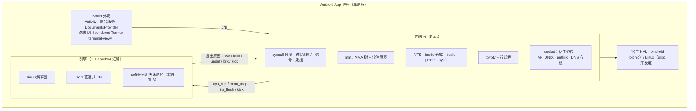

# appine 设计文档

- **状态**：草案 v0.1，所有决策已于 2026-10-24 的设计评审中逐条确认
- **范围**：v1
- **一句话**：一个能上 Google Play 的**单进程** Android App，在进程内用解释器 / 同 ISA 二进制翻译运行未经修改的 Alpine Linux aarch64 用户态程序。思路与 iSH 相同，是它在 Android 上的对应物。

---

## 1. 目标与非目标

### 1.1 目标

- 用户从 Play 安装 App、打开即得到一个 Alpine shell，不需要 root、不依赖 Termux，也不需要任何额外步骤。
- 整个 Linux 环境都跑在 App 自己的进程里，Android 12+ 的 phantom process killer 对它不起作用。
- 直接运行 Alpine 官方 aarch64 仓库里**未经修改**的二进制。

### 1.2 v1 负载分档

| 档位 | 负载 | v1 要求 |
|---|---|---|
| A 日常 CLI | busybox ash、`apk`、coreutils、vim、git、curl、openssh client | **全部可用** |
| B 计算型 | python3、gcc/make 编译中等规模的 C 项目、`./configure` | **能跑通** |
| C 难缠的运行时 | Go 静态二进制、node/V8、JVM | **行为正确，不要求快** |
| D 不做 | docker/podman（namespace、cgroup）、systemd、内核模块、X11/GUI | — |

ptrace（gdb/strace）推迟到 v1 之后。

### 1.3 性能目标

- CPU 密集任务比原生慢 **3–5 倍以内**（JIT 级别）。这个目标会在 M2 由性能探针实测后复核。
- 交互延迟优先：`ls`、tab 补全不能让人感到卡顿。

---

## 2. 硬约束

| 约束 | 来源 | 后果 |
|---|---|---|
| **Google Play 合规** | Device and Network Abuse 政策：不得下载可执行代码（dex/JAR/.so），"在虚拟机或解释器中运行的代码"除外 | 从网络下载的 Alpine 二进制**不能在宿主 CPU 上直接执行**，CPU 后端只能是解释器或翻译器 |
| 单进程 | 设计目标 + phantom process killer | 所有 guest 进程共享一个宿主地址空间，guest 进程之间的隔离和 fork 都得在软件里实现 |
| W^X 执行限制 | targetSdk ≥ 29 不能 `execve` App 数据目录里的文件 | 不使用 execve，也不依赖宿主加载器 |
| 存储限制 | SELinux：App 不能建硬链接、不能 `chown`、不能 `mknod`；共享存储不区分大小写、没有权限位、不能建 symlink | 文件系统的元数据和命名空间都要自己实现 |
| 网络限制 | targetSdk ≥ 30 不能 bind `NETLINK_ROUTE`，`RTM_GETLINK` 也被拦截；没有 `CAP_NET_RAW` | netlink 在进程内模拟，ICMP 改走 ping socket |
| 页大小 | Android 15 起要求 App 兼容 16KB 页内核 | 给 guest 呈现的页大小必须和宿主页大小解耦 |
| 宿主地址空间 | GKI 常见配置是 4K 页 + 39-bit VA，用户态只有约 512GB | 不能给每个 guest 进程预留很大的连续地址空间 |

**最低系统版本：minSdk 29（Android 10）**。DNS 存根依赖 `android_res_nsend`，它从 API 29 开始提供。

---

## 3. 总体架构



分层原则：

- **引擎**只关心"执行 guest 指令"。遇到 `svc`、访存缺页、未定义指令、`brk` 时，把控制权交给内核层。
- **内核层**实现 Linux 用户态 ABI，持有所有 guest 状态：进程、地址空间、fd、文件系统。
- **宿主 HAL** 把宿主的差异隔离开。开发阶段的宿主是 Linux arm64，生产宿主是 Android；不写 macOS 版本的 HAL。
- 核心库（引擎 + 内核层）**不依赖任何 Android 组件**。Android 相关的部分只在 HAL 和 Kotlin 外壳里出现。

---

## 4. CPU 引擎

### 4.1 Guest ISA

guest 是 **aarch64**，直接使用 Alpine 官方 aarch64 仓库。这样选有三个好处：

- guest 和宿主的内存模型都是 ARM 弱序，没有 x86 TSO 与 ARM 弱序之间的转换问题。
- 同 ISA 翻译时，大量指令可以原样拷贝。
- 按 arm64 规范，修改代码之后必须执行 `ic ivau` + `isb`，所以这条指令可以直接当作失效翻译缓存的钩子，不需要对代码页做写保护。

### 4.2 分层

**Tier 0：解释器。**
- 负责冷代码、短命进程、调试，同时作为语义上的参考实现。
- 分发采用 `[[clang::musttail]]` 尾调用的 threaded 风格。
- 和 Tier 1 共享 guest 状态布局、soft-MMU 接口和异常上报接口。
- **SIMD&FP 数据处理、CRC32 和 LSE 原子指令用"原生单指令执行"实现**（M1a 决定）：白名单判定（§4.4）、地址翻译和寄存器搬运写在 C 里，运算本身交给宿主执行同一条指令。每个指令编码对应一段缓存起来的小桩（`core/engine/src/c/native.c`）：通用寄存器字段被换成宿主临时寄存器，执行前从 CPU 上下文读入、执行后写回；FP 类的桩还会载入并写回 V0–V31、FPCR、FPSR 和 NZCV，同时保存和恢复宿主的 d8–d15 与 FPCR。LSE 指令的地址字段换成翻译好的宿主指针。
  - 好处：结果与硬件逐位一致，NaN 传播、舍入、FZ/DN、FPSR 累积标志都不需要自己实现；实现量只有白名单解码和访存部分。
  - 代价：对 SIMD&FP 而言，Tier 0 不再是独立于硬件的参考实现（硬件本来就是 lockstep 的标准答案）；Tier 0 需要宿主能分配可执行内存（Android 允许 JIT）；只能运行在 aarch64 Linux 宿主上，非这类宿主不宣告 FP/ASIMD。
  - SIMD&FP 的访存（LDR/STR/LDP/STP 的 B/H/S/D/Q 形式、LD1–LD4/ST1–ST4 的多结构、单结构和 replicate 形式）仍用 C 经 soft-MMU 实现：先确认要访问的每一页都可访问，再读写，失败时没有副作用。

**Tier 1：同 ISA 直通式 DBT。** 在 `core/engine/src/c/dbt.c`，`appine-run --tier 1` 和 Android App 使用它。M2 是原型，M7 补全成正式版（见 §14 的 M7 结果）。
- **寄存器约定**：guest 的 X0–X15、X19–X25、X29、X30 放在同号的宿主寄存器里，guest SP 放在宿主 X26；宿主 X28 指向 CPU 上下文，X16、X17、X27 是临时寄存器。guest 自己的 X16、X17、X18、X26、X27、X28 存放在上下文里（"被占用的寄存器"）。SP 出现在 17% 的指令里（函数的序言和尾声），X26 是编译器生成的代码里用得最少的被调用者保存寄存器（gcc 的 cc1 里不到 SP 的十分之一），所以宿主 X26 让给 SP。被占用的寄存器：引用它们的指令先把值读进临时寄存器，改写寄存器字段后执行，再写回。宿主 X18 是平台寄存器（Android 上 ShadowCallStack 用它），翻译后的代码不碰它，宿主的信号处理函数随时可以用（R6）。guest 的 NZCV、FPCR、FPSR 和 V0–V31 就是宿主的（§4.3），所以插入的代码一律不改动条件标志（用 `cbnz`/`tbnz`/`eor` 代替 `cmp`）。
- 只读写寄存器的 ALU、FP、NEON 指令**原样拷贝**。SIMD&FP 数据处理的白名单判定与 Tier 0 共用同一个函数。
- 需要改写的指令：
  - 访存指令，包括 SIMD&FP 的 LDR/STR/LDP/STP 和 LD1–LD4/ST1–ST4：插入 soft-MMU 的 TLB 快速路径，访问换成宿主地址。
  - 分支和 PC 相对寻址（`adr`/`adrp`/`ldr literal`）：改成以 guest PC 为基准的常量。
  - `svc`：转去调用内核层。
  - `mrs/msr tpidr_el0`、`mrs dczid_el0`：读写 guest 状态结构里的字段，或者换成常数。
  - `ldxr…stxr`：改写成比较并交换，见 4.5；LDAR/STLR 和 LSE 原子指令在翻译好的宿主地址上原样执行。
  - `dc zva`：翻译地址后用 `stp xzr` 清零。`dc cvau`、`ic ivau` 交给 Tier 0：前者只检查地址，后者让内核作废翻译（见下面的"失效"）。
  - PAC 系列 HINT 指令（`PACIASP`/`AUTIASP` 等）：改写为 NOP，见 4.4。
  - `mrs ID_*_EL1`、写 FPCR/FPSR 这类少见的系统寄存器访问交给 Tier 0 执行。
- **访存快速路径**（算地址之外 6 条宿主指令）：算出 guest 地址 → 用最后一个字节所在页的下标取出 TLB 表项，一条 `ldp` 取出 tag 和 addend → 与第一个字节所在的页比较 → 访问 `addend + 地址`。TLB 直接映射，跨页时第一页的页号不可能出现在下一页的表项里，所以这一次比较同时排除了跨页访问。未命中时跳进代码缓存里的回填例程：它按 §5.1 的结构遍历页表、填好表项，再回来重新检查。只有页没有映射、权限不符、跨页、SP 未对齐或者地址带 TBI 标签时，才退出到分发器，由 Tier 0 执行这一条指令；这时指令还没有产生任何副作用，所以异常是精确的。
- **控制流**：块不在条件分支处结束，不跳转的一侧接着翻译，跳转的一侧是侧出口。直接分支通过块链接回填成一条 `b`；条件分支的目标在它的偏移范围内时，直接改写条件分支本身。间接分支（`br`/`blr`/`ret`）先查一张 4096 项的跳转缓存，未命中再回到分发器。函数调用（`bl`/`blr`）翻译成宿主的 `bl`，跳过紧随其后的"落点"（链接到 guest 返回地址处的块），再把 (guest 返回地址, 落点) 压进线程的影子返回栈；`ret` 看到栈顶等于 x30 就弹栈、用宿主 `ret` 跳回落点，由宿主的返回地址栈预测，对不上时（longjmp、信号处理函数、协程切换）才查跳转缓存。影子栈是 64 项的环形缓冲，每一项都跳往继续执行它记的 guest 地址的代码（空项按 x30 查找），翻译缓存清空时整体重置。经由后向边或间接分支进入块时检查 kick 标志：块的起始地址沿前向边严格递增，任何循环里至少有一条边会经过检查，所以链接成环的循环也能被打断。
- Tier 0 不认识的指令同样交给 Tier 0 执行，保证两层的白名单完全一致（§4.4）。
- 精确状态几乎是免费的：宿主 `ucontext` 里的寄存器就是 guest 寄存器，被占用的寄存器另外保存在上下文里。
- **翻译共享**：一个块的翻译只取决于它的 guest pc 和翻译过的指令字，与进程、映射无关。每翻译一个块就存成模板，放进所有实例共用的模板区；别的实例（另一个线程、fork 出来的子进程、又一次 exec 的同一个程序）要翻译同一个 pc 时，先比对指令字，相同就把模板拷进自己的代码缓存，只重新计算跳往例程的几条 `b`。块之间的链接在各自的拷贝里回填，所以不需要像原计划那样按 `(inode, offset)` 识别文件页，不同进程在同一地址映射了不同的代码也不会互相影响。`./configure` 这类负载里 85% 的块直接来自模板。
- **翻译保留**：exec 之后、以及实例回到池里再交给下一个线程时，翻译不清空，标成待核对；下次运行之前逐块比对 guest 指令字（每个块记着自己翻译时的指令字），对不上的按"失效"的办法作废，大部分对不上时（exec 了别的程序）才整体清空。这和拷贝模板时的比对是同一件事，只是一次做完：shell 脚本里反复 exec 的 busybox、fork 出来的子进程，都不用再逐块拷贝模板、重新链接、同步指令缓存。块数超过 32768 的实例放回池里时仍然清空。
- **失效**：guest 修改代码之后执行的 `ic ivau`，以及可执行映射的拆除和权限变化，都记进 `mm` 的代码失效日志，并递增代码代数；每个线程重新进入 guest 代码之前，按自己错过的范围逐页作废翻译（日志保留最近 4096 个代数，落后更多时整体清空）。作废的块入口改成跳往一个转发桩，重新翻译之后旧入口直接跳往新的块，别的块链接到旧入口的跳转不用找出来改写。CTR_EL0 报告 DIC = IDC = 0，guest 修改代码之后一定会执行 `ic ivau`。
- JIT 代码页使用 **W^X 双映射**：同一段共享匿名内存用 `mremap` 映射两次，一份 RW 用来写入，一份 RX 用来执行，不依赖 memfd；宿主不允许时退回 RWX。Tier 0 的原生指令桩也这样分配。

**否决了以 dynarmic 为核心的方案**，见 §15。dynarmic 是 0BSD 许可，可以直接借用它的 A64 解码表（`frontend/A64/decoder`）和测试用例。

### 4.3 FP 状态

FP 和 NEON 指令都在宿主上原生执行。所以每次从宿主代码进入 guest 代码，都要把 guest 的 FPCR 装进宿主 FPCR；回到宿主 C 代码之前再恢复，避免 guest 设置的 flush-to-zero 之类的模式影响我们自己的代码。Tier 1 的进入例程保存宿主的 d8–d15 和 FPCR，载入 guest 的 FPCR、FPSR 和 V0–V31，翻译后的代码里它们一直在宿主寄存器里；退出例程保存 guest 的 V0–V31 和 FPSR，再恢复宿主的状态。

### 4.4 CPU 特性基线

**原则：guest 看到的特性集合 = 宿主 CPU 支持的 ∩ Tier 0 已实现的 ∩ 白名单。**

- `AT_HWCAP`/`AT_HWCAP2`、`/proc/cpuinfo` 的 Features 行、guest 读 `mrs ID_AA64*_EL1` 得到的值，三者从**同一份集合**生成。
- 白名单以外的编码，在两个 Tier 里都投递 SIGILL（`ILL_ILLOPC`），**绝不把它们原样拷贝执行**。
- 两个 Tier 对同一条指令的语义必须一致。PAC 在 Tier 1 原样执行会用宿主密钥签名，而 Tier 0 只能把它当 NOP。为了一致，Tier 1 也把它们改写成 NOP，并且不宣告 PACA/PACG。
- 通用定时器的 `CNTVCT_EL0`、`CNTFRQ_EL0` 与 Linux 一样允许 EL0 读，两个 Tier 都读宿主的值（M8）。Go 的运行时和 V8 直接读它们计时，原来是 SIGILL。
- **实现**（M1a，`core/engine/src/c/features.c`）：启动时读宿主的 `AT_HWCAP`，与 Tier 0 已实现的集合求交，作为 guest 的 `AT_HWCAP`（`AT_HWCAP2` 为 0）；guest 读 ID 寄存器空间（`MIDR_EL1`、`ID_AA64ISAR0_EL1`、`ID_AA64PFR0_EL1` 等）时，返回与这份集合一致的值。`/proc/cpuinfo` 随 procfs 一起生成（M3b）。
- **白名单的独立核对**：硬件只能告诉我们一条编码能否执行，分不清它属于基础集还是 FP16 之类没宣告的扩展。所以另用 LLVM 的反汇编器（`llvm-mc`，按 guest 特性集合设置 `-mattr`）做对照：在 SIMD&FP 数据处理、SIMD 访存、独占访问、LSE、整数 2 源数据处理这几个编码空间里随机抽样，Tier 0 认为能执行的编码必须恰好是 LLVM 能解码的编码（`tests/lockstep/tests/whitelist.rs`）。对"应当全为 1"（SBO）的字段，沿用 LLVM 的口径：独占访问和 LDAR/STLR 忽略它们，CAS/CASP 的 Rt2 必须全为 1。

| 级别 | 特性 |
|---|---|
| 必须 | FP、ASIMD（v8.0）、CPUID |
| 宿主支持时宣告 | ATOMICS（LSE）、AES、PMULL、SHA1、SHA2、CRC32 |
| v1.x | ASIMDDP、LRCPC、SHA3、SHA512 |
| v1 不做 | FP16（FPHP/ASIMDHP）、SVE/SVE2/SME、BF16、I8MM、PACA/PACG、BTI、MTE |

宣告 LSE 之后，libgcc 的 outline atomics 和 Go 会改走单条原子指令，这类指令很容易翻译。但 musl 的原子操作是用 `ldaxr`/`stlxr` 内联汇编写死的，所以 **LL/SC 必须支持**。

### 4.5 独占访问（LL/SC）

在 `ldxr` 和 `stxr` 之间插入额外的访存（比如 TLB 查找），可能会让独占监视器失效，导致活锁。处理办法是：识别出整个 LL/SC 序列，在序列开始前一次性完成地址翻译；做不到的就把整段改写成 CAS 语义，或者整段放到慢路径执行。DynamoRIO 在 AArch64 上遇到过同样的问题，可以参考它的做法。soft-MMU 翻译得到的是真实宿主指针，所以原子指令直接作用在宿主内存上，多个线程或进程共享同一页时语义天然正确。

**Tier 0 的做法**（M1a，`core/engine/src/c/atomic.c`）：LDXR/LDXP 记下地址、长度和读到的值；STXR/STXP 在宿主地址上做比较并交换，只有内存值仍等于记下的值才成功，与 QEMU 的做法相同（允许 ABA，对正确的 LL/SC 用法没有影响）。CLREX 和 svc 都会清掉独占标记。要求自然对齐，否则是对齐错误。LDAR/STLR 用 C 的 acquire/release 原子操作实现；LSE 原子指令和 CAS/CASP 交给原生桩，在翻译后的宿主地址上原样执行。

**Tier 1 的做法**（M7）：语义与 Tier 0 相同，不需要识别整个序列。LDXR 查过 TLB 之后在宿主地址上读（LDAXR 用 `ldar`），记下地址、长度和读到的值。STXR 先确认独占标记是同一地址、同一长度，再在宿主地址上用 `ldaxr`/`stlxr` 循环做比较并交换：两条指令之间只有寄存器运算，没有访存，宿主的独占监视器不会被我们自己的代码清掉。CLREX 清掉标记，svc 退出时也清掉。LDAR/STLR、CAS 和 LSE 原子指令换上宿主地址原样执行。成对的 LDXP/STXP，以及操作数是被占用寄存器的 CASP 很少见，仍交给 Tier 0。

---

## 5. 内存：轻量用户态 soft-MMU

这里**不模拟** ARM 的硬件页表，包括 TTBR、描述符格式、TLBI/ASID、异常级别、物理地址层和 MMIO，但**要自己实现 Linux mm 的语义**。

### 5.1 数据结构

- **每个进程一个 `mm`**，包含两部分：
  - VMA 区间树：实现 mmap/mprotect/munmap 语义，并用来生成 `/proc/<pid>/maps`。
  - 页表：以 guest 虚拟页号为键的基数树，表项内容为 `{宿主页指针, R/W/X/COW 标志位}`。只有 TLB 未命中时，我们自己的 C 代码才会遍历它。
- **每个线程一个软件 TLB**：直接映射，4096 项（M7 从 512 项加大），每项 `{读 tag, 读 addend, 写 tag, 写 addend}`。tag 存的是页号取反，0 表示无效，所以清零的内存就是空的 TLB，新线程不必逐项写入，没碰过的页不占内存。表项填写时记进一张位图，清空时只处理填过的项，所以 munmap 频繁的程序清空 TLB 也不贵。

Tier 1 的 TLB 命中路径（8 字节的读；x16 = guest 地址）：

```asm
add  x17, x16, #7            // 最后一个字节
ubfx x17, x17, #12, #12      // 它所在页的页号低 12 位 → TLB 下标
add  x17, x28, x17, lsl #5   // x28 指向 CPU 上下文
ldp  x17, x27, [x17, #TLB]   // tag（页号取反）, addend
eon  x17, x17, x16, lsr #12  // 与第一个字节所在的页比较，跨页时一定不等
cbnz x17, refill
ldr  x0, [x27, x16]          // 宿主地址 = addend + guest 地址
```

- **TLB 未命中**：查基数树（Tier 1 在代码缓存里的回填例程中查，Tier 0 在 C 里查）。查不到，或者权限不符，就交给内核层，由它给 guest 投递 SIGSEGV 或 SIGBUS。
- **TLB shootdown**：多个线程共享一个 `mm` 时，页表可以在被别的线程遍历的同时修改（表项用原子操作读写，中间表在 `mm` 销毁前不释放）。解除映射或降低权限之后，修改方递增 `mm` 的代数，打断正在执行 guest 代码的其他线程，等它们退出 guest 代码；每个线程重新进入 guest 代码之前比较代数，变了就刷新自己的 TLB。只增加权限时不刷新：TLB 里的旧表项只是少了权限，未命中时会重新填写。代码的变化另有一个代数和失效日志，见 §4.2。被解除映射的宿主内存要等 shootdown 完成后才释放，所以 guest 自己的数据竞争碰不到已经还给宿主的内存。

### 5.2 页与后备内存

- guest 页**固定 4K**，不管宿主页是 4K 还是 16K。`AT_PAGESZ` 报告 4096。
- 匿名内存按大块 arena（如每块 2MB）从宿主申请，再切成 4K 页，宿主 VMA 数量因此保持很少。所有 guest 进程共用宿主的 `vm.max_map_count`，这一点很重要。
- 文件映射直接用宿主 `mmap(objects/<ino>)` 的页作为后备内存。如果宿主是 16K 页，就映射包含目标位置的 16K 对齐区间，再把页表项指向区间里正确的 4K 偏移。这样带来两个好处：
  - busybox/musl 的代码页通过宿主 page cache **在所有 guest 进程之间共享**。
  - `MAP_SHARED` 映射和 `read`/`write` 之间天然一致。
- 进程间的 `MAP_SHARED` 匿名内存，就是让两张页表指向同一个宿主页。System V 共享内存段同理：段持有一段宿主内存，`shmat` 把它映射进地址空间。
- 宿主内存总是可读写，guest 的权限只记在页表里，所以宿主的内存提交量（overcommit 记账）按 Linux 的规则由 guest 的参数决定：只有可写的私有映射计入，`MAP_NORESERVE`、只读和 `PROT_NONE` 的映射用 `MAP_NORESERVE` 向宿主申请（M8）。V8 为每块 wasm 内存预留 8 GB 的 `PROT_NONE`，计入的话在内存小的设备上直接失败。
- `PROT_NONE` 的页不放进页表，mprotect 加上权限时再放：8 GB 的预留逐页写页表要占 16 MB。页表的解除映射和修改权限遇到没有中间表的地方整段跳过。
- `MADV_DONTNEED` 把私有匿名内存里整页的部分交给宿主的 `madvise` 回收，宿主页比 4K 大时两头不满一页的部分清零。Go、JVM、V8 的 GC 用它归还内存，全部清零反而会让这些页实际占用内存。
- 文件映射超出 EOF 的整页不放进页表，访问它们时宿主 mmap 会产生 SIGBUS。guest 访问这些页，得到的是 guest 自己的 SIGBUS（`BUS_ADRERR`）；共享映射的文件后来变长了，就把新的内容映射进来，重新执行那条指令。文件被截短时（truncate、ftruncate、`O_TRUNC`，都经过内核层），所有地址空间里映射它的页超出新末尾的部分从页表里拿掉，再做 shootdown，与 Linux 的 truncate 相同。

### 5.3 fork

- **v1：全量复制。** shell 的 fork 通常紧接着 exec，复制几 MB 内存的代价可以接受。复制之前先让同一 `mm` 的其他线程停在 guest 代码之外（与 shootdown 用同一套机制），得到 fork 那一刻的快照；全零的页不复制，没碰过的栈页因此不会在子进程里占用内存。从来没有可写过（内核也没有写过）的匿名映射内容全是零，整段跳过，不逐页检查（M8：V8 的 wasm 预留区原来让 node 的每次 fork 多花一秒）。写过的匿名映射按 `/proc/self/pagemap` 只看宿主碰过（在内存里或已换出）的页：栈的 VMA 有 8 MB，用到的只是顶上一点。不能用 mincore，它把换出到 zram 的页也报告成"不在"，跳过就丢了数据。
- **v2：页引用计数 + CoW。** 用页表项里的 COW 位实现，不依赖宿主的 `mprotect`。

### 5.4 guest 地址空间布局

guest 地址空间的布局由我们自己的 mmap 实现决定，不受宿主地址空间布局的限制。软件页表的规模只和实际用到的页数有关，所以 V8 那种动辄预留几个 GB 的做法也能满足。

---

## 6. 进程、线程与调度

- **1:1 线程模型**：每个 guest 线程（`struct task`）对应一个宿主 pthread，调度交给宿主内核。
- **大内核锁（BKL）**：进入 syscall 时获取；执行 guest 代码时**不持有**；在内核层里等待之前**释放**。之后按 profiling 结果逐步拆分。
- **统一的等待机制**：guest 线程永远不直接阻塞在宿主 syscall 上。所有等待都走以下两种途径之一：
  - 自管的 wait queue（mutex + condvar）；
  - 宿主 `poll()`，监听集合里包含该线程专属的 **eventfd**，作为唤醒通道。

  这样 guest 信号、futex 和 I/O 就绪都走同一条唤醒路径，也不需要用宿主信号去打断阻塞调用，避免了和 ART/bionic 抢信号编号。
- **futex**：以翻译后的宿主地址为键，用自管 wait queue 实现。不同 guest 进程共享同一页时也能正确等待和唤醒，而且信号可以唤醒指定线程。别的等待在任何相关修改之后都被全部叫醒、各自重新检查；futex 的等待者不在这个名单里，只被 FUTEX_WAKE（它只通知被唤醒的那几个线程）、信号和结束线程组直接通知：JVM、Go 运行时里停在锁和条件变量上的线程很多，原来别处的每次修改都把它们全部叫醒一遍。
- **TLS**：guest 的 `tpidr_el0` 只是 guest 状态结构里的一个字段。**宿主的 `TPIDR_EL0` 永远是 bionic 的值**，所以 ART 的信号处理链可以安全运行。
- **PID 1**：内核层内置一个虚拟的 init。它不对应任何 guest 程序，只负责收养孤儿进程、回收僵尸进程。每个终端标签页的登录 shell 都是它的子进程。v1 不运行 OpenRC。
- **namespace**：不支持。`unshare`、`setns`、`clone(CLONE_NEW*)` 一律返回 `EPERM`。

---

## 7. 信号与 ABI

### 7.1 信号帧

信号帧**逐字节照抄 Linux arm64 的布局**：

- `siginfo` + `ucontext`；`sigcontext` 包含 `fault_address`、`regs[31]`、`sp`、`pc`、`pstate`，后跟 `__reserved` 区里的上下文记录：
  - `fpsimd_context`：每次都带（FPSR、FPCR、V0–V31）。
  - `esr_context`：只在同步异常时带，由我们合成 EC、WnR、DFSC 字段。
  - 以一个空记录结尾。**不带** `sve_context`/`za_context`。
- 帧下方压入 `frame_record {fp, lr}`，整体按 16 字节对齐。`AT_MINSIGSTKSZ` 要和实际帧大小一致。
- v1 就完整支持 `sigaltstack`，包括 `SS_ONSTACK`、`SS_DISABLE`、`SS_AUTODISARM`。
- 返回地址：设置了 `SA_RESTORER` 时用 `sa_restorer`，否则指向 vDSO 里的 `__kernel_rt_sigreturn`。

### 7.2 vDSO

- v1 提供一个最小但真实的 ELF 镜像，通过 `AT_SYSINFO_EHDR` 交给 guest。镜像只有一页，每个进程映射一份只读、可执行的私有拷贝（与 Linux 一样，调试器可以在里面下断点）。
- `__kernel_rt_sigreturn` **必须恰好是 `mov x8, #139; svc #0` 这两条指令**，因为 libgcc 的 unwinder 靠逐字节匹配它们来识别信号帧。
- 时间函数（`__kernel_clock_gettime`、`gettimeofday`、`clock_getres`）在 v1 里只写成 `svc` 存根。
- v1.x 实现快速路径：guest 代码直接读 `CNTVCT_EL0`，再配合一个由我们更新的 vvar 页提供换算系数。

### 7.3 投递精度

| 类型 | 规则 |
|---|---|
| 访存出错（SIGSEGV/SIGBUS） | pc 指向出错的那条指令；`si_addr` 是精确的 guest 地址；`si_code` 区分 `SEGV_MAPERR`/`SEGV_ACCERR`；基址寄存器的回写（post-index、`ldp`）不能提前生效 |
| `brk #imm` | 投递 SIGTRAP，`si_code` 为 `TRAP_BRKPT`；与 Linux 一样，信号帧里没有 `esr_context` |
| 对齐错误 | 投递 SIGBUS，`si_code` 为 `BUS_ADRALN`。ESR 的 EC：数据访问（独占访问、原子操作）是 0x24，DFSC 为对齐错误；SP 未对齐是 0x26，`si_addr` 是 SP；PC 未对齐是 0x22 |
| `udf` 和白名单外的编码 | 投递 SIGILL，`si_code` 为 `ILL_ILLOPC` |
| 异步信号 | 解释器在指令边界投递；DBT 在块出口和循环回边检查每线程的 pending 标志后投递 |

- `rt_sigreturn` 恢复全部通用寄存器和 FPSIMD 寄存器，并校验每个记录的 magic 和 size，帧损坏时投递 SIGSEGV。信号处理函数**可能修改 pc**（Go 的异步抢占就会这样做），所以恢复后引擎要按新的 pc 重新查找翻译。
- syscall 重启语义照搬 Linux 的 `ERESTARTSYS`/`ERESTARTNOHAND`/`ERESTARTNOINTR`/`ERESTART_RESTARTBLOCK`（配合 `restart_syscall`）。因为 `x0` 会被返回值覆盖，需要像 Linux 那样**另外保存一份 `orig_x0`**。

### 7.4 宿主侧信号

宿主侧只需要处理两种信号：文件映射越过 EOF 时的 SIGBUS，以及引擎自身 bug 导致的 SIGSEGV（转成崩溃报告）。用普通 `sigaction` 安装即可，libsigchain 会把我们的处理函数链在 ART 自己的处理函数之后。

实际上宿主的 SIGBUS 都可以事先避开（§5.2）：映射时就超出 EOF 的页不放进页表，映射之后文件被截短时把超出新末尾的页从页表里拿掉。仓库的 object 文件只有 appine 自己会改，所以不需要宿主侧的 SIGBUS 处理函数。

### 7.5 auxv 与内核版本

- auxv 依次提供：`AT_HWCAP`/`AT_HWCAP2`（§4.4）、`AT_PAGESZ=4096`、`AT_MINSIGSTKSZ`、`AT_SYSINFO_EHDR`、`AT_RANDOM`、`AT_SECURE`、`AT_PLATFORM="aarch64"`、`AT_EXECFN`、`AT_CLKTCK=100`、`AT_PHDR`/`AT_PHENT`/`AT_PHNUM`/`AT_ENTRY`/`AT_BASE`，以及 `AT_UID`/`AT_EUID`/`AT_GID`/`AT_EGID`。
- `uname -r` 固定报告一个 LTS 版本，比如 `6.1.0-appine`。我们把它当作一份 **ABI 契约**：除文档明确列出的例外，按这个内核版本的语义实现。
- 未实现的 syscall **一律返回 `ENOSYS`，绝不崩溃**，同时记录一条本地调试日志。

---

## 8. 文件系统

### 8.1 rootfs：inode 仓库

- **SQLite** 保存完整的命名空间：目录项、inode、symlink 目标、xattr。使用 WAL 模式，SQLite 以 amalgamation 形式随 App 打包（NDK 不对外提供系统 SQLite）。
- 每个普通文件的数据存成一个宿主文件 `objects/<ino>`。目录、symlink、设备节点、FIFO、socket 文件只存在于数据库里。
- 元数据的归属：
  - 普通文件的 **size 和 mtime 以宿主 object 文件为准**。`utimensat` 直接对宿主 object 调用 `futimens`。
  - mode、uid/gid、ctime、xattr、nlink 存在 SQLite 里。
- 硬链接就是多个目录项指向同一个 ino。`rename`/`unlink` 在同一个 SQLite 事务里完成。被 LMK 杀掉进程不会丢失已提交的事务。
- 读写数据直接对宿主 fd 做 `pread`/`pwrite`。路径查找和 stat 走内存里的元数据缓存（目录项，包括不存在的名字；inode 行；符号链接目标；目录列表），不逐级查询数据库。自己的写入只去掉受影响的条目。多个进程可以共用一个仓库，所以仓库目录里 `lock` 文件的前 8 字节是所有进程共享映射的提交计数器：每次提交之后加一，缓存发现它不是因为自己的提交而变了，就整体作废。缓存没命中时，一次路径解析里的所有查询共用一个读事务：WAL 模式下每条语句单独开、关读事务都要 fcntl 加解锁，比查询本身还贵。
- 删除最后一个链接时立即删除宿主 object：已经打开的宿主 fd 仍然可以读写和 fstat，数据在最后一个 fd 关闭时由宿主释放。inode 行以 nlink = 0 保留，下次打开仓库时清理。
- 每个元数据操作是一个事务（`BEGIN IMMEDIATE`），多个 appine 进程可以同时使用同一个仓库：写事务互相等待，只有独占打开仓库时才清理 nlink = 0 的 inode。M4 实测过这样做的代价，`apk add` 的瓶颈不在这里（见 M4 结果）。

### 8.2 挂载表

| 挂载点 | 文件系统 |
|---|---|
| `/` | inode 仓库 |
| `/dev` | inode 仓库里的目录，标准设备节点（`null`、`zero`、`full`、`random`/`urandom`、`tty`、`console`、`ptmx`）每次启动时补齐，打开时按设备号找到进程内的实现 |
| `/dev/pts` | devpts：每个 PTY 一个 `/dev/pts/N`，随 PTY 的创建和关闭出现和消失 |
| `/proc` | procfs：根据内核层的 task、mm 等结构实时合成 |
| `/sys` | 暂时是空目录 |
| `/tmp` | 默认放在 inode 仓库里，不用内存 tmpfs，避免占用 App 内存配额 |
| `/mnt/<名字>` | SAF 目录挂载（v1.x，见 §11.3） |

### 8.3 inotify

所有文件系统修改都经过内核层，所以 inotify 不需要宿主参与：各个 syscall 改完仓库之后报告事件，报告的位置和顺序与 Linux 的 fsnotify 钩子相同。监视按仓库的 inode 登记；没有任何监视时，每个事件只多一次判空。

- 文件上的事件同时报给它所在目录的监视，带上文件名。按路径的操作只在有监视时再解析一次路径，找出文件所在的目录。按 fd 的操作（读写、截断、关闭）用打开时经过的目录：仓库没有按 inode 反查目录项的索引，所以打开之后又被改名的文件，事件仍然报给原来的目录。监视建立之前就打开的文件只报给它自己的监视。
- `IN_CLOSE_*` 在打开文件的最后一个引用释放时报告，与 Linux 的 fput 相同。`IN_DELETE_SELF` 在最后一个链接删除时就报告，不等文件关闭。
- procfs、devpts 上可以建监视，但不会有事件。`/proc/sys/fs/inotify/*` 和 `/proc/<pid>/fdinfo/<fd>` 的格式与 Linux 相同。

---

## 9. TTY 与终端

- **PTY 和行规程完全在进程内实现**。如果借用宿主 PTY，宿主的 `ISIG` 会把信号发给宿主进程组，而宿主根本不知道 guest 进程组的存在。实现覆盖以下内容：
  - termios：`ICANON` 行编辑、`ECHO*`、`ICRNL`/`OPOST`/`ONLCR`、`VMIN`/`VTIME`。
  - 作业控制：`ISIG` 发信号给 guest 前台进程组；`setsid`/`TIOCSCTTY`/`tcsetpgrp`；后台进程组读写终端时的 `SIGTTIN`/`SIGTTOU`；会话关闭时的 `SIGHUP`；`TIOCSWINSZ` 触发的 `SIGWINCH`。
- guest 可以通过 `/dev/ptmx` 自己申请 PTY，tmux、screen、`script`、sshd 都依赖这一点。
- App 里每个终端标签页对应一个 `/dev/pts/N`，在上面启动一个新会话和登录 shell。
- **终端 UI**：把 Termux 的 `terminal-emulator` + `terminal-view` vendor 进仓库，替换掉原来的 `TerminalSession`（它是 `final` 类，并且写死了 `JNI.createSubprocess`）。新实现继承 `TerminalOutput`，通过 JNI 接到进程内 PTY master 的 ring buffer。扩展键栏属于 GPLv3 的 `termux-app` 主模块，需要自己重写。
- 开发阶段的 CLI 前端 `appine-run` 把宿主终端切到 raw 模式，把它当作 PTY master 使用：一个桥接线程把宿主的按键写进 master，把 master 的输出写回宿主，宿主的 SIGWINCH 变成 `TIOCSWINSZ`。`--pty` 在宿主 stdin 不是终端时也这样做，测试就是经由管道发送 ^C、^Z 这些字节。

---

## 10. 网络

| 子项 | 做法 |
|---|---|
| TCP/UDP | 透传给宿主：guest 的 file 对象内部持有一个宿主非阻塞 socket |
| ICMP | 把 guest 的 `SOCK_RAW + IPPROTO_ICMP` 翻译成宿主的 `SOCK_DGRAM + IPPROTO_ICMP`（ping socket） |
| `NETLINK_ROUTE` | 在进程内模拟，接口和地址取自宿主的 `getifaddrs`（targetSdk 37 下 bionic 仍能列出，只是没有 MAC）；不够用时再改为通过 JNI 从 `ConnectivityManager`/`LinkProperties` 获取 |
| DNS | `resolv.conf` 写 `nameserver 127.0.0.53`。socket 层截下发往这个地址 53 端口的 UDP/TCP 请求，交给 `android_res_nsend`，这样系统的私人 DNS、VPN 和按网络分流设置都能生效 |
| 1024 以下的端口 | v1 直接返回宿主给出的 `EACCES`，之后再加可配置的端口映射 |
| 回环地址 | 透传给宿主，Android 上的浏览器能直接访问 guest 里起的服务。代价是设备上的其他 App 同样能访问，需要写进文档 |
| AF_UNIX | 进程内模拟。`SCM_RIGHTS` 传递的是 guest fd，`SO_PEERCRED` 返回 guest 的 pid 和 uid |
| tun/VpnService | v1 不做 |

**I/O 多路复用**：每个 guest file 对象实现一个 `poll` 操作。宿主 fd 和进程内对象统一在 §6 的等待机制里处理。guest 的 `epoll` 在进程内实现，等待时把关注的宿主 fd 和线程自己的唤醒事件放进同一次宿主 `poll`（M4 没有用宿主 epoll，fd 很多时再换）。

`EPOLLET` 是近似的边沿触发（M8，Go 的 netpoller 全部用它）：某一位从未就绪变成就绪时触发。宿主 socket 上看不到"又来了一批数据"这种事件，所以改为看程序：程序在一个方向上用完数据（读写得到 EAGAIN，或者没有读写满要求的长度）之后，这个方向上次报告过的位作废，之后的数据一定会再触发一次。等待时不等报告过、仍然就绪的位，否则宿主 poll 立刻返回，epoll_wait 变成反复释放、获取 BKL 的忙等，把别的线程饿死；作为代价，程序用完数据时要叫醒这些 epoll_wait 重新计算要等什么。`epoll_ctl` 也叫醒正在等的线程，让它们按新的关注重新等。

---

## 11. 用户、权限与 Android 集成

### 11.1 凭据与权限

- 按 Linux 的 `struct cred` 实现：ruid/euid/suid/fsuid、对应的四个 gid、附加组、umask。凭据放在线程组里（libc 的 setuid 系列本来就会让每个线程都调用一遍）。VFS 做 DAC 权限检查（`generic_permission`、粘滞位、setgid 目录），root 经由能力绕过。
- **默认以 root 登录**。设置里提供"以指定用户登录"。
- setuid/setgid 位在 execve 时生效，并设置 `AT_SECURE`。
- 支持 `chroot`（每个进程记录自己的根目录）。
- capabilities 按 capabilities(7) 的规则随用户 ID 变化：有效用户 ID 为 0 时拥有边界集内的全部能力，变成非 0 时清空有效集，三个用户 ID 都非 0 时清空允许集，文件系统能力跟着 fsuid；`capset`、`PR_CAPBSET_DROP` 可以缩小。v1 不支持文件 capabilities 和环境（ambient）能力。
- guest 自己安装 seccomp 过滤器：v1 返回 `EINVAL`，v1.x 在内核层实现 cBPF 解释器。

### 11.2 生命周期

- 只要还有终端会话或 guest 进程在运行，就保持一个**前台服务**，类型为 `specialUse`。通知栏显示"N 个会话运行中"，附带"全部退出"按钮。
- 所有会话和 guest 内核的生命周期都**挂在 Service 上，不挂在 Activity 上**。
- 熄屏后继续运行依赖 `PARTIAL_WAKE_LOCK`，由用户手动开启，默认关闭。
- 在 `onTrimMemory` 中缩减可以重建的缓存：翻译缓存、dentry/inode 缓存、空闲 arena。
- 进程被杀后，v1 只恢复标签页布局、每个标签的 cwd 和滚动回看记录，并启动新的 shell，同时明确提示"上次会话因 App 被系统终止而结束"。v1 **不恢复进程**。
- 开机自启 v1 不做。

### 11.3 共享存储

- **v1：DocumentsProvider**。把登录用户的 home 目录注册为系统"文件" App 里的一个根，高级选项可以把整个 `/` 以只读方式暴露。用户在"文件" App 里用"复制到…"即可导入或导出文件。
- **v1.x：SAF 目录挂载到 `/mnt/<名字>`**。权限位是合成的（目录 0755、文件 0644）；`chmod`/`chown` 静默成功；`symlink`/`link` 返回 `EPERM`；目录列表在内存中缓存；不区分大小写这一点写进文档。
- 不申请 `MANAGE_EXTERNAL_STORAGE`，Play 不批准终端类 App 使用。

### 11.4 首次启动

1. 把 APK assets 里的 Alpine minirootfs 以流的方式导入 inode 仓库。打包前，构建脚本会按官方 sha256 和 GPG 签名校验这个 tarball，版本锁定为构建时最新的 stable 分支。
2. 写入 `/etc/resolv.conf`、`/etc/hosts`、`/etc/hostname`、`/etc/apk/repositories`、`/etc/profile.d/appine.sh`（`TERM=xterm-256color`、`LANG=C.UTF-8`、`PS1`）和 `/etc/motd`。
3. 以 root 身份启动 `ash -l`。

- **镜像选择**：APK 里内置一份镜像列表，包括 dl-cdn、TUNA、USTC、阿里云等。首次启动时在后台并发测速，选最快的写入配置，测速失败时退回 dl-cdn。设置里可以手动更换。
- **升级**：App 更新时不动用户已有的 rootfs。同一分支内由用户自己运行 `apk upgrade`；跨分支升级由用户修改 `repositories`。
- **v1 提供"重置 rootfs"**。rootfs 导出和导入（tar 格式）放到 v1.x。

---

## 12. 威胁模型

**对外声明**：和 iSH、Termux 一样，appine **不是安全沙箱**。我们不承诺在 guest 内部不同 uid 之间，以及 guest 和宿主 App 之间，提供安全边界。

**硬性工程不变量**：

1. guest 只能通过自己的页表访问内存。DBT 只原样拷贝白名单内的指令，所有访存指令都必须改写。
2. 内核层不把 guest 指针当作宿主指针。在 Rust 里用 `UserPtr<T>` 类型表示 guest 指针，它只能通过 `mm.read`/`mm.write` 访问。
3. 宿主路径永远不由 guest 输入拼出来，宿主侧只出现 `objects/<数字>` 形式的路径，symlink 只存在于数据库里。因此"恶意 tar 包借 symlink 逃逸"这类问题在结构上不可能发生。

**稳健性**：

4. **guest 自己的 OOM killer**：给所有 guest 内存设一个总上限，默认按设备内存的比例计算，可以配置。超出上限时由我们挑选一个 guest 进程杀掉，不让系统 LMK 杀掉整个 App。同时为 `RLIMIT_NPROC` 设置默认值，防止 fork 炸弹。
5. 内核层以 `panic=unwind` 编译，在 syscall 入口用 `catch_unwind` 兜住 panic，只杀掉当前 guest 进程并生成报告。debug 构建下直接 abort。

**对 Android 暴露的接口**：

6. 只导出启动 Activity 和 DocumentsProvider，不提供供其他 App 执行命令的 intent。
7. guest 第一次在非回环地址上 `listen` 某个端口时，发出一条通知。
8. JIT 代码页使用 W^X 双映射（M7）。

**信任链**：`apk` 用 rootfs 中自带的 Alpine 公钥验证每个软件包的签名，所以更换镜像不会削弱信任。调试日志只保存在本地；如果以后加入遥测，必须由用户主动开启，并同步更新 Play 的数据安全表单。

---

## 13. 工程

### 13.1 语言与接口

- **引擎**：C17 + aarch64 汇编，用 Clang（NDK）编译。
- **内核层**：Rust，可以参考 Fuchsia Starnix 和 Asterinas 的设计。
- **Android 外壳**：Kotlin。

引擎与内核层之间的接口很窄，采用**退出原因**模型：引擎从不回调内核层，`appine_cpu_run()` 一直执行到需要内核层介入的事件，返回一个退出原因；内核层处理完之后再调用它继续执行。这样 C 与 Rust 之间没有重入，FFI 边界最简单。完整定义见 `core/engine/include/appine/engine.h`，Rust 绑定见 `core/engine/src/lib.rs`。

```c
/* 运行：返回 SVC / UNDEF / BRK / FAULT / KICK 之一 */
enum appine_exit appine_cpu_run(struct appine_cpu *cpu);
void appine_cpu_kick(struct appine_cpu *cpu);   /* 可从任意线程调用，让目标线程在下一个指令边界退出 */
void appine_cpu_tlb_flush(struct appine_cpu *cpu);

/* soft-MMU 页表：由内核层维护，修改后要刷新所有共用它的 CPU 的 TLB */
int appine_mmu_map(struct appine_mmu *mmu, uint64_t gva, void *host, uint64_t len, uint32_t prot);
int appine_mmu_unmap(struct appine_mmu *mmu, uint64_t gva, uint64_t len);
int appine_mmu_protect(struct appine_mmu *mmu, uint64_t gva, uint64_t len, uint32_t prot);
void *appine_mmu_translate(const struct appine_mmu *mmu, uint64_t gva, uint32_t required_prot);
```

- FAULT 退出时，pc 指向出错指令，`fault_addr`/`fault_access`/`fault_kind` 给出地址、访存类型以及页错误还是对齐错误；该指令不产生任何副作用。
- 翻译缓存失效（`tc_invalidate`，由 `ic ivau` 和 munmap 触发）随 Tier 1 加入。

guest 状态（`struct appine_cpu`）包含：`x[31]`、`sp`、`pc`、`nzcv`、`fpcr`、`fpsr`、`v[32]`（128 位）、`tpidr_el0`、`orig_x0`、fault 信息、pending 标志、mmu 指针和软件 TLB。独占监视器状态随 LL/SC 一起加入。Rust 侧逐字段镜像这个结构体，由 `appine_cpu_layout_check()` 在测试里校验布局。

### 13.2 仓库结构

```
core/engine/     C 引擎（include/appine/engine.h、src/c/）及其 Rust 绑定
core/kernel/     Rust 内核层
core/hal/        宿主抽象层（Android 与 Linux 共用一套实现）
hosts/cli/       appine-run（开发用 CLI 前端）及 guest 端到端测试
hosts/android/   Android App 的原生库 libappine.so（JNI）
tests/guest/     手写的 guest 汇编测试程序
tests/lockstep/  指令级 lockstep：原生跳板、随机指令生成，同时比对 Tier 0 和 Tier 1
tests/bench/     M2 性能探针：独立编译的基准程序和测量工具 appine-bench
scripts/dev      在 Linux arm64 容器里运行命令
android/         Gradle 工程（Kotlin 外壳、vendored 终端库），M5 加入
docs/            设计文档
```

构建：Cargo 工作区；引擎通过 `cc` crate 编译，C 代码在 gcc 和 clang 下都以 `-Wall -Wextra -Werror` 编译。Rust 工具链由 `rust-toolchain.toml` 锁定。M5 起由 Gradle 构建 App 外壳，cargo-ndk 构建原生库。

### 13.3 开发环境与测试

- 主要的开发和测试宿主是 Mac 上的 **Linux arm64 虚拟机**（colima、OrbStack 或 Lima），90% 的工作不需要碰手机。`scripts/dev <命令>` 会在一个 arm64 Linux 容器里运行命令，比如 `scripts/dev cargo test --workspace`；Docker daemon 配了代理时，容器会自动沿用。
- CI 跑在 GitHub 的 `ubuntu-24.04-arm` runner 上，依次执行格式检查、clippy、全部测试（含三方 lockstep、白名单与 `llvm-mc` 的对照、guest 程序和基准程序在两个执行层下的输出比对）、加长的 lockstep、性能探针、差分测试（M7），以及用 clang 编译的引擎测试。
- 性能探针：`cargo build --release -p appine-run -p appine-bench` 之后运行 `appine-bench`，它分别以原生、Tier 0、Tier 1 运行 `tests/bench/programs/` 下的程序，要求输出逐字相同，并打印耗时比。
- 测试分为五层：
  1. **指令级 lockstep**：用宿主 CPU 当标准答案。生成随机指令和随机寄存器值，分别原生执行和在解释器/DBT 中执行，逐条比对结果。这同时也是对解码器的 fuzz。
  2. musl libc-test，加上 LTP 中挑选出的 syscall 和信号子集。
  3. 端到端场景：busybox 测试集、`apk add`、`git clone`、从源码编译真实项目。
  4. **差分测试**：同一条命令分别在 appine 和真正的 arm64 Linux 虚拟机中运行，比对输出；信号测试比对 `ucontext` 的内容。`scripts/difftest`（M7）先在 appine 里把测试仓库的根文件系统打包、导入成 docker 镜像，再把 `tests/diff/` 下的每个脚本分别交给 docker 容器和 `appine-run` 执行，比对输出和退出码。
  5. Android 专项：用 arm64 Android 模拟器跑 instrumentation 测试，覆盖 4K 和 16K 页。GitHub 的 runner 没有 KVM，这一层在本地运行，CI 只构建 APK 并运行 lint。核心库另外提供一个"模拟 Android 限制"的开关，在 Linux 上提前暴露问题。

---

## 14. 里程碑

按执行顺序排列。编号保持不变，所以 M2 排在 M1a 之前。

| 里程碑 | 内容 | 退出标准 |
|---|---|---|
| **M0 骨架** ✅ | 仓库结构、引擎与内核层的工程、`appine-run`、CI、lockstep 测试框架 | 手写的静态 aarch64 程序（`write` + `exit`）能在解释器里跑通；lockstep 测试进入 CI |
| **M2 性能探针** ✅ | 原型 Tier 1：整数指令 + 访存 + 分支 + 内联 TLB + 块链接；独立编译的整数基准程序（不依赖 libc、不用 SIMD） | 测出原生、Tier 0、Tier 1 的耗时比，**按判定规则复核 3–5 倍的目标**；M1 完成后用 busybox `gzip`/`sha256sum` 补测 |
| **M1a 指令集补全** ✅ | SIMD&FP、LL/SC 独占访问、按 §4.4 宣告 HWCAP；lockstep 扩展到这些指令 | lockstep 覆盖 SIMD&FP 和独占访问，并在 CI 中通过 |
| **M1b 加载程序** ✅ | ELF 加载器（PIE、`ld-musl`）、完整 auxv、soft-MMU v1（mmap/brk/mprotect）、基础 syscall、inode 仓库 v1 + minirootfs 导入 | `appine-run /bin/busybox ls /` 跑通（经过 `ld-musl`） |
| **M3a 多进程** ✅ | 每个 guest 线程一个宿主 pthread、BKL、统一的等待机制；fork/vfork/线程、execve、wait4；信号帧、sigaltstack、vDSO；管道、futex；基本的设备节点；修改命名空间的 syscall | `sh -c` 里的管道、命令替换、trap、`find -exec`、后台任务，以及一个多线程测试程序，在 CI 里两个执行层都通过 |
| **M3b 交互式 shell** ✅ | 进程内 PTY + 行规程、会话和进程组的作业控制（停止和继续）、`appine-run` 接管宿主终端、devpts 和 procfs | `ash` 下管道、Ctrl-C、Ctrl-Z/`fg`、`vi` 都正常 |
| **M4 网络 + apk** ✅ | socket 透传、DNS 存根、netlink 模拟、硬链接、AES/SHA 指令 | `apk update && apk add git python3` 成功，`git clone https://…` 成功 |
| **M5 Android 外壳** ✅（未提交 Play） | Kotlin App、vendored 终端库、`specialUse` 前台服务、首次启动流程 | 真机上装好即用；4K/16K 页设备都通过；**提交 Play 内部测试或封闭测试轨道** |
| **M6 B 档负载** ✅ | 扩大 syscall 覆盖、文件 mmap 共享、LTP 子集、能跑 `./configure` | 在 appine 中从源码编译 Lua 或 SQLite；python3 测试集子集通过 |
| **M7 Tier 1 正式版** ✅ | 块链接、跨进程共享翻译缓存、精确异常、LL/SC 处理 | 达到性能目标；lockstep 和差分测试在 Tier 1 下全部通过 |
| **M8 C 档正确性** ✅ | Go（SIGURG 抢占、nil 解引用转 panic）、node（guest JIT、`ic ivau`、wasm trap handler）；JVM 随后补测 | 能跑一个 Go CLI，`node -e` 正常，`npm install` 一个小包成功 |
| **M9 发布** | 被杀后恢复标签页、wake lock 开关、许可证审计 | Play 正式版上线 |

排序依据：

- **最没把握的前提最先验证**：M2 用实测数据检验 soft-MMU + DBT 的性能。M0 已经提供了静态 ELF 加载器和 soft-MMU，M2 不需要等 M1，所以提前到 M1 之前，免得 M1 在内存模型上大量投入之后才发现要返工。
- **M2 的判定规则**（事先定好）：Tier 1 相对原生 ≤ 3 倍，按原计划继续；3–5 倍，继续，同时记下优化方向；做完块链接、内联 TLB 这些明显的优化之后仍然 > 5 倍，就在开始 M1 之前重新审视决策 4（soft-MMU）。
- **M1 拆成两步**：M1a 补全解释器的指令集（工作量最大，而且可以完全靠 lockstep 验证），M1b 打通加载和系统调用路径。
- **M3 也拆成两步**：M3a 把内核层改成多进程、多线程，这部分可以用 `sh -c` 和测试程序在 CI 里自动验证；M3b 再做依赖终端交互的部分。线程原本不在任何一个里程碑里，但它和 fork 共用"每个任务一个宿主线程、BKL、futex"这套机制，M4 的 `git` 也需要它，所以放进 M3a。
- **只能在真机或 Play 上暴露的风险尽早撞上**：放在 M5，而不是最后。
- **先有负载，再做 DBT**：Tier 1 正式版排在 B 档负载之后，这样有真实负载可测。C 档放到最后，因为它同时依赖精确信号和成熟的 DBT。

### M2 结果（2026-10-24）

**结论：Tier 1 相对原生的几何平均，在 Apple Silicon 上是 1.85 倍，在 Neoverse N2 上是 2.37 倍，都落在"≤ 3 倍，按原计划继续"一档。决策 4（soft-MMU）和决策 5（分层引擎）不需要改动，下一步做 M1a。**

测量条件：

- **Apple Silicon**：colima 起的 arm64 Linux 虚拟机（4 核）。原生和 Tier 1 各运行 5 次取最短耗时，Tier 0 运行 1 次。
- **Neoverse N2**：GitHub 的 `ubuntu-24.04-arm` runner，据 Arm 的文档跑在 Azure Cobalt 100 上。CI 日志里 `appine-bench` 打印的是 `ARM 0xd49 Neoverse-N2 x2`，也就是私有仓库拿到的 2 vCPU 规格。性能探针步骤运行 3 次取最短，不测 Tier 0；两次 CI 运行都测得 2.37×。
- 基准程序用 gcc `-O2 -mgeneral-regs-only` 静态编译，不依赖 libc，见 `tests/bench/programs/`；三种方式的输出逐字相同。

| 程序 | 负载 | 原生（Apple） | Tier 0（Apple） | Tier 1（Apple） | Tier 1（Neoverse N2） |
|---|---|---|---|---|---|
| sha256 | 32 位 ALU | 0.287s | 65.7× | 1.36× | 2.06× |
| lz | 访存、分支 | 0.239s | 49.7× | 1.97× | 2.33× |
| sort | 访存、难预测的分支 | 0.318s | 23.3× | 1.64× | 1.98× |
| crc32 | 查表 | 0.311s | 18.5× | 2.17× | 2.32× |
| vm | 间接分支 | 0.290s | 73.6× | 2.29× | **3.37×** |
| **几何平均** | | | **40.1×** | **1.85×** | **2.37×** |

翻译统计（`appine-run --stats`）：约 55% 的 guest 指令原样拷贝，5–13% 因为用到被占用的寄存器或 SP 而改写，13–22% 是改写成快速路径的访存指令，没有指令退回 Tier 0。开销基本按访存比例增长：ALU 为主的 sha256 最低，以访存和间接分支为主的 crc32、vm 最高。

这个数字偏乐观，原因有四：

1. **宿主核心偏宽**。Apple Silicon 能把插入的整数指令大量并行吸收；换到较窄的 Neoverse N2 上，几何平均从 1.85× 升到 2.37×，印证了这一点。据公开资料，Neoverse N2 和手机上的 Cortex-A710 同源，所以 2.37× 更接近手机大核、中核的情况。手机小核（A510/A520 这类顺序执行核心）会更差，M5 要上真机测。
2. **只有整数负载**。没有 SIMD、没有 libc，热循环里也没有 syscall。M1 完成后要用 busybox `gzip`/`sha256sum` 补测（结果见下面的 M1b 结果）。
3. **原型缺少一些功能**。自修改代码的失效检查、LL/SC、SIMD 访存都还没做；加上之后，访存路径的成本应该大致相同，但还要实测确认。
4. **单线程**，也没有信号投递。

最薄弱的是间接分支：`vm` 在 Neoverse N2 上已经到了 3.37×。如果补测结果变差，手上的优化方向按优先级排列如下：

1. **`ret` 改用宿主的返回地址预测**，不走跳转缓存。这是针对 `vm` 这类间接分支负载的，排第一。
2. 同一基本块内，对同一页的 TLB 检查外提。
3. 把 guest SP 常驻在一个宿主寄存器里，省掉每次栈访问前的一条 `ldr`。
4. 基址对齐已知时，省掉跨页检查。

Tier 0 慢了 40 倍，这在意料之中：它只负责冷代码和语义参考，而且还没用上设计里的尾调用分发。

### M1a 结果（2026-10-24）

- **SIMD&FP**：基础 FP 和 Advanced SIMD 全部可用，AES/PMULL/SHA1/SHA2 按宿主特性开放；数据处理指令走原生桩，访存用 C 实现。
- **原子类**：LDXR/STXR、LDXP/STXP、LDAR/STLR、CLREX，以及宿主支持时的 LSE（LD<op>、SWP、CAS、CASP）。CRC32 按宿主特性开放。
- **特性宣告**：`AT_HWCAP` 和 ID 寄存器按 §4.4 从同一份集合生成。
- **lockstep** 扩展成三方比对（硬件、Tier 0、Tier 1）：用例最多 4 条指令，状态包括 V0–V31、FPCR、FPSR 和两页数据区，新增整数与 SIMD 访存、独占访问序列、LSE、CRC32、FP 系统寄存器，以及覆盖整个 SIMD&FP 数据处理编码空间的模糊测试。每类 5 万次、共约 160 万个用例全部一致；人为注入的三个 bug（SIMD 多结构访存的寄存器错位、FPSR 不写回、STXR 状态反转）都在几次迭代内被抓到。
- **白名单**：五个编码空间各抽样 30 万条，与 `llvm-mc` 完全一致；其中 SIMD&FP 数据处理空间里约 10% 的样本是可执行编码。
- 过程中修掉一个 M0 遗留的解码 bug：整数 LDNP 的 opc = 01（不存在的 LDNPSW）原来会被当成 LDPSW 执行。

### M1b 结果（2026-10-24）

**结论：`appine-run --rootfs <仓库> /bin/busybox ls /` 经由 `ld-musl` 跑通，Tier 0 和 Tier 1 的输出相同，达到退出标准。**

- **加载器**：支持 `ET_EXEC` 和 `ET_DYN`。位置无关的主程序加载在 `0x5555_5555_0000`（47 位地址空间的 2/3，与 arm64 Linux 的 `ELF_ET_DYN_BASE` 取法相同），解释器放在 mmap 区的顶端；program break 紧跟在主程序之后。auxv 按 §7.5 提供，`AT_MINSIGSTKSZ` 暂报 5120；`AT_SYSINFO_EHDR` 随 vDSO 在 M3a 加入。
- **soft-MMU v1**：VMA 表加页表。支持匿名映射和文件映射（私有、共享）、`MAP_FIXED`/`MAP_FIXED_NOREPLACE`、按页切分 VMA 的 munmap/mprotect、brk；地址自顶向下分配，栈下方留 1 GiB 间隔。凡是拆除映射或修改权限的操作，都会让运行循环刷新 TLB 和 Tier 1 的翻译缓存。只读打开的文件建立共享映射后，不能再用 mprotect 加写权限（`EACCES`），与宿主映射的权限保持一致。
- **inode 仓库 v1**：表结构按 §8.1。tar.gz 在一个事务里导入，路径只在仓库的命名空间里解析，含 `..` 的条目直接拒绝。Alpine 3.24.3 minirootfs 导入后有 83 个文件、96 个目录、335 个符号链接。`appine-run --rootfs <目录> --import <tar.gz>` 建库，`scripts/fetch-rootfs` 下载并按 sha256 校验 tarball。
- **syscall**（约 60 个）：
  - 文件：`openat`（含 `O_CREAT`/`O_EXCL`/`O_TRUNC`/`O_PATH`）、读写四件套、`lseek`、`getdents64`、`newfstatat`/`fstat`、`readlinkat`、`faccessat(2)`、`mkdirat`、`chdir`/`fchdir`/`getcwd`、`dup`/`dup3`/`fcntl`、`sendfile`、`ppoll`；`ioctl` 只把终端相关的几个请求（`TCGETS`、`TCSETS*`、`TIOCGWINSZ`、`TIOCSWINSZ`）透传给宿主 fd。
  - 内存：`brk`、`mmap`、`munmap`、`mprotect`、`madvise`（`MADV_DONTNEED` 把匿名内存清零）；`mremap` 返回 `ENOMEM`，musl 会退回到复制。
  - 进程、时间、杂项：`exit(_group)`、`set_tid_address`、`futex`（单线程语义）、各种 `get*id`、`prctl`（只支持进程名）、`prlimit64`/`getrlimit`/`setrlimit`、`umask`、`uname`、`sysinfo`、`getrandom`、`clock_*`、`nanosleep`、`gettimeofday`。
  - 信号：`rt_sigaction`、`rt_sigprocmask`、`kill`/`tkill`/`tgkill`。信号有挂起和屏蔽，但还没有信号帧：发给自己的信号要么被忽略，要么按默认动作终止进程（装了处理函数的也按默认动作处理，并记一条日志）。musl 的 `abort()` 因此能正确终止。
- **指令**：musl 的 `memset` 会读 `DCZID_EL0` 并使用 `DC ZVA`，Tier 0 补上了这两条（块大小 64 字节）。
- **测试**：`hosts/cli/tests/rootfs_programs.rs` 的 12 个端到端用例，每个都在两个执行层下运行：`ls`、经符号链接调用 applet、`cat` 跟随相对符号链接、`uname`、两个执行层的 `sha256sum` 结果一致、shell 重定向与追加、`mkdir -p`/`cp`/`find`、stdin、环境变量、退出码，以及找不到程序（127）和不能执行（126）。CI 先运行 `scripts/fetch-rootfs`，并设置 `APPINE_REQUIRE_ROOTFS=1`，找不到 rootfs 时测试直接失败而不是跳过。

和设计相比，以下几处推迟实现：

- §5.2：程序段是拷贝进匿名内存的，代码页还没有经由宿主 page cache 在进程间共享；匿名内存是一次映射对应一次宿主 mmap，还没有用 2MB arena。
- §8.1：没有内存里的 dentry/inode 缓存，每个路径组件都查一次 SQLite。
- devfs、procfs、vDSO 移到 M3；`unlinkat`、`renameat2`、`symlinkat`、`linkat`、`fchmodat`、`fchownat`、`utimensat` 等修改命名空间的 syscall 也在 M3 补齐（M3a 已完成后者和 vDSO）。目前只以 root 运行，VFS 不做权限检查（§11.1）。

**busybox 补测**（M2 遗留项）。测量条件：Apple Silicon 上的 colima 虚拟机，输入是 16 MB 的数据（busybox 和 `ld-musl` 两个文件重复拼接），从宿主 stdin 读入；原生是在同一台虚拟机上直接用 Alpine 的 `ld-musl` 启动同一个 busybox。每种方式运行 2 次取较短的一次，三种方式的输出逐字相同。

| 命令 | 原生 | Tier 0 | Tier 1 |
|---|---|---|---|
| `sha256sum` | 0.089s | 51.3× | 1.51× |
| `gzip -c` | 0.712s | 34.7× | **4.75×** |

`gzip` 落在"3–5 倍，继续，同时记下优化方向"一档。原因已经查明：`--stats` 显示 Tier 1 退回 Tier 0 达 9800 万次，几乎全部来自 `fill_window` 滑动哈希表的循环。编译器把这段循环生成了 `ldr h`、`uqsub h`、`str h` 这类 SIMD 标量指令，而 Tier 1 还不翻译 SIMD&FP，每执行一条都要退出一次。所以 M2 结果里列出的优化方向前面要再加一条，并排在第一位：

0. **Tier 1 翻译 SIMD&FP**：数据处理指令原样拷贝（guest 的 V 寄存器在块内常驻宿主 V 寄存器），SIMD 访存和整数访存一样走内联 TLB。

### M3a 结果（2026-10-24）

**结论：`sh -c` 里的管道、命令替换、子 shell、trap、`find -exec`/`xargs`（vfork）、后台任务和 `wait`/`kill`、SIGPIPE、`#!` 脚本都与原生的 Alpine busybox 行为一致；多线程测试程序在两个执行层下都通过，各连续运行 20 次没有失败。达到退出标准。**

- **内核层结构**（§6）：全局状态是一个 `Kernel`，由一把 `Mutex`（BKL）保护。内核对象之间仍然用 `Rc`/`RefCell` 共享，规则是只在持有 BKL 时访问它们；唯一的例外是线程自己的私有状态（`TaskState`），只有它所属的线程会访问，等待期间也一直借用着。每个 guest 线程一个宿主线程，运行循环不持有 BKL 执行 guest 代码，遇到 syscall、同步异常或 kick 时获取 BKL。内核层 panic 时直接终止宿主进程，因为 BKL 保护的状态可能已经不一致。
- **等待**（§6）：只用了"宿主 `poll()` + 每线程 eventfd"这一种途径。任何可能让别人的等待条件成立的修改都请求一次唤醒，释放 BKL 时唤醒所有正在等待的线程，由它们各自重新检查条件（相当于只有一个 wait queue，以后按 profiling 拆分）。宿主 fd 的读先 poll（可以被 guest 信号打断）再读，写在释放 BKL 之后进行，阻塞的宿主 I/O 不会卡住其他 guest 线程。
- **进程与线程**：
  - `clone` 支持 fork、vfork（父进程等到子进程 execve 或退出）、线程，以及 `CLONE_PARENT`、`CLONE_SETTLS`、`CLONE_{PARENT,CHILD}_SETTID`、`CLONE_CHILD_CLEARTID`；`CLONE_NEW*` 返回 `EPERM`，`clone3` 返回 `ENOSYS`（glibc 和 musl 会退回到 `clone`；M9 之前的兼容性补漏实现了 `clone3`）。
  - `execve` 支持 `#!`（最多 4 层），先结束同一线程组的其他线程（非主线程调用时接过主线程的 tid），然后关闭 close-on-exec 的 fd，把信号处理函数恢复默认。
  - `wait4`/`waitid`、`exit`/`exit_group`、进程组和会话（`setpgid`/`setsid` 等）。init 收养孤儿进程并立即回收；父进程忽略 SIGCHLD 或设置了 `SA_NOCLDWAIT` 时子进程不留僵尸。第一个进程结束时会话结束，其余进程收到 SIGKILL。
- **内存**：fork 按 §5.3 v1 整份复制，`MAP_SHARED|MAP_ANONYMOUS` 在 fork 之后真正共享。TLB shootdown 按 §5.1。C 引擎里两处原本不能多线程运行的地方也改了：页表表项改用原子操作读写；原生指令桩的缓存写满会整体清空，现在查找和执行都在读锁内，避免覆盖别的线程正在执行的桩。
- **信号**（§7）：线程和线程组各有挂起集合；信号在 syscall 之后、被 kick 打断之后和同步异常之后投递，同步异常产生的信号优先，一次可以叠放多个帧。帧的布局与 Linux arm64 逐字节一致（有单元测试核对偏移），同步异常时带上合成的 `esr_context`。`rt_sigreturn` 校验 pstate 和每个记录，帧无效时以 SIGSEGV 终止。`sigaltstack` 支持 `SS_AUTODISARM`。syscall 重启实现了 `ERESTARTSYS`/`ERESTARTNOINTR`/`ERESTARTNOHAND`；`rt_sigsuspend` 和 `ppoll` 临时换上的屏蔽字由信号投递恢复。`AT_MINSIGSTKSZ` 改为 4720，与没有 SVE/SME 的 arm64 Linux 算出来的值相同。
- **vDSO**（§7.2）：在运行时按字节拼出 ELF 镜像，导出 `LINUX_2.6.39` 版本的 `__kernel_rt_sigreturn`（前面有一条 nop，与 Linux 相同）和三个时间函数的 svc 存根；有一个单元测试按 musl `__vdsosym` 的算法查找这些符号。
- **其他 syscall**：futex（`WAIT`/`WAKE`/`*_BITSET`/`REQUEUE`/`CMP_REQUEUE`，键是宿主地址）、`pipe2`、`ppoll` 支持管道和宿主 fd 混合等待、`unlinkat`、`renameat`/`renameat2`（含 `RENAME_NOREPLACE`/`RENAME_EXCHANGE`）、`symlinkat`、`linkat`、`mknodat`、`fchmod(at)`、`fchown(at)`、`utimensat`、`(f)truncate`、`(f)statfs`、`close_range`、`sched_getaffinity`、`times`、`getrusage`，以及一些常用的 `fcntl`/`ioctl` 请求。
- **设备**：`/dev/null`、`zero`、`full`、`random`、`urandom` 按设备号在进程内实现。这些节点作为普通的设备节点存在仓库的 `/dev` 里（导入 rootfs 和每次启动时补齐），guest 自己用 mknod 建的同号节点行为相同（M3b 决定保留这种做法，见 M3b 结果）。
- **测试**：`hosts/cli/tests/rootfs_programs.rs` 增加到 21 个端到端用例；`tests/guest/threads.c` 用 musl-gcc 静态编译，检查互斥锁、条件变量（含超时）、原子操作、线程局部存储、发给指定线程的信号、备用信号栈、访存出错后修复返回和 `siglongjmp` 跳出、`SA_RESTART`、多线程进程里的 fork、分离线程的退出。开发容器和 CI 安装了 musl-tools，CI 设置 `APPINE_REQUIRE_MUSL=1`。

**性能**：BKL 没有带来可见的开销。M1b 的 busybox 测量重做一遍（同样的条件），Tier 1 的 `sha256sum` 是 1.50×、`gzip -c` 是 4.84×，与 M1b 的 1.51×、4.75× 在误差范围内。新增一项进程创建的测量：`sh` 循环 200 次 fork + exec `/bin/true`，原生 0.25s，Tier 0 0.68s，Tier 1 0.73s，即每次 3.5ms 左右，代价主要是整份复制和每个线程新建的翻译缓存。

和设计相比，以下几处推迟实现：

- 作业控制在 M3b：停止信号的默认动作暂时按忽略处理（记一条日志），还没有 `SIGCONT`、`WUNTRACED`。
- `restart_syscall`（`ERESTART_RESTARTBLOCK`）没有实现：没有处理函数的信号打断 `nanosleep` 时，按原来的时长重新睡。
- 还没有：间隔定时器（`setitimer`/`alarm`）、`pselect6`、具名 FIFO、文件记录锁（加锁总是成功）、robust futex 列表、CPU 时间统计（`times`/`getrusage` 返回 0）、实时信号排队（同一个信号挂起多次只算一次）、`chroot`。
- 每个线程一份 Tier 1 翻译缓存，跨进程共享在 M7。

### M3b 结果（2026-10-24）

**结论：在进程内 PTY 上运行的交互式 `ash` 里，管道、Ctrl-C、Ctrl-Z/`jobs`/`fg`、`vi` 编辑文件都正常，Tier 0 和 Tier 1 都是。达到退出标准。**

- **PTY 与行规程**（§9）：`core/kernel/src/tty.rs` 是纯数据结构，覆盖 `ICANON` 行编辑（ERASE、WERASE、KILL、LNEXT、REPRINT、EOF，`IUTF8` 时按字符退格）、`ECHO`/`ECHOE`/`ECHOK`/`ECHOKE`/`ECHOCTL`/`ECHONL`、`ICRNL`/`INLCR`/`IGNCR`/`ISTRIP`、`IXON` 流控、`OPOST`/`ONLCR`/`OCRNL`、`ISIG`（^C、^\、^Z，产生信号时清空队列），非规范模式按 `VMIN`/`VTIME`。初始设置与 Linux 的 `tty_std_termios` 相同。阻塞、ioctl 和作业控制检查在 `syscall/tty.rs`：`TCGETS`/`TCSETS*`、`TIOCGWINSZ`/`TIOCSWINSZ`（变化时给前台进程组发 SIGWINCH）、`TIOCGPGRP`/`TIOCSPGRP`、`TIOCSCTTY`/`TIOCNOTTY`、`TIOCGSID`、`TCFLSH`、`TCXONC`、`FIONREAD`、`TIOCSTI`、`TIOCGPTN`/`TIOCSPTLCK`。
- **会话与控制终端**：会话组长打开一个还没有会话的终端（没有 `O_NOCTTY`）时它成为控制终端，与 Linux 一样；`setsid` 放弃控制终端；会话组长退出或 `TIOCNOTTY` 时，前台进程组收到 SIGHUP 和 SIGCONT。后台进程组读控制终端时收到 SIGTTIN，设置 `TOSTOP` 时写终端收到 SIGTTOU，修改终端设置和 `tcsetpgrp` 时收到 SIGTTOU；这些信号被忽略或屏蔽、或者进程组是孤儿时，读返回 EIO，写和修改照常进行（Linux 的 `tty_check_change`）。
- **停止与继续**：停止信号的默认动作停住整个线程组，其他线程在下一次进入内核时一起停下，父进程收到 `CLD_STOPPED`；SIGCONT 在产生时就让线程组继续（即使被忽略或屏蔽），并丢掉挂起的停止信号，反之亦然。`wait4` 支持 `WUNTRACED`/`WCONTINUED`，`waitid` 支持 `WSTOPPED`/`WCONTINUED`/`WNOWAIT`，`SA_NOCLDSTOP` 生效。孤儿进程组不响应终端产生的停止信号；进程退出导致某个有停住成员的进程组变成孤儿时，按 POSIX 给它发 SIGHUP 和 SIGCONT（判定条件与 Linux 的 `kill_orphaned_pgrp` 相同：只有这次退出切断了进程组与会话里其他进程组的联系才算）。
- **VFS 挂载**：路径解析从"只认仓库的 inode"改成在一棵混合的树里进行：节点是仓库的 inode，或者合成文件系统的节点（`Node`）。`/proc` 和 `/dev/pts` 挂在仓库的目录上，`..` 能从合成文件系统回到仓库。`/proc/<pid>/fd/<n>` 是"魔法链接"：跟随时直接得到那个打开文件，所以 `cat /dev/stdin` 在 stdin 是管道时也能工作。
- **procfs**：`/proc/self`、`/proc/thread-self`；`/proc/<pid>/` 下的 `stat`、`status`、`statm`、`cmdline`、`comm`、`environ`、`maps`、`mounts`、`cwd`、`exe`、`root`、`fd/`、`task/<tid>/`、`oom_score_adj`（写入被接受但不起作用）；全局的 `cpuinfo`（来自 §4.4 的那份特性集合和 MIDR）、`meminfo`、`stat`、`uptime`、`loadavg`、`version`、`filesystems`、`cmdline`、`mounts`，以及 `/proc/sys/kernel` 下的 `hostname`、`osrelease`、`ostype`、`version`、`pid_max`、`random/boot_id`、`random/uuid` 等几项。文件在打开时生成完整内容。CPU 时间取宿主线程的 CPU 时钟（`pthread_getcpuclockid`），驻留内存用宿主的 `mincore`。为了让别的线程能读到某个进程的 fd 表、当前目录和地址空间，每个线程的这几样资源在 `Task::res` 里有一份共享的引用，替换时同步更新。busybox 的 `ps`、`top`、`df`、`free`、`mount`、`uptime` 输出正常。
- **`appine-run`**：stdin 和 stdout 都是终端时自动在 PTY 上运行（宿主终端切到 raw 模式，退出时恢复），`--pty` 强制、`--no-pty` 关闭。宿主的 SIGWINCH 由一个只写管道的信号处理函数转给桥接线程。
- **测试**：`hosts/cli/tests/rootfs_programs.rs` 增加到 26 个用例，其中三个交互式用例用 `--pty` 运行 `sh -i`，等输出里出现预期的文字再发下一个按键：管道和 `tty`/`stty size`、^Z/`jobs`/`fg`/^C 和 `$?` 为 130、在 `vi` 里输入两行并保存。另有 procfs（`ps`、`/proc/self/status`、`/proc/self/exe`、`df`、`cat /dev/stdin`）和 SIGSTOP/SIGCONT（经由 `/proc/<pid>/status` 观察状态）的用例。行规程有单元测试。整套 rootfs 测试连续运行 10 次没有失败；也在 `script` 提供的真实 PTY 上手工验证过登录 shell、`top` 和 raw 模式的恢复。

和设计相比的改动和推迟项：

- **`/dev` 不做内存里的 devfs**（修改 §8.2）：标准设备节点保留在仓库里，只有 `/dev/pts` 是动态的挂载。这正是 Linux 上"静态 `/dev` + devpts"的模型，节点每次启动时补齐，guest 删掉也能恢复。代价是 `/dev/shm` 在仓库里，内容会跨会话保留（Linux 上它是 tmpfs）。
- 宿主的输入结束（`--pty` 时 stdin 是管道并且关闭了）不算终端挂断：桥接线程不再读，会话照常运行到第一个进程退出。
- `/proc/<pid>/exe` 和 `maps` 里的路径是词法上规范化的路径，不解析符号链接（Linux 报告的是解析后的真实路径）。`/proc/<pid>/stat` 的 stime、`loadavg` 的负载是 0。没有 sysfs。
- 仍然没有 `pselect6`、间隔定时器（`setitimer`/`alarm`）。

### M4 结果（2026-10-24）

**结论：`apk update && apk add git python3` 成功（44 个软件包，63 MiB），`git clone --depth 1 https://github.com/octocat/Hello-World.git` 成功，python3 能导入 `ssl`、`sqlite3`、`asyncio`、`hashlib`。达到退出标准。这一项需要外网，CI 里作为单独的一步运行（`APPINE_NETWORK_TESTS=1`），开发容器里经过宿主的 HTTP 代理也能通过。**

- **TCP/UDP 透传**（§10）：guest socket 持有一个宿主非阻塞 socket，地址、选项和控制消息按字节原样传递（guest 和宿主是同一种 ABI）。阻塞由内核层在统一的等待机制里模拟，可以被信号打断，`SO_RCVTIMEO`/`SO_SNDTIMEO` 由内核层计时。支持阻塞和非阻塞的 `connect`、`accept4`、`sendmsg`/`recvmsg`，`MSG_PEEK`/`MSG_WAITALL`/`MSG_DONTWAIT`/`MSG_NOSIGNAL`（对方关闭时给发送方 SIGPIPE），`FIONREAD`，接口类 ioctl（`SIOCGIF*`、`SIOCGIFCONF`）。接口类 ioctl 与 socket 的地址族无关，AF_UNIX 和 netlink socket 上也能用（musl 的 `if_nametoindex` 用的是 AF_UNIX socket），这时借一个临时的宿主 socket。guest 的 raw ICMP socket 换成宿主的 ping socket。
- **DNS 存根**：打开仓库时如果没有 `/etc/resolv.conf` 就写一份 `nameserver 127.0.0.53`。发往 `127.0.0.53:53` 的 UDP 数据报（`sendto` 或者先 `connect`）不经过宿主网络：内核层释放 BKL 后交给宿主解析器，回答放进这个 socket 自己的队列，看上去来自 `127.0.0.53:53`；解析失败时回 SERVFAIL，让解析器立即失败而不是等到超时。Linux 开发宿主上的解析器转发给宿主 `/etc/resolv.conf` 里的服务器（UDP，3 秒超时，回答被截断时改用 TCP），所以超过 512 字节的回答也能完整交给 guest；Android 上按 §10 换成 `android_res_nsend`（M5）。发往存根的 TCP 连接没有截获，目前的解析器只在 UDP 回答被截断时才用 TCP。
- **netlink**：`NETLINK_ROUTE` 的 `RTM_GETLINK`、`RTM_GETADDR` 转储由宿主的 `getifaddrs` 生成，`RTM_GETROUTE` 返回空的转储，其他请求回 `EOPNOTSUPP`。另外合成了 `/proc/net/dev`。busybox 的 `ip addr`、`ifconfig` 和 musl 的 `getifaddrs` 都正常。§10 写的 `ConnectivityManager` 数据源在 M5 接入；Android 对 App 限制了 netlink 的部分请求，那时再确认宿主侧能拿到什么。
- **AF_UNIX**（进程内模拟，`core/kernel/src/unix.rs`）：`SOCK_STREAM`、`SOCK_DGRAM`、`SOCK_SEQPACKET`；`socketpair`；路径地址在仓库里建一个 socket 节点（已存在时 `EADDRINUSE`），抽象地址和自动绑定只在内核的名字表里，socket 关闭后地址随之释放；`listen` 最多容纳 backlog + 1 个等待 accept 的连接，与 Linux 相同。`SCM_RIGHTS` 传递的是打开文件本身，接收时装进接收进程的 fd 表（支持 `MSG_CMSG_CLOEXEC`，控制缓冲区放不下时置 `MSG_CTRUNC`）；`SO_PASSCRED`/`SCM_CREDENTIALS`、`SO_PEERCRED` 给出 guest 的 pid，uid、gid 总是 0。流式读取的合并规则和 poll 报告的事件按 Linux 的 `unix_stream_read_generic`、`unix_poll`。每个方向最多缓冲 208 KiB。
- **I/O 多路复用**：进程内的 epoll（水平触发，`EPOLLET` 按水平触发处理，支持 `EPOLLONESHOT` 和嵌套）、`pselect6`、`eventfd2`。`ppoll` 从 `fs.rs` 移到了 `poll.rs`，三者共用一套"先查进程内对象和宿主 fd，都没就绪再一起等"的逻辑。
- **间隔定时器**：`setitimer`/`getitimer` 的 `ITIMER_REAL`（musl 的 `alarm` 也经由它）。到期时刻记在线程组里，由宿主主线程负责：它本来就在等会话结束，现在等到最早的到期时刻，给进程发 SIGALRM，有间隔的重新计时，错过的周期不补发。按 CPU 时间计时的 `ITIMER_VIRTUAL`、`ITIMER_PROF` 返回 `EINVAL`。
- **文件系统**：`flock` 真正互斥（锁属于打开文件，关闭后释放，支持 `LOCK_NB`；apk 用它锁数据库）；扩展属性存在仓库新加的 `xattrs` 表里，12 个 xattr syscall 都实现了，`user.*` 只能加在普通文件和目录上；`memfd_create` 是一个没有名字的 inode，`F_ADD_SEALS`/`F_GET_SEALS` 的写入、增长、缩短封印会被检查；`statx`、`fallocate`（预留、打洞、清零）、`preadv`/`pwritev` 和 `preadv2`/`pwritev2`。
- **其他 syscall**：`getpriority`/`setpriority`（nice 值记录在线程组里，`/proc/<pid>/stat` 能看到，不影响宿主调度）、`sched_*`（不支持实时调度，`SCHED_FIFO`/`SCHED_RR` 返回 `EPERM`；musl 自己就不调用 `sched_getscheduler` 等几个）、`mlock` 一族和 `mincore`（只检查范围）、`prctl` 的 `PDEATHSIG`（父进程退出时发出）、`DUMPABLE`、`NO_NEW_PRIVS`、`CAPBSET_READ`、`GET_SECCOMP`、`GET_TIMERSLACK`。`getrusage`、`times` 和 `wait4`/`waitid` 的 rusage 现在给出 CPU 时间（M3a 时全是 0）；宿主的线程 CPU 时钟分不出用户态和内核态，全部算作用户态。
- **跑 apk、git、python3 时发现并修正的问题**：
  - fork 复制私有文件映射时读到了文件末尾之后的页，宿主发 SIGBUS（busybox 的 trigger 脚本里出现）。VMA 现在记录有文件内容的长度；只读的私有文件映射在 fork 之后直接共用宿主映射，mprotect 加写权限之前先复制一份自己的。
  - futex 的键原来是宿主地址。不同进程分别 mmap 同一个文件（`sem_open` 的 `/dev/shm` 文件）时宿主地址不同，跨进程唤醒丢失，python 的 `multiprocessing.Pool` 因此卡死。文件的共享映射现在以宿主文件的 (设备号, inode, 偏移) 为键。
  - 多个 appine 进程同时写同一个仓库时 SQLite 返回 `SQLITE_BUSY`，变成 `EIO`；更糟的是创建文件这类多步操作中途失败，留下指向不存在 inode 的目录项。现在设置了 10 秒的 busy_timeout，写事务用 `BEGIN IMMEDIATE`，创建文件、目录、符号链接、设备节点、硬链接和修改 xattr 都在一个事务里完成（导入 rootfs 时并入外层的大事务），所有语句都缓存预编译结果。仓库目录里新增一个 `lock` 文件：每个进程持有它的共享锁，只有能独占时才清理 nlink = 0 的 inode，否则会删掉别的进程还打开着的文件。
- **测试**：`tests/guest/net.c` 在两个执行层下检查 AF_UNIX（socketpair、跨 fork 的 `SCM_RIGHTS`、抽象地址上的 listen/connect 和双方的 `SO_PEERCRED`、`EPIPE`/SIGPIPE）、TCP/UDP 回环、`getifaddrs`、epoll/eventfd/select、`setitimer`/`alarm`，都不需要外网；rootfs 用例增加到 30 个：`ip`/`ifconfig`/`/proc/net/dev`/`resolv.conf`、syslogd 和 logger 经由 `/dev/log` 路径地址传日志、`flock -n` 互斥，以及需要外网的 apk + git + python3 用例。单元测试覆盖 netlink 转储、DNS 存根、epoll 的 `EPOLLONESHOT`、AF_UNIX 的读取合并规则和关闭语义、定时器重新计时、仓库的 xattr 和匿名文件、多个连接并发写。另外手工验证了 python3 的 `asyncio`、`multiprocessing.Pool`（3.14 默认的 forkserver 方式）、`socket.send_fds`/`recv_fds`、`os.memfd_create` 和封印、xattr。

**R5：apk 的元数据开销。** 测量条件：Apple Silicon 上的 colima 虚拟机，release 构建，Tier 1，仓库放在容器自己的文件系统上；先 `apk fetch -R git python3` 下载好 33 个包（23.6 MB），再离线安装，排除网络。原生是同一台虚拟机上的 `alpine:3.24` 容器。

| 操作 | 原生 | appine Tier 1 | 倍数 |
|---|---|---|---|
| `apk add`（33 个包） | 0.45s | 3.1s | 6.9× |
| `apk del` | 0.19s | 1.0s | 5.4× |
| `apk info`（只读，不改元数据） | 0.15s | 0.95s | 6.3× |
| 对 33 个包逐个 `gzip -dc` | 0.49s | 1.8s | 3.7× |

只读的 `apk info` 和安装慢得差不多，说明瓶颈不在每个元数据操作一个事务。`--stats` 显示这一轮里有 2.4 亿次单条指令交给 Tier 0 执行（主要是 Tier 1 还不翻译的 SIMD&FP）、1.37 万次代码缓存清空（munmap 之后整个缓存作废），这两项留给 M7。单看元数据操作（扣除 shell 循环本身）：创建空文件约 75µs、stat 约 15µs、删除约 40µs，原生都在 10µs 以内；本里程碑把所有语句改成缓存预编译结果、多步操作合并成一个事务之前分别是 115µs、25µs、85µs。R5 因此关闭，不做按 syscall 批量提交。

和设计相比的改动和推迟项：

- epoll 没有用宿主 epoll（修改 §10），见上。
- AF_UNIX 没有垃圾回收：socket 经由自己传递自己形成的环不会被释放（Linux 用专门的 GC 处理）；没有 `/proc/net/unix`（M9 之前补上了）。
- 没有实现 `execveat`（musl 的 `fexecve` 会退回到 `/proc/self/fd/<n>`）、`membarrier`（musl 有基于信号的退路）、`pidfd_open`（python 会退回）、POSIX 定时器、`timerfd`、`signalfd`、`inotify`、文件记录锁（`F_SETLK` 仍然总是成功）。其中 POSIX 定时器、timerfd、signalfd 和记录锁在 M6 补上了，`execveat` 和 pidfd 在 M9 之前的兼容性补漏里补上了。
- 1024 以下的端口、回环地址对其他 App 可见等 §10 的问题在 M5 的真机上确认。

### M5 结果（2026-10-24）

**结论：APK 在 arm64 模拟器上装好即用。Android 14（API 34，4K 页）和 Android 17（API 37，16K 页内核）上，首次启动自动导入 rootfs、进入登录 shell；`apk update`、`apk add python3 git`、python3 导入 `ssl`/`sqlite3`/`asyncio`、`git clone https://…` 都成功（这里的网络连 GitHub 要经过宿主的代理）；instrumentation 测试在两种页大小上都通过。按决定，这一步没有提交 Play 测试轨道。这次没有接真机，"真机上装好即用"还要在手机上确认。**

- **内核层接口**：新增 `Machine`（`core/kernel/src/machine.rs`），一个常驻的内核实例。`spawn` 启动进程（init 的子进程）；`open_console`、`read_console`、`write_console`、`resize_console`、`close_console` 管理控制台，即宿主持有主设备的进程内 PTY；另有 `wait`/`try_wait`、`kill_all`。方法可以在任意宿主线程上调用，阻塞的调用和 guest 线程一样走统一的等待机制。关闭控制台按 Linux 挂断终端的规则，给会话组长发 SIGHUP 和 SIGCONT。间隔定时器改由一个专门的宿主线程负责（M4 时由宿主主线程顺带负责）。`appine-run` 的 `run()` 改为基于 `Machine` 实现。另外新增公开函数 `write_file`，首次启动时用它往仓库里写配置文件。
- **原生库**（`hosts/android`）：cdylib `libappine.so`，用 `jni` 0.21。`Machine` 以 `Arc` 的裸指针交给 Kotlin，每次调用临时加一个引用，所以 `stop` 和别的线程上正在阻塞的读并发时也安全。出错时抛 `IOException`，stderr 转到 logcat。这个 crate 只为 Android 编译，其他宿主上是一个空库。NDK 29 默认把 LOAD 段按 16K 对齐，APK 里不压缩存放（`useLegacyPackaging = false`），16K 页设备可以直接从 APK 映射。
- **HAL 的 Android 部分**：
  - DNS 存根交给 `android_res_nsend`（默认网络，另加 30 秒兜底超时）。
  - `flock` 改用 libc，因为 Rust 标准库的 `File::lock` 在 Android 上没有实现。
  - Android 不让 App 读硬件地址，`SIOCGIFHWADDR` 返回的地址族是 0；内核层按接口是不是回环补上 `ARPHRD_LOOPBACK` 或 `ARPHRD_ETHER`，`ifconfig` 不再显示 `UNSPEC`。
  - netlink 仍然由宿主的 `getifaddrs` 提供数据。targetSdk 37 下 bionic 能列出接口和地址（没有 MAC），所以暂时不需要 §10 写的 `ConnectivityManager`（修改 §10）。
- **引擎**：
  - R6：Tier 1 把宿主 x18 当临时寄存器，而 bionic 在每个线程的 x18 里放着影子调用栈指针。现在进入翻译后的代码时把 x18 存进栈帧，退出时恢复。翻译后的代码从不直接调用宿主函数，只有这段时间里到达的宿主异步信号会看到错误的 x18，而 App 进程里不会有人给 guest 线程发信号。
  - `__builtin___clear_cache` 换成内联的缓存维护，做法与 compiler-rt 的 aarch64 实现相同：Rust 链接 Android 动态库时不带 compiler-rt，加载时找不到 `__clear_cache`。
  - 代码缓存仍是可读写可执行的匿名映射，`untrusted_app` 允许这样做，两个模拟器上 Tier 1 都正常。
- **App**（`android/`）：AGP 9.4.1、Gradle 9.8.2，用 AGP 内置的 Kotlin 支持；minSdk 29，compileSdk 和 targetSdk 37，只打 arm64-v8a。Gradle 任务用 cargo-ndk 构建原生库（总是 release 构建），并把 rootfs 放进 assets。asset 叫 `rootfs.tgz`，因为 AAPT 会把以 `.gz` 结尾的 asset 自动解压。
  - `TerminalService`（§11.2）：`specialUse` 前台服务，持有内核和所有会话，通知里显示会话数，带"全部退出"。会话的回调由服务转发给当前的 Activity，Activity 销毁、重建不影响会话。最后一个标签页关闭时整个应用退出。
  - `MainActivity`：
    - 标签栏：点击切换，长按关闭，"+" 新开。
    - 终端：双指缩放字号，字号会保存。会话结束后按回车关闭它。
    - 扩展键：ESC、TAB、一次性的 CTRL/ALT、`-`、`/`、`|` 和方向键。
    - 用 `WindowInsetsCompat` 给系统栏和输入法让出位置（targetSdk 35 起内容默认画到系统栏后面）。
  - 终端库：vendor 了 Termux 的 `terminal-emulator`、`terminal-view`（提交 `8629e632`）。删掉了 JNI 和原生代码，改写了 `TerminalSession`，经由 `Pty` 接口接到控制台，线程结构和对外接口不变；shell 退出之后最多等读线程 0.5 秒，取完剩下的输出。扩展键栏是重新写的，因为 Termux 的那份属于 GPLv3 的主模块。来源和改动记在 `android/README.md`。
  - 首次启动（§11.4）：
    1. 先导入到 `rootfs.tmp`，完成后再改名，导入中途被杀时下次重来。
    2. 写入 `/etc/apk/repositories`、`/etc/hostname`、`/etc/hosts`（已有就不动）、`/etc/motd`，以及 `/etc/profile.d/appine.sh`（设置 `TERM`、`LANG`、彩色 `PS1`，显示 motd，切到 `$HOME`）。
    3. 在后台给 dl-cdn、清华、中科大、阿里云四个镜像并发测速：下载 APKINDEX 的前 128 KB，每个最多 5 秒。最快的写进仓库列表。

    在模拟器上，首次启动到出现提示符约 1 秒。
- **测试**：
  - `app/src/androidTest` 的 `MachineTest`：两个执行层下运行 busybox（guest 看到的页大小是 4096、`/dev/pts/N`、sha256），交互式 shell 的输入和 ^C，三个控制台并发。在两个模拟器上本地运行。
  - Linux 侧新增 `Machine` 的用例：两个会话同时运行、输入、改窗口大小、关闭控制台时 shell 收到 SIGHUP。
  - CI 新增一个 x86_64 上的 Android job：Android 目标的 clippy、`assembleDebug`、lint，APK 作为构件上传。
  - 手工验证了多标签页、`top` 这样的全屏程序、软键盘和扩展键、通知里的"全部退出"、按返回键回到桌面之后会话还在。

和设计相比的改动和推迟项：

- 不提交 Play 测试轨道（这次的决定），R2 留到提交时验证。
- netlink 没有接 `ConnectivityManager`，见上。
- 首次启动的 tarball 只按 sha256 校验，没有校验 GPG 签名。
- 还没有：wake lock 开关、`onTrimMemory`、被杀之后恢复标签页（M9）、DocumentsProvider（§11.3）、设置界面（选执行层、换镜像、重置 rootfs）。
- 没有真机，R1 的真机性能测量、1024 以下端口和回环地址对其他 App 可见等问题仍待确认。

### M6 结果（2026-10-25）

**结论：在 appine 里从源码编译成功。Lua 5.4.7 `make linux` 用 51 秒，编出来的 `lua` 正常；SQLite 3.50.4 `./configure && make` 用 15 + 485 秒，编出来的 `sqlite3` 正常。两者都比原生慢约 10 倍。python3 测试集子集的 29 个测试文件（2929 个用例，跳过 307 个）全部通过。LTP 的 syscall 测试从 490 个通过增加到 849 个，剩下的失败大多是 appine 不打算支持的功能（见下）。达到退出标准。**

测量条件与 M4 相同：Apple Silicon 上的 colima 虚拟机（4 核），release 构建，Tier 1，单个 make 作业。原生是同一台虚拟机上的 `alpine:3.24` 容器。

| 负载 | 原生 | appine Tier 1 | 倍数 |
|---|---|---|---|
| Lua 5.4.7 `make linux` | 4.9s | 51s | 10× |
| SQLite 3.50.4 `./configure` | 1.2s | 15s | 12× |
| SQLite 3.50.4 `make` | 50s | 485s | 9.6× |

- **性能**：M6 开始时 Lua 要编 5 分 33 秒，找到的问题有三个：
  1. **代码缓存清空太频繁**。编译 `lvm.c` 这一个文件就清空了 19613 次：gcc 的垃圾回收器、malloc 频繁地 munmap、mprotect，原来每次都作废整个代码缓存。`Mm` 现在分开记两个代数：TLB 代数在任何映射变化时递增，代码代数只在可执行的映射被拆除、改了权限或者被 `MADV_DONTNEED` 时递增；只有后者变化时才清空翻译缓存。
  2. **翻译表太小**。表满了也要整体清空，表从 2^16 项加到 2^18 项。
  3. **加载器拷贝整个程序**。cc1 有 37 MB，每次 execve 都把各段拷贝进匿名内存。现在仓库里的程序以私有文件映射的方式映射各段（§5.2），代码页经由宿主 page cache 在进程之间共享；只有段之间共用一页、或者偏移没有对齐时才退回到拷贝。

  三项修好之后，编译 `lvm.c` 从 32.3 秒降到 7.4 秒（原生约 0.4 秒），整个 Lua 从 333 秒降到 51 秒。剩下的瓶颈很集中：编译 `lvm.c` 时有 1.34 亿次退回 Tier 0 执行单条指令，按类别是 SIMD 访存约 60%、SIMD 数据处理约 21%、整数访存的 TLB 未命中约 19%。前两类来自 musl 用 NEON 写的 `memcpy`、`strlen` 这类函数。退回 Tier 0 的指令只占翻译指令的 0.9%，执行次数却很高。所以 R1 的退路"先让 Tier 1 翻译 SIMD&FP"现在有了实测依据。
- **凭据与权限**（§11.1）：`Cred` 放在线程组里，包括 ruid/euid/suid/fsuid、四个 gid、附加组、能力集（有效、允许、可继承、边界）和 securebits。
  - 实现了 setuid 系列的 14 个 syscall 和 `capget`/`capset`，用户 ID 变化时按 capabilities(7) 的规则调整能力。
  - VFS 做 DAC 检查：路径上每个目录的搜索权限、open 的读写权限、新建和删除要求父目录可写、粘滞位、chmod/chown/utimes 的属主规则、access 用真实 ID。
  - 新文件的属主是 fsuid/fsgid，setgid 目录里继承目录的属组。
  - execve 时 setuid/setgid 位生效，并设置 `AT_SECURE`。
  - kill、setpriority、调度参数、prlimit 按凭据检查权限；`/proc/<pid>` 的属主是进程的有效 ID；PTY 从设备属于打开主设备的进程。
- **文件**：
  - fcntl 的记录锁：传统的 POSIX 锁属于 fd 表，关闭任何一个指向该文件的 fd 都会释放它在该文件上的全部锁；OFD 锁属于打开文件。锁会拆分和合并，F_SETLKW 能检测死锁（`core/kernel/src/locks.rs`）。
  - FIFO：同一个 inode 的所有打开共用一个管道，open 按 Linux 的规则等对端。
  - chroot（每个进程记录自己的根目录）、ETXTBSY、`RLIMIT_FSIZE`（SIGXFSZ）、`RLIMIT_NOFILE`。
  - 新增 `copy_file_range`、`splice`/`tee`/`vmsplice`（经由宿主缓冲区复制，不是零拷贝）、`name_to_handle_at`/`open_by_handle_at`（句柄就是 inode 编号），以及 `fadvise64`、`sync_file_range`、`readahead`、`syncfs`。
  - 管道容量可以用 `F_SETPIPE_SZ` 修改。
  - `pwritev2` 支持 `RWF_NOAPPEND`：Alpine 3.24 的 musl 用它实现 pwrite，原来返回 EOPNOTSUPP 时，musl 的退路会让 O_APPEND 文件上的 pwrite 全部失败。
  - 所有 guest 进程共用宿主进程的 fd，每个打开的仓库文件、socket 都占一个，所以 `Machine` 启动时把宿主的 fd 软限制提到硬限制。
- **内存**：
  - `mremap`：搬家时不复制数据，只把同一段宿主内存映射到新地址；扩展出来的部分是匿名内存，共享文件映射则接着映射文件。
  - `msync` 做参数检查。
  - `mlock` 一族记录哪些映射被锁住，实行 `RLIMIT_MEMLOCK`，`/proc/<pid>/status` 有 VmLck。
  - `madvise` 检查参数和区间，`mincore` 改用宿主的 mincore。
  - mmap 支持 `MAP_SHARED_VALIDATE`、`MAP_LOCKED` 和 `/dev/zero`；封印了写入的 memfd 不能有可写的共享映射。
- **进程间通信和定时器**：
  - System V 消息队列、信号量集（含 `SEM_UNDO`）和共享内存段，有 `/proc/sysvipc/*`，`/proc/sys/kernel` 下的限制可以修改（`core/kernel/src/ipc.rs`）。共享内存段是一段宿主内存；段被 shmat 的次数不单独记录，而是数各个地址空间里的映射。
  - POSIX 定时器：墙上时钟和进程、线程的 CPU 时钟，`SIGEV_SIGNAL`/`SIGEV_THREAD_ID`/`SIGEV_NONE`，超限次数记在挂起的信号里。
  - 另外还有：timerfd、signalfd、`rt_sigtimedwait`、`rt_sigqueueinfo`、按 CPU 时间计时的 `ITIMER_VIRTUAL`/`ITIMER_PROF`、`RLIMIT_CPU`（SIGXCPU）、进程和线程的 CPU 时钟。
  - epoll 的 `EPOLLET` 改为按状态变化触发，并检查嵌套和成环。
- **其他 syscall**：
  - 调度：调度策略、实时优先级和 `SCHED_DEADLINE` 的参数按线程记录（只记录，由宿主调度），`sched_setattr`/`sched_getattr`，CPU 亲和性。
  - prctl：补了 keepcaps、securebits、边界集、环境能力、timerslack 等选项，用不到的参数要求为 0。
  - 还有 `personality`、`getcpu`、`get_robust_list`、`sendmmsg`/`recvmmsg`、`sethostname`/`setdomainname`、`reboot`（只接受 Ctrl-Alt-Del 的开关）。
  - `/proc/<pid>/stat` 只有真正在内核里等待的线程才报告 S：刚 fork 还没运行的子进程原来也报告 S，LTP 里按状态同步的测试因此出现竞争。
- **LTP**：`scripts/build-ltp` 在 `alpine:3.24` 容器里原生编译 LTP 20260930（1562 个程序），`scripts/ltp` 每个测试启动一个新的 `appine-run`，同时把一份描述 appine 特性的内核配置交给 LTP（`KCONFIG_PATH`）。syscall 测试共 1552 个：

  | | M6 开始时 | M6 结束时 |
  |---|---|---|
  | 通过 | 490 | 849 |
  | 不适用（TCONF） | 310 | 393 |
  | 失败 | 752 | 310 |

  剩下的失败按原因：
  - 176 个需要块设备、挂载或者特定的文件系统：LTP 用 loop 设备建文件系统来测（`.needs_device`、`.all_filesystems`），appine 没有块设备。
  - 18 个是命名空间、ptrace、cgroup；18 个是 inotify/fanotify、AIO、io_uring、POSIX 消息队列、userfaultfd；18 个是文件租约和 core dump；14 个要修改宿主时间；2 个是内核模块、keyctl。这些都没有实现，见下面的推迟项。
  - 16 个是 musl 自己的行为，在真正的 Linux 上配 musl 也会失败：musl 的 `clone()` 拒绝 `CLONE_THREAD`，`sched_setscheduler` 不调用内核，`sigtimedwait` 遇到 EINTR 自动重试，`sendmsg`/`recvmmsg` 先在用户态读写参数，`fchmod` 对 O_PATH fd 退回到 `/proc/self/fd`。
  - 10 个程序在 LTP 的其他目录里，`scripts/build-ltp` 没有编。
  - 剩下 38 个是零散的语义差别，比如 `EPOLLEXCLUSIVE`、`/proc/<pid>/smaps` 和 `pagemap`、`MAP_GROWSDOWN` 的栈、一些 ioctl 的错误码。
- **测试**：
  - 单元测试新增凭据和能力的转换、DAC、粘滞位和 setgid 目录、记录锁的拆分合并和死锁检测、System V IPC、mremap、执行文件映射的 .bss。
  - `tests/guest/posix.c` 在两个执行层下检查消息队列、信号量（`SEM_UNDO`）、跨 fork 的共享内存、POSIX 定时器（超限次数、`SIGEV_THREAD`、CPU 时钟）、signalfd、管道之间的 splice/tee/vmsplice、mremap、降低权限之后的凭据规则、亲和性和实时策略、`RLIMIT_NOFILE`。
  - rootfs 用例新增一个：su 到 nobody 之后检查 DAC。
  - 另外，`APPINE_STRACE=1` 会打印每个 syscall 的参数和结果，查 LTP 失败时用到。

和设计相比的改动和推迟项：

- 没有：inotify/fanotify、文件租约（`F_SETLEASE`）和 `O_ASYNC`/SIGIO（`F_SETOWN` 等只记录）、core dump、AIO/io_uring、POSIX 消息队列、挂载、命名空间、ptrace、seccomp 过滤、文件能力和环境能力。
- 线程退出时不处理 robust futex 链表（只记录 `set_robust_list`）。
- `MREMAP_DONTUNMAP` 不支持；私有文件映射不能用 mremap 扩展。
- epoll 没有 `EPOLLEXCLUSIVE`。
- Tier 1 翻译 SIMD&FP 原本在 R1 的退路里。按上面的数据，建议把它放进 M7 作为第一项。

### M7 结果（2026-10-25）

**结论：Tier 1 补全成正式版。编译 `lvm.c` 这一个文件从 M6 结束时的 7.4 秒降到 3.3 秒，是原生的 4.8 倍；SQLite `make` 从 485 秒降到 237 秒（4.7×），Lua `make linux` 从 51 秒降到 30.1 秒（6.1×），整数基准的几何平均是 1.77×。达到性能目标：CPU 密集的负载在 3–5 倍以内，短命进程多的构建脚本略高。100 万轮的三方 lockstep，以及新加的差分测试（6 组脚本，与 docker 里的原生 Alpine 逐字节比对输出），在 Tier 1 下全部通过。达到退出标准。**

测量条件与 M6 相同：Apple Silicon 上的 colima 虚拟机（4 核），release 构建，Tier 1，单个 make 作业，原生是同一台虚拟机上的 `alpine:3.24` 容器。M6 记的"`lvm.c` 原生约 0.4 秒"偏低，同样条件下重测是 0.69 秒。

| 负载 | 原生 | M6 | M7 | 倍数 |
|---|---|---|---|---|
| 编译 `lvm.c`（`gcc -O2 -c`） | 0.69s | 7.4s | 3.3s | 4.8× |
| Lua 5.4.7 `make linux` | 4.9s | 51s | 30.1s | 6.1× |
| SQLite 3.50.4 `./configure` | 1.2s | 15s | 9.2s | 7.7× |
| SQLite 3.50.4 `make` | 50s | 485s | 237s | 4.7× |
| `sh` 循环 200 次 fork + exec `/bin/true` | 0.25s | 0.73s（M3a） | 0.46s | 1.8× |
| `appine-bench` 几何平均 | — | 1.85×（M2） | 1.77× | |

CI 的 `ubuntu-24.04-arm` runner（Neoverse N2，2 vCPU）上，性能探针的几何平均从 M2 的 2.37× 降到 2.25×。这种核心比 Apple Silicon 窄，更接近手机的大核和中核：

| 程序 | M2（Neoverse N2） | M7（Neoverse N2） |
|---|---|---|
| sha256 | 2.06× | 1.88× |
| lz | 2.33× | 2.24× |
| sort | 1.98× | 1.80× |
| crc32 | 2.32× | 2.42× |
| vm | 3.37× | 3.15× |
| **几何平均** | **2.37×** | **2.25×** |

间接分支仍然最弱（`vm`），下一步的优化方向（`ret` 走宿主的返回地址预测）不变。crc32 从 2.32× 略升到 2.42×，原因还没有细查。

- **编译负载**按影响从大到小（括号里是编译 `lvm.c` 的时间）：
  1. **Tier 1 翻译 SIMD&FP**（7.4 → 5.0 秒）：guest 的 V0–V31、FPCR、FPSR 在翻译后的代码里一直放在宿主寄存器里，数据处理指令原样拷贝；SIMD 访存走和整数一样的 TLB 快速路径。退回 Tier 0 执行单条指令的次数从 1.34 亿降到 3179 万。
  2. **TLB 从 512 项加到 4096 项**（→ 4.0 秒）。模拟显示剩下的未命中里 86% 是直接映射的冲突，4096 项就能命中；清空 TLB 改为只处理填过的项，munmap 频繁的 gcc 清空 1.95 万次也不贵。cpu 结构体为此重新排了布局：生成的代码直接寻址的字段放在 TLB 前面。
  3. **跨页检查并进 TLB 比较，前向的链接跳过块入口的 kick 检查**（→ 3.7 秒）。
  4. **代码缓存里的 TLB 回填例程**（退回 Tier 0 从 696 万次降到 311 万次）：未命中时不退出到分发器，直接遍历页表。
  5. **`dc zva`、`mrs dczid_el0`、LL/SC 和 LSE 在 Tier 1 里翻译**：前两项来自 musl 的 memset，退回 Tier 0 降到 48 万次，剩下的基本是真正跨页的访存。
  6. **块不在条件分支处结束，条件分支直接链接到目标块**（→ 3.25 秒），翻译的块从 50 万降到 14 万。跳转缓存试过从 4096 项加到 16384 项，间接分支未命中从 374 万次降到 131 万次，但只快了 1%，每个线程却要多占 192 KB，所以保持 4096 项。

  剖析（perf 采样，按生成的每条宿主指令的用途归类）显示，翻译后的代码占八成以上的时间，其中 TLB 检查和访问本身约占三分之一，块之间的跳转（取指延迟）约占两成，进出例程降到 2% 左右。剩下的开销主要是 soft-MMU 访存链路上多出来的延迟和代码膨胀，见下面的推迟项。
- **短命进程**：SQLite 的 `./configure` 里，翻译占了 46% 的时间（236 万个块，平均每个 1.5µs）。
  - **翻译模板共享**（§4.2）：按 guest pc 和指令字比对，`./configure` 里 85% 的块直接拷贝模板。模板区 32 MB，写满时整体丢弃；同一个 pc 最多留 4 个版本，否则 JIT 反复改写同一处代码时查找会退化（lockstep 就是这样的负载，一度从 10 秒变成 766 秒）。
  - 翻译本身也提速：CTR_EL0 只读一次（这台虚拟机上 EL0 读它会陷入内核），工作区不再每次 malloc，每个块只查一次页表。
  - 退出的线程留下的 Tier 1 实例清空后放进一个两个位置的池子，新线程直接复用，不必重新映射代码缓存、在第一次写入每页时缺页。
  - 这台虚拟机上 EL0 的 `dc cvau`/`ic ivau` 也会陷入内核，每生成一个块都要付出这笔开销；真机上通常不陷入，所以这一项在真机上会小一些。
- **LL/SC**（§4.5，R4 关闭）：STXR 改写成两条指令之间没有访存的 `ldaxr`/`stlxr` 比较并交换循环。顺带修了两个原型的问题：Tier 1 把 CLREX 当屏障原样拷贝，没有清掉 guest 的独占标记；Tier 1 的 svc 退出也没有清。
- **自修改代码**（§4.2"失效"）：Tier 0 实现了 `mrs ctr_el0`（DIC = IDC = 0）和 `dc cvac`/`dc cvau`/`dc civac`/`ic ivau`（原来都是未定义指令，Node.js、Java、LuaJIT 这类带 JIT 的程序和 libffi 闭包都会收到 SIGILL）。`ic ivau` 以新的退出原因交给内核，内核把这一页记进 `mm` 的代码失效日志，打断共用地址空间的其他线程；可执行映射的拆除、改权限同样只作废涉及的页，不再整体清空翻译缓存。`tests/guest/jit.c` 在两个执行层下检查：同一页反复改写、只改一条指令、W^X 的 mprotect 切换、memfd 双映射（需要文件系统，不带 rootfs 时跳过）、另一个线程执行过的代码被改写，以及对未映射地址做缓存维护得到 SIGSEGV。去掉内核里的作废之后，这个测试在 Tier 1 下确实失败。
- **精确异常**：
  - 翻译后的代码里，访存出错都交给 Tier 0 从头执行那条指令，状态是精确的；差分测试的 `signals` 用例把 x19–x28 设成已知的值后触发各种同步异常，比对 `si_code`、出错地址、ESR 的 EC 和 WnR 以及这些寄存器，其中 x27、x28 在 Tier 1 里存放在上下文中。
  - 差分测试找出了两处与 Linux 不同的地方：数据访问的对齐错误原来报成 EC 0x26（SP 对齐），现在是 EC 0x24 加对齐错误的 DFSC，SP 对齐另用一个错误类别；`brk` 的 SIGTRAP 原来带 `esr_context`，Linux 不带（§7.3）。
  - 文件映射超出 EOF 的页不再放进页表（§5.2）：guest 访问时得到 SIGBUS（`BUS_ADRERR`），原来是宿主进程直接被 SIGBUS 杀掉。LTP 的 `mmap13` 因此通过。
- **W^X**：代码缓存和原生指令桩都改为双映射（§12 第 8 条），Linux 和 4K、16K 页的 Android 模拟器上的 App 进程里都没有 RWX 映射了。
- **宿主 X18**（R6 关闭）：临时寄存器改用宿主 X27，guest X27 存放在上下文里，翻译后的代码不再碰 X18。编译 `lvm.c` 和基准程序的耗时差别都在误差范围内。
- **每个线程的内存**：完整跑 LTP 时，`futex_cmp_requeue01`（fork 出 1000 个等待的子进程）被虚拟机的 OOM killer 杀掉，峰值常驻内存 3.3 GB，平均每个线程 3 MB 多。原因有三个，第一个从 M6 起就有：
  1. Tier 1 实例的几张表按最大规模用 calloc 分配。glibc 释放过同样大的块之后会调高 mmap 的阈值，之后的 calloc 改从堆里分配并逐字节清零，几 MB 的表整块占用内存。现在实例、各张表和 cpu 结构体都直接用 mmap 分配，没碰过的页不占内存。
  2. 翻译表按哈希散开，短命进程的几百个块在 2^18 项的表里会各自碰到一页新的内存。现在从 2^12 项开始，装到四分之三时加倍。
  3. 4096 项的 TLB 初始化时要逐项写成"无效"。现在 tag 存页号取反，0 表示无效，清零的内存就是空的 TLB。

  改完之后同一个测试的峰值是 410 MB，平均每个线程约 400 KB，编译 `lvm.c` 的耗时不变。
- **其他**：mprotect 只增加权限时不再刷新 TLB；`--stats` 增加模板命中和作废的块数。
- **测试**：
  - lockstep 的报告增加一列 `tier1-fallback`：Tier 1 退回 Tier 0 执行单条指令的次数，用来确认 SIMD、原子操作这些类别确实在翻译后的代码里执行，而不是因为 TLB 未命中退回 Tier 0。100 万轮全部一致。
  - 差分测试 `scripts/difftest`（§13.3 第 4 层）：busybox 的文本处理和压缩、fork 与信号、CPython（哈希、浮点格式化、decimal、unicode、sqlite3、线程）、gcc 编译运行 C 程序（浮点、自动向量化、原子操作、setjmp）并比对编译器输出的散列、Lua 和 SQLite 命令行、同步信号的 ucontext。两个执行层下都和原生一致。
  - 单元测试新增代码失效日志、文件映射超出 EOF 的页表和 SIGBUS 判定。
  - LTP 的 syscall 测试 849 个通过，与 M6 持平：新通过 `mmap13`（超出 EOF 的 SIGBUS）、`mprotect04`（改权限之后执行拷贝来的代码，要用 `ic ivau`）和 `splice07`；`clock_nanosleep02`、`epoll_pwait03` 变成失败，它们检查睡眠的超时精度（睡 1ms 实际睡了 1.6ms），用 M6 的二进制在同一环境下重测也失败，是虚拟机当时的计时器延迟。
  - App 的 instrumentation 测试在 4K、16K 页的模拟器上通过。

和设计相比的改动和推迟项：

- 跨进程共享翻译按指令内容比对，而不是原计划的按 `(inode, offset)`：不需要内核层告诉引擎页的来源，也天然处理了同一地址映射不同代码的情况。
- 还没做的优化：`ret` 走宿主的返回地址预测、guest SP 常驻宿主寄存器（栈访问前的那条 `ldr` 约占 8% 的采样）、退出桩压缩（每条访存的回填桩加退出桩约 10 个字；M7 中途测得生成的代码是 guest 代码的 6 倍多）、多线程 JIT 下每条 `ic ivau` 都要打断其他线程。
- 成对的 LDXP/STXP、操作数是被占用寄存器的 CASP、`mrs ctr_el0`、`mrs ID_*_EL1`、写 FPCR/FPSR、`dc cvau`/`ic ivau` 仍交给 Tier 0 执行。
- 映射之后文件被截短，宿主仍会收到 SIGBUS 并退出（§7.4）。
- 真机测量仍未做（R1）。


### M8 结果（2026-10-25）

**结论：Go 和 Node.js 在 appine 里行为正确。Go 1.26 标准库 100 多个包的测试（`-short`）全部通过，包括 os、os/exec、syscall、net、runtime（含 cgo 和 CPU profiling）、crypto（含 tls、x509）和 go/types；Go 写的命令行工具 fzf、yq、age 正常。Node.js 24 的 JIT、WebAssembly 越界访问的 trap、worker_threads、子进程和回环上的 HTTP 都和原生一致，`node -e` 正常，`npm install express`（65 个包）连同起服务、发请求共 13 秒。新加的 Go 和 Node.js 差分测试在两个执行层下都和原生一致，LTP 的 syscall 测试 856 个通过。达到退出标准。**

测量条件与 M7 相同（Apple Silicon 上的 colima 虚拟机，4 核，release 构建，Tier 1）。原生是差分测试的 docker 镜像，和 appine 里的文件完全相同（Alpine 3.24 的 go 1.26.9、nodejs 24.22.1）。C 档只要求行为正确，这些数字用来指出下一步的方向：

| 负载 | 原生 | appine Tier 1 | 倍数 |
|---|---|---|---|
| `node -e 0` | 0.02s | 0.23s | 12× |
| node 里 3 亿次循环（JIT 生成的代码） | 0.70s | 1.32s | 1.9× |
| `go build` hello，冷缓存 | 2.2s | 19.2s | 8.7× |
| 同上，`-p 1`、`GOMAXPROCS=1` | 5.7s | 32.2s | 5.6× |
| `go build` hello，热缓存 | 0.07s | 0.57s | 8× |

V8 生成的代码在 Tier 1 下和普通程序一样快。`go build` 慢有两个原因：一是多线程扩展性差，原生用 4 个线程比单线程快 2.7 倍，appine 只快 1.65 倍（BKL，以及 futex 唤醒时叫醒所有等待者）；二是每个包起一个新的 compile 进程，一次冷编译翻译了 980 万个块（54% 直接拷贝模板），代码缓存清空了 221 次。

- **指令**：Go 的运行时读 `CNTFRQ_EL0`、npm 读 `CNTVCT_EL0`，两个 Tier 原来都当未定义指令。现在都读宿主的值（§4.4）。
- **信号**：
  - Go 的异步抢占（SIGURG 打断不调用函数的死循环，GC 才能 stop the world）和 nil 解引用转 panic（SIGSEGV 处理函数改 pc 跳进 `sigpanic`）没有改动就能工作，靠的是 M3a 的信号帧和 M7 的精确异常。
  - A1 证实：Go 在 arm64 上不设置 `SA_RESTORER`，信号处理函数经由 vDSO 的跳板返回。
  - CPU 时间定时器（`ITIMER_PROF`、`ITIMER_VIRTUAL`、按进程 CPU 时钟的 POSIX 定时器）到期时，信号原来交给第一个没屏蔽它的线程，通常是在睡眠的主线程。Linux 是在消耗 CPU 的线程的时钟中断里发现定时器到期的，所以由它处理。现在优先叫醒正在运行的线程，Go 的 profiler 才能采到 cgo 线程里的样本（`TestCgoPprofThread`）。
- **epoll**（§10）：Go 的 netpoller 全部用 `EPOLLET`，找到三个问题：
  1. 读到 EAGAIN 和新数据到达之间没有调用 epoll_wait 时，按状态变化判断的边沿会丢，os/exec 的管道测试会卡住。改为程序在一个方向上用完数据之后，这个方向上次报告的位作废。
  2. 边沿触发的关注上次报告过、仍然就绪的位（最常见的是一直可写的 socket），等待时宿主 poll 会立刻返回。epoll_wait 于是不停地释放、重新获取 BKL；`std::sync::Mutex` 不保证公平，别的线程几乎拿不到锁。net 的 `TestSplice` 6 次里卡住 2 次、慢到 270 秒 1 次，修好之后每次 2 秒。
  3. `epoll_ctl` 没有叫醒正在 epoll_wait 的线程，新加的 fd 要等别的事情把它叫醒之后才会被关注。
- **内存**：
  - V8 为每块 wasm 内存预留 8 GB 的 `PROT_NONE`。宿主映射原来按可写的私有内存计入提交量，在 3.6 GB 内存的虚拟机上直接失败（`Out of memory: Cannot allocate Wasm memory`），现在按 Linux 的规则决定是否计入（§5.2）。
  - fork 原来要逐页检查这 8 GB，node 每起一个子进程就多花一秒。从来没有可写过的匿名映射现在整段跳过（§5.3），node 里 fork + exec 从 1076 毫秒降到 50 毫秒。
  - wasm 越界访问的 trap 不需要额外的工作：V8 的 SIGSEGV 处理函数看到出错的 pc 在 wasm 代码里，就改 pc 跳到抛异常的桩，和 Go 的 nil 解引用是同一条路径。
- **文件系统**（Go 的 os 测试，`TestRoot*`、`TestChtimesOmit`）：
  - 路径解析按 Linux 的规则处理 `.` 和末尾的 `/`：`file/.`、`file/..`、`file/` 和指向 `file/` 的符号链接都是 ENOTDIR；新建的名字带末尾的 `/` 时（mknodat、symlinkat、linkat），名字已存在返回 EEXIST，否则 ENOENT；unlinkat 按目标返回 ENOENT、EISDIR 或 ENOTDIR；renameat2 的任何一边带末尾的 `/` 而源不是目录时返回 ENOTDIR。
  - `open(O_CREAT)` 遇到悬空的符号链接时在链接指向的位置创建文件。
  - utimensat 分别设置 atime 和 mtime，stat 报告真正的 atime（普通文件取宿主对象的 atime）。
- **其他 syscall**：
  - `membarrier`：V8 改写代码之后用 `PRIVATE_EXPEDITED_SYNC_CORE` 让其他线程同步指令流；实现是打断共用地址空间的其他线程，让它们离开 guest 代码。
  - `futex_waitv`（Linux 5.16，按 §7.5 的 ABI 契约应当有）：同时登记在多个键上，任何一个被唤醒就返回它的下标。
  - `RLIMIT_NOFILE` 的默认值改为与 Linux 相同的 1024/4096，`nr_open` 是 2^20（Go 的 `TestOpenFileLimit` 要把软限制提到硬限制）。
  - recvmsg 的 `msg_flags` 带上 `MSG_CMSG_CLOEXEC`（`TestSCMCredentials`）。
  - AF_UNIX 的 bind 拒绝最后一段是 `.` 或 `..` 的路径。原来 bind `"//"` 会在根目录里建出一个名为 `.` 的 socket。
  - clone 忽略 `CLONE_PIDFD`，与 5.2 之前的内核一样，Go 据此退回到不用 pidfd 的路径（`TestPidFD`）。M9 之前实现了 pidfd，Go 改走 pidfd 的路径。
  - ptrace 一律返回 EPERM，与 Yama 的 `ptrace_scope=3` 相同，程序会当作没有权限（`TestExecPtrace`）；原来是 ENOSYS。
- **调试**：`APPINE_STRACE=1` 的每一行带上从启动算起的时间和 syscall 的耗时，查 epoll 卡住时用到。
- **测试**：
  - Go 标准库的测试在 appine 里用 `go test -short` 运行。Alpine 的 go 包删掉了 `_test.go` 和 testdata，从同版本的源码包补回去。通过的包有 os、os/exec、os/signal、syscall、net、internal/poll、runtime、runtime/pprof、runtime/debug、reflect、sync、time、context、io/fs、path/filepath、math/big、compress/*、archive/*、crypto/*、encoding/*、hash/*、text/template、html/template、go/parser、go/types、strings、strconv、regexp 等。
  - 差分测试新增 `go` 和 `node` 两组（`tests/diff`），差分测试的仓库因此要重新生成：
    - Go：goroutine 和 select，不调用函数的死循环里的 GC（只能靠 SIGURG 抢占），`os/signal`，os/exec，nil 解引用转 panic。
    - Node.js：多态调用让 V8 反复优化、反优化，wasm 越界访问抛 RuntimeError，crypto、zlib、worker_threads、子进程，回环上的 HTTP。
  - 单元测试新增 `EPOLLET` 按方向作废、fork 跳过没写过的匿名映射、路径解析的 ENOTDIR。
  - LTP 的 syscall 测试 856 个通过（M7 是 849）。新通过 futex_waitv01–03、membarrier01、pipe15、ptrace02，以及 M7 时因为虚拟机计时延迟失败的 clock_nanosleep02、epoll_pwait03；新失败 nice05，它比较两个 nice 值不同的线程用掉的 CPU 时间，appine 不按 nice 分配 CPU，两者几乎相等，差值的正负是随机的。计时精度类的测试（这两个和 futex_wait05）在这台虚拟机上时好时坏，同一时刻用 M7 的二进制也一样失败。
  - lockstep 100 万轮全部一致；单元测试、rootfs 用例，以及 Android 目标的 clippy 都通过。

和设计相比的改动和推迟项：

- JVM 在 §1.2 的 C 档里，M8 没有测，随后补测，见下一节。
- 多线程负载的扩展性（见上面的 `go build`）：BKL 之外，futex 唤醒、信号这些修改都叫醒所有等待中的线程，线程多时代价明显。
- 短命进程多的构建（`go build` 每个包一个 compile 进程）翻译开销大，可以考虑把翻译结果在进程之间、或者跨运行保存下来。
- `PROT_NONE` 的预留区仍然逐页写页表：V8 的每块 wasm 内存占 16 MB 页表。可以改成到 mprotect 成可访问时再填。
- `MADV_DONTNEED` 用清零实现，对大块从没碰过的内存反而会占用内存，应当改用宿主的 madvise（宿主 16K 页时边缘部分仍要清零）。
- `EPOLLET` 的近似：程序没有用完数据（没读到 EAGAIN、读满了缓冲区）时，新到的数据不会再触发。
- 不按 nice 值分配 CPU（nice05）。

### M8 补测：JVM（2026-10-25）

**结论：OpenJDK 21 和 25 在 appine 里行为正确。覆盖线程、虚拟线程、JIT、GC、异常、子进程、网络、文件和信号的测试程序，在两个执行层下、各种 GC 和 JIT 配置下输出都和原生一致；jshell、jcmd、jstack 和 `kill -3` 的线程转储正常；Maven 和 Gradle 能从 Maven Central 下载依赖，编译项目、跑 JUnit 5 测试并打包。补测发现两个问题并已修好：经由符号链接启动的程序找不到自己的库（`/proc/self/exe` 没有解析符号链接），以及没有 inotify（WatchService 用不了）。**

测量条件与 M8 相同，原生是同一个仓库导出的 docker 镜像（Alpine 3.24 的 openjdk21 21.0.12、maven 3.9.16、gradle 8.14.4）：

| 负载 | 原生 | appine Tier 1 | 倍数 |
|---|---|---|---|
| 测试程序（`-XX:+UseSerialGC`） | 0.84s | 3.93s | 4.7× |
| 同上，ZGC | 0.97s | 4.91s | 5.1× |
| 同上，只用 C1 | 0.87s | 3.57s | 4.1× |
| 同上，纯解释（`-Xint`） | 7.58s | 28.4s | 3.7× |
| Maven `package`，依赖已在本地 | 1.68s | 18.5s | 11× |
| Gradle `build`，守护进程已在运行 | 0.52s | 7.5s | 14× |
| Gradle `build`，冷启动并下载依赖 | 8.9s | 64.7s | 7.3× |

Maven、Gradle 慢在 JIT 生成的代码上：Gradle 那次运行里，间接跳转（包括 `ret`）没命中跳转缓存、退回分发器 1.09 亿次；HotSpot 不停地给编译好的代码打补丁（内联缓存、调用点），作废了 82 万个块。

- **`/proc/<pid>/exe`**：原来是 execve 拿到的路径做词法规范化，不解析符号链接。musl 按 `/proc/self/exe` 展开主程序的 `$ORIGIN`，经由 `/usr/bin/java`（指向 `../lib/jvm/default-jvm/bin/java`）启动时找不到 `libjli.so`。现在与 Linux 的 `d_path` 一样，给出解析完符号链接的路径（`Vfs::real_path`），maps 里的名字相同。Go 的 `os.Executable`、Node.js 的 `process.execPath` 同样受益。
- **代码失效日志**（§4.2）：原来只保留 64 个代数。HotSpot 每装一个编译好的方法就 `ic ivau` 一串缓存行，睡一会儿的 GC、编译线程醒来几乎都落在日志之外，只能整体清空翻译缓存。一次 Maven 构建清空了 2449 次，其中 2388 次是这个原因。改成保留 4096 个代数之后，清空降到 248 次，翻译的块从 1466 万降到 128 万，用户态 CPU 时间少了 22%。墙钟时间没有变，因为这些重新翻译都在后台线程上，虚拟机的 4 个核本来就有空闲；核少的手机上应当能看出来。
- **inotify**（§8.3）：`inotify_init1`、`inotify_add_watch`、`inotify_rm_watch` 和对它的 read、poll、FIONREAD。事件的种类、顺序、`IN_ISDIR`（`*_SELF` 事件不带）、rename 的 cookie、`IN_ONESHOT`、`IN_EXCL_UNLINK`、`IN_MASK_ADD`、`IN_MASK_CREATE`、队列溢出、合并相同事件都与 Linux 相同。`IN_CLOSE_*` 在打开文件的最后一个引用释放时报告。新增 `/proc/sys/fs/inotify/*` 和 `/proc/<pid>/fdinfo/<fd>`（位置、标志、inode，eventfd 的计数，inotify 的监视）。Java 的 WatchService、Node.js 的 `fs.watch` 因此可用。
- **不用改就正常的**：
  - 隐式空指针检查、栈溢出保护页（第二次溢出还能抓到，说明黄区重新打开了）、safepoint，都靠 SIGSEGV。
  - Serial、Parallel、G1、ZGC（含分代 ZGC 和多重映射的堆）、Shenandoah；JDK 25 的紧凑对象头。
  - 虚拟线程，CDS 归档的映射。
  - jcmd/jstack 的 attach：SIGQUIT 加 AF_UNIX；jshell 经由 socket 用 JDI 控制另一个 JVM。
  - `sun.misc.Signal`、SIGTERM 触发关闭钩子，posix_spawn 加 jspawnhelper，NIO 的 epoll Selector，HttpClient 和 HttpServer，内存映射和文件锁，crypto 指令内建。
  - `-XshowSettings:system` 显示"No metrics available"，因为没有 cgroup（D 档）；JVM 退回到宿主的 CPU 数和内存，算出的参数与原生相同。
- **测试**：
  - 差分测试新增两组：`java`（上面的测试程序，加上 ZGC 运行一遍、jcmd attach）和 `inotify`（一个 C 程序逐步打印目录和文件上的事件序列、错误码、阻塞读，以及 WatchService 和 `fs.watch`）。差分测试的仓库多装 openjdk21-jdk。全部 10 组在两个执行层下都和原生一致。
  - 单元测试新增 `real_path` 和 inotify 的投递、合并、一次性监视、溢出；rootfs 用例里 `readlink /proc/self/exe` 的期望值改为 `/bin/busybox`。
  - LTP 的 syscall 测试 867 个通过（M8 是 856），新通过 inotify01、02、04、05、06、09–12 和 inotify_init1_01、02；inotify03、07、08 要挂载块设备。shmctl01 在全量并发运行时偶发失败（以前的全量运行里也出现过），单独重跑 5 次都通过。

和设计相比的改动和推迟项：

- JIT 负载的性能：跳转缓存是 4096 项直接映射，JIT 代码里间接跳转和 `ret` 的目标多，冲突严重；给编译好的代码打补丁按页作废翻译。见 R1 的退路。
- inotify 的近似：监视建立之前就打开的文件关闭时不报告；打开之后改名的文件，按 fd 的事件仍然报给原来的目录；`IN_DELETE_SELF` 在最后一个链接删除时报告，不等文件关闭；`max_user_instances`、`max_user_watches` 可写但不起作用。
- fdinfo 只有通用的几行和 eventfd、inotify 的内容，没有 epoll、timerfd、signalfd 的；挂载编号是合成的，没有 `/proc/<pid>/mountinfo`。这两项在 M9 之前补上了。
- 没有 fanotify。

### M9 之前：稳定性和内存（2026-10-25）

开始 M9 之前，先补上推迟项里手机上最容易碰到的几处：一个 guest 程序就能让整个 App 崩溃的情况，以及让内存白白多占的两处。

- **截短已映射的文件**（M7 推迟，§5.2、§7.4）：一个进程映射着文件，另一个进程截短它，再访问超出新末尾的页，宿主进程收到 SIGBUS，所有会话一起退出。差分测试在上一版上复现了这一点（"Bus error"）。现在 truncate、ftruncate、`O_TRUNC` 之后，遍历所有地址空间，把映射这个文件、超出新末尾的页从页表里拿掉（`Mm::file_truncated`），别的进程的地址空间就地做 shootdown。guest 访问这些页得到自己的 SIGBUS，与 Linux 相同。VMA 因此给私有文件映射也记下宿主文件的标识，原来只有共享映射记了（futex 的键）。
- **`PROT_NONE` 不进页表**（M8 推迟，§5.2）：mprotect 加上权限时再按 VMA 放进去，去掉全部权限时拿掉；内核写 guest 内存（加载器）改为按 VMA 找宿主地址。C 里的解除映射和修改权限遇到没有中间表的地方，整张叶子表（2 MB）跳过，原来对 8 GB 的预留要逐页查两百万次。
- **`MADV_DONTNEED` 交给宿主**（M8 推迟，§5.2）：原来是清零，反而把要归还的页都碰了一遍。
- 两项合起来，创建 10 块 wasm 内存的 Node.js 进程，宿主峰值 RSS 从 536 MB 降到 118 MB；`java -version` 从 116 MB 降到 106 MB。
- **`restart_syscall`**（M3a 推迟）：nanosleep 和相对时间的 clock_nanosleep 被信号打断时记下到期时刻，返回 `ERESTART_RESTARTBLOCK`。有处理函数时是 EINTR，没有时（比如停止之后又继续）重新执行的 svc 改成 restart_syscall，接着睡剩下的时间。原来按原来的时长重新睡满：`sleep 10` 中途 Ctrl-Z、`fg`，要再睡 10 秒。
- **robust futex**（M6 推迟）：线程退出和 execve 时按 Linux 的 `exit_robust_list` 处理 `set_robust_list` 登记的链表，线程还持有的锁标上 `FUTEX_OWNER_DIED` 并唤醒一个等待者，等待者拿到 EOWNERDEAD。musl 的 `pthread_exit` 自己处理链表，所以这条路径管的是进程直接退出或被杀的情况；原来进程间共享的 robust 互斥锁的等待者会永远卡住。
- **`EPOLLEXCLUSIVE`**（M6 推迟）：参数检查与 Linux 相同（只能在加入时用，不能用于 epoll，不能配别的标志，加了它的关注不能修改）；唤醒仍然是全部唤醒。
- **测试**：差分测试新增 `edge-cases`（别的进程用三种方式截短映射着的文件、`MADV_DONTNEED`、8 GB 的 `PROT_NONE` 预留、停止又继续的 nanosleep、被处理函数打断的 nanosleep、进程间 robust 锁、`EPOLLEXCLUSIVE`），全部 11 组在两个执行层下都和原生一致。单元测试新增截短、`PROT_NONE` 不进页表、`MADV_DONTNEED`。LTP 的 syscall 测试 869 个通过（上次 867），没有新失败；多出来的 futex_wake05、nice05 以前就时好时坏。lockstep 和 clang 编译的引擎测试通过。

### M9 之前：性能剖析（2026-10-25）

用 6 个代表负载剖析了一轮（perf；Tier 1 写 `/tmp/perf-<pid>.map`，见 README），原生一侧是同一个仓库导出的 docker 镜像。负载分成两类：

- **文件系统和进程密集的**（shell 起外部命令、`git status`）：时间花在内核层。路径解析占 `git status` 的 47%、shell 的 28%，其中一半以上不是查询本身，而是 SQLite 每条语句单独开、关读事务时的 fcntl 加解锁（`unixShmLock`，git 的 24.5%）。shell 还有 14% 花在 fork 逐页扫描栈的 8 MB。
- **计算密集的**（gcc、python、apk）：80–96% 在翻译后的代码里。

这次做了第一类：

- **元数据缓存**（§8.1，M1b 起推迟）：目录项（包括不存在的名字）、inode 行、符号链接目标、目录列表放在内存里。自己的写入只去掉受影响的条目；仓库 `lock` 文件开头 8 字节是所有进程共享映射的提交计数器，提交之后加一，缓存发现它不是因为自己的提交而变了，就整体作废，所以多个进程共用一个仓库时也不会读到旧数据。
- 缓存没命中时，一次路径解析（包括 stat 取属性）里的查询共用一个读事务，读事务在第一次没命中时才开始。
- 宿主 object 文件的 stat 改为相对 `objects` 目录的 fd，不再每次在宿主上逐级解析整个路径。
- **fork 只看碰过的页**（§5.3）：写过的匿名映射按 `/proc/self/pagemap` 只检查宿主碰过的页。
- 测量方法：每个负载在同一个 appine 会话里连跑两次，取第二次（原生一侧同样）。元数据缓存和翻译模板都在 appine 进程的内存里，每次新起 appine-run 测到的主要是冷启动；手机上 App 是长期运行的进程，第二次更接近实际：

| 负载 | 原生 | 之前 | 之后 |
|---|---|---|---|
| shell 起 600 个进程 | 0.15s | 2.24s（15×） | 1.37s（9×） |
| `git status` 两次，5733 个文件 | 0.03s | 0.58s（19×） | 0.19s（6×） |
| 同上，第一次（含刷新索引） | 0.27s | 0.72s | 0.46s |
| gcc 编译 `lvm.c` | 0.69s | 3.19s | 3.18s（4.6×） |
| python 启动 5 次加循环 | 0.35s | 2.45s | 2.39s（6.8×） |

- 剖析中途的一个教训：对照镜像起初没有打包 `/var`，原生一侧的 apk 没有仓库索引要读，看上去 appine 慢了 180 倍，实际是 2.4 倍。git 也一样：每个新容器里 git 都要重新读一遍所有文件来刷新索引，热缓存下原生只要 0.02 秒。对照必须用完全相同的文件和状态。
- 测试：单元测试新增两个连接（相当于两个进程）交替写入时缓存的一致性；LTP 的全量运行会有很多 appine 进程同时用同一个仓库，868 个通过（上次 869；nice05 是随机的，getrusage03 因为当时虚拟机里可用内存不足 512 MB 跳过）。全部 11 组差分测试在两个执行层下通过；inotify 那组的阻塞读改用 mkdir，避免结果取决于父进程醒来的时机。

剖析看到、留到后面的：

- 起进程的剩余开销：每个新进程都要把常用代码从翻译模板里重新复制、重新链接一遍（shell 每个进程约 1150 个块，`appine_dbt_run` 自身占 31%），要根本解决得让翻译结果在进程之间直接共用；其次是宿主缺页（15%）。
- 多线程争用 BKL：git 的并行 lstat 线程上，唤醒和锁争用约占 30%（R1 的退路：拆分 BKL、定向唤醒）。
- 翻译后代码的质量：python 6.8×、gcc 4.6×；gcc 有 370 万次间接跳转没命中跳转缓存（返回地址预测）。
- `/proc/<pid>/maps` 里库的文件映射没有名字；brk 每扩一页就是一个新的 VMA，相邻的 VMA 不合并（apk 运行中有 800 个 VMA）。这两项在兼容性补漏里做了。

### M9 之前：起进程的翻译开销（2026-10-25）

上一轮剖析之后，shell 起进程最大的开销是每个新进程都把常用代码从翻译模板重新拷贝、重新链接一遍：起 600 个进程翻译了 69 万个块（99.5% 来自模板），`appine_dbt_run` 自身占 31%。

- 翻译不再随 exec 和线程退出清空（§4.2"翻译保留"），换地址空间之后第一次运行前逐块核对 guest 指令字。同一个负载翻译的块从 69 万降到 9419；对得上的块连同块之间的链接一起沿用。
- 热缓存下 shell 起 600 个进程从 1.37 秒降到 0.95 秒（原生 0.15 秒，9× → 6.3×）；其余负载不变（`git status` 0.19 秒，gcc 3.18 秒，python 2.36 秒）。
- 测试：引擎新增 `tests/dbt.rs`，检查 exec 了不同程序之后核对、池里的实例交给下一个线程之前核对、只改了一页时只作废那一页的块（另一页的块和到它的链接保留）。lockstep、全部 11 组差分测试在两个执行层下通过，LTP 868 个通过（与上一轮相同）。

### M9 之前：栈指针常驻寄存器和返回预测（2026-10-25）

计算密集的负载几乎全在翻译后的代码里。一个微基准把问题分开了：纯循环和原生一样快，调用密集的部分慢 3.6 倍。一条 `stp x29, x30, [sp, #-32]!` 原来要生成约 14 条宿主指令：从上下文取 SP、查对齐、算地址、TLB 检查、访存，回写时再取一次 SP、加偏移、存回去；函数返回还要走 7 条指令的跳转缓存查找，gcc 编译一个文件就有 370 万次没命中。

- **SP 常驻宿主 X26**（§4.2，M7 推迟）：guest X26 改为被占用的寄存器。以 SP 为基址的访存直接用 X26，回写只要一条 `add`；`add sp, …` 这类指令只把寄存器编号 31 换成 26。调用密集的部分从 0.358 秒降到 0.219 秒（原生 0.100 秒），gcc、python、apk 各快 4–6%。
- **返回预测**（§4.2）：见上面的"控制流"。gcc 的 lookup 退出从 369 万次降到 7.9 万次，耗时 3.02 → 2.72 秒（快 10%），python 2.23 → 2.16 秒。规整的微基准反而从 0.219 秒变成 0.253 秒：宿主的间接跳转预测器本来就猜得中那种模式，多出来的十几条压栈、弹栈指令成了纯开销；真实代码的返回目标分散，收益明显，所以保留。
- 两项加上这一轮的其他改动，Maven 热构建 18.5 → 17.3 秒，Gradle 热构建 7.5 → 6.2–6.5 秒。
- 测试：`tests/dbt.rs` 新增普通的调用返回、被调函数改了 x30 时按 x30 返回、x30 恰好等于空项标记时照样得到 pc 对齐错误、递归 200 层（超过影子栈的 64 项）。lockstep、全部 11 组差分测试在两个执行层下通过，LTP 869 个通过。差分测试 `java` 里等子进程输出的 `grep` 改用 `-s`：CI 上子进程还没创建输出文件时，grep 会多打印一行错误。
- 没做：SP 对齐检查（每次以 SP 为基址的访存两条指令）仍然保留；跳转缓存保持 4096 项（加到 64K 项能让 gcc 的 lookup 退出再少一个数量级，但返回预测之后剩下的已经不多）。

### M9 之前：futex 定向唤醒（2026-10-25）

原来任何修改都会在释放 BKL 时叫醒所有正在等待的线程，futex 唤醒也一样。现在 futex 的等待项记下等待线程的事件，FUTEX_WAKE 只通知被唤醒的线程，futex 等待者也不再被别处的修改叫醒（§6）。其余的等待（管道、socket、epoll、wait4 等）仍是全部叫醒。

- 两个线程用互斥锁和条件变量来回传递 10 万次：3.74 → 2.97 秒（原生 1.8–2.1 秒），20 万次等待里"全部叫醒"只剩 12 次。
- JVM 受益最大：Maven 热构建 17.5 → 15.7 秒，Gradle 热构建 6.1 → 4.8 秒；`go build` 冷编译 16.7 → 16.3 秒（M8 时是 19.2 秒）；`git status` 不变，它的线程争用在 BKL 本身。
- Gradle 那次运行里剩下的"全部叫醒"约 3.2 万次（等待 7.5 万次），每次白醒十几微秒，给每种对象建自己的等待队列的收益已经不大。拆分 BKL 仍放到发布之后（R1）。
- 测试：futex 的单元测试检查唤醒只通知被唤醒的线程。全部 11 组差分测试在两个执行层下通过（Go、Java、Node.js 都用大量 futex），LTP 868 个通过（与上一轮相比只有随机的 nice05 不同）。

### M9 之前：兼容性补漏（2026-10-25）

把推迟项里程序会直接碰到的接口缺口补上一轮：

- **`/proc/<pid>/maps`**：所有文件映射（程序、解释器、mmap 的库和文件）都显示路径、文件偏移、设备号和 inode，与 stat 一致。原来只有程序和解释器有名字，vDSO 那一行还被错标成解释器。
- **brk 和 VMA**：堆第一次扩展时预留 256 MB 的宿主地址空间（`MAP_NORESERVE`，不碰不占内存），之后的扩展只是加长同一个 VMA；收缩后再扩展的页清零，fork 出来的子进程照样预留。maps 里相邻、权限相同的匿名映射（以及同一个文件里接着的部分）与 Linux 一样合成一段：每次匿名 mmap 都是单独的宿主内存，VMA 本身合不起来。python 跑一会儿，maps 从 276 行变成 40 行左右。
- **实时信号排队**：挂起的信号从位图换成 Linux 的 `sigpending` 结构，标准信号同一种只挂一个，实时信号每次产生都排队，按先后投递，各带各的 siginfo。一个线程组最多排 `RLIMIT_SIGPENDING` 个（默认 16384，与 4 GB 内存的 Linux 相同）；排满时 sigqueue 返回 EAGAIN，kill 照样挂起但丢掉 siginfo。`/proc/<pid>/status` 的 SigQ 是真实的数字。
- **pidfd**：`pidfd_open`、`pidfd_send_signal`（也接受打开的 `/proc/<pid>` 目录）、`pidfd_getfd`（按 ptrace 的规则检查权限）、clone 的 `CLONE_PIDFD`、`waitid(P_PIDFD)`（非阻塞的 pidfd 没有事件时是 EAGAIN）。pidfd 拿着线程组的弱引用，pid 分给别的进程之后仍然指向原来那个；所有线程退出时 poll 可读，fdinfo 有 `Pid:`。另外实现了 `clone3`，包括 `CLONE_CLEAR_SIGHAND`；指定 pid 的 `set_tid` 和 `CLONE_INTO_CGROUP` 返回 EINVAL。Go 探测到这些之后，os/exec 改用 pidfd 等子进程、发信号（strace 里能看到 `waitid(P_PIDFD)` 和带 `CLONE_PIDFD` 的 vfork），Go 的差分测试照样通过。
- **`execveat`**：路径相对 dirfd，`AT_EMPTY_PATH` 执行 fd 本身（fexecve），`AT_SYMLINK_NOFOLLOW` 遇到符号链接是 ELOOP。新程序看到的 `AT_EXECFN` 是 `/dev/fd/<n>[/<路径>]`，comm 取文件名；用 close-on-exec 的 fd 执行脚本是 ENOENT（解释器打开它时 fd 已经关了），与 Linux 相同。
- **`/proc/net/{tcp,tcp6,udp,udp6,unix}`**：遍历所有进程的 fd 表收集 socket。TCP、UDP 的地址、协议和 TCP 状态向宿主 socket 查，不读宿主的 `/proc/net`（Android 10 起 App 读不了）；格式照抄 Linux，包括 IPv4 的两个文件每行补空格到固定宽度。只在 SCM_RIGHTS 消息里、或者还在 accept 队列里的 socket 不列出。
- **`/proc/<pid>/mountinfo`** 和 epoll、timerfd、signalfd 的 fdinfo：挂载编号与 fdinfo 的 `mnt_id` 一致，设备号与 stat 的 `st_dev` 一致。
- **零碎的**：
  - `/proc/sys/fs/pipe-max-size` 可写并且生效，没有 `CAP_SYS_RESOURCE` 时新管道的容量不超过它（LTP fcntl35）。
  - 老式的 `TCGETA`/`TCSETA*`（ioctl01）。
  - `/dev/urandom` 的 `RNDGETENTCNT` 和 `entropy_avail`（ioctl07）。
  - 带偏移的读写遇到不能定位的文件先报 ESPIPE，再看打开方式（pwritev202）。
  - `MADV_REMOVE`：有锁住的页或私有匿名映射是 EINVAL，不能获得写权限的是 EACCES，共享映射清零（madvise02）。
  - `MREMAP_DONTUNMAP`：与 5.7–5.12 一样只支持私有匿名映射，原地址留下空的映射。
  - 读写 epoll 和 pidfd 是 EINVAL。
  - kcmp（LTP 的 pidfd_getfd01 用它核对复制来的 fd）：文件、地址空间、fd 表、fs、信号处理表比较对象本身，`KCMP_EPOLL_TFD` 到 epoll 里找目标文件；appine 没有 IO 上下文，SysV 信号量的 undo 表也不在进程之间共享，这两种总是相同。
- LTP 的 sigtimedwait01、sigwaitinfo01 超时不是 appine 的问题：第一项测试等的是"空集合被信号打断返回 EINTR"，而 musl 的 `sigtimedwait` 遇到 EINTR 会自己重试，在原生 Alpine 上一样卡住；直接发 syscall 的 rt_sigtimedwait01 是通过的。
- 测试：差分测试新增 `compat`（以上各项，只比较与环境无关的列），共 12 组，在两个执行层下都和原生一致。原生一侧的容器改为不加 seccomp 过滤：Docker 默认的规则让 clone3 返回 ENOSYS、pidfd_getfd 返回 EPERM，比对的应当是内核本身的行为。内核版本相关的部分只测各版本相同的：6.9 起进程回收之后 pidfd 有 POLLHUP，`CLONE_PIDFD` 可以和 `CLONE_THREAD` 一起用，这里与 6.1 相同。单元测试新增堆的扩展、maps 的合并和信号的排队。LTP 的 syscall 测试 889 个通过（上次 868），新通过的是 execveat01/02、pidfd 的 8 个、kcmp01–03、fcntl35（两个）、ioctl01、ioctl07、madvise02、pwritev202（两个）和 splice06，没有新失败。getrusage03 由跳过变成失败：上次虚拟机可用内存不足 512 MB 没有运行，这次运行了，暴露出 `ru_maxrss` 总是 0。

推迟：

- pidfd：`PIDFD_THREAD`、`/proc/sys/kernel/ns_last_pid`（pidfd_send_signal03 要用它让新进程拿到同一个 pid）。
- 不产生 core dump，`WCOREDUMP` 总是 0（waitid10）；getrusage 的 `ru_maxrss` 总是 0（getrusage03）。
- `MREMAP_DONTUNMAP` 不支持文件映射；没有 `/proc/net/{icmp,raw}`。

---

## 15. 已否决的方案

| 方案 | 否决理由 |
|---|---|
| arm64 原生执行 + 拦截 `svc`（seccomp `RET_TRAP`/SIGSYS，或二进制改写） | 违反 Play 关于执行下载代码的政策；guest 修改 `TPIDR_EL0` 会破坏 bionic/ART 的 TLS；在共享地址空间里无法实现 fork |
| Syscall User Dispatch | arm64 依赖 Generic Entry 转换，这组补丁到 2026 年初仍在评审，现有 GKI 设备上没有 |
| 多宿主进程（真正 fork 宿主进程，proot 式） | 受 phantom process killer 影响；和 Termux + proot-distro 没有差异化 |
| fastmem 固定槽位（`host = base + guest`） | 39-bit VA 下进程数受限；4GB 槽位放不下 V8 的 cage；VMA 数量会触顶；guest 页大小被迫等于宿主页大小；宿主进程内没有 CoW 原语 |
| Tier 0 用纯 C（加 SoftFloat）实现 SIMD&FP 语义 | 几百种指令形式，每种都要逐条对齐硬件的 NaN、舍入和标志位规则，工作量是数万行级别；原生单指令执行在同 ISA 宿主上天然逐位精确（M1a 决定） |
| 以 dynarmic 为核心 | 页表不区分读写权限；内存回调拿不到精确 guest 状态；code cache 不能跨实例共享；同 ISA 场景下还要绕道 IR；上游仓库已经 404，活跃的 fork 只关心 A32 |
| QEMU / Unicorn | GPLv2（QEMU 有些文件只许 GPLv2），与 appine 的 AGPLv3 不能结合；QEMU linux-user 的模型是每个 guest 进程对应一个宿主进程 |
| 单宿主线程 + 绿色线程 / M:N | 前者无法并行，`make -j` 失去意义；后者要同时承担两边的复杂度 |
| iSH fakefs 式（真实目录树 + 元数据库） | Android 上不能建硬链接；rename/unlink 时目录树与数据库难以保持一致 |
| 磁盘镜像 + 进程内 ext4 驱动 | 要自己实现日志保证崩溃一致性；容量固定；数据缓存两份；无法共享宿主 page cache |
| 借用宿主 PTY | 宿主 `ISIG` 发出的信号到不了 guest 进程组 |
| xterm.js / 自己写终端渲染器 | 前者在 Android 上 IME 和延迟表现差；后者工作量太大 |
| `MANAGE_EXTERNAL_STORAGE` | Play 不批准终端类 App 使用 |
| `dataSync` 前台服务 | Android 15 起每 24 小时最多运行 6 小时 |
| 处处假装 root（proot `-0` 式） | postgres、测试集、sshd 权限分离等场景会出问题 |
| 全部用 C 实现 | 内核层是代码量的大头，内存安全的收益最大 |

---

## 16. 风险与待验证的假设

| # | 风险或假设 | 何时验证 | 退路 |
|---|---|---|---|
| R1 | soft-MMU + 直通式 DBT 能达到 3–5 倍以内 | M2 初测 1.85×（Apple Silicon）和 2.37×（Neoverse N2）；M1b 用 busybox 补测，`sha256sum` 1.51×、`gzip` 4.75×（Apple Silicon）；M6 的编译负载（Lua、SQLite）约 10×，主要是 Tier 1 还不翻译的 SIMD 退回 Tier 0；M7 之后编译 `lvm.c` 4.8×、SQLite `make` 4.7×、Lua `make linux` 6.1×，性能探针在 Neoverse N2 上是 2.25×，见 §14；M8 的 C 档负载里，node 中 JIT 生成的代码 1.9×，`go build` 冷编译 8.7×（单线程 5.6×，多线程扩展性差）；JVM 补测时测试程序 4–5×，Maven 热构建 11×、Gradle 热构建 14×（跳转缓存未命中、JIT 代码打补丁）；M9 前的剖析之后，`git status` 6×、shell 起进程 6.3×（翻译跨 exec 保留）；SP 常驻寄存器和返回预测之后 gcc 3.9×、python 6.2×；futex 定向唤醒之后 Gradle 热构建 9×；真机待测 | 跳转缓存改成组相联或加大、块内 TLB 检查外提、压缩退出桩；多线程负载拆分 BKL、其余等待也按对象定向唤醒 |
| R2 | `specialUse` 前台服务能通过 Play 审核 | 提交 Play 时（M5 按决定暂不提交） | 准备好"运行用户主动发起的命令行任务"的说明；退而使用有时长限制的类型，并在 UI 中提示用户 |
| R3 | Termux `terminal-emulator`/`terminal-view` 的许可证。仓库整体是 GPLv3，例外条款只提到 jackpal 的 Apache 2.0 代码，Termux 后来新增的文件归属不明确 | 发布前 | 只保留 jackpal 原版 Apache 2.0 代码，放弃后来新增的功能（如 sixel） |
| R4 | DBT 中 LL/SC 序列的处理（独占监视器活锁） | 已解决：M1a 在 Tier 0 用 CAS 模拟，M7 在 Tier 1 把 STXR 改写成两条指令之间没有访存的 `ldaxr`/`stlxr` 循环，见 §4.5 | — |
| R5 | 每个元数据操作一个 SQLite 事务时 `apk add` 的速度 | M4 已验证：`apk add` 比原生慢约 7 倍，但只读的 `apk info` 也慢 6.3 倍，瓶颈在引擎而不在事务，见 §14 | 不需要；元数据操作本身再慢时按 syscall 批量合并提交 |
| R6 | Tier 1 能否在 Android 上使用宿主 X18 作临时寄存器 | 已解决：M5 在进入、退出翻译代码时保存、恢复 X18，但翻译代码执行期间宿主信号处理函数仍可能用到它；M7 改用宿主 X27 作临时寄存器，guest X27 存放在上下文里，翻译后的代码不再碰 X18，性能差别在误差范围内 | — |
| A1 | Go 在 linux/arm64 上不设置 `SA_RESTORER`，依赖 vDSO 中的 sigreturn 跳板 | 已证实：M8 确认 Go 1.26 在 arm64 上 `_SA_RESTORER = 0`（只在 x86 上用），信号处理函数经由 vDSO 的 `__kernel_rt_sigreturn` 返回，异步抢占、`os/signal` 和 CPU profiling 都正常 | — |
| A2 | Android GKI 常见配置为 4K 页 + 39-bit VA | 仅影响 §15 的论证 | — |
| A3 | dynarmic 内存回调拿不到精确 guest 状态（根据接口签名推断） | 仅影响 §15 的论证 | — |

---

## 参考资料

- [Google Play: Device and Network Abuse policy](https://support.google.com/googleplay/android-developer/answer/9888379)
- [arm64: entry: Convert to Generic Entry v11（2026-01，含 SUD）](https://lkml.iu.edu/2601.3/04930.html)
- [arm64 memory layout: 4KB pages + VA39（LKML）](https://lore.kernel.org/lkml/YV3ZfmSHHKSWfDQu@arm.com/t/)
- [AOSP sepolicy: support hard linking for split APKs（create_file_perms 移除 link）](https://android.googlesource.com/platform/external/sepolicy/+/9bef250)
- [termux-app LICENSE.md](https://github.com/termux/termux-app/blob/master/LICENSE.md)
- [azahar-emu/dynarmic（0BSD）](https://github.com/azahar-emu/dynarmic)
- iSH：<https://github.com/ish-app/ish>（GPLv3，只借鉴思路，不复制代码）
