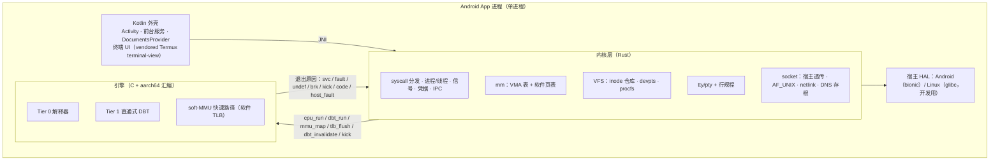

# appine 设计文档

- **状态**：设计决策在 2026-10-24 的设计评审中逐条确认。M0–M8 已完成；M9（发布）进行中，还剩真机验证、许可证义务和 Play 提交（§14.1）。
- **范围**：v1。第 1–13 节写当前的做法，随每一轮的改动更新；改动的经过、测量和出处记在各轮里（[milestones.md](../milestones.md)）。各子系统的做法正逐节迁到 `.claude/maps/` 里各模块的 map（英文，模块见 [MODULES.md](../../.claude/MODULES.md)），迁走的节从这里删掉，节号不变。
- **一句话**：一个能上 Google Play 的**单进程** Android App，在进程内用解释器 / 同 ISA 二进制翻译运行未经修改的 Alpine Linux aarch64 用户态程序。思路与 iSH 相同，是它在 Android 上的对应物。

**目录**

1. [目标与非目标](#1-目标与非目标)
2. [硬约束](#2-硬约束)
3. [总体架构](#3-总体架构)
4. CPU 引擎，已迁到 [engine 的 map](../../.claude/maps/engine.md)（英文）
5. 内存：轻量用户态 soft-MMU，已迁到 [kernel/mm 的 map](../../.claude/maps/kernel/mm.md)（英文）
6. 进程、线程与调度，已迁到 [kernel/process 的 map](../../.claude/maps/kernel/process.md)（英文）
7. 信号与 ABI，已迁到 [kernel/signal 的 map](../../.claude/maps/kernel/signal.md)（英文）
8. [文件系统](08-filesystem.md)
9. [TTY 与终端](09-tty.md)
10. [网络](10-network.md)
11. [用户、权限与 Android 集成](11-android.md)
12. [威胁模型](12-threat-model.md)
13. [工程](13-engineering.md)
14. [里程碑](14-milestones.md)
15. [已否决的方案](15-rejected.md)
16. [风险与待验证的假设](16-risks.md)

---

## 1. 目标与非目标

### 1.1 目标

- 用户从 Play 安装 App、打开即得到一个 Alpine shell，不需要 root、不依赖 Termux，也不需要任何额外步骤。
- 整个 Linux 环境都跑在 App 自己的进程里，Android 12+ 的 phantom process killer 对它不起作用。
- 直接运行 Alpine 官方 aarch64 仓库里**未经修改**的二进制。

### 1.2 v1 负载分档

| 档位 | 负载 | v1 要求 |
|---|---|---|
| A 日常 CLI | busybox ash、`apk`、coreutils、vim、git、curl、openssh client | **全部可用** |
| B 计算型 | python3、gcc/make 编译中等规模的 C 项目、`./configure` | **能跑通** |
| C 难缠的运行时 | Go 静态二进制、node/V8、JVM | **行为正确，不要求快** |
| D 不承诺 | 容器、init 系统、内核模块、X11/GUI | — |

A–C 都已达到。D 档里 podman、docker（[kernel/process 的 map](../../.claude/maps/kernel/process.md) 的 namespace、§10）和 OpenRC（[kernel/process 的 map](../../.claude/maps/kernel/process.md) 的 PID 1）实际能用；systemd、内核模块、GUI 不做。strace、gdb 可以用（[kernel/signal 的 map](../../.claude/maps/kernel/signal.md)）。

发行版默认是 Alpine，设置里可以换成 Debian 13（§11.4）。glibc 的程序（manylinux wheel、Node.js 的预编译模块、rustup、OpenJDK）不用改内核层就能运行。

### 1.3 性能目标

- CPU 密集任务比原生慢 **3–5 倍以内**（JIT 级别）。现状见 §16 的 R1。
- 交互延迟优先：`ls`、tab 补全不能让人感到卡顿。

## 2. 硬约束

| 约束 | 来源 | 后果 |
|---|---|---|
| **Google Play 合规** | Device and Network Abuse 政策：不得下载可执行代码（dex/JAR/.so），"在虚拟机或解释器中运行的代码"除外 | 从网络下载的 Alpine 二进制**不能在宿主 CPU 上直接执行**，CPU 后端只能是解释器或翻译器 |
| 单进程 | 设计目标 + phantom process killer | 所有 guest 进程共享一个宿主地址空间，guest 进程之间的隔离和 fork 都得在软件里实现 |
| W^X 执行限制 | targetSdk ≥ 29 不能 `execve` App 数据目录里的文件 | 不使用 execve，也不依赖宿主加载器 |
| 存储限制 | SELinux：App 不能建硬链接、不能 `chown`、不能 `mknod`；共享存储不区分大小写、没有权限位、不能建 symlink | 文件系统的元数据和命名空间都要自己实现 |
| 网络限制 | targetSdk ≥ 30 不能 bind `NETLINK_ROUTE`，`RTM_GETLINK` 也被拦截；没有 `CAP_NET_RAW` | netlink 在进程内模拟，ICMP 改走 ping socket |
| 页大小 | Android 15 起要求 App 兼容 16KB 页内核 | 给 guest 呈现的页大小必须和宿主页大小解耦 |
| 宿主地址空间 | GKI 常见配置是 4K 页 + 39-bit VA，用户态只有约 512GB | 不能给每个 guest 进程预留很大的连续地址空间 |

**最低系统版本：minSdk 29（Android 10）**。DNS 存根依赖 `android_res_nsend`，它从 API 29 开始提供。

## 3. 总体架构

分层原则：

- **引擎**只关心"执行 guest 指令"。遇到 `svc`、访存缺页、未定义指令、`brk`、`ic ivau` 时，把控制权交给内核层。
- **内核层**实现 Linux 用户态 ABI，持有所有 guest 状态：进程、地址空间、fd、文件系统。
- **宿主 HAL** 把宿主的差异隔离开。开发阶段的宿主是 Linux arm64，生产宿主是 Android；不写 macOS 版本的 HAL。
- 核心库（引擎 + 内核层）**不依赖任何 Android 组件**。Android 相关的部分只在 HAL 和 Kotlin 外壳里出现。

---

## 参考资料

- [Google Play: Device and Network Abuse policy](https://support.google.com/googleplay/android-developer/answer/9888379)
- [arm64: entry: Convert to Generic Entry v11（2026-01，含 SUD）](https://lkml.iu.edu/2601.3/04930.html)
- [arm64 memory layout: 4KB pages + VA39（LKML）](https://lore.kernel.org/lkml/YV3ZfmSHHKSWfDQu@arm.com/t/)
- [AOSP sepolicy: support hard linking for split APKs（create_file_perms 移除 link）](https://android.googlesource.com/platform/external/sepolicy/+/9bef250)
- [termux-app LICENSE.md](https://github.com/termux/termux-app/blob/master/LICENSE.md)
- [azahar-emu/dynarmic（0BSD）](https://github.com/azahar-emu/dynarmic)
- iSH：<https://github.com/ish-app/ish>（GPLv3，只借鉴思路，不复制代码）
